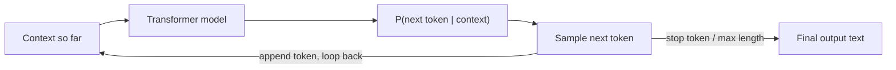

# Generative AI

## Overview

Generative AI refers to models that **create** new content — text, code, images, audio — rather than just classifying or scoring existing input. For text, the workhorse is the large language model (LLM): a transformer network trained to predict the next token given everything that came before it, one token at a time, feeding its own output back in as new input.

See [`example.py`](example.py) in this folder for a runnable, dependency-free demonstration of the autoregressive loop below.

## Data Flow Diagram — Autoregressive Generation Loop



The model never "writes" a sentence in one shot — it predicts one next token, appends it, and re-runs on the new, longer context, until it emits a stop token or hits the length limit.

## Interview Q&A

### Easy — Screening Round

**E1. What is Generative AI, in plain terms?**
AI that produces new content — text, images, code, audio — instead of only labeling or scoring existing input. It works by learning the statistical patterns of its training data well enough to sample brand-new, plausible examples from that same distribution.

**E2. How does an LLM actually generate a response?**
Autoregressively: it computes a probability distribution over the next token given everything before it, samples one token, appends it to the input, and repeats — one token at a time — until it produces a stop token or hits the max length.

**E3. What does "temperature" control during generation?**
It rescales the model's output logits before sampling. Low temperature sharpens the distribution toward the single most likely token (more deterministic, sometimes repetitive); high temperature flattens it, giving more variety but more risk of incoherent output.

**E4. What is the difference between a base model and a chat/instruct model?**
A base model is only trained to predict the next token on raw text and will happily continue a prompt in unexpected directions. A chat/instruct model is the same architecture further fine-tuned (usually with instruction data and RLHF/DPO) to follow instructions, hold a conversation, and refuse unsafe requests — the base model has no notion of "being helpful," only of continuing text.

**E5. What does it mean when people say a model has "70 billion parameters"?**
Parameters are the learned numeric weights inside the neural network (the values in every weight matrix across all layers) that get adjusted during training. More parameters generally mean more capacity to capture complex patterns, at the cost of more memory and compute to train and run.

**E6. What is a token, and why don't LLMs process raw characters or whole words directly?**
A token is a sub-word unit produced by a tokenizer (commonly Byte-Pair Encoding) — smaller than a word for rare/complex words, but larger than a single character for common ones. It's a deliberate middle ground: character-level tokenization makes sequences too long (slow, expensive), while word-level tokenization needs a huge vocabulary and can't handle unseen words at all.

```python
# a tiny illustration of the *idea* behind sub-word tokenization
# (real BPE learns merges from a training corpus; this just shows the shape)
def naive_subword_split(word, known_pieces):
    pieces, i = [], 0
    while i < len(word):
        for j in range(len(word), i, -1):
            if word[i:j] in known_pieces:
                pieces.append(word[i:j])
                i = j
                break
        else:
            pieces.append(word[i])  # unknown char, fall back to single character
            i += 1
    return pieces

print(naive_subword_split("unbelievable", {"un", "believe", "able", "un", "bel", "iev"}))
```

**E7. What's the difference between a "completion" and a "chat response"?**
Mostly historical/API framing: older completion-style APIs took one raw text prompt and continued it; chat-style APIs take a list of role-tagged messages (system/user/assistant) and return the next assistant message. Under the hood a chat model still just autoregressively predicts tokens — the roles are encoded into the token sequence via a template, not a fundamentally different mechanism.

**E8. If you run the same prompt twice with temperature 0 (greedy decoding), do you always get the exact same output?**
In principle yes, since greedy decoding always picks the single highest-probability token with no randomness. In practice, minor non-determinism can creep in from floating-point differences in parallel/batched GPU execution, so "temperature 0" is usually "very close to deterministic" rather than a hard guarantee on real production infrastructure.

### Medium — Technical Round

**M1. Generative vs. discriminative models — what's the difference?**
A discriminative model learns a boundary to tell classes apart (models P(label | input)) — good for classification. A generative model learns the underlying data distribution itself (P(input), or P(input | label)) and can sample entirely new examples from it, not just label the ones it's given.

**M2. Why do LLMs hallucinate?**
Because they're trained to produce fluent, statistically plausible token sequences — not to verify facts. There's no built-in truth check; if a wrong answer "sounds like" the kind of thing that follows the prompt, the model has no internal signal telling it to stop and say "I don't know."

**M3. Pretraining vs. fine-tuning?**
Pretraining teaches broad language and world knowledge from a huge, mostly unlabeled corpus via next-token prediction. Fine-tuning then adapts that base model to a narrower goal — following instructions, a specific tone, a specific task — using a smaller, more curated dataset (often with human feedback, i.e. RLHF).

**M4. What is a context window, and why does it matter?**
The maximum number of tokens (prompt plus generated output) the model can attend to in one call — anything older simply falls out. It's finite, which is exactly why retrieval (RAG), memory, and agent context-management strategies exist: you can't just paste an entire company's documents into the prompt.

**M5. What is top-k / top-p (nucleus) sampling, and how is it different from temperature?**
Temperature reshapes the whole probability distribution. Top-k restricts sampling to the k highest-probability tokens; top-p (nucleus) restricts sampling to the smallest set of tokens whose cumulative probability exceeds p. Both are truncation strategies layered on top of temperature to cut off the long, unreliable tail of low-probability tokens.

**M6. What is few-shot prompting, and how is it different from zero-shot?**
Zero-shot gives the model only an instruction and expects it to perform the task cold. Few-shot includes a handful of worked examples of the task directly in the prompt, which steers the model's output format and style purely through in-context pattern matching — no weight updates involved.

**M7. What is chain-of-thought prompting, and why does it help?**
Asking the model to reason step by step before giving a final answer, rather than jumping straight to it. It helps because the model's own intermediate tokens become additional context it can condition on — effectively giving it more "compute" (more forward passes) to work through a multi-step problem instead of trying to produce the answer in one shot.

**M8. Show how temperature is actually applied to raw logits before sampling.**
```python
import math, random

def softmax_with_temperature(logits, temperature=1.0):
    scaled = [l / temperature for l in logits]
    m = max(scaled)                              # subtract max for numerical stability
    exps = [math.exp(x - m) for x in scaled]
    total = sum(exps)
    return [e / total for e in exps]

logits = [2.0, 1.0, 0.1]           # raw, un-normalized model outputs for 3 candidate tokens
for t in (0.3, 1.0, 2.0):
    print(t, [round(p, 3) for p in softmax_with_temperature(logits, t)])
```
Subtracting the max before exponentiating avoids overflow from `math.exp` on large logits — it doesn't change the result since it cancels out in the normalization, but it keeps the intermediate numbers small and stable.

**M9. What is beam search, and why do most chat LLMs use sampling instead of it for open-ended generation?**
Beam search keeps the top-B highest cumulative-probability partial sequences at each step instead of just one, exploring several candidate continuations in parallel and returning the overall highest-scoring full sequence. It works well for tasks with one "correct" output (translation, captioning), but for open-ended chat it tends to produce bland, repetitive, overly "safe" text — sampling (with temperature/top-p) is preferred there because it trades a bit of optimality for natural variety.

### Advanced — Bar-Raiser / System-Design Round

**A1. What are scaling laws, and why do they matter for how a company plans model training?**
Empirical relationships (e.g. Chinchilla) showing how model loss improves as a function of model size, dataset size, and compute — and, critically, that for a fixed compute budget there's an optimal balance between model size and training tokens. Companies use scaling laws to decide whether to spend a training budget on a bigger model or more data, instead of guessing.

**A2. RLHF vs. DPO — what's the practical difference?**
RLHF (Reinforcement Learning from Human Feedback) trains a separate reward model from human preference data, then optimizes the LLM against that reward model with an RL algorithm (e.g. PPO) — powerful but complex and unstable to tune. DPO (Direct Preference Optimization) skips the reward model and RL loop entirely, directly optimizing the LLM on preference pairs with a supervised-style loss — simpler and more stable, at some cost in flexibility.

**A3. What is KV-caching, and why is it central to inference cost?**
During autoregressive generation, each new token's attention would naively require recomputing key/value projections for every prior token. KV-caching stores those key/value tensors after they're computed once, so each new token only computes attention against the cache — turning generation from O(n²) recomputation into roughly O(n) incremental work, which is what makes long-context chat responses fast enough to be usable.

**A4. What is Mixture-of-Experts (MoE), and why do large labs use it?**
Instead of every token passing through the entire dense network, an MoE model routes each token to a small subset of "expert" sub-networks (via a learned gating function). This lets total parameter count scale up (more capacity) while keeping the compute cost per token roughly fixed to the active experts — more capacity without a proportional inference cost increase.

**A5. You need to cut LLM inference cost/latency in production by half — what levers do you pull?**
Quantization (running weights in int8/int4 instead of fp16/fp32), distillation to a smaller model, response caching for repeated/similar queries, batching concurrent requests, speculative decoding (a small draft model proposes tokens a larger model verifies in parallel), and simply routing easy queries to a cheaper model and only escalating hard ones to the expensive model.

**A6. What is speculative decoding, and why doesn't it change the output distribution?**
A small, fast "draft" model proposes several tokens ahead; the large target model then verifies all of them in a single forward pass and accepts the longest correct prefix, falling back to its own sampling the moment the draft diverges. Because every accepted token is checked against the exact distribution the large model would have produced, throughput improves without changing what the large model would have said.

**A7. How would you detect and mitigate model or data drift for a deployed generative model over time?**
Track output-quality proxies over time (user feedback rate, evaluator scores on a fixed benchmark, flagged/regenerated response rate) rather than assuming a static model stays equally good as the world and user population change; when drift is detected, options include refreshing retrieval data (for RAG-backed systems), re-evaluating or swapping the underlying model version, and periodically refreshing few-shot examples or fine-tuning data to match current usage patterns.

**A8. How does KV-cache memory scale, and why is it often the real bottleneck for serving long-context requests?**
Roughly: `memory ≈ 2 × layers × attention_heads × head_dim × sequence_length × batch_size × bytes_per_value` (the factor of 2 is for both keys and values). This grows linearly in both sequence length and batch size, and for long-context or high-concurrency serving it can dwarf the memory used by the model's weights themselves — which is exactly why serving frameworks like vLLM implement paged attention (allocating KV-cache in fixed-size non-contiguous blocks, like OS virtual memory pages) instead of naive contiguous per-request allocation.

### Practical / Coding Round

*Questions below reference [`example.py`](example.py), a from-scratch, dependency-free n-gram text generator that implements the autoregressive loop and temperature sampling shown in the diagram above.*

**P1. In `sample_with_temperature`, why do we raise each probability to the power `1/temperature` and renormalize, instead of dividing something by temperature directly?**
Real models apply temperature to raw logits before the softmax (`softmax(logits / T)`). Here we only have post-softmax probabilities to work with, and raising each probability to `1/T` then renormalizing is the probability-space equivalent of that same rescaling — it sharpens the distribution as T→0 and flattens it as T→∞, matching the real mechanism without needing the original logits.

**P2. What does the code do when `temperature <= 0`, and why is that the correct edge-case behavior?**
It falls back to `max(distribution, key=distribution.get)` — plain greedy/argmax decoding. Dividing by zero (or a negative number) is undefined, and greedy decoding is the sensible mathematical limit of the temperature-scaled distribution as T→0⁺ (probability mass collapses entirely onto the single most likely token).

**P3. What happens in `next_char_distribution` when the model has never seen a given context, and how does that connect to hallucination?**
It backs off to a uniform distribution over the whole vocabulary. This mirrors a real LLM being asked something far outside its training distribution: there's no learned signal either way, but the model still has to output *something* — confidently, with no built-in flag that says "I actually don't know this."

**P4. What's the time complexity of `generate()` for producing `max_length` characters, and where does memory blow up as the context order `n` grows?**
Each step is an O(1) average dict/Counter lookup, so generation itself is O(max_length). But the model's memory grows with the number of distinct (n-1)-character contexts seen, which grows roughly exponentially with `n` for a fixed alphabet — this is the toy version of why real models need embeddings and neural networks instead of literal lookup tables once context length grows.

**P5. Extend `sample_with_temperature` to add top-k sampling on top of temperature — what would you change?**
After computing the temperature-scaled probabilities, sort the (char, prob) pairs descending, keep only the top k, renormalize just those k probabilities so they sum to 1, and sample from that restricted set — truncating the long tail of unlikely characters before sampling, exactly as described in question M5 above.
