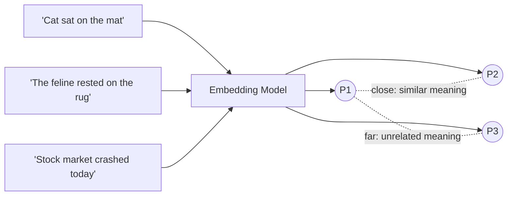

# Embeddings

## Overview

An embedding is a fixed-length list of numbers — a vector — that represents the **meaning** of a piece of data (a word, sentence, image, or document) so that semantically similar things land close together in that vector space, and unrelated things land far apart. Everything downstream in this guide — search, retrieval, RAG — is built on that one property.

## Data Flow Diagram — Meaning to Vector Space



Two paraphrases of the same idea (P1, P2) land close together in vector space; an unrelated sentence (P3) lands far away — regardless of how many words they do or don't share.

## Interview Q&A

### Easy — Screening Round


## E1. What Exactly Is an Embedding?

### 1. Overview

An **embedding** is a numerical representation of data, such as text, images, audio, or documents, in the form of a vector (a list of numbers). It captures meaningful patterns and semantic information so that machines can compare and process the data mathematically.

In Generative AI and Retrieval-Augmented Generation (RAG), embeddings are commonly used to represent text so that semantically similar content can be retrieved even when different words are used.

**In simple terms:**

`Embedding` = Converting data into a list of numbers that represents its learned features and meaning.

For example:

- "I want to learn Python."
- "I am interested in learning Python programming."

Although these sentences use different words, their meanings are similar. An embedding model can generate vectors that are relatively close to each other in the embedding space.

---

### 2. How Does an Embedding Work?

The embedding process generally follows these steps:

1. **Input:** Provide text to an embedding model.
2. **Processing:** The model analyzes patterns and semantic information in the text.
3. **Vector generation:** The model converts the text into a numerical vector.
4. **Storage:** The vector can be stored in a vector database.
5. **Similarity search:** The vector can be compared with other vectors to find relevant content.

**Workflow:**

```text
Input Text
    |
    v
Embedding Model
    |
    v
Numerical Vector
    |
    v
Vector Database
    |
    v
Similarity Search
    |
    v
Relevant Text or Documents
```

---

### 3. Example of an Embedding

Consider the following sentences:

```python
text1 = "Python is a programming language."
text2 = "Python is used for software development."
text3 = "The weather is sunny today."
```

An embedding model converts each sentence into a numerical vector.

For illustration, imagine the vectors look like this:

```python
embedding1 = [0.82, 0.15, 0.67, 0.34]
embedding2 = [0.79, 0.18, 0.64, 0.39]
embedding3 = [0.12, 0.91, 0.23, 0.76]
```

**Note:** These are hypothetical values used only to explain the concept. Actual embeddings depend on the model and may contain hundreds or thousands of dimensions.

Here:

- `embedding1` represents a sentence about Python.
- `embedding2` represents a related sentence about software development.
- `embedding3` represents a sentence about the weather.

The first two vectors may be closer to each other because their meanings are more closely related.

---

### 4. How Do We Measure Similarity Between Embeddings?

After converting text into vectors, we can compare those vectors to estimate how semantically similar the corresponding texts are.

Common similarity measures include:

- **Cosine Similarity:** Measures the angle between two vectors.
- **Dot Product:** Measures the sum of the products of corresponding vector components.
- **Euclidean Distance:** Measures the straight-line distance between two vectors.

Cosine similarity is commonly used for text embeddings.

**Formula:**

\[
\text{Cosine Similarity}(A,B)
=
\frac{A \cdot B}{\|A\|\|B\|}
\]

Where:

- \(A\) = First embedding vector.
- \(B\) = Second embedding vector.
- \(A \cdot B\) = Dot product of the two vectors.
- \(\|A\|\) and \(\|B\|\) = Magnitudes of the vectors.

For nonzero vectors, cosine similarity ranges from -1 to 1 mathematically. A higher score often indicates greater similarity, depending on the embedding model.

**Important:** Similarity scores are not necessarily probabilities or percentages of semantic similarity.

---

### 5. Python Example Using an Embedding Model

We can generate embeddings using the `sentence-transformers` library.

**Install the dependencies:**

```bash
pip install sentence-transformers scikit-learn
```

**Python Code:**

```python
from sentence_transformers import SentenceTransformer
from sklearn.metrics.pairwise import cosine_similarity

# Load a pretrained embedding model
model = SentenceTransformer("all-MiniLM-L6-v2")

sentences = [
    "Python is a programming language.",
    "Python is used for software development.",
    "The weather is sunny today."
]

# Generate embeddings
embeddings = model.encode(sentences)

# Compare the first sentence with the remaining sentences
similarities = cosine_similarity(
    [embeddings[0]],
    embeddings[1:]
)

print("Embedding shape:", embeddings.shape)

print("Similarity with sentence 2:", similarities[0][0])
print("Similarity with sentence 3:", similarities[0][1])
```

**Explanation:**

1. `SentenceTransformer()` loads a pretrained embedding model.
2. `model.encode()` converts sentences into numerical vectors.
3. `cosine_similarity()` compares the vectors.
4. The similarity scores indicate how closely the sentences are related according to the model.

The `all-MiniLM-L6-v2` model produces embeddings with 384 dimensions per sentence.

---

### 6. What Is the Relationship Between Embeddings and RAG?

Embeddings are an important component of a typical RAG system because they help retrieve relevant information from a knowledge base.

Suppose we have the following documents:

```text
Document 1: FastAPI is a Python framework for building APIs.

Document 2: Django is a Python web framework.

Document 3: Kafka is a distributed event-streaming platform.
```

A user asks:

"What Python frameworks can I use to build APIs?"

The RAG system generally performs the following steps:

1. **Document Chunking:** Split documents into smaller, manageable chunks.
2. **Document Embedding:** Convert each chunk into a numerical vector.
3. **Vector Storage:** Store the vectors along with their associated text.
4. **Query Embedding:** Convert the user's question into a vector using a compatible embedding model.
5. **Similarity Search:** Compare the query vector with stored document vectors.
6. **Retrieval:** Retrieve relevant chunks, such as the FastAPI and Django descriptions.
7. **Generation:** Provide the retrieved context to an LLM to generate the final answer.

**RAG Workflow:**

```text
          Knowledge Base
                 |
                 v
          Split into Chunks
                 |
                 v
          Embedding Model
                 |
                 v
         Store Vectors + Text
                 |
                 v
User Query --> Query Embedding
                 |
                 v
           Vector Search
                 |
                 v
       Retrieve Relevant Chunks
                 |
                 v
            LLM + Context
                 |
                 v
            Final Answer
```

**Important:** Embeddings help retrieve relevant information; they do not generate the final natural-language answer. The LLM typically performs that generation step.

---

### 7. What Is the Difference Between an Embedding and a Token?

| Feature | Token | Embedding |
|---|---|---|
| Meaning | A unit of text processed by a model | A numerical vector representing data |
| Representation | Token ID or tokenized text | List of numerical values |
| Purpose | Represents text units for model processing | Captures learned features and relationships |
| Example | A token ID such as `1234` | `[0.82, 0.15, 0.67, ...]` |
| Usage | Tokenization and language-model processing | Semantic search, retrieval, clustering |

A token and an embedding are not the same thing. A token ID is a discrete identifier, while an embedding is a vector of numerical values.

Embeddings can represent individual tokens, sentences, document chunks, or other data, depending on the model and its usage.

---

### 8. What Is the Difference Between an Embedding Model and an LLM?

| Feature | Embedding Model | Generative LLM |
|---|---|---|
| Primary purpose | Convert data into vector representations | Generate or transform content |
| Typical output | Numerical vector | Text or other supported outputs |
| Common use cases | Semantic search, retrieval, clustering | Chatbots, summarization, reasoning |
| Role in RAG | Helps retrieve relevant context | Uses retrieved context to generate an answer |

Some model families support both embedding and generative tasks, but the two operations serve different purposes.

---

### 9. Important Points to Remember

- An embedding is a numerical vector generated from data by an embedding model.
- Embeddings can capture semantic relationships and other learned patterns.
- Semantically similar texts often have nearby vectors, depending on the model and similarity metric.
- Embeddings are widely used in RAG, semantic search, recommendation systems, and clustering.
- A vector database can store embeddings and support efficient similarity search.
- The embedding model used for queries should be compatible with the model used to generate the stored document embeddings.
- Embeddings do not guarantee correct retrieval; chunking, metadata filtering, ranking, and query formulation also affect results.
- Generating embeddings does not require fine-tuning the LLM used for answer generation.

---

### 10. Interview Answer

**Question:** What exactly is an embedding?

**Answer:**

"An embedding is a numerical vector representation of data, such as text, that captures meaningful patterns and semantic relationships learned by a model. In Generative AI applications, embeddings are commonly used to compare text based on semantic similarity rather than just exact keyword matching.

For example, in a RAG application, we convert document chunks into embeddings and store them in a vector database. When a user submits a question, we generate an embedding for that query and compare it with the stored vectors to retrieve relevant chunks. Those chunks are then provided to the LLM as context to generate the final answer.

Embeddings are useful for semantic search, document retrieval, recommendation systems, and other tasks where representing and comparing data numerically is important."

---

### 11. Key Takeaway

- `Embedding Model` = Converts data into numerical vectors.
- `Vector Database` = Stores and searches vectors.
- `Retriever` = Finds relevant document chunks.
- `LLM` = Uses the retrieved context to generate the answer.

**An embedding converts data into a numerical vector that allows machines to compare learned patterns and semantic relationships mathematically.**


## E2. Cosine Similarity vs. Euclidean Distance — Which Do You Use, and Why?

### 1. Cosine Similarity

Cosine similarity measures the similarity between two vectors by calculating the cosine of the angle between them. It focuses on the **direction of the vectors rather than their magnitude**.

**Formula:**

\[
\text{Cosine Similarity}(A,B)=\frac{A\cdot B}{\|A\|\|B\|}
\]

**Range:** -1 to 1

- `1` means the vectors point in the same direction.
- `0` means the vectors are perpendicular and have no directional similarity.
- `-1` means the vectors point in opposite directions.

**Example:**

Consider two embedding vectors:

```python
A = [1, 2]
B = [2, 4]
```

Both vectors point in the same direction, so their cosine similarity is `1`, even though their magnitudes differ.

### 2. Euclidean Distance

Euclidean distance measures the straight-line distance between two vectors in a multidimensional space. It considers the **actual distance between the vector coordinates**, so differences in magnitude affect the result.

**Formula:**

\[
d(A,B)=\sqrt{\sum_{i=1}^{n}(A_i-B_i)^2}
\]

**Example:**

```python
import numpy as np

A = np.array([1, 2])
B = np.array([2, 4])

distance = np.linalg.norm(A - B)

print(distance)
```

**Output:**

```text
2.23606797749979
```

A smaller Euclidean distance generally means the vectors are closer together.

### 3. Key Differences

| Feature | Cosine Similarity | Euclidean Distance |
|---|---|---|
| Measures | Angle between vectors | Straight-line distance |
| Focus | Direction | Distance and magnitude |
| Best interpretation | Higher is more similar | Lower is more similar |
| Magnitude sensitivity | Generally insensitive to magnitude | Sensitive to magnitude |
| Typical use | Text embeddings and semantic search | Spatial data, clustering, and distance-based analysis |
| Result | Usually between -1 and 1 | Zero or greater |

### 4. Which One Do You Use in RAG, and Why?

In a typical RAG (Retrieval-Augmented Generation) application, I often use **cosine similarity** to compare query embeddings with document embeddings.

The reason is that semantic search aims to identify documents with similar meanings. Cosine similarity compares the directions of embedding vectors, which often captures semantic similarity effectively even when vector magnitudes differ.

**RAG retrieval flow:**

1. Convert documents into embedding vectors.
2. Store the embeddings in a vector database.
3. Convert the user's query into an embedding.
4. Compare the query embedding with stored document embeddings.
5. Retrieve the most relevant documents.
6. Pass the retrieved context to the LLM to generate an answer.

**Example using Python:**

```python
import numpy as np
from sklearn.metrics.pairwise import cosine_similarity

query_embedding = np.array([[1, 2, 3]])

document_embeddings = np.array([
    [1, 2, 3],      # Document 1
    [2, 4, 6],      # Document 2
    [-1, -2, -3]    # Document 3
])

similarities = cosine_similarity(
    query_embedding,
    document_embeddings
)

print(similarities)
```

**Output:**

```text
[[ 1.  1. -1.]]
```

Documents 1 and 2 have identical embedding directions, so both receive a cosine similarity of `1`. Document 3 points in the opposite direction and receives `-1`.

### 5. Important Consideration

Cosine similarity is not always better than Euclidean distance. The choice depends on the embedding model, the vector database, and how the embeddings are normalized.

- **Cosine similarity:** Useful when directional similarity is the primary concern.
- **Euclidean distance:** Useful when the actual distance between vector coordinates matters.
- **Normalized embeddings:** When both vectors have unit length, cosine similarity and Euclidean distance produce equivalent rankings, with higher cosine similarity corresponding to lower Euclidean distance.

Some vector databases also support dot-product similarity. For unit-normalized vectors, dot product equals cosine similarity.

### 6. Interview Answer

"In my RAG applications, I generally prefer cosine similarity for semantic search because it compares the direction of query and document embeddings rather than their absolute magnitudes. This helps retrieve documents with similar semantic representations. However, I don't choose a metric blindly; I consider the embedding model's recommendations, vector normalization, and the vector database's supported distance metrics. Euclidean distance is also useful when the actual geometric distance between vectors is important."


## E3. Word Embeddings vs. Sentence/Document Embeddings

### 1. What Are Word Embeddings?

Word embeddings represent individual words as numerical vectors in a multidimensional space. Words with similar meanings often have similar vector representations.

For example, words such as `"king"` and `"queen"` may have related embedding representations because they share some semantic characteristics.

**Example:**

```python
word_embeddings = {
    "king":   [0.8, 0.6, 0.2],
    "queen":  [0.7, 0.7, 0.2],
    "apple":  [0.1, 0.2, 0.9]
}
```

These are illustrative vectors, not actual embeddings produced by a trained model.

**Key characteristics:**

- Represents individual words or tokens.
- Useful for understanding relationships between words.
- Traditional methods include Word2Vec, GloVe, and FastText.
- A word's embedding may be static or context-dependent, depending on the model.

**Limitation:** Traditional static word embeddings assign the same vector to a word regardless of context. For example, the word `"bank"` can refer to a financial institution or the side of a river, but a static embedding cannot provide a different representation for each meaning.

### 2. What Are Sentence Embeddings?

Sentence embeddings represent an entire sentence as a single numerical vector. The vector captures semantic information about the sentence rather than representing each word independently.

**Example:**

```python
sentence_1 = "I want to learn Python programming."
sentence_2 = "I want to study Python coding."
```

A sentence embedding model can generate vectors for both sentences that are close to each other because their meanings are similar.

**Key characteristics:**

- Represents the meaning of an entire sentence.
- Useful for semantic search, sentence similarity, and question matching.
- Can capture contextual relationships between words.
- Commonly generated using models such as Sentence Transformers.

### 3. What Are Document Embeddings?

Document embeddings represent a larger piece of text, such as a paragraph, an article, a report, or a document, as a numerical vector.

For long documents, the text is often divided into smaller chunks before generating embeddings. Each chunk receives its own embedding, allowing the system to retrieve the most relevant section instead of searching only at the whole-document level.

**Example:**

```text
Document: Python Backend Development Guide

Chunk 1: Introduction to Python and its features.
Chunk 2: Building REST APIs using FastAPI.
Chunk 3: Connecting FastAPI to PostgreSQL.
Chunk 4: Deploying applications using Docker.
```

Each chunk can be converted into an embedding and stored in a vector database.

When a user asks, "How do I connect FastAPI to PostgreSQL?", the retrieval system can identify Chunk 3 as a relevant result.

### 4. Key Differences

| Feature | Word Embeddings | Sentence Embeddings | Document/Chunk Embeddings |
|---|---|---|---|
| Represents | Individual words or tokens | A complete sentence | A paragraph, chunk, or document |
| Granularity | Fine-grained | Medium-grained | Larger text units |
| Captures | Word meaning and relationships | Sentence-level meaning | Broader contextual information |
| Common use cases | NLP, word similarity, language analysis | Semantic search, sentence matching | RAG, document retrieval, knowledge bases |
| Example models | Word2Vec, GloVe, FastText | Sentence Transformers | Sentence Transformers or other embedding models |
| Typical retrieval target | Individual words | Relevant sentences | Relevant document chunks |

### 5. How Do They Work in RAG?

In a typical RAG system, sentence or chunk embeddings are commonly used instead of individual word embeddings because the system needs to retrieve text that answers a user's question.

**Data flow:**

1. Load documents from PDFs, files, databases, or other sources.
2. Split large documents into manageable chunks.
3. Generate an embedding for each chunk.
4. Store the embeddings and associated text in a vector database.
5. Convert the user's query into an embedding using the compatible embedding model.
6. Compare the query embedding with stored chunk embeddings.
7. Retrieve the most relevant chunks.
8. Pass the retrieved context to the LLM to generate an answer.

**Python example using Sentence Transformers:**

```python
from sentence_transformers import SentenceTransformer
from sklearn.metrics.pairwise import cosine_similarity

model = SentenceTransformer("all-MiniLM-L6-v2")

sentences = [
    "FastAPI is used to build Python REST APIs.",
    "PostgreSQL is a relational database.",
    "Docker packages applications and their dependencies."
]

embeddings = model.encode(sentences)

query = "How can I build REST APIs using Python?"
query_embedding = model.encode([query])

scores = cosine_similarity(
    query_embedding,
    embeddings
)[0]

for index in scores.argsort()[::-1]:
    print(sentences[index], "->", round(scores[index], 4))
```

The sentence most semantically similar to the query should rank highest, although the exact scores and ranking depend on the model.

### 6. Important Interview Point

Word embeddings and sentence embeddings are not simply different-sized versions of the same thing. They are designed for different levels of representation.

- Word embeddings represent individual words or tokens.
- Sentence embeddings represent the semantic meaning of a sentence.
- Document embeddings represent larger text units, but long documents are often split into chunks because one vector may not preserve all their details.

### 7. Interview Answer

"Word embeddings represent individual words as numerical vectors, whereas sentence embeddings represent the meaning of an entire sentence as a single vector. Document embeddings represent larger text units, such as paragraphs or document chunks. In RAG applications, I generally use sentence or chunk embeddings because they allow me to retrieve semantically relevant content based on a user's query. For long documents, I split the text into chunks, generate embeddings for each chunk, store them in a vector database, and retrieve the most relevant chunks during the query process."


## E4. What Does It Mean for Two Embeddings to Be "Close" — Is Closeness Always Measured with Cosine Similarity?

### 1. What Does "Close" Mean in Embedding Space?

When two embeddings are described as "close," it means that their vector representations are similar according to a chosen distance or similarity metric.

An embedding is a numerical vector representing information such as a word, sentence, document, image, or other data.

For example, consider these sentences:

- Sentence 1: "I want to learn Python."
- Sentence 2: "I want to study Python programming."
- Sentence 3: "The weather is sunny today."

A good sentence embedding model may place the embeddings of Sentence 1 and Sentence 2 closer together because they have similar meanings. Sentence 3 may be farther away because its meaning is different.

However, closeness does not automatically guarantee semantic similarity. It depends on the embedding model, the data, and the metric used.

### 2. Is Closeness Always Measured Using Cosine Similarity?

No. **Cosine similarity is one common way to measure closeness, but it is not the only method.**

Common metrics include:

**1. Cosine Similarity**

Measures the angle between two vectors and focuses on their directions.

\[
\text{cosine}(A,B)=\frac{A\cdot B}{\|A\|\|B\|}
\]

- Higher similarity generally means more similar directions.
- Commonly used for semantic search and text embeddings.
- Insensitive to vector magnitude when comparing nonzero vectors.

**2. Euclidean Distance (L2 Distance)**

Measures the straight-line distance between two vectors.

\[
d(A,B)=\sqrt{\sum_{i=1}^{n}(A_i-B_i)^2}
\]

- Smaller distance means the vectors are closer geometrically.
- Sensitive to differences in vector magnitude.
- Useful when the embedding model and retrieval setup are designed for distance-based comparison.

**3. Dot Product (Inner Product)**

Calculates the sum of the products of corresponding vector components.

\[
A\cdot B=\sum_{i=1}^{n}A_iB_i
\]

- A larger dot product generally indicates stronger alignment, but its value also depends on vector magnitudes.
- Often used in vector search systems.
- For unit-normalized vectors, dot product equals cosine similarity.

### 3. Python Example

The following example compares two vectors using all three metrics.

```python
import numpy as np
from sklearn.metrics.pairwise import cosine_similarity

A = np.array([1, 2, 3])
B = np.array([2, 4, 6])

# Cosine similarity
cos_sim = cosine_similarity([A], [B])[0][0]

# Euclidean distance
euclidean_dist = np.linalg.norm(A - B)

# Dot product
dot_prod = np.dot(A, B)

print("Cosine Similarity:", cos_sim)
print("Euclidean Distance:", euclidean_dist)
print("Dot Product:", dot_prod)
```

**Output:**

```text
Cosine Similarity: 1.0
Euclidean Distance: 3.7416573867739413
Dot Product: 28
```

**Explanation:**

- The cosine similarity is `1.0` because both vectors point in exactly the same direction.
- The Euclidean distance is greater than zero because their coordinates differ.
- The dot product is `28`, reflecting both their alignment and magnitudes.

This example demonstrates that two vectors can have maximum cosine similarity without being identical.

### 4. What Happens in a RAG System?

In a Retrieval-Augmented Generation (RAG) system, closeness helps determine which document chunks are most relevant to a user's query.

For example:

```text
User Query:
"How do I create a REST API using Python?"

Document A:
"FastAPI is a Python framework for building REST APIs."

Document B:
"PostgreSQL is a relational database management system."

Document C:
"Docker packages applications and their dependencies."
```

The retrieval system converts the query and document chunks into embeddings. It then ranks the document embeddings using the configured similarity or distance metric.

If Document A receives the strongest similarity score or smallest distance, it may be retrieved as the most relevant document.

**RAG retrieval flow:**

1. Generate embeddings for document chunks.
2. Store the embeddings in a vector database.
3. Generate an embedding for the user's query.
4. Compare the query embedding against document embeddings.
5. Rank and retrieve the most relevant chunks.
6. Pass the retrieved context to the LLM to generate an answer.

### 5. Does Closeness Always Mean Similar Meaning?

No. Geometric closeness is not a universal guarantee of semantic similarity.

Several factors influence the result:

- **Embedding model:** Different models represent information differently.
- **Training data:** The model's learned representations affect which concepts are close.
- **Distance metric:** Cosine similarity, Euclidean distance, and dot product can produce different rankings.
- **Normalization:** Normalizing vectors changes the influence of their magnitudes.
- **Domain:** A model trained for general text may perform differently on specialized medical, legal, or technical documents.

For this reason, an embedding model's recommended similarity metric should generally be followed, and retrieval quality should be evaluated using representative queries and documents.

### 6. Interview Answer

"When we say two embeddings are close, we mean that their vector representations are similar according to a chosen metric. Cosine similarity is widely used for semantic search because it compares vector directions, but closeness can also be measured using Euclidean distance or dot product. The appropriate metric depends on the embedding model, vector normalization, and retrieval system. In RAG, I select the metric recommended for the embedding model and evaluate retrieval quality to ensure that semantically relevant document chunks are ranked correctly."


## E5. Can Embeddings Be Created for Things Other Than Text — e.g., Images or Audio?

### 1. Overview

Yes. **Embeddings can be created for text, images, audio, video, and other types of data.** An embedding converts data into a numerical vector that captures meaningful features and patterns learned by a model.

These vectors allow machine learning systems to compare, search, classify, and retrieve similar items mathematically.

In Generative AI and RAG, embeddings are not limited to text. They can also support image search, audio retrieval, video search, and multimodal applications.

**In simple terms:**

`Embedding` = Converting data into a numerical vector that represents its learned features and meaning.

For example:

- Text embedding: Represents the meaning of a sentence.
- Image embedding: Represents visual features of an image.
- Audio embedding: Represents learned characteristics of an audio signal.
- Video embedding: Represents visual and potentially audio information from video content.
- Multimodal embedding: Connects different data types, such as text and images, in a shared or aligned vector space.

---

### 2. Types of Embeddings

**1. Text Embeddings**

Text embeddings represent words, sentences, paragraphs, or document chunks as numerical vectors.

For example:

```text
Input:
"FastAPI is a Python web framework."

Embedding:
[0.21, -0.34, 0.78, 0.15, ...]
```

**Use cases:**

- Semantic search
- Retrieval-Augmented Generation (RAG)
- Document similarity
- Question-answering systems
- Recommendation systems

Common tools and models include Sentence Transformers and embedding models provided by AI platforms.

**2. Image Embeddings**

Image embeddings represent visual information in an image as a numerical vector. Depending on the model, the vector may capture objects, shapes, textures, scenes, and other visual features.

For example:

```text
Input:
An image of a golden retriever.

Embedding:
[0.42, 0.18, -0.61, 0.29, ...]
```

A suitable image embedding model may place visually similar images closer together in the embedding space.

**Use cases:**

- Image similarity search
- Product image search
- Duplicate image detection
- Image classification
- Visual content retrieval

Models such as CLIP can generate image embeddings that are compatible with text embeddings in a shared embedding space.

**3. Audio Embeddings**

Audio embeddings represent learned characteristics of an audio signal as numerical vectors. Depending on the model, they may capture information about speech, speakers, music, or other acoustic patterns.

For example:

```text
Input:
An audio recording of someone saying,
"How do I learn Python?"

Embedding:
[0.17, 0.53, -0.28, 0.64, ...]
```

Audio embeddings are not necessarily the same as text embeddings generated from a transcript. An audio embedding model may capture acoustic characteristics that are not present in the written transcript.

**Use cases:**

- Audio similarity search
- Speech and sound classification
- Audio retrieval
- Music recommendation
- Speaker-related tasks

**4. Video Embeddings**

Video embeddings represent information from video content. A system may process individual video frames, audio segments, or temporal sequences to represent the content.

For example:

```text
Input:
A video showing a person riding a bicycle.

Embedding:
A numerical vector representing learned features
of the video content.
```

Depending on the model, a video retrieval system may use separate embeddings for video frames and audio segments or use a model designed to represent video sequences.

**Use cases:**

- Video search
- Scene retrieval
- Video recommendation
- Activity recognition
- Searching video content using natural-language queries

**5. Multimodal Embeddings**

Multimodal embeddings connect different types of data, such as text and images, within a shared or aligned embedding space.

For example, CLIP is designed to produce compatible text and image representations. This allows a system to compare a text query with an image.

Consider the following example:

```text
Text Query:
"A red sports car"

Image A:
A red sports car.

Image B:
A brown wooden chair.
```

A suitable text-image embedding model can rank Image A as more relevant to the text query than Image B.

**Use cases:**

- Text-to-image search
- Image-to-text retrieval
- Multimodal RAG
- Visual question-answering pipelines
- Cross-modal recommendation

---

### 3. How Do Embeddings Work for Different Data Types?

The general workflow is similar across different data types:

1. **Input:** Provide the data, such as text, an image, an audio recording, or a video.
2. **Preprocessing:** Prepare the input according to the model's requirements.
3. **Encoding:** Pass the input through a suitable embedding model.
4. **Vector generation:** Generate a numerical vector representing learned features.
5. **Storage:** Store the vector and associated metadata in a vector database or another suitable index.
6. **Query encoding:** Convert the search query into a compatible vector representation.
7. **Similarity search:** Compare the query vector with stored vectors.
8. **Retrieval:** Retrieve the most relevant items.

**General Workflow:**

```text
          Input Data
       (Text/Image/Audio)
               |
               v
        Preprocessing
               |
               v
        Embedding Model
               |
               v
        Numerical Vector
               |
               v
        Vector Database
               |
               v
         Similarity Search
               |
               v
        Relevant Results
```

The embedding model must be appropriate for the input modality and the retrieval task.

---

### 4. Python Example: Creating Text Embeddings

We can generate text embeddings using the `sentence-transformers` library.

**Install the dependencies:**

```bash
pip install sentence-transformers
```

**Python Code:**

```python
from sentence_transformers import SentenceTransformer

# Load a pretrained embedding model
model = SentenceTransformer("all-MiniLM-L6-v2")

sentences = [
    "Python is a programming language.",
    "FastAPI is used to build web APIs.",
    "Cats are domestic animals."
]

# Generate embeddings
embeddings = model.encode(sentences)

print("Number of sentences:", len(sentences))
print("Embedding shape:", embeddings.shape)

for sentence, embedding in zip(sentences, embeddings):
    print("\nSentence:", sentence)
    print("First five values:", embedding[:5])
```

**Explanation:**

1. `SentenceTransformer()` loads a pretrained text embedding model.
2. `model.encode()` converts each sentence into a numerical vector.
3. Each vector represents learned features of the corresponding sentence.
4. The vectors can be compared to estimate semantic similarity.

The `all-MiniLM-L6-v2` model produces embeddings with 384 dimensions per sentence.

---

### 5. Python Example: Comparing Text and Image Embeddings

A multimodal model such as CLIP can generate compatible representations for text and images. This enables a system to compare a text query against a collection of images.

**Install the dependencies:**

```bash
pip install torch transformers pillow requests
```

**Python Code:**

```python
import io
import requests
import torch
from PIL import Image
from transformers import CLIPModel, CLIPProcessor

model_name = "openai/clip-vit-base-patch32"

# Load the pretrained CLIP model
model = CLIPModel.from_pretrained(model_name)
processor = CLIPProcessor.from_pretrained(model_name)

# Example image URLs
image_urls = [
    "https://images.unsplash.com/photo-1494976388531-d1058494cdd8",
    "https://images.unsplash.com/photo-1543466835-00a7907e9de1"
]

images = []

# Download and prepare images
for url in image_urls:
    response = requests.get(url, timeout=20)
    response.raise_for_status()

    image = Image.open(
        io.BytesIO(response.content)
    ).convert("RGB")

    images.append(image)

# Text descriptions to compare with the images
texts = [
    "A photograph of a car",
    "A photograph of a dog"
]

# Prepare text and images for CLIP
inputs = processor(
    text=texts,
    images=images,
    return_tensors="pt",
    padding=True
)

# Generate text-image similarity scores
with torch.no_grad():
    outputs = model(**inputs)

similarity_scores = outputs.logits_per_text

print("Text-image similarity scores:")
print(similarity_scores)
```

**Explanation:**

1. `CLIPModel` loads a pretrained model capable of processing text and images.
2. `CLIPProcessor` prepares the text and images in the format required by the model.
3. The model calculates similarity scores between each text description and each image.
4. The scores can be used to rank images for a text query.

**Important:** The example requires an internet connection to download the model and images. The similarity scores are relative model outputs, not guaranteed probabilities of correctness.

---

### 6. What Is the Relationship Between Multimodal Embeddings and RAG?

Traditional text-based RAG retrieves relevant text chunks from a knowledge base. Multimodal RAG can retrieve information from different types of data, including images, documents, audio, and video.

For example, imagine a company has the following knowledge sources:

```text
Knowledge Base:
    |
    |-- PDF documents
    |-- Product images
    |-- Audio recordings
    |-- Training videos
```

A multimodal retrieval system may generate embeddings for supported content and store them alongside references and metadata.

When a user asks a question, the system can retrieve relevant information from the available modalities, depending on the models and retrieval pipeline.

**Multimodal RAG Workflow:**

```text
          Knowledge Sources
                  |
       +----------+----------+
       |          |          |
       v          v          v
      Text      Images      Audio
       |          |          |
       v          v          v
   Embedding   Embedding   Embedding
     Model       Model       Model
       |          |          |
       +----------+----------+
                  |
                  v
       Vector Index / Database
                  |
                  v
             User Query
                  |
                  v
          Query Processing
                  |
                  v
       Retrieve Relevant Content
                  |
                  v
            Context + LLM
                  |
                  v
             Final Answer
```

**Example:**

A user asks:

"What does the damaged component in this product image look like, and what does the repair manual recommend?"

A multimodal RAG system could retrieve the relevant image information and search the repair manual for supporting text. The LLM can then use the retrieved evidence to formulate an answer.

The exact workflow depends on the supported modalities, embedding models, retrieval strategy, and how the content is represented.

**Important:** Embeddings help represent and retrieve information. They do not independently generate the final natural-language answer. The LLM typically performs that generation step.

---

### 7. Important Considerations

- **Use the correct embedding model:** Choose a model designed for the data type and retrieval task.
- **Compatible representations:** Query and stored embeddings must be compatible. Text-to-image search requires a model designed to align text and image representations.
- **Preprocessing matters:** Images, audio, and video may require resizing, normalization, segmentation, or sampling.
- **Vector dimensions vary:** Different models can generate embeddings with different dimensions.
- **Similarity metrics vary:** Cosine similarity, dot product, and Euclidean distance are possible choices depending on the model and index configuration.
- **Metadata is important:** Store references to original files, document chunks, timestamps, or other useful information so retrieved vectors can lead back to the original content.
- **Embeddings are not the original data:** They represent learned features and generally cannot reconstruct the original input exactly.
- **Retrieval quality must be evaluated:** Similarity scores alone do not guarantee that the retrieved information is correct or relevant.

---

### 8. Important Points to Remember

- Embeddings can represent text, images, audio, video, and other data types.
- Text embeddings are commonly used for semantic search and RAG.
- Image embeddings support visual similarity search and image retrieval.
- Audio embeddings can represent learned speech and acoustic features.
- Video retrieval may use frame embeddings, audio embeddings, or specialized video representations.
- Multimodal embeddings allow compatible representations from different modalities to be compared.
- CLIP is an example of a model that aligns text and image representations.
- A vector database can store embeddings and support efficient similarity search.
- The embedding model and similarity metric should be selected according to the retrieval task.
- Multimodal RAG extends retrieval beyond text, allowing relevant information from supported modalities to be used as context for an LLM.

---

### 9. Interview Answer

**Question:** Can embeddings be created for things other than text, such as images or audio?

**Answer:**

"Yes, embeddings can be generated for different types of data, including text, images, audio, and video. An embedding model converts the input into a numerical vector that captures useful features learned by the model.

For example, text embeddings are commonly used for semantic search and RAG, while image embeddings support visual similarity search. Audio embeddings can represent speech or acoustic characteristics, depending on the model. Multimodal models such as CLIP can align text and images in a shared embedding space, enabling text-to-image retrieval.

In a multimodal RAG application, we can generate embeddings for supported data sources, store them with their metadata, and retrieve relevant information based on a user's query. The retrieved information is then provided to the LLM as context to generate the final answer."

---

### 10. Key Takeaway

- `Text Embedding` = Represents learned features and meaning of text.
- `Image Embedding` = Represents learned visual features of an image.
- `Audio Embedding` = Represents learned characteristics of an audio signal.
- `Video Embedding` = Represents learned information from video content.
- `Multimodal Embedding` = Aligns or represents multiple data modalities in compatible vector spaces.
- `Vector Database` = Stores and searches embeddings.
- `Retriever` = Finds relevant content.
- `LLM` = Uses retrieved context to generate an answer.

**Embeddings are not limited to text. They provide a numerical representation of many types of data, enabling similarity search, retrieval, and multimodal AI applications.**


## E6. What Does "Embedding Space" or "Vector Space" Actually Mean, Geometrically?

### 1. Overview

An **embedding space** or **vector space** is a mathematical space in which data, such as words, sentences, images, or documents, is represented as numerical vectors.

Each item is represented as a point in this space. Items with similar meanings or characteristics are generally positioned closer together, according to the similarity measure and embedding model being used.

For example, a text embedding model might represent these words as vectors:

- `king` → `[0.82, 0.15, 0.41, ...]`
- `queen` → `[0.79, 0.18, 0.44, ...]`
- `banana` → `[0.12, 0.91, 0.07, ...]`

The vectors for `king` and `queen` may be closer to each other than either is to `banana`, because they have related meanings and contexts.

**Key idea:** An embedding space allows us to represent relationships between data points using mathematical operations on their vectors.

---

### 2. Understanding Embedding Space Geometrically

Imagine a two-dimensional graph with an X-axis and a Y-axis.

Each point on the graph has two coordinates, such as `(2, 3)` or `(8, 7)`. We can calculate the distance between two points to understand how close they are.

For example:

- Point A = `(2, 3)`
- Point B = `(3, 4)`
- Point C = `(8, 7)`

A and B are closer to each other than A and C.

We can apply the same concept to embeddings, except that embeddings usually contain many more than two dimensions.

For example:

- A 2D embedding has 2 dimensions.
- A 3D embedding has 3 dimensions.
- A 384-dimensional embedding has 384 dimensions.
- A 1,536-dimensional embedding has 1,536 dimensions.

Each dimension is a numerical component of the vector. The dimensions collectively represent patterns learned by the embedding model.

**Important:** In a high-dimensional embedding space, we generally cannot visualize every dimension directly, but we can calculate distances and similarities mathematically.

---

### 3. A Simple 2D Visualization

Consider three points representing different concepts:

```text
Y-axis
  |
  |      King (2, 5)     Queen (3, 5)
  |          ●-------------●
  |
  |
  |                                  Banana (8, 1)
  |                                       ●
  |
  +-------------------------------------------- X-axis
```

In this simplified example:

- `King` and `Queen` are positioned close together.
- `Banana` is positioned farther away from both.
- The distance between points helps illustrate their geometric relationship.

This is only an illustrative example. Real embedding models do not necessarily place words at these exact coordinates, and the meaning of individual dimensions is not usually directly interpretable.

---

### 4. How Are Embeddings Represented as Points?

An embedding is a vector containing numerical values.

For example:

```python
king = [2, 5]
queen = [3, 5]
banana = [8, 1]
```

Each vector corresponds to a point in a two-dimensional space.

We can calculate the Euclidean distance between two points using the following formula:

\[
d(A,B) = \sqrt{(x_2-x_1)^2+(y_2-y_1)^2}
\]

For `King` and `Queen`:

\[
d = \sqrt{(3-2)^2+(5-5)^2}=1
\]

For `King` and `Banana`:

\[
d = \sqrt{(8-2)^2+(1-5)^2}
\]

\[
d = \sqrt{36+16}=\sqrt{52}\approx7.21
\]

Therefore, `King` and `Queen` are closer than `King` and `Banana` in this example.

In real embedding systems, the vectors may contain hundreds or thousands of dimensions, but the same Euclidean distance principle can be extended to higher-dimensional vectors.

---

### 5. What Does Each Dimension Represent?

A common question is: What does the first, second, or third dimension of an embedding actually mean?

In most modern embedding models, **individual dimensions do not necessarily correspond to specific human-readable concepts**.

For example, an embedding might look like this:

```python
embedding = [0.21, -0.45, 0.73, 0.08, -0.19]
```

It is generally not correct to assume:

- Dimension 1 represents gender.
- Dimension 2 represents emotion.
- Dimension 3 represents an object's size.

Instead, the model learns numerical representations during training. Information about meaning, context, and relationships is distributed across the vector's dimensions.

The overall vector can be useful even when individual dimensions are difficult to interpret.

---

### 6. How Does an Embedding Model Learn the Space?

An embedding model is trained to produce vector representations that capture useful patterns and relationships in its training data.

Depending on the model and training objective, related items may receive vectors that are close under a chosen similarity measure, while less-related items may be farther apart.

For example, a text embedding model may learn useful relationships among:

- `Python programming`
- `Software development`
- `Backend engineering`
- `Cooking recipes`

The first three concepts may be related in a particular embedding model because they frequently appear in similar contexts or express related concepts. Cooking recipes may be less related in that same context.

However, the exact arrangement depends on the model, training data, and training objective. Semantic similarity does not guarantee that every related pair will be close under every metric.

---

### 7. Is Embedding Space the Same as Vector Space?

The terms are related, but they are not exactly interchangeable.

**Vector space:** A mathematical structure in which vectors can be added together and multiplied by scalars while satisfying specified mathematical rules.

**Embedding space:** The space in which a particular embedding model represents data as vectors.

In machine learning discussions, people often use "vector space" informally to refer to the numerical space containing embeddings. Strictly speaking, the mathematical properties of that space depend on how the vectors and operations are defined.

For example, an embedding model might map text into a 768-dimensional vector space. Each text item is represented by a point or vector in that space.

---

### 8. How Do We Measure Closeness in Embedding Space?

Geometric closeness can be measured in different ways. Two common approaches are:

**A. Euclidean distance**

Measures the straight-line distance between two vectors.

\[
d(A,B)=\sqrt{\sum_{i=1}^{n}(A_i-B_i)^2}
\]

A smaller distance means the points are closer under Euclidean geometry.

**B. Cosine similarity**

Measures the cosine of the angle between two vectors.

\[
\text{CosineSimilarity}(A,B)=
\frac{A\cdot B}{\|A\|\|B\|}
\]

A larger cosine similarity generally indicates that the vectors point in more similar directions.

These measures capture different geometric properties. Euclidean distance considers the vectors' positions and magnitudes, while cosine similarity focuses on their directions.

**Important:** Closeness is meaningful only in relation to the embedding model, its intended task, and the metric being used. A smaller Euclidean distance or a higher cosine similarity does not automatically guarantee that two items are semantically equivalent.

---

### 9. Why Is Embedding Space Important in RAG?

In Retrieval-Augmented Generation (RAG), embedding space helps a system retrieve documents that are relevant to a user's question.

A simplified workflow is:

1. Convert documents into embeddings.
2. Store the vectors in a vector database.
3. Convert the user's query into an embedding using a compatible embedding model.
4. Compare the query embedding with document embeddings.
5. Retrieve the most relevant documents using a similarity or distance measure.
6. Pass the retrieved content to the language model to generate an answer.

For example, a user asks:

`How do I authenticate a request using JWT?`

The system converts this question into a vector and searches for document embeddings that are relevant to JWT authentication, token validation, and authorization.

A document does not have to contain the exact wording of the question to be retrieved. Its embedding may still be close to the query embedding because the model learned related semantic patterns.

The actual retrieval quality depends on the embedding model, chunking strategy, search metric, indexing configuration, and other retrieval settings.

---

### 10. Interview Answer

**Question: What is embedding space or vector space geometrically?**

An embedding space is a numerical space in which data such as text, images, or documents is represented as vectors. Geometrically, each vector can be treated as a point in a high-dimensional space.

The relative positions or directions of these vectors can capture useful relationships learned by the embedding model. We can measure those relationships using metrics such as Euclidean distance or cosine similarity.

For example, in a text retrieval system, a query about JWT authentication may have a similar embedding to a document explaining JWT validation, allowing the system to retrieve relevant content even when the wording differs.

Embedding spaces are important in semantic search, clustering, recommendation systems, and RAG pipelines.

---

### 11. Key Takeaway

An **embedding space is the numerical space in which an embedding model represents data as vectors**.

- Each vector represents an item, such as a word, sentence, image, or document.
- Each vector can be treated geometrically as a point in a high-dimensional space.
- Relationships between vectors can be measured using Euclidean distance, cosine similarity, or other suitable metrics.
- Individual dimensions usually do not have straightforward human-readable meanings.
- The geometry of the space reflects patterns learned by the model; it is not a universal map of meaning.
- In RAG, embedding space enables semantic retrieval by comparing query and document vectors.


## E7. What's a Typical Embedding Size, and Can You Freely Mix Vectors from Two Different Models?

### 1. What Is Embedding Size?

**Embedding size**, also called embedding dimension, is the number of numerical values in an embedding vector.

For example, consider this embedding:

```python
embedding = [0.25, 0.81, -0.32, 0.47]
```

This vector contains four numerical values, so its embedding dimension is **4**.

In real-world applications, embedding models typically produce vectors with hundreds or thousands of dimensions.

### 2. What Is a Typical Embedding Size?

Embedding dimensions depend on the model being used. There is no single standard size for all embedding models.

Common examples include:

| Embedding dimensions | Example or use case |
|---|---|
| 384 | Some sentence-transformer models, such as `all-MiniLM-L6-v2` |
| 768 | Some BERT-based models and embedding models |
| 1,024 | Some embedding models designed for semantic search |
| 1,536 | OpenAI `text-embedding-3-small` by default |
| 3,072 | OpenAI `text-embedding-3-large` by default |

These are examples, not universal requirements. Some models support configurable output dimensions, and the actual dimensions depend on the selected model and configuration.

### 3. Can We Freely Mix Vectors from Two Different Models?

**No. You generally should not mix embeddings from different models directly in the same vector search space.**

Even if two models produce vectors with the same number of dimensions, their embeddings may represent information differently.

For example:

```python
# Model A
embedding_a = [0.25, 0.81, -0.32, 0.47]

# Model B
embedding_b = [0.72, -0.15, 0.64, 0.21]
```

Both vectors have four dimensions, but that does not mean their coordinates have the same meaning or that they are directly comparable.

Each model learns its own representation space based on its architecture, training data, and training objective.

Therefore, calculating cosine similarity between embeddings from unrelated models may produce a numerical result that is not semantically meaningful.

**Key point:** Matching dimensions do not guarantee compatible embeddings.

### 4. What Happens If the Embedding Dimensions Are Different?

Suppose Model A generates a 384-dimensional vector, while Model B generates a 768-dimensional vector.

```python
embedding_a = [0.12, 0.34, ...]  # 384 dimensions
embedding_b = [0.56, 0.78, ...]  # 768 dimensions
```

You cannot directly calculate standard cosine similarity or Euclidean distance between these vectors because the operations require vectors of equal length.

For example, using NumPy:

```python
import numpy as np

embedding_a = np.random.rand(384)
embedding_b = np.random.rand(768)

similarity = np.dot(embedding_a, embedding_b)
```

This raises a shape-mismatch error because the vectors have different lengths.

However, matching their dimensions by truncating, padding, or otherwise modifying them does not automatically make them semantically compatible.

### 5. What If Both Models Produce the Same Number of Dimensions?

Suppose both models generate 768-dimensional vectors.

```python
embedding_a = np.random.rand(768)
embedding_b = np.random.rand(768)
```

The vectors have matching shapes, so a mathematical operation such as cosine similarity can be calculated.

However, **mathematical compatibility is not the same as semantic compatibility**.

Model A might organize its representation space differently from Model B. As a result, a similarity score calculated between their vectors may not reliably represent semantic similarity.

Therefore, use embeddings from the same model and compatible configuration when comparing vectors, unless the models have been specifically designed or validated to work together.

### 6. What Is the Best Practice in a RAG System?

In a Retrieval-Augmented Generation (RAG) system, document embeddings and query embeddings should generally be generated using the same embedding model and compatible configuration.

A typical workflow is:

1. Select an embedding model.
2. Generate embeddings for all document chunks.
3. Store the vectors in a vector database.
4. Generate the user's query embedding using the compatible model.
5. Retrieve relevant document vectors using the configured similarity metric.
6. Pass the retrieved documents to the LLM to generate an answer.

For example:

```python
from sentence_transformers import SentenceTransformer

model = SentenceTransformer("all-MiniLM-L6-v2")

documents = [
    "JWT is used for token-based authentication.",
    "FastAPI supports asynchronous request handling.",
    "Redis can be used as a caching layer."
]

document_embeddings = model.encode(documents)

query = "How does JWT authentication work?"
query_embedding = model.encode(query)

print("Document embeddings:", document_embeddings.shape)
print("Query embedding:", query_embedding.shape)
```

Both document and query embeddings are generated by the same model, so they share a compatible representation space.

For this model, the output dimension is 384.

### 7. Can We Change the Embedding Model in an Existing RAG System?

Yes, but the migration needs to be handled carefully.

Suppose an existing RAG system uses Model A, and you want to replace it with Model B.

A recommended migration process is:

1. Select Model B and confirm its output dimension and supported similarity metric.
2. Regenerate embeddings for all existing document chunks using Model B.
3. Rebuild or update the vector index as required.
4. Configure query embedding generation to use Model B.
5. Validate retrieval quality using representative queries.
6. Switch the application to the new index after testing.

Do not simply insert Model B vectors into an index containing Model A vectors and assume that the resulting search will be reliable.

If both models have the same dimension, a vector database might technically accept the new vectors, but the combined search results can still be incorrect or unreliable.

### 8. Are There Exceptions?

Yes. Different models can sometimes be used together when a system is specifically designed for it.

Examples include:

- **Compatible query and document encoders:** Some retrieval models intentionally use separate encoders for queries and documents. Those encoders are trained to produce compatible vectors.
- **Multimodal embedding models:** A model may map text and images into a shared space, allowing text-to-image or image-to-text retrieval.
- **Explicit alignment or transformation:** Separate embedding spaces can sometimes be aligned through a trained mapping or another validated method.

These are deliberate designs, not a guarantee that arbitrary models can be mixed.

### 9. Interview Answer

**Question: What's a typical embedding size, and can you freely mix vectors from two different models?**

Embedding size is the number of numerical dimensions in a vector. Common embedding sizes include 384, 768, 1,536, and 3,072, depending on the model.

We generally should not mix embeddings from different models directly because each model can learn a different representation space. Even if both models produce vectors with the same dimensions, their coordinates may not be semantically compatible.

In a RAG system, I would normally use the same embedding model and compatible configuration for document and query embeddings. If I change the model, I would regenerate the document embeddings and rebuild or migrate the vector index.

There are exceptions, such as models explicitly trained to produce compatible query and document embeddings or multimodal embeddings that share a common space.

### 10. Key Takeaway

- Embedding size is the number of numerical values in a vector.
- Common dimensions include 384, 768, 1,536, and 3,072, depending on the model.
- Vectors with different dimensions cannot be directly compared using standard cosine similarity or Euclidean distance.
- Vectors with matching dimensions are not necessarily semantically compatible.
- In RAG, use compatible query and document embeddings.
- When changing embedding models, regenerate document embeddings and rebuild or migrate the vector index.
- Mixing models is appropriate only when compatibility has been established and validated.


## E8. What Is a Vector Database, and Why Not Just Use a Regular Relational or Document Database?

### 1. What Is a Vector Database?

A **vector database** is a database designed to store, index, and search high-dimensional numerical vectors efficiently.

In Generative AI applications, embedding models convert text, documents, images, or other data into numerical vectors. A vector database stores these vectors along with associated metadata and, depending on the system, the original text or references to the source data.

For example, in a Retrieval-Augmented Generation (RAG) system, documents are divided into chunks, and each chunk is converted into an embedding. These embeddings are stored in a vector database so that the system can retrieve relevant chunks when a user asks a question.

Example:

```python
document = {
    "id": 1,
    "text": "JWT is used for token-based authentication.",
    "embedding": [0.12, 0.45, -0.31, 0.78],
    "metadata": {
        "category": "authentication",
        "source": "security_guide.pdf"
    }
}
```

Here:

- `id` uniquely identifies the document chunk.
- `text` contains the original document content.
- `embedding` represents the content numerically.
- `metadata` contains additional information useful for filtering and retrieval.

The example embedding contains only four dimensions for illustration. Real-world embeddings commonly contain hundreds or thousands of dimensions.

### 2. Why Do We Need a Vector Database?

Traditional databases are excellent at retrieving records using exact matches, conditions, joins, and structured queries.

However, semantic search often requires finding records whose embeddings are mathematically similar to a query embedding, even when their text does not contain the exact words used in the query.

For example, suppose a knowledge base contains this document:

`JWT allows applications to authenticate users using signed tokens.`

A user asks:

`How can I verify a user's identity using a token?`

A keyword-based search might not find the document if the wording differs significantly. Semantic search can retrieve it by comparing the query embedding with document embeddings.

A vector database makes this type of search efficient by using vector indexes and similarity-search algorithms.

**Key idea:** A vector database helps retrieve information based on vector similarity rather than relying only on exact text matches.

### 3. How Does a Vector Database Work?

A typical vector database workflow involves the following steps:

1. **Generate embeddings:** Convert documents or other data into vectors using an embedding model.
2. **Store vectors:** Save the embeddings with unique identifiers and optional metadata.
3. **Build an index:** Organize vectors to accelerate similarity searches.
4. **Embed the query:** Convert the user's question into a vector using a compatible embedding model.
5. **Search for similar vectors:** Find vectors that are closest to the query according to the selected similarity or distance metric.
6. **Apply filters:** Optionally restrict results using metadata, permissions, categories, or other conditions.
7. **Return relevant results:** Retrieve the associated text or document references for use by the application or an LLM.

For example:

```text
                User Question
                      |
                      v
              Embedding Model
                      |
                      v
                Query Vector
                      |
                      v
              Vector Database
                      |
             Similarity Search
                      |
                      v
            Relevant Document Chunks
                      |
                      v
                 LLM / RAG
                      |
                      v
               Final Answer
```

The vector database retrieves relevant content. The LLM uses that content to generate a response.

### 4. Why Not Just Use a Relational Database?

A relational database, such as PostgreSQL or MySQL, stores data in tables with rows, columns, relationships, and constraints.

For example:

| id | title | content |
|---|---|---|
| 1 | JWT Authentication | JWT uses signed tokens to authenticate requests. |
| 2 | Redis Caching | Redis stores frequently accessed data in memory. |
| 3 | FastAPI | FastAPI supports building Python APIs. |

A relational database can retrieve records using SQL:

```sql
SELECT *
FROM documents
WHERE title = 'JWT Authentication';
```

This works well when the search condition is based on an exact value or a structured condition.

However, ordinary SQL filtering does not automatically provide semantic similarity search over embeddings. You need appropriate vector-search functionality to support that capability efficiently.

For example, the query:

`How can I authenticate an API request?`

may be semantically related to a document about JWT authentication, even if the document does not contain the exact query wording.

A vector database is designed to support this kind of vector search.

**Important:** Relational databases are not inherently incapable of vector search. PostgreSQL, for example, can use the `pgvector` extension to store embeddings and perform similarity searches.

### 5. Why Not Just Use a Document Database?

A document database, such as MongoDB, stores data in flexible, document-oriented structures, often using JSON-like documents.

For example:

```json
{
  "id": 1,
  "title": "JWT Authentication",
  "content": "JWT uses signed tokens to authenticate requests.",
  "category": "security"
}
```

Document databases are useful when records have flexible schemas or nested data structures.

They can also support text search and, depending on the database and configuration, vector search.

However, storing an embedding as an array of numbers is not the same as having an efficient vector-search system. To perform scalable semantic retrieval, the database must support appropriate vector indexes and similarity-search operations.

Therefore, the important distinction is not simply relational versus document storage. It is whether the database provides the search capabilities required by the application.

### 6. Relational Database vs. Document Database vs. Vector Database

| Feature | Relational database | Document database | Vector database |
|---|---|---|---|
| Primary data model | Tables and rows | JSON-like documents | Numerical vectors with optional metadata |
| Typical query | SQL conditions, joins | Document queries and filters | Vector similarity search |
| Exact-match search | Excellent | Excellent | Supported by many systems, but not its main purpose |
| Structured filtering | Excellent | Excellent | Often supported through metadata filters |
| Semantic search | Requires vector-search support or another search system | Depends on available capabilities | A core capability |
| Similarity search over embeddings | Available with extensions or built-in vector features in some systems | Available in some systems | A core capability |
| Common use cases | Transactions, reporting, business data | Flexible application data | Semantic search, RAG, recommendations |

No database type is universally better. The right choice depends on the application's data model, query patterns, scale, and operational requirements.

### 7. What Is Approximate Nearest Neighbor (ANN) Search?

A vector database may contain millions of embeddings. Comparing a query vector with every stored vector can become computationally expensive.

To accelerate retrieval, many vector databases use **Approximate Nearest Neighbor (ANN)** search algorithms.

ANN algorithms aim to find vectors that are very close to the query vector without necessarily calculating an exhaustive comparison against every vector.

Common indexing approaches include:

- **HNSW:** Builds a hierarchical graph to help navigate toward nearby vectors.
- **IVF:** Divides vectors into clusters and searches selected clusters.
- **Product Quantization (PQ):** Compresses vector representations to reduce memory usage and can accelerate search.

These methods make large-scale similarity search more practical, although they can introduce trade-offs between search speed, memory usage, recall, and accuracy.

Some systems also support exact nearest-neighbor search, which can be useful for smaller datasets or when exhaustive comparisons are required.

### 8. Popular Vector Databases and Vector Search Solutions

Examples include:

- **Pinecone:** A managed vector database designed for vector search applications.
- **Weaviate:** A vector database supporting vector search and metadata filtering.
- **Milvus:** A vector database designed for large-scale similarity search.
- **Qdrant:** A vector search engine supporting vector similarity search and payload filtering.
- **Chroma:** A vector database commonly used in AI prototypes and applications.
- **FAISS:** A library for efficient similarity search and clustering of dense vectors; it is not a full database service by itself.
- **PostgreSQL with pgvector:** Adds vector storage and similarity-search capabilities to PostgreSQL.

The choice depends on deployment requirements, filtering needs, scale, latency, cost, and integration with the existing application.

### 9. Can We Use a Regular Database and a Vector Database Together?

Yes. In production applications, combining them is often a good design.

For example, a RAG application might use PostgreSQL to store users, document metadata, permissions, and transactional data, while a vector database handles semantic retrieval.

A simplified architecture could look like this:

```text
                Document Upload
                      |
                      v
               Python / FastAPI
                      |
           +----------+----------+
           |                     |
           v                     v
    Embedding Model        PostgreSQL
           |              Metadata, Users,
           v              Permissions
     Vector Database
    Document Embeddings
           |
           v
     Semantic Retrieval
           |
           v
       RAG Application
           |
           v
          LLM
```

The application can use the relational database for authoritative business records and access-control information while using vector search to find relevant content.

When combining these systems, the application must keep their records synchronized and enforce authorization rules before exposing retrieved content.

### 10. Python Example Using Chroma

The following example demonstrates how to store text documents and perform semantic search using Chroma.

Install the required packages:

```bash
pip install chromadb sentence-transformers
```

Example:

```python
import chromadb
from sentence_transformers import SentenceTransformer

# Initialize the embedding model
model = SentenceTransformer("all-MiniLM-L6-v2")

# Create a Chroma client and collection
client = chromadb.Client()

collection = client.create_collection(
    name="technical_documents"
)

# Prepare documents
documents = [
    "JWT is used for token-based authentication.",
    "Redis is commonly used for caching.",
    "FastAPI is a Python framework for building APIs.",
    "Kafka supports event-driven communication."
]

# Generate embeddings
embeddings = model.encode(documents).tolist()

# Store documents and their embeddings
collection.add(
    ids=["doc1", "doc2", "doc3", "doc4"],
    documents=documents,
    embeddings=embeddings
)

# Search using a natural-language query
query = "How can I authenticate API requests?"

query_embedding = model.encode([query]).tolist()

results = collection.query(
    query_embeddings=query_embedding,
    n_results=2
)

print(results["documents"])
```

In this example:

1. The embedding model converts each document into a vector.
2. Chroma stores the document text and its vector.
3. The query is converted into a vector using the same embedding model.
4. Chroma searches for similar document vectors.
5. The application receives the most relevant documents.

This is a simplified demonstration. A production implementation should also consider persistence, metadata filtering, access control, error handling, and retrieval-quality evaluation.

### 11. Interview Answer

**Question: What is a vector database, and why not just use a regular relational or document database?**

A vector database is designed to store, index, and retrieve high-dimensional vectors using similarity-search techniques. In Generative AI applications, embedding models convert documents or other data into vectors, allowing us to retrieve semantically related content even when the wording differs.

Relational databases are excellent for structured data, transactions, joins, and exact filtering. Document databases are useful for flexible, nested records. Vector databases specialize in similarity search over embeddings and often use indexes such as HNSW or IVF to accelerate retrieval.

For a RAG application, I might use a vector database to retrieve relevant document chunks and PostgreSQL to manage users, metadata, and permissions. However, a separate vector database is not always necessary because some existing databases, such as PostgreSQL with pgvector, also support vector search.

### 12. Key Takeaway

- A vector database stores and searches numerical embeddings.
- It enables semantic search based on vector similarity rather than only exact keyword matches.
- Relational databases excel at structured queries, relationships, and transactions.
- Document databases excel at flexible, document-oriented data.
- Vector databases specialize in similarity search, often using ANN indexes.
- Some relational and document databases also support vector search, so a separate vector database is not always required.
- In RAG, vector search retrieves relevant context that an LLM can use to answer questions.
- Production systems often combine vector search with relational storage, metadata filtering, and access-control checks.


### Medium — Technical Round

**M1. How is an embedding model trained?**
Usually with contrastive learning: the model is shown pairs of texts known to be similar (or dissimilar) and is trained to pull similar pairs' vectors together and push dissimilar pairs' vectors apart, so the geometry of the space ends up encoding meaning.

**M2. Does higher embedding dimensionality always mean better quality?**
No. More dimensions can capture finer nuance, but they cost more storage and compute, and past a point you hit diminishing returns (and the "curse of dimensionality," where distances become less meaningful). Production systems pick a size that trades off quality against cost.

**M3. What is "embedding drift," and why should you care for RAG?**
If you switch or update the embedding model, the new vectors live in a different, incompatible geometry from the old ones. You can't mix them — you have to re-embed your entire corpus whenever you change embedding models, or similarity search will silently return garbage.

**M4. The classic "king − man + woman ≈ queen" example — what does it actually show?**
That the vector space can encode relationships as consistent directions, not just clusters — "royalty" and "gender" behave like separate axes you can add and subtract. It's most visible in classic static word embeddings; contextual embeddings are more entangled but the underlying idea (structure = geometry) still holds.

**M5. What is L2 normalization of an embedding, and why is it commonly done before storing vectors?**
L2 normalization rescales a vector to unit length — dividing every component by the vector's Euclidean norm — while preserving its direction. Once every stored vector has length 1, cosine similarity's denominator (`‖a‖ · ‖b‖`) is always 1, so cosine similarity collapses into a plain dot product, which is exactly the metric most vector index implementations compute fastest — trading a tiny one-time preprocessing cost for cheaper queries, potentially billions of times over.

```python
def l2_normalize(vector):
    norm = sum(x * x for x in vector) ** 0.5
    return [x / norm for x in vector] if norm else vector

# once both vectors are unit length, dot product IS cosine similarity
a, b = l2_normalize([3, 4]), l2_normalize([6, 8])   # same direction, different magnitude
dot = sum(x * y for x, y in zip(a, b))
print(dot)  # 1.0 -- identical direction, so "maximally similar"
```

**M6. Bi-encoder vs. cross-encoder — what's the difference, and why do RAG/search systems typically use both?**
A bi-encoder embeds the query and each candidate document independently, then compares the resulting vectors with a cheap similarity function — fast enough to run against millions of documents because document vectors can be precomputed and indexed offline. A cross-encoder feeds the query and one candidate through the model together in a single forward pass, letting it directly attend across both texts — much more accurate, but it must run once per candidate at query time, so it can't scale to a whole corpus. Production pipelines typically use a bi-encoder to cheaply retrieve a top-K candidate set from the full corpus, then a cross-encoder to re-rank just those K candidates into a precise final order.

**M7. Sparse vs. dense embeddings/retrieval — and why do many production systems use hybrid search?**
Sparse representations (TF-IDF, BM25) are long, mostly-zero vectors keyed by vocabulary term — they excel at exact keyword/entity matches (product codes, names, acronyms) but miss paraphrases that share no words. Dense embeddings are short, fully-populated vectors that capture semantic similarity — they catch paraphrases but can dilute a rare exact term across the whole vector. Hybrid search runs both and fuses their results (e.g. reciprocal rank fusion), because real query traffic is a mix of "needs an exact term" and "needs the meaning."

**M8. What is the distributional hypothesis, and how does a from-scratch co-occurrence approach relate to it, versus modern neural embeddings?**
The distributional hypothesis says a word's meaning is defined by the company it keeps — words that occur in similar contexts tend to have similar meanings. Classic co-occurrence counting (and refinements like PMI-weighted counts or matrix-factorization methods such as GloVe/LSA) operationalizes this literally: count neighboring words directly and use the counts themselves as the vector. Modern neural embeddings exploit the exact same hypothesis but *learn* a compact dense vector via a prediction task (predict a word from its context, or vice versa) instead of storing raw counts — which is what lets vector size stay small and fixed regardless of vocabulary size (see Q P4).

```python
# the core idea behind a co-occurrence window, in miniature
sentence = ["cat", "sat", "on", "the", "mat"]
window = 2
for i, word in enumerate(sentence):
    neighbors = sentence[max(0, i - window): i] + sentence[i + 1: i + 1 + window]
    print(word, "->", neighbors)   # these neighbors are what get counted per word
```

**M9. How does chunking strategy (chunk size and overlap) affect embedding-based retrieval quality in a RAG pipeline?**
Chunks that are too large get compressed into one averaged-out vector that dilutes any single specific fact, hurting precision; chunks that are too small lose surrounding context, hurting recall and the coherence of what gets handed to the generator. Overlap between consecutive chunks (commonly 10–20% of chunk length) helps avoid severing a fact right at a chunk boundary, since the same sentence then appears in two chunks instead of being split mid-idea. There's no universal ideal size — it's tuned empirically against your own retrieval-quality metrics and document/question style.

### Advanced — Bar-Raiser / System-Design Round

**A1. What is Matryoshka Representation Learning, and why is it useful in production?**
An embedding-training technique where the first N dimensions of the full vector are themselves a valid, independently useful lower-dimensional embedding — nested like Russian dolls. In production this lets you truncate a 1536-dim embedding down to, say, 256 dims for a fast first-pass filter, then use the full vector for precise re-ranking, without training or storing two separate models.

```python
def truncate_and_renormalize(full_vector, dims):
    truncated = full_vector[:dims]
    norm = sum(x * x for x in truncated) ** 0.5
    return [x / norm for x in truncated] if norm else truncated

full_vector = [0.62, -0.18, 0.44, 0.09, -0.31, 0.77]   # pretend 6-dim Matryoshka embedding
fast_vector = truncate_and_renormalize(full_vector, dims=3)
print(fast_vector)  # first 3 dims alone are already a valid, usable embedding
```

**A2. What is multi-vector retrieval (e.g. ColBERT), and how does it differ from single-vector embeddings?**
Instead of compressing a whole passage into one vector, ColBERT keeps one vector per token and scores a query-document pair with a "late interaction" — matching each query token against its best-fitting document token and summing those scores. It preserves much more fine-grained matching signal than single-vector cosine similarity, at the cost of far more storage and compute per document.

**A3. How do you evaluate embedding model quality before picking one for production?**
Benchmark on tasks that resemble your actual use case — retrieval, classification, clustering, semantic similarity — using something like the MTEB (Massive Text Embedding Benchmark) leaderboard as a starting point, then validate on your own labeled query/document pairs, since public benchmark rankings don't always transfer to a specific domain (legal, medical, code).

**A4. What is embedding quantization, and when would you use it at scale?**
Reducing the precision of each vector's numbers — e.g. from 32-bit floats down to int8 or even binary (1 bit per dimension) — to cut memory and speed up distance computation. At tens or hundreds of millions of vectors, this is often the difference between an index fitting in RAM or not; the trade-off is a small, usually acceptable, loss of recall.

**A5. When would you fine-tune your own embedding model instead of using an off-the-shelf one?**
When your domain vocabulary is specialized enough (legal contracts, medical notes, internal product jargon) that a general-purpose embedding model clusters things incorrectly, or when you have labeled relevance data (click-through, human-judged pairs) that can meaningfully improve retrieval quality beyond what a generic model achieves — fine-tuning is usually a later-stage optimization, not a first step.

**A6. What is CLIP, and how does it create a shared embedding space across text and images?**
CLIP (Contrastive Language-Image Pretraining) trains two separate encoders — a text encoder and an image encoder — jointly, using a contrastive loss over (image, caption) pairs: for each batch, it pulls a matching image/caption pair's embeddings together and pushes every other, mismatched pairing in that batch apart. Both encoders are trained to output vectors into the *same* shared space, so after training a text query and an image can be embedded with two different networks and still compared directly with plain cosine similarity — that's what powers text-to-image search and zero-shot image classification (comparing an image's vector against embedded class-name strings).

**A7. How would you debug a production system where retrieval quality suddenly degraded overnight with no code changes?**
Walk through, roughly in order of likelihood: check whether the embedding provider silently rolled out a new model version behind the same API/model name, since that alone changes the entire vector geometry; check whether the vector index got partially rebuilt, corrupted, or a deployment left it serving a stale or mixed shard; check whether the query distribution shifted — a new user segment or feature sending queries the corpus was never good at, rather than an actual regression; and check whether newly ingested documents were embedded with a different model or preprocessing pipeline than the rest of the corpus, silently reintroducing embedding drift (Q M3). The common thread is that embeddings fail silently — comparing two incompatible vector spaces throws no exception, it just quietly returns wrong nearest neighbors.

**A8. Why is exact nearest-neighbor search not used at scale, and what's the HNSW vs. IVF trade-off?**
Exact search means comparing a query vector against every stored vector — O(N·d) per query — which is fine for thousands of vectors but far too slow once N reaches millions or billions. Approximate Nearest Neighbor (ANN) indexes trade a small, tunable amount of recall for large speedups: HNSW (Hierarchical Navigable Small World) builds a multi-layer graph of vectors and greedily walks it from a coarse top layer down to a precise bottom layer, giving high recall and fast queries at the cost of more memory and slower inserts; IVF (Inverted File Index) clusters vectors into buckets via k-means and only searches the nearest few buckets, using less memory and building faster but typically trading off some recall versus a well-tuned HNSW graph. Most managed vector databases default to HNSW today and expose its recall-vs-latency knobs (e.g. `ef_search`, `M`) directly.

```python
def brute_force_knn(query, vectors, k):
    scored = [(cosine_similarity(query, v), word) for word, v in vectors.items()]
    scored.sort(reverse=True)          # the O(N) scoring pass above is the real cost
    return scored[:k]

# fine for a few thousand vectors; at tens of millions this linear scan is
# exactly what ANN indexes like HNSW/IVF exist to avoid
```

### Practical / Coding Round

*Questions below reference [`example.py`](example.py), a from-scratch, dependency-free word-embedding builder that turns co-occurrence counts over a tiny corpus into dense vectors — the actual mechanism behind the diagram at the top of this file.*

**P1. Why does `cosine_similarity` divide by the product of norms instead of just returning the dot product?**
The raw dot product is sensitive to vector magnitude — a word that simply appears far more often in the corpus (like "the") would rack up larger raw co-occurrence counts and inflate its dot product with everything, regardless of whether the words are actually related in meaning. Dividing by `‖v1‖ · ‖v2‖` cancels out each vector's own magnitude, leaving only the cosine of the angle between them — pure directional similarity, unaffected by how frequently either word happens to occur.

**P2. What does the `window` parameter in `build_cooccurrence_vectors` control, and what changes if you set it to 1 vs. 5?**
`window` is how many positions to each side of a word count as its "context" for that occurrence. A small window (1) counts only immediate left/right neighbors, capturing tight, almost syntactic substitutability — in `example.py`'s demo corpus, `window=1` actually pushes `cosine_similarity("cat", "kitten")` higher (0.935) than the default window of 2 (0.713). A large window (5) — wider than most of the demo's 3–6-word sentences — effectively captures "appeared anywhere in the same sentence," which behaves more like a topical, bag-of-words signal and washes out some of that precision (0.789 in the same test); real systems tune this as a hyperparameter trading positional precision against how much context gets captured.

**P3. This produces one static vector per word — what would need to change to get a *contextual* embedding (a different vector for "bank" in "river bank" vs. "bank account")?**
`build_cooccurrence_vectors` hands back exactly one fixed vector per vocabulary word, no matter which sentence it's looked up from — there's no notion of "which occurrence." A contextual embedding needs the vector to be a function of the whole input sequence at inference time rather than a lookup keyed only on the word itself, which is what a transformer encoder does: every token's output vector is produced by attending over every other token in that specific input, so "bank" in two different sentences produces two different vectors even though it's the "same word."

**P4. The dense vector length here equals vocabulary size — why doesn't that scale, and how do real neural embedding models avoid it?**
In `build_cooccurrence_vectors`, every vector has one dimension per distinct vocabulary word, so a vocabulary of 50,000 words means every vector is 50,000-dimensional and mostly zeros — and it grows without bound as the corpus grows. Real neural embedding models fix the output size upfront (e.g. always 768 dims) regardless of vocabulary size; training compresses whatever signal matters into that fixed budget instead of allocating one dimension per possible word.

**P5. What does `tokenize` do, and why does this normalization step matter before building co-occurrence vectors?**
`tokenize` lowercases the text and strips punctuation before splitting on whitespace, so `"Cat,"`, `"cat!"`, and `"cat"` all collapse to the identical token `"cat"`. Skipping this would silently fragment one word's co-occurrence counts across several near-duplicate vocabulary entries (`"cat"`, `"cat,"`, `"Cat"`), diluting the very signal the whole approach depends on — the toy version of the general rule that embedding quality is only as good as the text preprocessing feeding it.

**P6. Add a call to `l2_normalize` before storing each embedding — why does pre-normalizing make a downstream vector database's search faster?**
Once every stored vector is unit length, `cosine_similarity`'s division step becomes unnecessary at query time — the plain dot product already equals the cosine similarity (see Q M5) — and a dot product is cheaper to compute, and easier to vectorize on hardware, than a dot product plus two square roots and a division. Doing that normalization once at write time, instead of on every comparison at query time, is exactly the kind of cheap precomputation that lets a vector database answer nearest-neighbor queries over millions of vectors fast.
