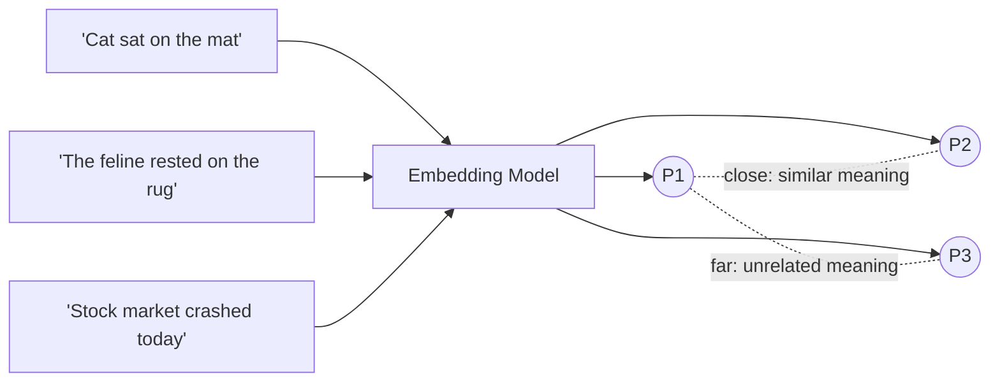

# Embeddings

## Overview

An embedding is a fixed-length list of numbers — a vector — that represents the **meaning** of a piece of data (a word, sentence, image, or document) so that semantically similar things land close together in that vector space, and unrelated things land far apart. Everything downstream in this guide — search, retrieval, RAG — is built on that one property.

## Data Flow Diagram — Meaning to Vector Space



Two paraphrases of the same idea (P1, P2) land close together in vector space; an unrelated sentence (P3) lands far away — regardless of how many words they do or don't share.

## Interview Q&A

### Easy — Screening Round

**E1. What exactly is an embedding?**
A vector of floating-point numbers (commonly 384–1536 dimensions) produced by a model for a piece of input, chosen so that distance and direction in that vector space correspond to similarity in meaning — not similarity in spelling.

**E2. Cosine similarity vs. Euclidean distance — which do you use, and why?**
Cosine similarity measures the angle between two vectors and ignores their magnitude — it's the standard for text embeddings because only the "direction" (meaning) matters, not vector length. Euclidean distance measures straight-line distance and is sensitive to magnitude, which can distort results unless vectors are normalized first.

**E3. Word embeddings vs. sentence/document embeddings?**
Classic word embeddings (Word2Vec, GloVe) give one static vector per word, regardless of context. Sentence/document embeddings from transformer encoders produce one vector for a whole passage and are contextual — the same word contributes differently depending on what surrounds it.

**E4. What does it mean for two embeddings to be "close" — is closeness always measured with cosine similarity?**
Not necessarily. Cosine similarity (the angle between two vectors) is the most common choice for text because it ignores magnitude, but the dot product on already-normalized (unit-length) vectors gives the exact same ranking and is cheaper to compute — that equivalence is why so many pipelines normalize vectors up front. Euclidean (L2) distance is used instead when magnitude genuinely carries information; the "right" metric is usually whichever one the embedding model was trained and evaluated with.

**E5. Can embeddings be created for things other than text — e.g. images or audio?**
Yes — the same idea (map an input to a point in a meaning-preserving vector space) applies to any modality; it just needs a different encoder network trained on that kind of data (a CNN/ViT for images, a spectrogram-based encoder for audio). This is also what enables cross-modal search — typing a text query and retrieving matching images, for example — whenever the text and image encoders are trained to share one embedding space (see CLIP, Q A6).

**E6. What does "embedding space" or "vector space" actually mean, geometrically?**
Each dimension of the embedding is one axis of a high-dimensional coordinate system, and a single embedding is just one point (or one vector from the origin) in that space — the same geometry as 2D/3D, just with hundreds or thousands of axes instead of 2 or 3. Because it can't be visualized directly, tools like t-SNE or UMAP project it down to 2D/3D for human inspection, at the cost of distorting exact distances.

**E7. What's a typical embedding size, and can you freely mix vectors from two different models?**
Common sizes are 384, 768, and 1536 dimensions, though this varies by model and is mostly a cost/quality trade-off (see Q M2). You cannot mix or directly compare vectors from two different models, or even two versions of the same model — each one defines its own arbitrary geometry, so "close" in one space has no defined meaning in another (see embedding drift, Q M3).

**E8. What is a vector database, and why not just use a regular relational or document database?**
A vector database is a data store purpose-built to index and search high-dimensional vectors efficiently, typically via an approximate-nearest-neighbor (ANN) index rather than a full scan. Regular databases index for exact-match or range queries on scalar columns; they have no efficient way to answer "give me the k closest vectors to this query vector" out of millions or billions of rows, which is exactly the query pattern embeddings need.

### Medium — Technical Round

**M1. How is an embedding model trained?**
Usually with contrastive learning: the model is shown pairs of texts known to be similar (or dissimilar) and is trained to pull similar pairs' vectors together and push dissimilar pairs' vectors apart, so the geometry of the space ends up encoding meaning.

**M2. Does higher embedding dimensionality always mean better quality?**
No. More dimensions can capture finer nuance, but they cost more storage and compute, and past a point you hit diminishing returns (and the "curse of dimensionality," where distances become less meaningful). Production systems pick a size that trades off quality against cost.

**M3. What is "embedding drift," and why should you care for RAG?**
If you switch or update the embedding model, the new vectors live in a different, incompatible geometry from the old ones. You can't mix them — you have to re-embed your entire corpus whenever you change embedding models, or similarity search will silently return garbage.

**M4. The classic "king − man + woman ≈ queen" example — what does it actually show?**
That the vector space can encode relationships as consistent directions, not just clusters — "royalty" and "gender" behave like separate axes you can add and subtract. It's most visible in classic static word embeddings; contextual embeddings are more entangled but the underlying idea (structure = geometry) still holds.

**M5. What is L2 normalization of an embedding, and why is it commonly done before storing vectors?**
L2 normalization rescales a vector to unit length — dividing every component by the vector's Euclidean norm — while preserving its direction. Once every stored vector has length 1, cosine similarity's denominator (`‖a‖ · ‖b‖`) is always 1, so cosine similarity collapses into a plain dot product, which is exactly the metric most vector index implementations compute fastest — trading a tiny one-time preprocessing cost for cheaper queries, potentially billions of times over.

```python
def l2_normalize(vector):
    norm = sum(x * x for x in vector) ** 0.5
    return [x / norm for x in vector] if norm else vector

# once both vectors are unit length, dot product IS cosine similarity
a, b = l2_normalize([3, 4]), l2_normalize([6, 8])   # same direction, different magnitude
dot = sum(x * y for x, y in zip(a, b))
print(dot)  # 1.0 -- identical direction, so "maximally similar"
```

**M6. Bi-encoder vs. cross-encoder — what's the difference, and why do RAG/search systems typically use both?**
A bi-encoder embeds the query and each candidate document independently, then compares the resulting vectors with a cheap similarity function — fast enough to run against millions of documents because document vectors can be precomputed and indexed offline. A cross-encoder feeds the query and one candidate through the model together in a single forward pass, letting it directly attend across both texts — much more accurate, but it must run once per candidate at query time, so it can't scale to a whole corpus. Production pipelines typically use a bi-encoder to cheaply retrieve a top-K candidate set from the full corpus, then a cross-encoder to re-rank just those K candidates into a precise final order.

**M7. Sparse vs. dense embeddings/retrieval — and why do many production systems use hybrid search?**
Sparse representations (TF-IDF, BM25) are long, mostly-zero vectors keyed by vocabulary term — they excel at exact keyword/entity matches (product codes, names, acronyms) but miss paraphrases that share no words. Dense embeddings are short, fully-populated vectors that capture semantic similarity — they catch paraphrases but can dilute a rare exact term across the whole vector. Hybrid search runs both and fuses their results (e.g. reciprocal rank fusion), because real query traffic is a mix of "needs an exact term" and "needs the meaning."

**M8. What is the distributional hypothesis, and how does a from-scratch co-occurrence approach relate to it, versus modern neural embeddings?**
The distributional hypothesis says a word's meaning is defined by the company it keeps — words that occur in similar contexts tend to have similar meanings. Classic co-occurrence counting (and refinements like PMI-weighted counts or matrix-factorization methods such as GloVe/LSA) operationalizes this literally: count neighboring words directly and use the counts themselves as the vector. Modern neural embeddings exploit the exact same hypothesis but *learn* a compact dense vector via a prediction task (predict a word from its context, or vice versa) instead of storing raw counts — which is what lets vector size stay small and fixed regardless of vocabulary size (see Q P4).

```python
# the core idea behind a co-occurrence window, in miniature
sentence = ["cat", "sat", "on", "the", "mat"]
window = 2
for i, word in enumerate(sentence):
    neighbors = sentence[max(0, i - window): i] + sentence[i + 1: i + 1 + window]
    print(word, "->", neighbors)   # these neighbors are what get counted per word
```

**M9. How does chunking strategy (chunk size and overlap) affect embedding-based retrieval quality in a RAG pipeline?**
Chunks that are too large get compressed into one averaged-out vector that dilutes any single specific fact, hurting precision; chunks that are too small lose surrounding context, hurting recall and the coherence of what gets handed to the generator. Overlap between consecutive chunks (commonly 10–20% of chunk length) helps avoid severing a fact right at a chunk boundary, since the same sentence then appears in two chunks instead of being split mid-idea. There's no universal ideal size — it's tuned empirically against your own retrieval-quality metrics and document/question style.

### Advanced — Bar-Raiser / System-Design Round

**A1. What is Matryoshka Representation Learning, and why is it useful in production?**
An embedding-training technique where the first N dimensions of the full vector are themselves a valid, independently useful lower-dimensional embedding — nested like Russian dolls. In production this lets you truncate a 1536-dim embedding down to, say, 256 dims for a fast first-pass filter, then use the full vector for precise re-ranking, without training or storing two separate models.

```python
def truncate_and_renormalize(full_vector, dims):
    truncated = full_vector[:dims]
    norm = sum(x * x for x in truncated) ** 0.5
    return [x / norm for x in truncated] if norm else truncated

full_vector = [0.62, -0.18, 0.44, 0.09, -0.31, 0.77]   # pretend 6-dim Matryoshka embedding
fast_vector = truncate_and_renormalize(full_vector, dims=3)
print(fast_vector)  # first 3 dims alone are already a valid, usable embedding
```

**A2. What is multi-vector retrieval (e.g. ColBERT), and how does it differ from single-vector embeddings?**
Instead of compressing a whole passage into one vector, ColBERT keeps one vector per token and scores a query-document pair with a "late interaction" — matching each query token against its best-fitting document token and summing those scores. It preserves much more fine-grained matching signal than single-vector cosine similarity, at the cost of far more storage and compute per document.

**A3. How do you evaluate embedding model quality before picking one for production?**
Benchmark on tasks that resemble your actual use case — retrieval, classification, clustering, semantic similarity — using something like the MTEB (Massive Text Embedding Benchmark) leaderboard as a starting point, then validate on your own labeled query/document pairs, since public benchmark rankings don't always transfer to a specific domain (legal, medical, code).

**A4. What is embedding quantization, and when would you use it at scale?**
Reducing the precision of each vector's numbers — e.g. from 32-bit floats down to int8 or even binary (1 bit per dimension) — to cut memory and speed up distance computation. At tens or hundreds of millions of vectors, this is often the difference between an index fitting in RAM or not; the trade-off is a small, usually acceptable, loss of recall.

**A5. When would you fine-tune your own embedding model instead of using an off-the-shelf one?**
When your domain vocabulary is specialized enough (legal contracts, medical notes, internal product jargon) that a general-purpose embedding model clusters things incorrectly, or when you have labeled relevance data (click-through, human-judged pairs) that can meaningfully improve retrieval quality beyond what a generic model achieves — fine-tuning is usually a later-stage optimization, not a first step.

**A6. What is CLIP, and how does it create a shared embedding space across text and images?**
CLIP (Contrastive Language-Image Pretraining) trains two separate encoders — a text encoder and an image encoder — jointly, using a contrastive loss over (image, caption) pairs: for each batch, it pulls a matching image/caption pair's embeddings together and pushes every other, mismatched pairing in that batch apart. Both encoders are trained to output vectors into the *same* shared space, so after training a text query and an image can be embedded with two different networks and still compared directly with plain cosine similarity — that's what powers text-to-image search and zero-shot image classification (comparing an image's vector against embedded class-name strings).

**A7. How would you debug a production system where retrieval quality suddenly degraded overnight with no code changes?**
Walk through, roughly in order of likelihood: check whether the embedding provider silently rolled out a new model version behind the same API/model name, since that alone changes the entire vector geometry; check whether the vector index got partially rebuilt, corrupted, or a deployment left it serving a stale or mixed shard; check whether the query distribution shifted — a new user segment or feature sending queries the corpus was never good at, rather than an actual regression; and check whether newly ingested documents were embedded with a different model or preprocessing pipeline than the rest of the corpus, silently reintroducing embedding drift (Q M3). The common thread is that embeddings fail silently — comparing two incompatible vector spaces throws no exception, it just quietly returns wrong nearest neighbors.

**A8. Why is exact nearest-neighbor search not used at scale, and what's the HNSW vs. IVF trade-off?**
Exact search means comparing a query vector against every stored vector — O(N·d) per query — which is fine for thousands of vectors but far too slow once N reaches millions or billions. Approximate Nearest Neighbor (ANN) indexes trade a small, tunable amount of recall for large speedups: HNSW (Hierarchical Navigable Small World) builds a multi-layer graph of vectors and greedily walks it from a coarse top layer down to a precise bottom layer, giving high recall and fast queries at the cost of more memory and slower inserts; IVF (Inverted File Index) clusters vectors into buckets via k-means and only searches the nearest few buckets, using less memory and building faster but typically trading off some recall versus a well-tuned HNSW graph. Most managed vector databases default to HNSW today and expose its recall-vs-latency knobs (e.g. `ef_search`, `M`) directly.

```python
def brute_force_knn(query, vectors, k):
    scored = [(cosine_similarity(query, v), word) for word, v in vectors.items()]
    scored.sort(reverse=True)          # the O(N) scoring pass above is the real cost
    return scored[:k]

# fine for a few thousand vectors; at tens of millions this linear scan is
# exactly what ANN indexes like HNSW/IVF exist to avoid
```

### Practical / Coding Round

*Questions below reference [`example.py`](example.py), a from-scratch, dependency-free word-embedding builder that turns co-occurrence counts over a tiny corpus into dense vectors — the actual mechanism behind the diagram at the top of this file.*

**P1. Why does `cosine_similarity` divide by the product of norms instead of just returning the dot product?**
The raw dot product is sensitive to vector magnitude — a word that simply appears far more often in the corpus (like "the") would rack up larger raw co-occurrence counts and inflate its dot product with everything, regardless of whether the words are actually related in meaning. Dividing by `‖v1‖ · ‖v2‖` cancels out each vector's own magnitude, leaving only the cosine of the angle between them — pure directional similarity, unaffected by how frequently either word happens to occur.

**P2. What does the `window` parameter in `build_cooccurrence_vectors` control, and what changes if you set it to 1 vs. 5?**
`window` is how many positions to each side of a word count as its "context" for that occurrence. A small window (1) counts only immediate left/right neighbors, capturing tight, almost syntactic substitutability — in `example.py`'s demo corpus, `window=1` actually pushes `cosine_similarity("cat", "kitten")` higher (0.935) than the default window of 2 (0.713). A large window (5) — wider than most of the demo's 3–6-word sentences — effectively captures "appeared anywhere in the same sentence," which behaves more like a topical, bag-of-words signal and washes out some of that precision (0.789 in the same test); real systems tune this as a hyperparameter trading positional precision against how much context gets captured.

**P3. This produces one static vector per word — what would need to change to get a *contextual* embedding (a different vector for "bank" in "river bank" vs. "bank account")?**
`build_cooccurrence_vectors` hands back exactly one fixed vector per vocabulary word, no matter which sentence it's looked up from — there's no notion of "which occurrence." A contextual embedding needs the vector to be a function of the whole input sequence at inference time rather than a lookup keyed only on the word itself, which is what a transformer encoder does: every token's output vector is produced by attending over every other token in that specific input, so "bank" in two different sentences produces two different vectors even though it's the "same word."

**P4. The dense vector length here equals vocabulary size — why doesn't that scale, and how do real neural embedding models avoid it?**
In `build_cooccurrence_vectors`, every vector has one dimension per distinct vocabulary word, so a vocabulary of 50,000 words means every vector is 50,000-dimensional and mostly zeros — and it grows without bound as the corpus grows. Real neural embedding models fix the output size upfront (e.g. always 768 dims) regardless of vocabulary size; training compresses whatever signal matters into that fixed budget instead of allocating one dimension per possible word.

**P5. What does `tokenize` do, and why does this normalization step matter before building co-occurrence vectors?**
`tokenize` lowercases the text and strips punctuation before splitting on whitespace, so `"Cat,"`, `"cat!"`, and `"cat"` all collapse to the identical token `"cat"`. Skipping this would silently fragment one word's co-occurrence counts across several near-duplicate vocabulary entries (`"cat"`, `"cat,"`, `"Cat"`), diluting the very signal the whole approach depends on — the toy version of the general rule that embedding quality is only as good as the text preprocessing feeding it.

**P6. Add a call to `l2_normalize` before storing each embedding — why does pre-normalizing make a downstream vector database's search faster?**
Once every stored vector is unit length, `cosine_similarity`'s division step becomes unnecessary at query time — the plain dot product already equals the cosine similarity (see Q M5) — and a dot product is cheaper to compute, and easier to vectorize on hardware, than a dot product plus two square roots and a division. Doing that normalization once at write time, instead of on every comparison at query time, is exactly the kind of cheap precomputation that lets a vector database answer nearest-neighbor queries over millions of vectors fast.
