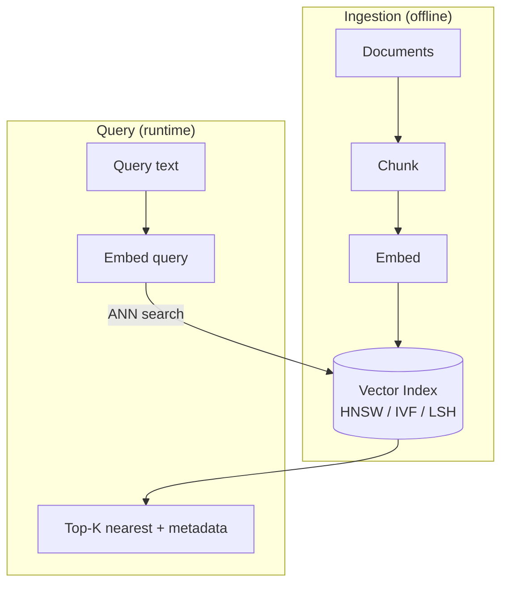

# Vector Databases

## Overview

A vector database stores embeddings and answers one core question fast, even across millions or billions of vectors: *"which stored vectors are closest to this query vector?"* It does that with approximate nearest neighbor (ANN) search instead of comparing the query to every single row.

## Data Flow Diagram — Ingestion + Query Pipeline



Two very different lifetimes share one index: ingestion happens once (or on a schedule) and builds the index; every query re-uses it in milliseconds.

## Interview Q&A

### Easy — Screening Round

**E1. Why not just store embeddings in a regular SQL database?**
SQL engines are optimized for exact-match and range queries over structured columns. Finding the "nearest" vectors among millions of high-dimensional points needs specialized approximate-nearest-neighbor indexing that general-purpose databases don't provide efficiently — brute-force comparison against every row doesn't scale.

**E2. Name a few popular vector databases and how they differ.**
Pinecone and Weaviate (managed, easy to start), Milvus and Qdrant (self-hostable, strong filtering), Chroma (lightweight, great for prototyping), and pgvector (an extension that adds vector search directly to Postgres, handy when you already run Postgres).

**E3. What is chunking, and why does chunk size matter so much?**
Splitting long documents into smaller pieces before embedding, because one embedding vector represents one chunk. Chunks that are too large blur many ideas into a single vector, diluting relevance; chunks that are too small lose surrounding context — chunk size and overlap are one of the highest-leverage tuning knobs in a retrieval system.

**E4. What does "top-K" mean in a vector search query?**
It means returning only the K stored vectors with the highest similarity (or lowest distance) to the query vector, rather than every match above some threshold. K is chosen by the application — a chatbot might retrieve the top 3 chunks to stuff into a prompt, while an analytics job might want the top 100 — and it's usually the first parameter you tune when balancing answer quality against latency and prompt size.

**E5. Is a vector database a replacement for your primary database (e.g. Postgres), or does it sit alongside one?**
It sits alongside one — a vector database is specialized for similarity search, not for transactional writes, joins, or relational integrity. Most teams keep their primary data (users, orders, permissions) in Postgres or similar and either run a separate vector database for embeddings, or use an extension like pgvector to add approximate nearest-neighbor search directly inside Postgres so they don't have to operate two systems.

**E6. What exactly is an "embedding"?**
A dense numeric vector — typically a few hundred to a few thousand floating-point numbers — produced by feeding a piece of content (text, image, audio) through a trained embedding model. The model is trained so that semantically similar inputs land close together in that vector space, which is what turns "similarity" into something you can compute with plain arithmetic instead of comparing raw content.

**E7. Why do we need an embedding model at all instead of just matching keywords in the text?**
Keyword matching only catches literal overlap in wording — it misses synonyms, paraphrases, and different phrasings of the same idea ("car" vs. "automobile" vs. "vehicle"). Embeddings capture meaning numerically, so a query and a relevant document that share no exact words can still land close together in vector space and get retrieved.

**E8. What's the difference between a sparse and a dense vector representation?**
A sparse vector (e.g. TF-IDF or BM25) has one dimension per vocabulary term, is mostly zeros, and is very good at exact keyword/term matches. A dense embedding vector is compact (every dimension carries signal) and captures semantic similarity, but can miss exact-term precision — which is why many production systems combine both instead of picking just one.

**E9. What is "hybrid search" in the context of vector databases?**
Running both a dense vector similarity search and a sparse keyword-based search (e.g. BM25) over the same query, then merging the two ranked result lists — often with a technique like reciprocal rank fusion — into one final ranking. It combines the semantic recall of embeddings with the exact-term precision of keyword search, which matters a lot for queries containing IDs, error codes, or specific names that embeddings alone tend to blur.

### Medium — Technical Round

**M1. What is Approximate Nearest Neighbor (ANN) search?**
Instead of comparing a query vector against every stored vector (exact search, O(n)), ANN algorithms — HNSW, IVF, LSH — build an index structure that finds "close enough" neighbors dramatically faster, trading a small, tunable amount of recall for large speed gains.

**M2. Explain HNSW in one breath.**
Hierarchical Navigable Small World — a multi-layer graph where each vector connects to its approximate nearest neighbors. Search starts at a sparse top layer and greedily "zooms in" layer by layer, landing near the true nearest neighbors in roughly logarithmic time with high recall.

**M3. What is metadata filtering, and why does it matter?**
Storing extra structured fields (date, author, category, permissions) alongside each vector so a query can combine similarity search with hard filters — e.g. "similar to X AND category = 'billing' AND user has access" — narrowing the candidate set instead of relying on similarity alone.

**M4. Vector index vs. vector database — what's the actual difference?**
An index (e.g. FAISS) is just the in-memory ANN search data structure. A vector database wraps that index with persistence, CRUD operations, metadata filtering, replication/scaling, and an API — you need the database, not just the index, for anything beyond a local prototype.

**M5. What is re-ranking, and why add it after vector search?**
ANN retrieval by embedding similarity is fast but approximate and doesn't weigh fine-grained relevance well. A second-stage re-ranker — typically a cross-encoder that scores the query and each candidate together — re-sorts the top-K results and materially improves final precision, at extra latency cost.

**M6. What is IVF (Inverted File Index), and how does it differ from HNSW?**
IVF partitions the vector space into clusters (via a k-means-like step at build time), assigning every stored vector to its nearest cluster centroid. A query first finds the nearest few centroids, then only searches the vectors inside those clusters, instead of the whole graph HNSW would traverse. IVF is generally faster and cheaper to build than HNSW, but tends to need more tuning (number of clusters, how many to probe) and often gets lower recall than HNSW at the same query speed — which is why some systems combine the two, using IVF to narrow down and a finer step within the shortlist.

**M7. Why do most vector databases recommend normalizing vectors and using dot-product/cosine rather than raw Euclidean distance for text search?**
For text embeddings, what usually matters is the *direction* of the vector (the meaning it encodes), not its magnitude — two embeddings of similar meaning but different lengths should still be considered close. Cosine similarity ignores magnitude entirely by design, and once vectors are pre-normalized to unit length, cosine similarity and dot product become the same computation. Databases exploit this by normalizing once at ingestion time and using the cheapest of the three operations — a plain dot product — at query time.

```python
import math

def normalize(v):
    norm = math.sqrt(sum(x * x for x in v))
    return [x / norm for x in v] if norm else v

a, b = [3.0, 4.0], [6.0, 8.0]                       # same direction, different magnitude
na, nb = normalize(a), normalize(b)
dot_raw = sum(x * y for x, y in zip(a, b))          # magnitude-sensitive
dot_normalized = sum(x * y for x, y in zip(na, nb)) # == cosine similarity
print(dot_raw, round(dot_normalized, 4))            # 50.0  1.0 -- "identical direction"
```

**M8. What is product quantization (PQ), and why is it used alongside an ANN index?**
PQ compresses each vector by splitting it into several sub-vectors, clustering each sub-vector's values across the whole dataset into a small codebook, and replacing the original sub-vector with just its codebook index (a few bits) instead of the full floating-point values. This shrinks memory footprint dramatically — often 10-30x — at the cost of some accuracy, since distance calculations become approximate lookups against the codebooks. It's commonly paired with IVF (IVF-PQ) so a billion-vector index can fit in memory that would otherwise only hold a few hundred million raw float vectors.

**M9. How do you choose the right embedding model for a RAG application?**
Match the domain (a general-purpose model vs. one tuned for code, legal, or medical text), check the model's max input length against your chunk size, and confirm multilingual support if you need it. Dimensionality is a direct trade-off between retrieval quality and storage/compute cost, so it shouldn't be picked by default. Most importantly, evaluate empirically — build a small labeled set of (query, relevant document) pairs from your own data and measure recall@K for each candidate model, rather than trusting a public leaderboard scored on different data.

**M10. What is the "curse of dimensionality," and how does it affect nearest-neighbor search?**
As the number of dimensions grows, distances between random points become less discriminative — the gap between the nearest and farthest neighbor's distance shrinks relative to the distances themselves, so "nearest" starts to mean less. This is why brute-force distance comparisons and many classic spatial index structures (like k-d trees) degrade in very high dimensions. ANN indexes like HNSW still work well at typical embedding dimensions in practice because real embeddings aren't uniformly random — they live on a much lower-dimensional manifold shaped by what the model learned — but the effect is exactly why "just add more dimensions" isn't automatically better.

```python
import math
import random

def nearest_farthest_ratio(dim, n=200, seed=0):
    rng = random.Random(seed)
    origin = [0.0] * dim
    points = [[rng.uniform(-1, 1) for _ in range(dim)] for _ in range(n)]
    dists = [math.dist(origin, p) for p in points]
    return min(dists) / max(dists)

for d in (2, 20, 200, 2000):
    print(d, round(nearest_farthest_ratio(d), 4))  # ratio creeps toward 1.0 as d grows
```

### Advanced — Bar-Raiser / System-Design Round

**A1. How do you scale a vector database horizontally?**
Shard the index across nodes (by hash of ID, or by tenant/category), fan the query out to every shard in parallel, and merge the top-K results from each shard on a coordinator node. The harder part is keeping shards balanced as data grows and handling the coordinator becoming a bottleneck as query volume rises.

**A2. Walk through the recall/latency/memory trade-off when tuning HNSW.**
`M` (connections per node) trades memory and build time for recall — higher M means a denser graph and better recall but more RAM. `efConstruction` trades index build time for graph quality. `efSearch` trades query latency for recall at search time — a larger candidate list explored per query means higher recall but slower responses. In practice you fix M and efConstruction at index-build time, then tune efSearch per query based on your latency budget.

**A3. How do you handle real-time updates and deletes without expensive full index rebuilds?**
Most ANN structures (HNSW included) support incremental inserts natively, but deletes are typically handled with soft-deletion (a tombstone flag filtered out at query time) rather than actually restructuring the graph, since removing a node from an HNSW graph is expensive. Periodically, a background compaction/rebuild reclaims space from tombstoned entries.

**A4. How would you enforce per-tenant data isolation in a shared vector index?**
Either physically separate indexes per tenant (strong isolation, higher operational overhead at scale) or a single shared index with a mandatory tenant-ID metadata filter applied to every query before the ANN search runs — the risk with the shared approach is a missed filter anywhere in the code path leaking data across tenants, so it needs to be enforced at the query layer, not just in application logic.

**A5. How would you benchmark two vector database configurations (e.g. different M/efSearch settings) fairly before choosing one for production?**
Use a fixed, representative query set pulled from real traffic, not synthetic random vectors, and measure recall@K against an exact brute-force ground truth computed once for that same query set. Measure latency as p50/p95/p99, not just average, and run the benchmark under realistic concurrent load rather than single-threaded, since contention changes both latency and effective throughput. Track memory footprint alongside recall and latency — a configuration that wins on speed but doubles RAM usage may not actually be the better production choice.

```python
def recall_at_k(approx_results, exact_results):
    """approx_results / exact_results: ranked lists of doc_ids, length K each."""
    exact_set = set(exact_results)
    hits = sum(1 for doc_id in approx_results if doc_id in exact_set)
    return hits / len(exact_results) if exact_results else 1.0

# example: the ANN index found 2 of the true top-3 nearest neighbors
print(recall_at_k(["doc_a", "doc_x", "doc_c"], ["doc_a", "doc_b", "doc_c"]))  # 0.667
```

**A6. What happens to query latency and recall as an index grows from 1 million to 1 billion vectors, and what architectural changes does that force?**
A single-node, fully in-memory HNSW graph simply stops fitting in RAM well before a billion vectors, and even if it did, graph traversal latency and build time both degrade. This forces sharding the index across many nodes, typically with a two-stage architecture: a coarse clustering step (IVF-style) routes a query to the few most relevant shards or partitions, and only then does a finer ANN search run within each candidate shard. It also typically forces compression (product quantization, scalar quantization) or disk-backed indexes to fit the memory budget, trading some recall for the ability to serve the scale at all.

**A7. How would you design hybrid dense + sparse search at scale, and how do you combine the two result sets?**
Run the dense vector search and the sparse (BM25/keyword) search as two independent retrieval paths against the same query, each returning its own ranked top-N list, then merge the two rankings. Reciprocal rank fusion — summing `1 / (rank + constant)` from each list per document — is a common, simple, and surprisingly effective choice because it doesn't require the two systems' raw scores to be on comparable scales. At scale, both paths need to run in parallel with a shared timeout budget, since the merge step can only start once both have returned.

```python
from collections import defaultdict

def reciprocal_rank_fusion(ranked_lists, k=60):
    scores = defaultdict(float)
    for ranked_list in ranked_lists:
        for rank, doc_id in enumerate(ranked_list, start=1):
            scores[doc_id] += 1 / (k + rank)
    return sorted(scores, key=scores.get, reverse=True)

dense_ranked  = ["doc_a", "doc_b", "doc_c"]
sparse_ranked = ["doc_c", "doc_a", "doc_d"]
print(reciprocal_rank_fusion([dense_ranked, sparse_ranked]))  # doc_a and doc_c rise to the top
```

**A8. What consistency/availability trade-offs come up in a distributed vector database during heavy write load, like a bulk re-index?**
ANN indexes are usually eventually consistent by design — a newly inserted vector might not be immediately visible to search on every replica, and a bulk re-index can leave read replicas serving a stale index for a noticeable window. Teams generally accept this for vector search, since missing a just-inserted document for a few seconds is rarely critical, while keeping the metadata/permissions layer strongly consistent — serving a document a user shouldn't see is a much worse failure than brief staleness in similarity ranking.

**A9. How would you design an embedding versioning or migration strategy when you switch to a new embedding model?**
Vectors from two different embedding models live in different, incompatible vector spaces — you cannot mix them in the same similarity comparison, even if the dimensionality happens to match. The safe approach is to re-embed the entire corpus into a new index under the new model, run it alongside the old index (shadow/dual-write) while validating quality, and only cut query traffic over once the new index is fully populated and verified — never migrate in place inside a single index.

### Practical / Coding Round

*Questions below reference [`example.py`](example.py), a from-scratch, dependency-free vector store that implements a brute-force baseline (`FlatVectorStore`) next to a minimal locality-sensitive hashing ANN index (`RandomProjectionLSH`), so the exact-vs-approximate trade-off from the diagram above is directly runnable instead of theoretical.*

**P1. In `FlatVectorStore.search`, what's the time complexity as the number of stored vectors grows, and how does that motivate `RandomProjectionLSH`?**
It's O(n · d) per query — every one of the n stored vectors gets a full d-dimensional `cosine_similarity` comparison, with no shortcuts. That's fine for a few thousand vectors but becomes the bottleneck well before a production-scale corpus. `RandomProjectionLSH` motivates the alternative: bucket vectors ahead of time so a query only has to score the handful of vectors sharing its bucket, trading the guarantee of finding the true nearest neighbor for a large constant-factor speedup.

**P2. Explain what `RandomProjectionLSH._hash` does geometrically — why does the sign of the dot product with a random hyperplane act as a locality-sensitive hash?**
Each random hyperplane through the origin splits the vector space into two halves; the sign of `vector · plane` just says which half a given vector falls on. Two vectors that point in a similar direction (high cosine similarity) are very likely to land on the same side of any single random plane, since it would take a plane that happens to cut almost exactly between them to separate them. Combining several planes' signs into one bucket key, as `_hash` does, means vectors sharing a key are, with reasonably high probability, close together — that's the "locality-sensitive" property, and it's approximate precisely because "reasonably high probability" is not "always."

**P3. Run `example.py` — it constructs a case where `RandomProjectionLSH.search` misses the true nearest neighbor that `FlatVectorStore.search` finds. Why does that happen, and how would adding more hash tables help?**
It happens whenever the true nearest neighbor sits just across one of the random hyperplanes from the query — geometrically close, but hashed into a different bucket, so `RandomProjectionLSH.search` never even scores it. Using multiple independent hash tables (each with its own random set of planes) and unioning the candidate buckets across all of them fixes this probabilistically: a neighbor that gets unlucky and lands in the wrong bucket in one table will very likely land in the right bucket in at least one of the others, so recall goes up — at the cost of doing that much more hashing and scoring work per query.

**P4. How would you add metadata filtering to `RandomProjectionLSH.search`, the same way `FlatVectorStore.search` supports the `where` callback?**
Store a parallel `self._metadata` dict keyed by `doc_id`, exactly like `FlatVectorStore` does, populated in `add`. Then in `search`, after collecting the candidate `doc_id`s from `self.buckets[key]`, filter out any candidate whose metadata fails `where(...)` before scoring. That filter runs only on the already bucket-restricted candidate list, not on the whole dataset — which is exactly why metadata filtering in real ANN indexes is described as "pre-filter within the index" vs. "post-filter after ANN search," and the two can return different result counts.

**P5. `FlatVectorStore.add` silently overwrites if called twice with the same `doc_id` — is that the right upsert behavior for a real vector database, or would you want separate methods?**
Silent overwrite-on-add is a reasonable default for a toy, but a real vector database API usually separates the concerns explicitly: `upsert(doc_id, vector, metadata)` for "insert or replace, I don't care which," `update(doc_id, vector=None, metadata=None)` for partially updating just the metadata without re-embedding, and `delete(doc_id)` as its own method rather than overloading `add` with `vector=None`. Making the intent explicit in the method name avoids a whole class of bugs where a caller accidentally overwrites a vector they meant to just re-tag.

**P6. If you wanted `cosine_similarity` to also support returning a distance instead of a similarity, what would you change, and would the sorting logic need to change too?**
Cosine distance is just `1 - cosine_similarity(v1, v2)`, so you'd add a small wrapper function or a `metric` flag. The important catch is sorting direction: `FlatVectorStore.search` and `RandomProjectionLSH.search` both sort by similarity descending (`reverse=True`) to get the closest vectors first — if you switch to distance, you must sort ascending instead, since the smallest distance, not the largest, is the best match. Mixing the two up silently returns the worst matches instead of the best, which is a classic, easy-to-miss bug.
