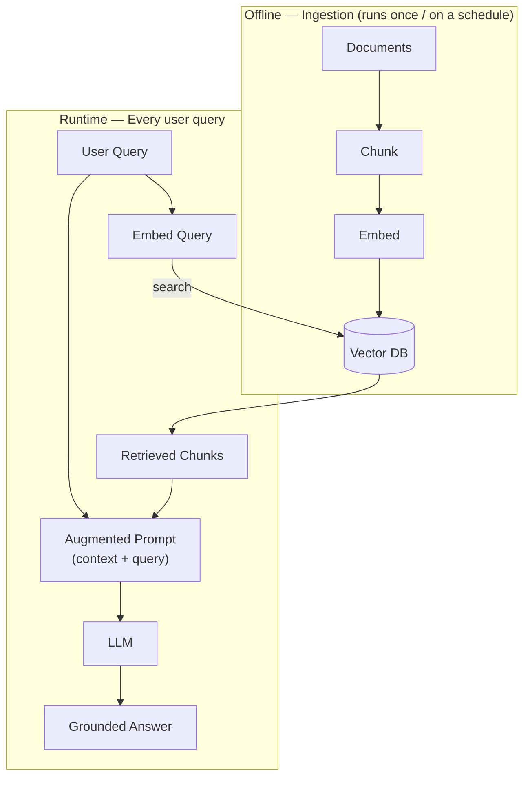

# RAG — Retrieval-Augmented Generation

## Overview

RAG grounds an LLM's answer in text retrieved from your own data, instead of relying only on what the model memorized during training. It's the pattern that turns a general-purpose LLM into something that can answer questions about private, current, or simply too-large-to-fit-in-context documents.

## Data Flow Diagram — Offline + Runtime Pipeline



Ingestion builds the index once; the runtime lane re-uses it on every query — retrieval happens before the LLM ever sees the question.

## Interview Q&A

### Easy — Screening Round

**E1. What problem does RAG actually solve?**
LLMs only "know" what was in their training data plus whatever fits in the current context window. RAG lets a model answer questions about private, current, or very large document sets — without retraining — by fetching the relevant text and handing it to the model as context at answer time.

**E2. Walk through the RAG pipeline end-to-end.**
Offline: split documents into chunks, embed each chunk, store the vectors plus metadata in a vector database. At query time: embed the user's question, run an ANN search to pull the top-K most relevant chunks, build a prompt containing those chunks plus the original question, send it to the LLM, and return its answer.

**E3. What's the difference between "context" in RAG and the model's "context window"?**
In **RAG (Retrieval-Augmented Generation)**, **context** is the relevant information retrieved from the database and sent to the model along with the user's question.

The **context window** is the maximum amount of information the model can process in a single request. It must accommodate the system prompt, retrieved information, conversation history, the user's question, and the model's generated response.

### Example

Suppose a model has a context window of **8,000 tokens**. The prompt, conversation history, and retrieved chunks must fit within the available token budget, while leaving room for the model's answer.

### In simple words

- **RAG context:** The information selected and provided to the model for the current question.
- **Context window:** The model's overall token capacity for a request, including input and output.

### Important point

Retrieving too much information can exceed the model's context window and cause errors or force information to be left out. To avoid this, retrieve the most relevant chunks and check that the full request fits within the model's token limit.
"""


**E4. Does RAG require fine-tuning the LLM?**
No — that's a big part of RAG's appeal. It works with an off-the-shelf model purely through prompting: you retrieve relevant text and include it in the prompt, no weight updates needed. Fine-tuning can be layered on top later (for example, to teach the model a specific citation format or tone), but it's an optional enhancement, not a requirement.

**E5. What is a "chunk," and why split documents into chunks instead of embedding each whole document?**
A chunk is a small, self-contained piece of a document — a paragraph, a few sentences, or a fixed-size window of text — that gets its own embedding and its own entry in the vector database. Whole-document embedding would average away the signal: a single vector for a 50-page PDF can't distinguish "the pricing section" from "the legal disclaimer," so a query about pricing would retrieve the whole document, most of it irrelevant.

**E6. In plain terms, what is an embedding, and what does it let you do that keyword matching can't?**
An embedding is a list of numbers (a vector) produced by a model, positioned so that texts with similar meaning end up close together in that numeric space, even if they don't share any exact words. That's what lets a search for "cheap flights" retrieve a document that says "budget airfare" — pure keyword matching would miss it, but the embeddings of the two phrases land near each other.

**E7. What is a vector database, and why not just store embeddings in a regular SQL table?**
A vector database stores embeddings alongside metadata and is built specifically to answer "which stored vectors are closest to this query vector" quickly, using approximate nearest-neighbor (ANN) indexes. A regular SQL database has no efficient way to do that similarity search at scale — you'd be stuck computing distance to every single row, which doesn't scale past a small table.

**E8. What does "top-K" mean when people talk about retrieval?**
K is simply how many of the highest-scoring chunks you pull back and hand to the LLM — top-5, top-10, whatever you configure. Too small a K risks missing a relevant chunk that scored just outside the cutoff; too large a K pads the prompt with marginally relevant text, burning context-window budget and risking the Lost-in-the-Middle problem.

**E9. In the RAG pipeline, which part does retrieval and which part does generation — and can you swap either piece independently?**
The embedding model plus the vector database handle retrieval — finding relevant chunks; the LLM handles generation — turning those chunks plus the question into a final answer. They're decoupled by design: you can swap the embedding model, the vector database, or the LLM independently, as long as whatever produced the stored vectors also produces the query vector — mixing embedding models breaks similarity search, since their vector spaces aren't compatible with each other.

### Medium — Technical Round

**M1. How does RAG reduce (not eliminate) hallucination?**
By supplying real source text as context, the model can quote or paraphrase actual facts instead of generating purely from memorized parameters. It doesn't eliminate hallucination — the model can still ignore, misread, or overconfidently extrapolate beyond the retrieved context.

**M2. Naive RAG vs. advanced RAG?**
Naive RAG is a single embed → retrieve → generate pass. Advanced RAG adds query rewriting/expansion, hybrid search, re-ranking, multi-hop retrieval, and self-checking loops on top, to fix the specific failure modes naive RAG runs into.

**M3. What is hybrid search?**
Running both sparse keyword search (BM25) and dense vector similarity search, then merging or re-ranking the two result sets. It matters because vector search can miss exact terms — product codes, names, acronyms — that keyword search catches trivially.

**M4. How do you evaluate a RAG system?**
Two layers: retrieval metrics (precision/recall@K, MRR — did we fetch the right chunks?) and generation metrics (faithfulness/groundedness — does the answer stick to retrieved content? — and answer relevance), often scored with an LLM-as-judge, plus end-to-end task accuracy on real questions.

**M5. What is "Lost in the Middle," and why should it change how you build prompts?**
Research showing LLMs attend less to information placed in the middle of a long context than at the very start or end. Practically: don't just stuff every retrieved chunk into the prompt in arbitrary order — put the most relevant chunk near the beginning or end, and consider re-ranking before insertion.

**M6. What is agentic / multi-hop RAG?**
Instead of one fixed retrieve-then-generate pass, the model can recognize it needs more information, issue another retrieval query, and iterate — necessary for questions that require combining facts scattered across multiple, non-adjacent sources.

**M7. What is GraphRAG?**
Building a knowledge graph of entities and relationships from the corpus, and retrieving connected subgraphs alongside (or instead of) flat text chunks — it helps with questions that require traversing relationships across many documents, which plain chunk retrieval struggles with.

**M8. What is query rewriting/expansion, and why do it before retrieval?**
It's rephrasing the user's raw query into one or more retrieval-friendly queries before embedding and searching — resolving pronouns and dropped context from earlier turns in a conversation ("what about its cost?" becomes "what is the cost of the Eiffel Tower's construction?"), or generating several phrasings of the same question to widen the net. It helps because users type conversationally and ambiguously, but retrieval quality depends heavily on the query actually containing terms that match relevant chunks.

**M9. How do you decide chunk size and overlap for a given document type — say, legal contracts vs. chat logs?**
There's no universal number — it's tuned empirically against retrieval eval metrics (precision/recall@K) for your actual corpus and query patterns. As a starting intuition: dense, self-contained documents (legal contracts, technical docs) tolerate larger chunks since each paragraph already stands alone; conversational data (chat logs, transcripts) usually needs smaller chunks with overlap, since a single turn out of context is often meaningless. Overlap exists specifically to avoid severing a sentence or idea exactly at a chunk boundary:

```python
def sliding_window_chunks(words, chunk_size, overlap):
    step = chunk_size - overlap
    return [
        " ".join(words[i:i + chunk_size])
        for i in range(0, len(words), step)
        if words[i:i + chunk_size]
    ]

text = "the quick brown fox jumps over the lazy dog near the river bank"
for c in sliding_window_chunks(text.split(), chunk_size=6, overlap=2):
    print(c)
```

Each window re-includes the last `overlap` words of the previous chunk, so a sentence split across the boundary still appears whole in at least one chunk.

**M10. What is re-ranking, and how does a cross-encoder differ from the bi-encoder used for initial retrieval?**
A bi-encoder embeds the query and each chunk independently (query and chunk never see each other), so similarity is just a fast vector-distance lookup — that's what makes ANN search over millions of chunks feasible. A cross-encoder instead reads the query and a single chunk together and outputs a relevance score directly, which is far more accurate but too slow to run against every chunk in the corpus. Re-ranking uses both: bi-encoder retrieval gets a cheap top-N candidate set, then a cross-encoder re-scores just those N before picking the final top-K.

```python
def bi_encoder_score(query_vec, chunk_vec):
    # dot product of two PRECOMPUTED vectors -- cheap, runs against millions of chunks
    return sum(a * b for a, b in zip(query_vec, chunk_vec))

def cross_encoder_score(query_text, chunk_text):
    # toy stand-in for a real cross-encoder network that reads BOTH texts
    # together -- accurate, but far too slow to run against a whole corpus
    shared_words = set(query_text.split()) & set(chunk_text.split())
    return len(shared_words) / max(len(query_text.split()), 1)

query_vec, chunk_vec = [0.2, 0.8, 0.1], [0.3, 0.7, 0.0]
print("bi-encoder (fast, precomputed):", bi_encoder_score(query_vec, chunk_vec))
print("cross-encoder (slow, per-pair):", cross_encoder_score("eiffel tower paris", "the eiffel tower is in paris"))
```

**M11. How do you compute precision@K and recall@K for retrieval evaluation?**
Precision@K is, out of the K chunks you retrieved, what fraction are actually relevant; recall@K is, out of all relevant chunks that exist for that query, what fraction you managed to retrieve in the top K. You need a labeled eval set (query → known relevant chunk ids) to compute either one.

```python
def precision_at_k(retrieved_ids, relevant_ids, k):
    top_k = retrieved_ids[:k]
    hits = sum(1 for cid in top_k if cid in relevant_ids)
    return hits / k

def recall_at_k(retrieved_ids, relevant_ids, k):
    top_k = retrieved_ids[:k]
    hits = sum(1 for cid in top_k if cid in relevant_ids)
    return hits / len(relevant_ids) if relevant_ids else 0.0

retrieved = ["c3", "c1", "c9", "c4"]
relevant = {"c1", "c4", "c7"}
print(precision_at_k(retrieved, relevant, k=4), recall_at_k(retrieved, relevant, k=4))
```

Precision tells you how noisy your top-K is (bloats the prompt with irrelevant chunks); recall tells you whether the answer was even retrievable at all — a generation-quality bug is unfixable if recall@K already missed the one chunk containing the answer.

### Advanced — Bar-Raiser / System-Design Round

**A1. How would you design document-level access control into a RAG system?**
Attach permission metadata (which users/groups can see this chunk) at ingestion time, and apply it as a mandatory filter in the vector search itself — not as a post-hoc filter on the LLM's answer, since by then the model may have already seen content the user shouldn't access. The filter has to be enforced at the retrieval layer, every time, with no code path that skips it.

**A2. How do you keep a RAG index fresh when the underlying data changes frequently?**
Options include incremental re-indexing (only re-embed changed/new documents, tracked via a last-modified timestamp or content hash), a streaming ingestion pipeline for near-real-time updates, and a TTL or versioning scheme so stale chunks are demoted or removed rather than silently lingering forever alongside newer, conflicting information.

**A3. Where does the latency budget go in a production RAG system, and where do you optimize first?**
Roughly: embedding the query (fast, ms), the ANN search (fast if tuned), optional re-ranking (can be the biggest hidden cost if using a cross-encoder over many candidates), and the LLM generation call itself (usually the dominant cost, especially for long outputs). Optimize generation latency first via streaming responses to the user, then re-ranking cost via reducing candidate count, before micro-optimizing the retrieval step.

**A4. How do you evaluate and monitor RAG quality continuously in production, not just offline?**
Sample live traffic and score it with an automated evaluator (faithfulness, relevance) on a rolling basis, track user feedback signals (thumbs down, follow-up rephrasing as an implicit negative signal), and periodically promote interesting production examples — especially failures — into your offline evaluation dataset so it keeps reflecting real usage instead of going stale.

**A5. RAG vs. fine-tuning vs. long-context — when do you choose each, or combine them?**
RAG is best for knowledge that's large, private, or changes frequently — updating it means re-indexing documents, not retraining a model. Fine-tuning is for teaching a fixed behavior — a style, a format, a specific skill — and is a poor tool for injecting facts that change often, since every update means an expensive retrain. Long-context (just pasting everything into the prompt) works when the relevant material is small and stable enough to fit and you'd rather skip retrieval infrastructure entirely. In practice, production systems often combine all three: RAG to fetch relevant material, fed into a model fine-tuned specifically to use retrieved context well (cite sources, refuse when context is insufficient), inside as large a context window as is cost-effective.

**A6. How would you design a RAG system to cite its sources — show which chunk each part of the answer came from?**
Tag every retrieved chunk with a stable id in the prompt itself, instruct the model to cite that id inline in its answer, then post-process the model's output to map cited ids back to real source documents/links for the UI. Critically, verify the model isn't just fabricating plausible-looking citations — at minimum, check that every cited id actually exists among the chunks retrieved for that query, and ideally spot-check that the cited chunk actually supports the sentence next to the citation.

```python
import re

def verify_citations(answer_text, retrieved_chunk_ids):
    cited = set(re.findall(r"\[(\d+)\]", answer_text))
    valid = {cid for cid in cited if int(cid) - 1 in range(len(retrieved_chunk_ids))}
    return {"cited": cited, "fabricated": cited - valid}

answer = "The tower is in Paris [1] and was finished in 1889 [2] per a 1970 survey [5]."
print(verify_citations(answer, retrieved_chunk_ids=["chunkA", "chunkB"]))  # [5] doesn't exist -> fabricated
```

A citation id the model invents that doesn't map to anything actually retrieved is a strong, cheap-to-detect signal of a hallucinated answer.

**A7. How would you implement Reciprocal Rank Fusion (RRF) to combine hybrid search results?**
RRF combines multiple ranked lists (for example, BM25 results and vector-search results) without needing their scores to be on the same scale — it only uses each document's *rank* in each list. Every document gets `1 / (k + rank)` from each list it appears in (k is a small constant, commonly 60, that dampens the impact of low ranks), and the sums become the fused ranking.

```python
def reciprocal_rank_fusion(ranked_lists, k=60):
    scores = {}
    for ranked_list in ranked_lists:
        for rank, doc_id in enumerate(ranked_list, start=1):
            scores[doc_id] = scores.get(doc_id, 0.0) + 1.0 / (k + rank)
    return sorted(scores, key=scores.get, reverse=True)

bm25_ranking = ["doc3", "doc1", "doc2"]
vector_ranking = ["doc1", "doc4", "doc3"]
print(reciprocal_rank_fusion([bm25_ranking, vector_ranking]))
```

It's popular precisely because it sidesteps the awkward problem of BM25 scores and cosine similarities living on completely different, hard-to-calibrate numeric scales.

**A8. What happens if you change your embedding model on a production RAG system, and how do you migrate safely?**
Two different embedding models produce vectors in two different, incompatible spaces — a query embedded with model B will not have meaningful cosine similarity to chunks embedded with model A, even though nothing looks obviously broken (the search still returns *some* results, just semantically wrong ones). Safe migration means re-embedding the entire corpus with the new model into a separate index, running both old and new indexes side by side (shadow/blue-green), validating retrieval quality on the new index against your eval set, and only then cutting traffic over — never mixing vectors from two embedding models in one index.

**A9. How do you handle two retrieved chunks that contradict each other — say, an old pricing page and a new one, both still in the index?**
The retrieval layer should give the model the tools to resolve this rather than silently picking one: attach metadata like last-updated timestamps or a source-authority ranking to each chunk, surface it in the prompt, and instruct the model to prefer the more recent/authoritative source or explicitly flag the conflict to the user instead of confidently merging both into one answer. The deeper fix is upstream — the TTL/versioning discussed in the "keeping an index fresh" question (A2) should be demoting or removing the stale document in the first place, so the conflict never reaches retrieval at all.

### Practical / Coding Round

*Questions below reference [`example.py`](example.py), a from-scratch, dependency-free mini RAG pipeline that implements the chunk → embed → index → retrieve → augment → generate flow shown in the diagram above, using bag-of-words term frequency as a clearly-labeled stand-in for real neural embeddings.*

**P1. In `chunk_documents`, what does `chunk_size` control, and what breaks if you set it very high (one chunk per document)?**
`chunk_size` is how many sentences get grouped into a single chunk before it's embedded and indexed. Set it as high as "every sentence in the document" and you're back to whole-document embedding — the Eiffel Tower sentence and the Machu Picchu sentence each blur into one averaged vector per document instead of standing on their own. It also directly feeds the Lost-in-the-Middle problem (M5): a giant single chunk dumped into the prompt buries the one relevant sentence inside a wall of irrelevant text instead of retrieval doing the job of isolating it.

**P2. `embed()` here is bag-of-words term frequency, not a real neural embedding — what specific retrieval failures would you expect that a real embedding model wouldn't have?**
Synonyms score as unrelated — a query about a landmark being "constructed" would completely miss a chunk that says "completed" or "built," since `embed()` only counts literal shared tokens with zero notion of meaning. It also can't handle rewording, word order, or cross-lingual matching, and two chunks about totally different topics that happen to share common filler words ("the," "is," "in") get nonzero similarity purely from noise — all things a real embedding model, trained to place semantically similar text nearby regardless of exact wording, handles naturally.

**P3. `retrieve()` does an O(n) brute-force scan over every chunk — how would you swap in an ANN index instead, and at what corpus size would that actually start to matter?**
You'd replace the linear `for chunk, vec in index` scan with a call into an ANN structure (HNSW, IVF, or a hosted vector database) built once at index time, turning each query from O(n) into roughly O(log n) or better. For a few thousand chunks, brute-force cosine similarity is genuinely fine — often faster than the network round-trip to an external vector database — the crossover point where ANN clearly pays for itself is typically somewhere in the tens-of-thousands-to-millions-of-vectors range, or sooner if query latency budgets are tight.

**P4. `fake_llm()` is a stub — what's the minimal change to call a real LLM API instead, and what would you add for production use?**
Minimally, swap the body of `fake_llm(prompt)` for an actual API call — e.g. `client.messages.create(model=..., messages=[{"role": "user", "content": prompt}])` — and return the response text; the rest of the pipeline (retrieval, prompt-building) doesn't change at all, since `fake_llm` is already isolated behind a single function boundary. For production you'd add retries with backoff for transient failures, a timeout so one slow call can't hang the whole request, streaming so the user sees tokens as they arrive instead of waiting for the full response, and explicit error handling for rate limits and context-length-exceeded errors.

**P5. This pipeline retrieves once and generates once (naive RAG). Sketch how you'd change `if __name__ == "__main__":` to implement one round of multi-hop RAG.**
Retrieve as normal, but before calling `fake_llm` for the final answer, check whether the retrieved chunks actually seem sufficient to answer the question; if not, use the gap to build a refined query and call `retrieve()` a second time, merging the new chunks with the first batch before building the final augmented prompt.

```python
top_k = retrieve(query, index, vocab, k=2)
if not looks_sufficient(query, top_k):           # e.g. ask an LLM, or a similarity-score threshold
    refined_query = f"{query} additional details"   # a real system would generate this with an LLM
    more_chunks = retrieve(refined_query, index, vocab, k=2)
    top_k = top_k + more_chunks                   # dedupe by chunk_id in a real implementation
prompt = build_augmented_prompt(query, top_k)
answer = fake_llm(prompt)
```

This is exactly M6's agentic/multi-hop RAG, just made concrete against this file's actual functions.

**P6. What role does `build_augmented_prompt` play, and what's the risk of blindly concatenating every retrieved chunk into it?**
It's the seam between retrieval and generation — it takes the query plus the scored chunks from `retrieve()` and turns them into the single text string that actually gets sent to the LLM (or to `fake_llm` here), including the citation-style `[1]`, `[2]` labels used by the citation-verification question (A6). The risk of dumping every retrieved chunk in without limits is twofold: you can blow past the model's context window entirely (E3), and even within budget you invite the Lost-in-the-Middle problem (M5) by padding the prompt with marginal chunks instead of keeping it tight and focused on the highest-scoring ones.
