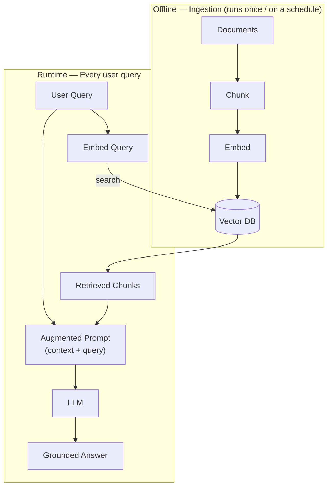

# RAG — Retrieval-Augmented Generation

## Overview

RAG grounds an LLM's answer in text retrieved from your own data, instead of relying only on what the model memorized during training. It's the pattern that turns a general-purpose LLM into something that can answer questions about private, current, or simply too-large-to-fit-in-context documents.

## Data Flow Diagram — Offline + Runtime Pipeline



Ingestion builds the index once; the runtime lane re-uses it on every query — retrieval happens before the LLM ever sees the question.

## Interview Q&A

### Easy — Screening Round

**E1. What problem does RAG actually solve?**
LLMs only "know" what was in their training data plus whatever fits in the current context window. RAG lets a model answer questions about private, current, or very large document sets — without retraining — by fetching the relevant text and handing it to the model as context at answer time.

**E2. Walk through the RAG pipeline end-to-end.**
Offline: split documents into chunks, embed each chunk, store the vectors plus metadata in a vector database. At query time: embed the user's question, run an ANN search to pull the top-K most relevant chunks, build a prompt containing those chunks plus the original question, send it to the LLM, and return its answer.

**E3. What's the difference between "context" in RAG and the model's "context window"?**
In **RAG (Retrieval-Augmented Generation)**, **context** is the relevant information retrieved from the database and sent to the model along with the user's question.

The **context window** is the maximum amount of information the model can process in a single request. It must accommodate the system prompt, retrieved information, conversation history, the user's question, and the model's generated response.

### Example

Suppose a model has a context window of **8,000 tokens**. The prompt, conversation history, and retrieved chunks must fit within the available token budget, while leaving room for the model's answer.

### In simple words

- **RAG context:** The information selected and provided to the model for the current question.
- **Context window:** The model's overall token capacity for a request, including input and output.

### Important point

Retrieving too much information can exceed the model's context window and cause errors or force information to be left out. To avoid this, retrieve the most relevant chunks and check that the full request fits within the model's token limit.
"""


**E4. Does RAG require fine-tuning the LLM?**
No. **RAG does not require fine-tuning the LLM.** One of the main advantages of RAG is that it can work with an existing, pre-trained language model without changing the model's weights.

In a typical RAG workflow, the system retrieves relevant information from a knowledge source, such as documents or a vector database, and adds that information to the prompt along with the user's question. The LLM then uses the provided context to generate its answer.

Fine-tuning can be added later if there is a specific need, such as adapting the model to a particular response style, output format, or specialized task. However, fine-tuning is an optional enhancement, not a requirement for RAG.

**Key difference:**
- **RAG** provides the model with relevant external information at query time.
- **Fine-tuning** updates the model's weights using training examples to influence how it responds or performs a task.

**Example:** A company can build a chatbot that answers questions using internal policy documents by retrieving relevant passages and passing them to an existing LLM. This can be done without fine-tuning the model.
"""

**E5. What is a "chunk," and why split documents into chunks instead of embedding each whole document?**
A **chunk** is a small part of a document, such as a paragraph or a few sentences. Each chunk is converted into an embedding and stored in a vector database.


### E5. What is a Chunk, and Why Do We Split Documents into Chunks?

A **chunk** is a small part of a document, such as a paragraph or a few sentences. Each chunk is converted into an embedding and stored in a vector database.

**Why do we split documents into chunks?**

- **Better search:** Helps retrieve information relevant to the user's question.
- **Higher accuracy:** Reduces irrelevant information in the retrieved results.
- **Efficient retrieval:** Retrieves only the required part instead of the entire document.

**Example:**

Suppose a PDF contains 50 pages covering pricing, company policies, and legal information. If a user asks about pricing, chunking helps the RAG system retrieve only the relevant pricing section instead of the entire PDF.

**In short:** Chunking improves the relevance and efficiency of information retrieval in RAG systems.


### E6. What Is an Embedding, and How Is It Better Than Keyword Matching?

An **embedding** is a list of numbers (a vector) that represents the meaning of text. Texts with similar meanings have embeddings that are close to each other in the vector space.

**Why do we use embeddings?**

- **Semantic search:** Finds information based on meaning, not just exact words.
- **Better results:** Can find relevant information even when different words are used.
- **Improved retrieval:** Helps RAG systems retrieve relevant document chunks for a user's question.

**Example:**

If a user searches for "cheap flights," an embedding-based search can find a document containing "budget airfare" because both phrases have similar meanings.

Keyword matching might miss this result because the exact words are different.

**In short:** Embeddings help search systems understand the meaning of text rather than matching only exact keywords.


**E7. What is a vector database, and why not just store embeddings in a regular SQL table?**
A vector database stores embeddings alongside metadata and is built specifically to answer "which stored vectors are closest to this query vector" quickly, using approximate nearest-neighbor (ANN) indexes. A regular SQL database has no efficient way to do that similarity search at scale — you'd be stuck computing distance to every single row, which doesn't scale past a small table.

**E8. What does "top-K" mean when people talk about retrieval?**
K is simply how many of the highest-scoring chunks you pull back and hand to the LLM — top-5, top-10, whatever you configure. Too small a K risks missing a relevant chunk that scored just outside the cutoff; too large a K pads the prompt with marginally relevant text, burning context-window budget and risking the Lost-in-the-Middle problem.

**E9. In the RAG pipeline, which part does retrieval and which part does generation — and can you swap either piece independently?**
The embedding model plus the vector database handle retrieval — finding relevant chunks; the LLM handles generation — turning those chunks plus the question into a final answer. They're decoupled by design: you can swap the embedding model, the vector database, or the LLM independently, as long as whatever produced the stored vectors also produces the query vector — mixing embedding models breaks similarity search, since their vector spaces aren't compatible with each other.

### Medium — Technical Round


### M1. How Does RAG Reduce Hallucination?

**RAG (Retrieval-Augmented Generation)** reduces hallucination by providing the LLM with relevant information retrieved from trusted documents before generating an answer.

**How does it work?**

1. **Retrieve:** Finds relevant information from a document or vector database.
2. **Augment:** Adds the retrieved information to the LLM's prompt as context.
3. **Generate:** The LLM uses the provided context to generate an answer based on the available information.

**Example:**

Suppose a company document states that its leave policy allows 20 days of annual leave. If a user asks about the leave policy, RAG retrieves the relevant section and provides it to the LLM to generate an answer.

Without RAG, the LLM might generate an incorrect answer based on its existing knowledge.

**Important:** RAG reduces hallucination but does not eliminate it completely. The LLM may misinterpret the retrieved information, ignore the context, or generate unsupported answers.

**In short:** RAG improves answer accuracy by grounding the LLM's responses in relevant source information.


### M2. What Is the Difference Between Naive RAG and Advanced RAG?

**Naive RAG** follows a simple process: retrieve relevant document chunks and provide them to the LLM to generate an answer.

**Advanced RAG** improves this process by adding techniques to retrieve more relevant information and generate more accurate answers.

**Key Differences:**

| Naive RAG | Advanced RAG |
|---|---|
| Uses a simple retrieval process. | Uses improved retrieval techniques. |
| Searches using the original user query. | Can rewrite or expand the query. |
| Typically uses vector search. | Can combine keyword search and vector search (hybrid search). |
| May retrieve irrelevant chunks. | Can use re-ranking to select the most relevant chunks. |
| Uses a straightforward retrieval and generation flow. | Can use multi-step retrieval and self-checking mechanisms. |

**Example:**

Suppose a user asks, "What is the company's leave policy?"

- **Naive RAG:** Retrieves document chunks based on the original query and generates an answer.
- **Advanced RAG:** Can rewrite the query, combine keyword and semantic search, re-rank the retrieved chunks, and use the most relevant information to generate an answer.

**In short:** Naive RAG uses a basic retrieval pipeline, whereas Advanced RAG adds techniques to improve retrieval quality and answer accuracy.


### M3. What Is Hybrid Search?

**Hybrid search** combines keyword search and vector search to find the most relevant information from documents.

It uses two search methods:

1. **Keyword Search (BM25):** Finds documents containing exact words or terms.
2. **Vector Search:** Finds documents based on the meaning and similarity of the text using embeddings.

The results from both methods are combined or re-ranked to improve search accuracy.

**Why do we use hybrid search?**

- Finds exact keywords, product codes, names, and acronyms.
- Retrieves information based on meaning, even when the wording is different.
- Improves the relevance of search results.

**Example:**

Suppose a user searches for `Python FastAPI`.

- **Keyword Search:** Finds documents containing the exact terms `Python` and `FastAPI`.
- **Vector Search:** May also find documents discussing Python API development using similar wording.
- **Hybrid Search:** Combines both results to find relevant information more effectively.

**In short:** Hybrid search combines keyword matching and semantic search to improve information retrieval in RAG systems.

**M4. How do you evaluate a RAG system?**
Two layers: retrieval metrics (precision/recall@K, MRR — did we fetch the right chunks?) and generation metrics (faithfulness/groundedness — does the answer stick to retrieved content? — and answer relevance), often scored with an LLM-as-judge, plus end-to-end task accuracy on real questions.


### M5. What Is "Lost in the Middle," and Why Does It Matter in Prompt Design?

**Lost in the Middle** is a phenomenon where an LLM may pay more attention to information at the beginning and end of a long context than to information in the middle.

In RAG systems, this can cause the LLM to overlook important information when too many document chunks are added to the prompt.

**Why does it matter?**

- **Better context ordering:** Place the most relevant information near the beginning or end of the prompt.
- **Reduce irrelevant content:** Avoid adding too many unnecessary document chunks.
- **Re-ranking:** Rank retrieved chunks by relevance before adding them to the prompt.
- **Improve answer quality:** Help the LLM focus on the most useful information.

**Example:**

Suppose a RAG system retrieves 20 document chunks, and the most important answer is hidden in the middle. The LLM might overlook that information and generate an incomplete answer.

By re-ranking the chunks and placing the most relevant information strategically, we can improve the chances that the LLM uses the correct context.

**In short:** Lost in the Middle reminds us that the order and amount of context in a prompt can affect the quality of an LLM's answer.


**M6. What is agentic / multi-hop RAG?**
Instead of one fixed retrieve-then-generate pass, the model can recognize it needs more information, issue another retrieval query, and iterate — necessary for questions that require combining facts scattered across multiple, non-adjacent sources.


### M7. What Is GraphRAG?

**GraphRAG (Graph-based Retrieval-Augmented Generation)** is an approach that combines RAG with a knowledge graph to retrieve information based on entities and their relationships.

A **knowledge graph** represents information as:
- **Entities:** People, companies, products, or other objects.
- **Relationships:** Connections between entities.

**How does GraphRAG work?**

1. **Extract:** Identifies entities and relationships from documents.
2. **Build:** Creates a knowledge graph connecting related information.
3. **Retrieve:** Finds relevant entities, relationships, or connected information based on the user's question.
4. **Generate:** Provides the retrieved information to the LLM to generate an answer.

**Why do we use GraphRAG?**

- Helps answer complex questions involving multiple documents.
- Identifies relationships between different entities.
- Connects related information that simple chunk-based retrieval might miss.

**Example:**

Suppose a user asks, "Which projects use Kafka, and which companies are responsible for them?"

GraphRAG can connect projects, technologies, and companies through their relationships to help answer the question.

**In short:** Traditional RAG mainly retrieves relevant text chunks, while GraphRAG uses relationships in a knowledge graph to help answer complex, connected questions.


### M8. What Is Query Rewriting/Expansion, and Why Do It Before Retrieval?

**Query rewriting** means changing the user's original question into a clearer query that helps the retrieval system find relevant information.

**Query expansion** means generating additional related queries or alternative phrasings to find more relevant information.

**Why do we use it?**

- **Clearer queries:** Resolves ambiguous questions and missing context.
- **Better retrieval:** Helps find relevant document chunks.
- **Wider search:** Uses different phrasings to retrieve more useful results.
- **Improved accuracy:** Provides more relevant context to the LLM.

**Example:**

Suppose a user asks, "What about its cost?" after discussing the Eiffel Tower.

- **Original query:** "What about its cost?"
- **Rewritten query:** "What was the cost of constructing the Eiffel Tower?"

The rewritten query provides clear context, helping the retrieval system find relevant information.

**In short:** Query rewriting and expansion improve RAG retrieval by making user queries clearer and helping the system find more relevant information.


**M9. How do you decide chunk size and overlap for a given document type — say, legal contracts vs. chat logs?**
There's no universal number — it's tuned empirically against retrieval eval metrics (precision/recall@K) for your actual corpus and query patterns. As a starting intuition: dense, self-contained documents (legal contracts, technical docs) tolerate larger chunks since each paragraph already stands alone; conversational data (chat logs, transcripts) usually needs smaller chunks with overlap, since a single turn out of context is often meaningless. Overlap exists specifically to avoid severing a sentence or idea exactly at a chunk boundary:

```python
def sliding_window_chunks(words, chunk_size, overlap):
    step = chunk_size - overlap
    return [
        " ".join(words[i:i + chunk_size])
        for i in range(0, len(words), step)
        if words[i:i + chunk_size]
    ]

text = "the quick brown fox jumps over the lazy dog near the river bank"
for c in sliding_window_chunks(text.split(), chunk_size=6, overlap=2):
    print(c)
```

Each window re-includes the last `overlap` words of the previous chunk, so a sentence split across the boundary still appears whole in at least one chunk.

**M10. What is re-ranking, and how does a cross-encoder differ from the bi-encoder used for initial retrieval?**
A bi-encoder embeds the query and each chunk independently (query and chunk never see each other), so similarity is just a fast vector-distance lookup — that's what makes ANN search over millions of chunks feasible. A cross-encoder instead reads the query and a single chunk together and outputs a relevance score directly, which is far more accurate but too slow to run against every chunk in the corpus. Re-ranking uses both: bi-encoder retrieval gets a cheap top-N candidate set, then a cross-encoder re-scores just those N before picking the final top-K.

```python
def bi_encoder_score(query_vec, chunk_vec):
    # dot product of two PRECOMPUTED vectors -- cheap, runs against millions of chunks
    return sum(a * b for a, b in zip(query_vec, chunk_vec))

def cross_encoder_score(query_text, chunk_text):
    # toy stand-in for a real cross-encoder network that reads BOTH texts
    # together -- accurate, but far too slow to run against a whole corpus
    shared_words = set(query_text.split()) & set(chunk_text.split())
    return len(shared_words) / max(len(query_text.split()), 1)

query_vec, chunk_vec = [0.2, 0.8, 0.1], [0.3, 0.7, 0.0]
print("bi-encoder (fast, precomputed):", bi_encoder_score(query_vec, chunk_vec))
print("cross-encoder (slow, per-pair):", cross_encoder_score("eiffel tower paris", "the eiffel tower is in paris"))
```

**M11. How do you compute precision@K and recall@K for retrieval evaluation?**
Precision@K is, out of the K chunks you retrieved, what fraction are actually relevant; recall@K is, out of all relevant chunks that exist for that query, what fraction you managed to retrieve in the top K. You need a labeled eval set (query → known relevant chunk ids) to compute either one.

```python
def precision_at_k(retrieved_ids, relevant_ids, k):
    top_k = retrieved_ids[:k]
    hits = sum(1 for cid in top_k if cid in relevant_ids)
    return hits / k

def recall_at_k(retrieved_ids, relevant_ids, k):
    top_k = retrieved_ids[:k]
    hits = sum(1 for cid in top_k if cid in relevant_ids)
    return hits / len(relevant_ids) if relevant_ids else 0.0

retrieved = ["c3", "c1", "c9", "c4"]
relevant = {"c1", "c4", "c7"}
print(precision_at_k(retrieved, relevant, k=4), recall_at_k(retrieved, relevant, k=4))
```

Precision tells you how noisy your top-K is (bloats the prompt with irrelevant chunks); recall tells you whether the answer was even retrievable at all — a generation-quality bug is unfixable if recall@K already missed the one chunk containing the answer.

### Advanced — Bar-Raiser / System-Design Round


### A1. How Would You Design Document-Level Access Control in a RAG System?

**Document-level access control** ensures that users can retrieve only the documents they are authorized to access.

**How does it work?**

1. **Attach permissions:** During document ingestion, store access metadata such as user IDs, group IDs, and roles with each document chunk.
2. **Authenticate the user:** Verify the user's identity using an authentication system such as Keycloak or JWT.
3. **Apply access filters:** Before retrieval, filter the vector database using the user's permissions.
4. **Generate the answer:** Pass only authorized document chunks to the LLM.
5. **Enforce security:** Apply permission checks on every request and prevent unauthorized access to retrieved content.

**Example:**

Suppose a company has two departments: HR and Engineering.

- HR users can access salary and employee documents.
- Engineering users can access technical documentation.
- If an Engineering user asks about employee salaries, the RAG system must not retrieve HR documents.

**Important Security Rule:**

Access control must be enforced at the retrieval layer, not after the LLM generates an answer. Otherwise, unauthorized information could already have been exposed to the model.

**In short:** Store permissions with document chunks and enforce authorization filters during every retrieval request to prevent unauthorized data access.


## A2. How Do You Keep a RAG Index Fresh When the Underlying Data Changes Frequently?

Keeping a RAG (Retrieval-Augmented Generation) index fresh means ensuring that the documents and embeddings stored in the vector database reflect the latest changes in the underlying data.

In a production RAG system, source documents may be created, updated, or deleted frequently. If the index is not synchronized, the retriever may return outdated information, causing the LLM to generate incorrect answers.

I would implement an **incremental indexing pipeline driven by change detection and asynchronous processing**, rather than rebuilding the entire index whenever a document changes.

### 1. Architecture for Keeping a RAG Index Fresh

```text
       Source Data
   (Database / Files / APIs)
             |
             v
       Change Detection
   (CDC / Events / Webhooks)
             |
             v
       Message Queue
      (Kafka / Celery)
             |
             v
      Indexing Pipeline
             |
      +------+------+
      |             |
      v             v
  Parse and      Detect
  Normalize     Deletions
      |
      v
  Chunk Documents
      |
      v
 Generate Embeddings
      |
      v
 Update Vector Database
      |
      v
   Fresh RAG Index
      |
      v
   Retrieval + LLM
```

The change-detection mechanism depends on the data source. For example, I might use database change data capture (CDC) for database records, webhooks for SaaS applications, or file watchers and scheduled scans for document repositories.

### 2. Use Incremental Indexing Instead of Full Reindexing

A full reindex processes every document again, even when only a small number have changed. This increases embedding costs, processing time, and infrastructure load.

With incremental indexing, I process only new, modified, and deleted documents.

| Change | Action |
|---|---|
| New document | Chunk, embed, and insert |
| Updated document | Reprocess affected chunks and replace stale vectors |
| Deleted document | Remove associated vectors and metadata |
| Unchanged document | Skip processing |
| Embedding model changed | Re-embed the affected corpus or migrate to a new index |

For example, if a knowledge base contains 100,000 documents and only 50 change, the pipeline should normally process those 50 rather than re-embedding all 100,000.

### 3. Detect Changes Reliably

I would use a combination of event-driven change detection and periodic reconciliation.

**Event-driven updates:**
- CDC events from databases.
- Webhooks from document management systems.
- Kafka events generated when application records change.
- File-storage events when documents are uploaded, replaced, or deleted.

**Periodic reconciliation:**
- Scan source metadata periodically.
- Compare source versions or checksums with indexed versions.
- Detect missed events and stale records.
- Retry failed indexing operations.

A source record might contain:

```python
document_metadata = {
    "document_id": "doc_123",
    "version": 7,
    "content_hash": "sha256_hash",
    "updated_at": "2026-10-25T12:00:00Z",
}
```

I would compare the source version or content hash with the indexed version. If the content has not changed, I can avoid unnecessary parsing and embedding generation.

### 4. Handle Document Updates and Deletions Correctly

One important challenge is preventing stale chunks from remaining in the vector database after a document changes.

Suppose a document originally contains five chunks. After an update, it contains only three. Simply inserting the three new chunks leaves two obsolete chunks in the index.

To avoid this, I would associate every chunk with a stable document identifier and a version.

Example metadata:

```python
chunk_metadata = {
    "document_id": "doc_123",
    "chunk_id": "doc_123_v7_chunk_1",
    "document_version": 7,
    "tenant_id": "tenant_42",
    "content_hash": "chunk_hash",
}
```

When a document changes, I would:

1. Detect the new source version.
2. Parse and chunk the updated document.
3. Generate embeddings for the new chunks.
4. Replace or atomically switch the indexed version.
5. Remove obsolete chunks.
6. Mark the new version as active.

For stronger consistency, I would stage the new chunks separately and activate the new version only after indexing succeeds. Retrieval would filter for the active version, preventing users from seeing a mixture of old and new chunks.

For deletion events, I would remove or deactivate all chunks associated with the deleted document and make the deletion durable so that a retry or reconciliation job does not accidentally restore the document.

### 5. Use Asynchronous Processing and Retry Mechanisms

Embedding generation and document processing can be expensive, particularly when many documents change simultaneously.

I would use a queue such as Kafka or Celery to decouple source updates from indexing.

For example:

```python
def process_document_change(event):
    document_id = event["document_id"]
    version = event["version"]
    operation = event["operation"]

    if operation == "DELETE":
        deactivate_document(document_id)
        return

    document = fetch_document(document_id)

    if document["version"] != version:
        # A newer source version may already exist.
        return

    chunks = chunk_document(document["content"])
    vectors = generate_embeddings(chunks)

    replace_document_index(
        document_id=document_id,
        version=version,
        chunks=chunks,
        vectors=vectors,
    )
```

The functions above represent application-specific operations that must be implemented.

In production, I would also:
- Make event processing idempotent.
- Retry transient API and embedding failures with exponential backoff.
- Send repeatedly failing events to a dead-letter queue.
- Prevent an older event from overwriting a newer document version.
- Monitor queue lag and indexing failures.

### 6. Manage the Freshness vs. Latency Trade-Off

Not every RAG application needs the same freshness guarantee.

| Strategy | Freshness | Cost / Complexity | Suitable for |
|---|---|---|---|
| Full reindex on a schedule | Depends on schedule | High for large datasets | Small, slowly changing corpora |
| Periodic incremental sync | Minutes to hours, depending on interval | Moderate | Knowledge bases and document repositories |
| Event-driven incremental indexing | Usually lower latency | Higher operational complexity | Frequently updated enterprise data |
| Direct source lookup plus vector retrieval | Can provide fresher authoritative data | More query-time latency and complexity | Critical or rapidly changing facts |

For most enterprise RAG applications, I would combine event-driven updates with periodic reconciliation.

For information that must be current at answer time, such as account status or inventory availability, I would retrieve the authoritative value directly from the source system instead of relying exclusively on an embedding index.

### 7. Avoid Stale Results During Indexing

There can be a delay between a source update and completion of embedding generation. During that window, the vector database may still contain an old version.

I would address this through one or more of the following:

- Track the active indexed version of each document.
- Filter retrieval to active versions.
- Use version-aware updates and atomic activation.
- Retrieve critical, rapidly changing values directly from the source.
- Expose freshness timestamps or status indicators for monitoring.

I would also measure indexing lag—the time between a source change and that change becoming available through retrieval.

### 8. Monitor Index Freshness

I would monitor metrics such as:

- **Indexing lag:** Time between the source update and index activation.
- **Queue lag:** Number or age of unprocessed indexing events.
- **Embedding failures:** Failed embedding requests and retries.
- **Stale-document count:** Documents whose indexed version differs from the source version.
- **Deletion lag:** Time between source deletion and removal from retrieval.
- **Indexing throughput:** Documents and chunks processed per minute.
- **Retrieval freshness:** Whether retrieved results correspond to the latest active versions.

These metrics help identify synchronization failures before they significantly affect answer quality.

### Interview-Ready Answer

"In a production RAG system, I would keep the index fresh using incremental indexing instead of rebuilding the entire vector database after every change.

I would detect updates using CDC, Kafka events, webhooks, or scheduled synchronization, depending on the source. The indexing pipeline would parse changed documents, split them into chunks, generate embeddings, and update the vector database. I would use stable document IDs, version numbers, and content hashes to identify changes and remove stale chunks.

I would make processing idempotent, use retries and a dead-letter queue, and periodically reconcile the index with the source system to catch missed events. I would also monitor indexing lag and use direct source lookups for information that must be accurate at query time.

This approach keeps the index fresh while reducing unnecessary embedding costs and processing time."

**Key takeaway:** Use event-driven incremental indexing, version-aware updates, reliable deletion handling, and periodic reconciliation. For facts that must always be current, query the authoritative source instead of relying solely on the vector index.

## A3. Where Does the Latency Budget Go in a Production RAG System, and Where Do You Optimize First?

In a production RAG (Retrieval-Augmented Generation) system, latency is the total time taken from receiving a user's query to returning the final answer.

The latency budget is distributed across query processing, embedding generation, retrieval, reranking, context preparation, LLM generation, and network communication.

I would **measure the latency of each stage first, identify the biggest bottleneck, and optimize it based on its impact on end-to-end latency and answer quality** rather than optimizing components based on assumptions.

### 1. Where Does the Latency Go?

A typical RAG pipeline looks like this:

```text
User Query
    |
    v
Query Preprocessing
    |
    v
Query Embedding
    |
    v
Vector Search
    |
    v
Metadata Filtering
    |
    v
Reranking
    |
    v
Context Preparation
    |
    v
LLM Generation
    |
    v
Final Response
```

Each stage contributes to the overall response time.

| Stage | Typical latency contributors | Optimization opportunities |
|---|---|---|
| Query preprocessing | Query rewriting, classification, agent planning | Simplify prompts and avoid unnecessary LLM calls |
| Query embedding | Embedding API latency, model inference | Use a suitable fast model, batch where applicable, and reuse cached embeddings when valid |
| Retrieval | Vector search, database network calls, metadata filters | Tune ANN indexes, filters, and database queries |
| Reranking | Cross-encoder inference or external reranking API | Reduce candidate count and use a faster reranker |
| Context preparation | Chunk formatting, deduplication, tokenization | Remove redundant chunks and limit context size |
| LLM generation | Time to first token, input processing, output generation | Reduce prompt size, choose an appropriate model, and stream responses |
| Network and orchestration | Service-to-service calls, retries, serialization | Reduce unnecessary network hops and parallelize independent operations |

These stages do not always execute sequentially. Some can overlap, and some applications skip query rewriting or reranking entirely.

### 2. Understand the End-to-End Latency Budget

Suppose a RAG system has the following illustrative latency measurements:

| Stage | Latency |
|---|---:|
| Query preprocessing | 50 ms |
| Query embedding | 100 ms |
| Vector retrieval | 80 ms |
| Reranking | 150 ms |
| Context preparation | 20 ms |
| LLM generation | 1,100 ms |
| **Total** | **1,500 ms** |

This example assumes sequential execution and excludes additional network overhead. Real measurements will vary by model, provider, workload, and infrastructure.

The example shows that LLM generation is the largest contributor, followed by reranking.

However, I would not automatically optimize the LLM first. I would measure production traffic and determine whether the latency comes from model time to first token, token generation, or another component.

### 3. Measure Before Optimizing

I would instrument each stage using timestamps and distributed tracing.

For example:

```python
import time


def measure_latency(func, *args, **kwargs):
    start = time.perf_counter()

    try:
        return func(*args, **kwargs)
    finally:
        elapsed_ms = (
            time.perf_counter() - start
        ) * 1000

        print(
            f"{func.__name__}: "
            f"{elapsed_ms:.2f} ms"
        )
```

This illustrates basic timing for synchronous functions. In production, I would use structured metrics and tracing rather than `print()` statements.

I would measure:

- End-to-end latency.
- Latency for each pipeline stage.
- Time to first token (TTFT).
- Time per output token.
- Number of retrieved chunks.
- Prompt and completion token counts.
- Cache hit rate.
- Timeout and retry rates.
- p50, p95, and p99 latency.

**Why percentile latency matters:** Average latency can hide slow requests. p95 latency indicates the time within which 95% of requests complete, making it useful for evaluating user-facing performance.

### 4. Where Would I Optimize First?

My optimization order would depend on the observed bottleneck, but I would generally follow this approach.

#### A. First: Remove Unnecessary LLM Calls

If the pipeline performs multiple LLM calls for query rewriting, classification, summarization, and final generation, I would check whether all of them are necessary.

For example, a straightforward question may not require a separate query-rewriting call.

Possible improvements:
- Skip query rewriting when the query is already clear.
- Use deterministic code for simple routing decisions.
- Avoid repeated summarization of unchanged documents.
- Run independent operations concurrently where possible.

Removing an unnecessary model call can improve latency more than tuning a relatively fast vector database query.

#### B. Second: Optimize Retrieval

If retrieval is slow, I would inspect the vector database and query execution path.

Possible improvements:
- Tune approximate nearest-neighbor (ANN) indexes.
- Optimize metadata filtering and database indexes.
- Reduce the number of candidates returned when recall remains acceptable.
- Use efficient connection pooling.
- Keep frequently accessed data close to the retrieval service.
- Avoid fetching full documents when metadata or selected fields are sufficient.

For example, retrieving 100 candidates and reranking them may be slower than retrieving 30 candidates. But I would validate retrieval recall and answer quality before reducing the candidate count.

#### C. Third: Optimize Reranking

Reranking improves relevance but introduces additional computation.

Possible improvements:
- Reduce the candidate set passed to the reranker.
- Choose a faster reranking model.
- Batch candidates when the model supports it.
- Skip reranking for simple queries if evaluation shows it is unnecessary.
- Cache reusable results where the query and data are unchanged.

I would retain reranking if its relevance improvement justifies the added latency.

#### D. Fourth: Reduce the Context Size

A larger context is not always better.

Sending many redundant chunks to an LLM increases input processing time and can reduce answer quality by introducing irrelevant information.

I would:
- Deduplicate overlapping chunks.
- Remove low-relevance results.
- Use an appropriate chunk size.
- Limit context according to the model's needs.
- Include only relevant metadata.
- Avoid repeatedly sending large system instructions.

The goal is not simply to minimize tokens. It is to provide enough relevant context to answer correctly.

#### E. Fifth: Optimize LLM Generation

If the LLM dominates latency, I would examine both TTFT and output generation time.

Possible improvements:
- Use a faster model that meets quality requirements.
- Reduce unnecessary prompt and completion tokens.
- Set an appropriate maximum output length.
- Stream tokens to the user.
- Use a lower-latency deployment or region when appropriate.
- Apply prompt caching when supported and beneficial.
- Avoid generating lengthy explanations when a concise answer is sufficient.

Streaming improves perceived latency because the user sees the answer before the full generation completes, although it does not necessarily reduce total completion time.

### 5. Use Parallelism Where It Helps

Some operations can run concurrently.

For example, retrieving documents from two independent authorized sources may be performed in parallel instead of sequentially.

Sequential execution:

```text
Source A: 200 ms
     |
     v
Source B: 300 ms
     |
     v
Total: approximately 500 ms
```

Parallel execution:

```text
       +--> Source A: 200 ms --+
       |                       |
Start --+                       +--> Combine results
       |                       |
       +--> Source B: 300 ms --+

Total: approximately 300 ms
```

These numbers are illustrative and assume comparable execution conditions and negligible coordination overhead.

I would use asynchronous I/O or concurrent tasks when the operations are independent and I/O-bound. I would also enforce timeouts and concurrency limits so that slow dependencies do not consume excessive resources.

### 6. Use Caching Carefully

Caching can reduce repeated work when queries or source content are reused.

Potential caching layers include:

| Cache | What it stores |
|---|---|
| Query embedding cache | Embeddings for repeated, identical queries under the same embedding configuration |
| Retrieval cache | Retrieved document IDs or results for equivalent queries |
| Reranking cache | Rankings for identical candidate sets and query configurations |
| LLM prompt cache | Reusable prompt prefixes, when supported by the provider |
| Application response cache | Complete answers for safe, repeatable requests |

Caching requires care in production RAG systems.

I would include relevant tenant, authorization, model, and index-version information in cache keys or enforce equivalent isolation. I would also invalidate or expire cached retrieval results when underlying documents change.

For personalized or permission-sensitive questions, I would not reuse a cached answer across users unless the access rules and data scope make that safe.

### 7. Optimize for Both Latency and Answer Quality

The fastest RAG system is not necessarily the best RAG system.

For example, reducing retrieval from 10 chunks to 2 might lower latency but remove the evidence needed to answer a question correctly.

I would evaluate performance using both latency and quality metrics.

| Metric | What it measures |
|---|---|
| p95 end-to-end latency | User-facing response speed |
| Retrieval recall | Whether relevant documents are retrieved |
| Reranking quality | Whether the most relevant candidates are ranked highly |
| Groundedness | Whether the answer is supported by retrieved evidence |
| Answer correctness | Whether the generated answer is accurate |
| Cost per request | Infrastructure and model cost |

I would run representative evaluations after each optimization to verify that faster responses do not come at an unacceptable cost to retrieval quality or correctness.

### 8. Production Monitoring Strategy

I would define latency objectives based on product requirements rather than assume one universal target.

For example, a conversational assistant might target a low time to first token and a reasonable p95 completion latency, while a complex research agent may be allowed more time.

I would monitor:
- End-to-end p50, p95, and p99 latency.
- Latency by pipeline stage.
- Timeouts and retries.
- Retrieval and reranking duration.
- LLM TTFT and token-generation speed.
- Token usage and cost.
- Cache effectiveness.
- Answer quality after configuration changes.

I would also establish alerts for latency regressions and investigate whether the root cause is a code change, a growing index, a slow dependency, increased traffic, or a change in model performance.

### Interview-Ready Answer

"In a production RAG system, latency comes from query processing, embedding generation, vector retrieval, reranking, context preparation, and LLM generation, along with network and orchestration overhead.

I would instrument every stage and measure end-to-end p50, p95, and p99 latency before optimizing anything. I would also separate LLM time to first token from token-generation time.

I would generally start by removing unnecessary LLM calls, then optimize the largest measured bottleneck. Depending on the measurements, that might mean tuning vector search, reducing reranking candidates, removing redundant context, using caching, or selecting a faster model.

Finally, I would validate every optimization against retrieval recall, answer correctness, and cost, because reducing latency should not significantly compromise response quality."

**Key takeaway:** Measure first, optimize the dominant bottleneck, and evaluate latency together with answer quality and cost. In many RAG applications, LLM generation and unnecessary model calls are major contributors, but production measurements should determine the actual priority.

## A4. How Do You Evaluate and Monitor RAG Quality Continuously in Production, Not Just Offline?

Evaluating RAG (Retrieval-Augmented Generation) in production requires monitoring the entire pipeline, including **retrieval quality, answer quality, groundedness, latency, cost, and user feedback**. Offline evaluation helps establish a baseline before deployment, while continuous production monitoring helps detect quality degradation as documents, user queries, embedding models, prompts, and LLMs change.

### 1. Evaluate RAG Quality at Multiple Levels

A RAG pipeline has two primary components: retrieval and generation. I evaluate them separately and then measure the quality of the complete pipeline.

#### A. Retrieval Quality

Retrieval evaluation checks whether the system retrieves the correct and relevant documents for a user's query.

Common metrics:

- **Precision@K:** The proportion of the top K retrieved documents that are relevant.
- **Recall@K:** The proportion of all relevant documents that appear in the top K results.
- **MRR (Mean Reciprocal Rank):** Measures how highly the first relevant document appears in the results.
- **NDCG@K:** Measures ranking quality while considering the relevance of documents and their positions.

For example, if the system retrieves five documents and four are relevant:

\[
\text{Precision@5} = \frac{4}{5} = 0.8
\]

A high retrieval score indicates that the system finds relevant information, but it does not guarantee that the final answer is correct.

#### B. Generation Quality

Generation evaluation checks whether the LLM produces a correct, relevant, and evidence-supported answer using the retrieved context.

Important metrics include:

- **Faithfulness / Groundedness:** Whether the answer's claims are supported by the retrieved context.
- **Answer Relevance:** Whether the answer directly addresses the user's question.
- **Correctness:** Whether the answer agrees with a trusted reference answer or verified facts.
- **Context Relevance:** Whether the retrieved context contains information useful for answering the question.
- **Citation Accuracy:** Whether the cited sources actually support the associated claims.

Frameworks such as Ragas and DeepEval can help automate these evaluations. LLM-as-a-judge can also be used, but its results should be calibrated against human-reviewed examples because the evaluator can make mistakes.

### 2. Establish an Offline Evaluation Baseline

Before deploying a RAG system, I create a representative evaluation dataset containing real-world query patterns and expected results.

The dataset should include:

- Common user questions.
- Complex or ambiguous questions.
- Questions requiring information from multiple documents.
- Questions with missing or insufficient context.
- Questions involving outdated or conflicting information.
- Questions that should be refused or answered with an appropriate uncertainty response.

For each query, I store the expected answer, relevant document IDs, and other reference information where available.

I run this dataset whenever I change the embedding model, chunking strategy, retrieval parameters, reranker, prompt, or LLM.

This helps me compare the new version against the previous baseline and identify regressions before deployment.

### 3. Monitor RAG Quality Continuously in Production

Offline evaluation cannot represent every real-world query. Therefore, I monitor production traffic and evaluate sampled interactions continuously.

#### A. Capture End-to-End Traces

For each request, I capture useful observability data such as:

- User query, subject to privacy policies.
- Retrieved document IDs, scores, versions, and ranks.
- Prompt and model version.
- Generated answer and citation references.
- Retrieval, reranking, and generation latency.
- Token usage and estimated cost.
- Errors, retries, and timeout information.
- User feedback, such as thumbs-up or thumbs-down.

I use trace IDs to connect all stages of a request. Sensitive information should be redacted or excluded, and access to logs should follow data-retention and access-control policies.

#### B. Run Online Quality Evaluations

I periodically evaluate a sample of production requests using automated evaluators and, where necessary, human review.

For example:

- Did retrieval return the expected source?
- Is the answer supported by the retrieved context?
- Does the answer correctly address the question?
- Are citations accurate?
- Should the system have abstained because the context was insufficient?

I compare these results over time and across model, prompt, and index versions.

#### C. Collect User Feedback

I collect explicit feedback, such as thumbs-up and thumbs-down, and investigate recurring negative responses.

User feedback is useful but not a perfect measure of correctness. A user may dislike a correct answer or approve an incorrect one, so I combine feedback with automated evaluation and human review.

### 4. Define Production Metrics and Alerts

I maintain a dashboard with separate quality, performance, and cost metrics.

| Category | Metrics to Monitor |
|---|---|
| Retrieval | Recall@K, Precision@K, empty-result rate, retrieval score distribution |
| Answer quality | Faithfulness, answer relevance, correctness, citation accuracy |
| User experience | Feedback rate, satisfaction, unresolved-query rate |
| Performance | p50, p95, and p99 latency; timeout and error rates |
| Cost | Tokens per request, cost per query, cost per successful answer |
| Freshness | Indexing lag, failed indexing jobs, document update delay |
| Safety | Sensitive-data leakage, unauthorized retrieval, prompt-injection incidents |

I establish thresholds based on the application's requirements and historical baseline rather than choosing arbitrary universal thresholds.

For example, if groundedness drops significantly after a prompt update, or p95 latency rises beyond the service-level objective, I investigate the affected component and alert the responsible team.

### 5. Detect Data Drift and Quality Degradation

Production RAG quality can decline even when the application code has not changed.

Common causes include:

- New document formats or changes in document structure.
- Stale or incomplete vector indexes.
- Changes in user query patterns.
- Embedding-model or LLM updates.
- Poor chunking or retrieval parameters.
- Prompt changes that affect answer generation.
- Increased noise in the knowledge base.

To detect these issues, I monitor query and retrieval distributions, index freshness, evaluation scores, and error rates. I also periodically replay a fixed benchmark dataset against the current system to detect regressions.

### 6. Automate the Evaluation and Monitoring Workflow

A practical production workflow looks like this:

```text
                User Query
                    |
                    v
             RAG Application
                    |
          +---------+---------+
          |                   |
          v                   v
    Retrieve Context      Generate Answer
          |                   |
          +---------+---------+
                    |
                    v
             Return Response
                    |
                    v
          Capture Trace and Metrics
                    |
                    v
        Sample Production Requests
                    |
                    v
      Automated Evaluation + Human Review
                    |
                    v
       Dashboard, Alerts, and Feedback
                    |
                    v
       Improve Retrieval, Prompts, or Data
                    |
                    v
          Regression Evaluation
                    |
                    v
             Controlled Release
```

In a FastAPI-based application, I can instrument each pipeline stage with structured logging and distributed tracing. I can export operational metrics to Prometheus and visualize them in Grafana. A background worker can process sampled traces and run quality evaluations without adding significant latency to the user's request.

For example, the request handler can record retrieval duration and generation duration separately, while a background evaluation job scores the answer's faithfulness and relevance.

### 7. Example: Production Monitoring with Python

The following simplified example records basic RAG request metrics. In a production system, these values would normally be exported to a monitoring platform rather than stored in a local dictionary.

```python
import time
from dataclasses import dataclass


@dataclass
class RAGMetrics:
    retrieval_latency: float
    generation_latency: float
    total_latency: float
    retrieved_documents: int
    answer: str


def run_rag(query: str) -> tuple[str, RAGMetrics]:
    start = time.perf_counter()

    # Step 1: Retrieve relevant documents
    retrieval_start = time.perf_counter()
    documents = retrieve_documents(query)
    retrieval_latency = time.perf_counter() - retrieval_start

    # Step 2: Generate an answer using retrieved context
    generation_start = time.perf_counter()
    answer = generate_answer(query, documents)
    generation_latency = time.perf_counter() - generation_start

    total_latency = time.perf_counter() - start

    metrics = RAGMetrics(
        retrieval_latency=retrieval_latency,
        generation_latency=generation_latency,
        total_latency=total_latency,
        retrieved_documents=len(documents),
        answer=answer,
    )

    # Export metrics and a privacy-safe trace to observability tools.
    record_metrics(metrics)

    return answer, metrics
```

Here, `retrieve_documents()`, `generate_answer()`, and `record_metrics()` represent application-specific functions that must be implemented.

This example demonstrates operational monitoring. To evaluate answer quality, I would additionally send sampled traces to an evaluation pipeline that checks faithfulness, relevance, correctness, and citation accuracy.

### 8. What Happens When Quality Drops?

Suppose the system's answer quality drops after a new embedding model is deployed.

I would follow this process:

1. Identify the affected model, index, prompt, and time window using trace metadata.
2. Replay a fixed evaluation dataset against the previous and current versions.
3. Compare retrieval metrics to determine whether relevant documents are being missed.
4. Compare generation metrics to determine whether the LLM is producing unsupported answers despite having relevant context.
5. Inspect representative failed queries and retrieved documents.
6. Roll back the problematic version if the regression is significant.
7. Correct the issue, rerun the evaluation suite, and deploy through a controlled rollout.

This approach helps isolate the root cause instead of changing the retriever, prompt, and LLM simultaneously.

### Interview-Ready Answer

"I evaluate RAG quality at both the retrieval and generation levels. Offline, I maintain a representative benchmark dataset and measure retrieval metrics such as Recall@K and MRR, along with generation metrics such as faithfulness, answer relevance, correctness, and citation accuracy.

In production, I instrument the pipeline to capture retrieved document IDs, model and prompt versions, latency, token usage, errors, and user feedback. I periodically evaluate sampled production traces using automated evaluators and human review, then visualize quality, latency, cost, and index freshness in monitoring dashboards.

I also establish alerts for quality regressions, indexing delays, and latency violations. Whenever I change the embedding model, chunking strategy, retriever, prompt, or LLM, I run regression evaluations before deploying. If quality drops, I compare traces and metrics across versions, identify whether the issue comes from retrieval or generation, and roll back if necessary."

**Key takeaway:** Offline evaluation establishes the baseline, while continuous production monitoring detects real-world failures, quality drift, and performance or cost regressions. A reliable RAG system needs both, supported by traceability, automated evaluation, human review, and controlled releases.

## A5. RAG vs. Fine-Tuning vs. Long-Context — When Do You Choose Each, or Combine Them?

RAG, fine-tuning, and long-context are three different approaches to improving an LLM's ability to solve a task. The main difference is **how the model accesses information and how its behavior is adapted**.

- **RAG (Retrieval-Augmented Generation):** Retrieves relevant external information at query time and provides it to the LLM as context.
- **Fine-tuning:** Trains a pretrained model further on task-specific examples to improve its behavior, output format, style, or specialized capabilities.
- **Long-context:** Provides a large amount of information directly in the model's context window so it can process that information within a single request.

The right choice depends on data freshness, accuracy requirements, task complexity, cost, latency, and whether the main problem is accessing knowledge or changing model behavior.

### 1. What Is RAG?

RAG retrieves relevant information from an external knowledge source and passes it to the LLM to generate an answer.

Typical architecture:

```text
Documents
    |
    v
Chunking and Embeddings
    |
    v
Vector Database / Search Index
    |
    v
User Query
    |
    v
Retrieve Relevant Chunks
    |
    v
Optional Reranking
    |
    v
LLM + Retrieved Context
    |
    v
Grounded Answer with Citations
```

**When I choose RAG:**

- The knowledge base changes frequently.
- The model must answer questions about private company documents.
- Answers need citations or traceable sources.
- Different users or organizations have different knowledge bases.
- I need to update knowledge without retraining the model.
- The complete knowledge base is too large to include in every prompt.

**Example:** An enterprise chatbot answers questions about company policies, product documentation, or pharmaceutical research documents. When a document changes, the application updates the index instead of retraining the LLM.

**Limitations:**

- Retrieval may return irrelevant, incomplete, or outdated information.
- Chunking and ranking can affect answer quality.
- Retrieval and reranking add latency and infrastructure costs.
- RAG does not guarantee correctness merely because documents were retrieved.

### 2. What Is Fine-Tuning?

Fine-tuning adapts a pretrained model using additional training examples. It changes model parameters so the model learns patterns that are useful for a particular task.

Typical architecture:

```text
Pretrained LLM
      |
      v
Task-Specific Training Dataset
      |
      v
Fine-Tuning
      |
      v
Fine-Tuned Model
      |
      v
User Input
      |
      v
Specialized Output
```

Fine-tuning methods include full fine-tuning and parameter-efficient techniques such as LoRA and QLoRA.

**When I choose fine-tuning:**

- I need consistent output formatting or a particular writing style.
- The task requires specialized classification or extraction behavior.
- I have sufficient high-quality training examples.
- Prompt engineering alone does not reliably produce the required behavior.
- I want to teach the model recurring task patterns or domain-specific terminology.

**Example:** A model needs to classify support tickets into predefined categories and produce structured JSON according to a strict schema. Fine-tuning may improve consistency when carefully designed prompts and structured-output constraints are insufficient.

**Limitations:**

- Preparing high-quality training data takes time.
- Training and evaluating models require additional resources.
- Fine-tuning does not guarantee factual correctness.
- Updating factual knowledge may require retraining or another knowledge-delivery mechanism.
- The model may still hallucinate or fail on examples outside its training distribution.

**Important:** Fine-tuning is not automatically the best way to teach a model frequently changing facts. RAG is often more appropriate when the application must retrieve the latest authoritative information.

### 3. What Is Long-Context?

Long-context means providing the LLM with a large amount of input text, documents, code, or other supported content within its context window.

Unlike RAG, it does not inherently require retrieving selected chunks from a vector database. Unlike fine-tuning, it does not update model parameters.

Typical architecture:

```text
User Query + Large Documents
             |
             v
      Long-Context Prompt
             |
             v
             LLM
             |
             v
       Generated Answer
```

**When I choose long-context:**

- The relevant documents are already known.
- I need to analyze a complete document or a collection of related files.
- The task involves cross-document reasoning or comparing information across sections.
- The input fits within the model's supported context window.
- Simplicity is more important than building and maintaining a retrieval pipeline for that workload.

**Example:** Reviewing a lengthy contract, comparing several reports, or analyzing a large source-code file where relationships between distant sections matter.

**Limitations:**

- Large prompts can increase token costs and latency.
- Context windows have finite limits.
- A larger context window does not guarantee that the model will use every relevant detail correctly.
- Repeatedly sending the same large documents wastes tokens when many requests use only a small portion of the content.
- Large inputs can make it harder to identify the most relevant evidence.

### 4. RAG vs. Fine-Tuning vs. Long-Context

| Factor | RAG | Fine-Tuning | Long-Context |
|---|---|---|---|
| Primary purpose | Provide relevant external knowledge | Adapt model behavior | Process a large input directly |
| Changes model weights? | No | Yes | No |
| Uses external knowledge at inference? | Yes, through retrieval | Not necessarily | Yes, when supplied in the prompt |
| Updating facts | Update the knowledge source and index | May require further training | Supply updated documents in the prompt |
| Citations | Supported through retrieved sources | Not inherently provided | Possible if the input includes identifiable sources |
| Data volume | Searches a large corpus selectively | Learns patterns from training examples | Processes supplied content within context limits |
| Initial setup | Build retrieval and indexing pipeline | Prepare data and train/evaluate the model | Prepare and send the input |
| Inference overhead | Retrieval and possibly reranking | No mandatory retrieval overhead | Potentially high input-token cost |
| Best suited for | Dynamic, searchable knowledge | Consistent task-specific behavior | Deep analysis of known, large inputs |

These approaches can overlap. For example, fine-tuning can improve how a model follows instructions while RAG supplies the current facts it needs.

### 5. How Do I Decide Which Approach to Use?

I start by identifying the actual problem.

**Case 1: The model lacks access to current or private information.**

Choose RAG.

For example, a company updates its policies every week. I would retrieve the latest relevant policy sections instead of retraining the model each time.

**Case 2: The model knows the context but behaves inconsistently.**

Consider fine-tuning.

For example, the model repeatedly produces inconsistent classifications or fails to follow a specialized output pattern despite good examples and carefully designed prompts.

**Case 3: The task requires reasoning over a large, known collection of documents.**

Consider long-context.

For example, comparing several complete contracts where clauses in different sections need to be considered together.

**Case 4: The model must use current knowledge and follow specialized behavior.**

Combine RAG with fine-tuning.

For example, retrieve current pharmaceutical documentation and use a fine-tuned model that produces structured, domain-specific summaries.

### 6. Can We Combine RAG, Fine-Tuning, and Long-Context?

Yes. They solve different problems and can complement each other.

A production system might combine all three:

```text
                  User Query
                      |
                      v
             Query Understanding
                      |
                      v
             RAG Retrieval Pipeline
                      |
                      v
        Relevant Documents and Evidence
                      |
                      v
         Build Long-Context Input
                      |
                      v
           Fine-Tuned LLM (Optional)
                      |
                      v
          Answer with Source Citations
                      |
                      v
          Evaluation and Validation
```

In this architecture:

1. **RAG** retrieves the most relevant and current information.
2. **Long-context** allows the model to process multiple retrieved passages or longer documents together, within the model's context limit.
3. **Fine-tuning** can improve specialized task behavior, terminology, or output consistency.
4. **Evaluation and validation** check whether the output is supported, correct, and compliant with the application's requirements.

However, combining all three is not always necessary. Each component adds complexity, cost, and maintenance. I introduce them only when evaluation shows a measurable benefit.

### 7. Practical Example: Enterprise Knowledge Assistant

Suppose I am building an AI assistant for an organization with thousands of internal documents.

**Requirement:** Users must ask questions about company policies, technical documentation, and frequently updated procedures.

My approach would be:

**Step 1: Use RAG for knowledge access.**

- Ingest documents and split them into meaningful chunks.
- Generate embeddings and store them in a vector database.
- Use metadata filters and access controls.
- Retrieve and optionally rerank relevant chunks.
- Generate answers with citations.

**Step 2: Use long-context when broader document analysis is necessary.**

If a user asks for a comparison of several long policy documents, provide the relevant full documents or sufficiently broad sections when they fit within the model's context window.

**Step 3: Use fine-tuning only if behavior requires it.**

If the assistant must consistently produce a specialized output format or perform a recurring domain-specific task and prompting is insufficient, evaluate fine-tuning using representative training and test datasets.

**Step 4: Evaluate the complete system.**

Measure retrieval recall, answer correctness, groundedness, citation accuracy, latency, and cost. Compare the results with a simpler baseline before deciding whether each additional component is worthwhile.

### 8. Common Interview Mistakes

- **Mistake:** Fine-tuning is the best way to keep factual knowledge updated.

  **Correction:** RAG is generally better suited to frequently changing facts because the knowledge source can be updated independently of model weights.

- **Mistake:** Long-context eliminates the need for RAG.

  **Correction:** Long-context can work well for known documents, but RAG is often more efficient for large, frequently queried knowledge bases.

- **Mistake:** RAG eliminates hallucinations.

  **Correction:** RAG can improve grounding, but retrieval errors, incomplete evidence, and generation mistakes can still produce unsupported answers.

- **Mistake:** Fine-tuning guarantees domain expertise or correctness.

  **Correction:** Fine-tuning can improve task performance, but it does not guarantee accurate outputs or reliable access to current facts.

- **Mistake:** Combining all three always produces better results.

  **Correction:** Each technique should be justified by measurable improvements in quality, latency, cost, or reliability.

### Interview-Ready Answer

"I choose RAG, fine-tuning, and long-context based on the problem I am trying to solve.

I use RAG when the model needs access to external, private, or frequently updated information. It retrieves relevant documents at inference time, which is useful for enterprise knowledge assistants and systems that require citations.

I use fine-tuning when I need to improve the model's behavior, such as specialized classification, domain-specific task patterns, or consistent output formatting, especially when prompting alone is insufficient.

I use long-context when the task requires reasoning over a large collection of known documents that can fit within the model's context window. It is useful for document analysis and cross-document comparison, but sending large inputs repeatedly can increase latency and cost.

I can combine them when needed. For example, RAG can retrieve current pharmaceutical documentation, a long-context prompt can include multiple relevant sections, and a fine-tuned model can generate consistent structured summaries. I evaluate each approach against a simpler baseline and choose the combination that meets the required quality, latency, cost, and security targets."

**Key takeaway:** Use RAG to provide relevant knowledge, fine-tuning to adapt model behavior, and long-context to process large amounts of supplied information. Combine them when their benefits are complementary and measurable.

## A6. How Would You Design a RAG System to Cite Its Sources — Showing Which Chunk Each Part of the Answer Came From?

To design a RAG system with reliable source citations, I would maintain **document metadata and chunk-level identifiers throughout the entire pipeline**, retrieve relevant chunks, ask the LLM to associate its claims with those chunks, and validate every citation before returning the answer.

The key principle is that **the LLM should reference source IDs supplied by the application, rather than inventing document names, page numbers, or URLs**.

### 1. Design the Architecture

A source-grounded RAG system has two main workflows: document ingestion and query processing.

```text
                 DOCUMENT INGESTION
                         |
                         v
                 Load Documents
                         |
                         v
              Extract Text and Metadata
                         |
                         v
                 Split into Chunks
                         |
                         v
          Assign Stable Document and Chunk IDs
                         |
                         v
             Generate Chunk Embeddings
                         |
                         v
             Store Text + Metadata + Vectors
                         |
                         |
                 QUERY PROCESSING
                         |
                         v
                    User Query
                         |
                         v
             Retrieve Relevant Chunks
                         |
                         v
              Optional Reranking
                         |
                         v
          Build Context with Source IDs
                         |
                         v
                 LLM Generates Answer
                  + Claim-Level Citations
                         |
                         v
                Validate Citation IDs
                         |
                         v
             Return Answer with Sources
```

The system should preserve each chunk's identity from ingestion through retrieval, generation, and response rendering.

### 2. Store Metadata for Every Chunk

When ingesting documents, I store each chunk with enough metadata to locate and verify the original source.

For example:

```python
chunk = {
    "chunk_id": "chunk_8f21",
    "document_id": "doc_102",
    "document_name": "employee_handbook.pdf",
    "page_number": 12,
    "section": "Leave Policy",
    "text": "Employees are eligible for 20 days of annual leave.",
    "source_uri": "https://example.com/employee-handbook.pdf",
    "document_version": "v3",
    "tenant_id": "company_001"
}
```

Important fields include:

- `chunk_id`: Unique identifier for the chunk.
- `document_id`: Identifier for the original document.
- `document_name`: Human-readable source name.
- `page_number` or source offsets: Location of the text in the original document.
- `section`: Section or heading containing the text.
- `source_uri`: Link to the original source, if available.
- `document_version`: Version of the source used to generate the answer.
- `tenant_id`: Organization identifier for access-controlled retrieval.

The exact metadata depends on the source type. For a web page, I might store a canonical URL and heading; for source code, I might store the repository, file path, and line range.

**Important:** I preserve the original source location during parsing and chunking. I do not attempt to reconstruct page numbers or line ranges from the generated answer afterward.

### 3. Retrieve Chunks with Their Source IDs

When a user submits a query, the retriever returns relevant chunks along with their IDs and metadata.

For example:

```python
retrieved_chunks = [
    {
        "chunk_id": "chunk_8f21",
        "document_name": "employee_handbook.pdf",
        "page_number": 12,
        "text": "Employees are eligible for 20 days of annual leave."
    },
    {
        "chunk_id": "chunk_9a42",
        "document_name": "leave_policy.pdf",
        "page_number": 3,
        "text": "Annual leave requests must be approved by the manager."
    }
]
```

I would use vector search, keyword search, or hybrid search depending on the application. If a reranker is used, it must preserve the original chunk IDs and metadata.

Before retrieval, I would also enforce authorization filters so that users cannot retrieve documents they are not allowed to access.

### 4. Pass Explicit Source IDs to the LLM

I construct the prompt so every piece of retrieved evidence has a stable source identifier.

Example prompt:

```text
You are an enterprise question-answering assistant.

Answer the user's question using only the supplied evidence.

Rules:
1. Support each factual claim with one or more source IDs.
2. Use only source IDs provided in the evidence.
3. Do not invent document names, page numbers, or URLs.
4. If the evidence is insufficient, say that you cannot determine
   the answer from the available sources.
5. If sources conflict, explain the conflict and cite both sources.
6. Keep citations close to the claims they support.

Evidence:

[SOURCE: chunk_8f21]
Document: employee_handbook.pdf
Page: 12
Text: Employees are eligible for 20 days of annual leave.

[SOURCE: chunk_9a42]
Document: leave_policy.pdf
Page: 3
Text: Annual leave requests must be approved by the manager.

Question:
How much annual leave can employees take, and who approves it?

Return a structured answer with claim-level citations.
```

The source ID is the link between the generated claim and the retrieved evidence. The LLM should not be trusted to create source metadata independently.

### 5. Generate Structured Output with Claim-Level Citations

For production systems, I prefer structured output over extracting citation IDs from arbitrary generated text.

For example, the LLM can return:

```json
{
  "claims": [
    {
      "text": "Employees are eligible for 20 days of annual leave.",
      "source_ids": ["chunk_8f21"]
    },
    {
      "text": "Annual leave requests must be approved by the manager.",
      "source_ids": ["chunk_9a42"]
    }
  ],
  "insufficient_evidence": false
}
```

This structure lets the backend associate each claim with the exact retrieved chunk that supports it.

I can then render the claims as a readable answer:

> Employees are eligible for 20 days of annual leave. [1]
>
> Annual leave requests must be approved by the manager. [2]

The frontend maps `[1]` and `[2]` to the corresponding source metadata.

**Why claim-level citations?**

A single answer may contain multiple factual claims supported by different documents. Attaching all retrieved sources to the end of the answer does not show which source supports each statement.

Claim-level citations make the answer easier to verify and help identify unsupported statements.

### 6. Validate Citations Before Returning the Answer

I would implement a citation-validation layer between generation and response rendering.

The validation process should check:

1. **Existence:** Does each cited chunk ID exist in the set of chunks retrieved for this request?
2. **Authorization:** Is the user allowed to access the underlying document?
3. **Source integrity:** Does the citation resolve to the correct document version and source location?
4. **Evidence support:** Does the cited text actually support the associated claim?
5. **Coverage:** Does every factual claim requiring evidence have at least one citation?
6. **Conflict handling:** Do the cited sources contradict each other?

The first three checks can generally be implemented deterministically. Evidence support and conflict detection may require rule-based checks, an LLM evaluator, or human review, depending on the risk level.

A citation existing in the retrieved set does **not** prove that it supports the claim. That distinction is critical.

### 7. Example: Citation Validation in Python

The following example validates citation IDs against the chunks retrieved for the current request.

```python
def validate_citations(answer: dict, retrieved_chunks: list[dict]) -> dict:
    allowed_ids = {
        chunk["chunk_id"]
        for chunk in retrieved_chunks
    }

    for claim in answer.get("claims", []):
        source_ids = claim.get("source_ids", [])

        if not source_ids:
            raise ValueError(
                f"Claim has no citations: {claim.get('text')}"
            )

        invalid_ids = set(source_ids) - allowed_ids

        if invalid_ids:
            raise ValueError(
                f"Invalid citation IDs: {invalid_ids}"
            )

    return answer
```

Example usage:

```python
answer = {
    "claims": [
        {
            "text": "Employees receive 20 days of annual leave.",
            "source_ids": ["chunk_8f21"]
        }
    ]
}

retrieved_chunks = [
    {
        "chunk_id": "chunk_8f21",
        "text": "Employees are eligible for 20 days of annual leave."
    }
]

validated_answer = validate_citations(
    answer,
    retrieved_chunks
)

print(validated_answer)
```

This validates citation membership, not semantic correctness. A separate verification stage must determine whether the cited evidence supports the claim.

In a production system, I would use Pydantic models to validate the response schema and return a controlled fallback or regenerate the answer if validation fails.

### 8. Build a Source Registry for the Frontend

The backend should return the answer and a source registry containing trusted metadata from the retrieved chunks.

For example:

```json
{
  "answer": [
    {
      "text": "Employees are eligible for 20 days of annual leave.",
      "citations": ["chunk_8f21"]
    }
  ],
  "sources": {
    "chunk_8f21": {
      "document_name": "employee_handbook.pdf",
      "page_number": 12,
      "section": "Leave Policy",
      "source_uri": "https://example.com/employee-handbook.pdf"
    }
  }
}
```

The frontend can render a citation as a clickable source reference. When the user clicks it, the application opens the authorized document at the appropriate page or section, if the document viewer supports deep linking.

The backend should populate this registry from trusted metadata, not from the LLM's response.

### 9. How Do You Ensure That the Citations Are Actually Correct?

There are two separate questions:

- **Is the citation valid?** Does the referenced chunk exist and belong to the request's retrieved evidence?
- **Is the citation faithful?** Does the referenced chunk support the associated claim?

I handle these separately.

For semantic verification, I can use an LLM-as-a-judge to evaluate whether each claim is entailed by its cited evidence. I would calibrate this evaluator against human-reviewed examples and use stronger verification for high-risk applications.

I would also measure:

- **Citation validity rate:** The proportion of citations that resolve to valid, authorized source IDs.
- **Citation coverage:** The proportion of factual claims that have citations.
- **Citation support rate:** The proportion of cited claims actually supported by their sources.
- **Answer faithfulness:** The proportion of answer content grounded in the provided evidence.
- **Retrieval recall:** Whether the system retrieved the evidence needed to answer the question.

A system can achieve 100% citation validity while still generating unsupported claims. Therefore, citation integrity alone is not sufficient.

### 10. Production Considerations

For an enterprise RAG application, I would also account for the following:

- **Document updates:** Store document versions and ensure citations resolve to the version used for the answer.
- **Chunking:** Preserve page numbers, section headings, and source offsets when splitting documents.
- **Hybrid retrieval:** Combine semantic and keyword retrieval when exact names, IDs, or technical terms matter.
- **Access control:** Apply tenant and user permissions during retrieval and before displaying source links.
- **Long answers:** Split answers into individual claims or sentences so citations remain precise.
- **Insufficient evidence:** Allow the model to abstain instead of fabricating an answer or citation.
- **Observability:** Log the query, retrieved chunk IDs, model version, citations, and validation results, subject to privacy requirements.
- **Evaluation:** Test citation correctness and groundedness using a representative dataset of questions and verified source passages.

For scanned PDFs, tables, or documents with complex layouts, the ingestion pipeline must also preserve reliable source locations. A citation is only as trustworthy as the document parsing and metadata behind it.

### Interview-Ready Answer

"I would design a RAG citation system by assigning stable IDs to every document and chunk during ingestion, while preserving metadata such as the document name, page number, section, source URL, and document version.

At query time, the retriever returns relevant chunks with their IDs and metadata. I pass those chunks to the LLM with explicit source IDs and instruct it to produce structured, claim-level citations rather than inventing references.

After generation, the backend validates that every citation exists in the retrieved evidence and is authorized for the user. I then map the IDs to trusted source metadata and return clickable references to the frontend.

I also distinguish citation validity from citation correctness. A valid chunk ID does not prove that the source supports the claim, so I evaluate claim-level faithfulness using automated checks and human-reviewed test cases. This produces answers that users can trace back to the exact evidence used by the system."

**Key takeaway:** Reliable RAG citations require stable chunk IDs, preserved source metadata, claim-level attribution, deterministic citation validation, and semantic verification that the cited evidence actually supports the answer.

## A7. How Would You Implement Reciprocal Rank Fusion (RRF) to Combine Hybrid Search Results?

Reciprocal Rank Fusion (RRF) is a ranking algorithm used to combine results from multiple search systems, such as **keyword search (BM25) and semantic search (vector similarity)**, into a single ranked list.

In a RAG system, keyword search is useful for exact terms, product IDs, names, and technical keywords, while vector search helps retrieve semantically related content even when the wording differs.

RRF combines their rankings without requiring the scores from different search systems to be on the same scale.

### 1. Why Do We Need RRF in Hybrid Search?

Consider a user asking:

"What are the authentication requirements for Keycloak?"

A hybrid retrieval system might use two search methods:

- **BM25 keyword search:** Finds documents containing terms such as `Keycloak` and `authentication`.
- **Vector search:** Finds documents semantically related to authentication, identity management, and access control.

Each search method returns its own ranked list. Their scores may use different scales, so directly adding the scores can produce misleading rankings.

RRF solves this by combining the **rank positions** rather than the raw scores.

### 2. How Does the RRF Formula Work?

The standard RRF score for a document \(d\) is:

\[
\operatorname{RRF}(d)=
\sum_{r \in R}
\frac{1}{k+\operatorname{rank}_r(d)}
\]

Where:

- \(d\) = a document or chunk.
- \(R\) = the set of ranked result lists.
- \(\operatorname{rank}_r(d)\) = the position of the document in result list \(r\).
- \(k\) = a smoothing constant, commonly set to 60.
- A document absent from a result list contributes zero for that list.

**Important:** A smaller rank means a better position. Therefore, rank 1 contributes more than rank 2.

For example, with \(k=60\):

\[
\operatorname{Contribution}_{rank\,1}=\frac{1}{61}
\]

\[
\operatorname{Contribution}_{rank\,2}=\frac{1}{62}
\]

A document appearing near the top of multiple lists accumulates contributions from each list, which can improve its final ranking.

### 3. Example: Combining BM25 and Vector Search

Suppose keyword search and vector search return these rankings:

| Document | BM25 Rank | Vector Rank |
|---|---:|---:|
| A | 1 | 3 |
| B | 2 | 1 |
| C | 3 | 2 |
| D | 4 | Not retrieved |

Using \(k=60\), we calculate the combined score for each document.

For document A:

\[
\operatorname{RRF}(A)=\frac{1}{60+1}+\frac{1}{60+3}
\]

\[
\operatorname{RRF}(A)\approx 0.03227
\]

For document B:

\[
\operatorname{RRF}(B)=\frac{1}{60+2}+\frac{1}{60+1}
\]

\[
\operatorname{RRF}(B)\approx 0.03252
\]

For document C:

\[
\operatorname{RRF}(C)=\frac{1}{60+3}+\frac{1}{60+2}
\]

\[
\operatorname{RRF}(C)\approx 0.03201
\]

For document D:

\[
\operatorname{RRF}(D)=\frac{1}{60+4}
\]

\[
\operatorname{RRF}(D)\approx 0.01563
\]

The final ranking is:

1. Document B — approximately 0.03252
2. Document A — approximately 0.03227
3. Document C — approximately 0.03201
4. Document D — approximately 0.01563

Document B wins because it ranks highly in both retrieval systems.

### 4. Implement RRF in Python

The following implementation combines multiple ranked lists. Each list contains document IDs in descending relevance order, starting at rank 1.

```python
def reciprocal_rank_fusion(
    ranked_lists: list[list[str]],
    k: int = 60,
    limit: int = 10,
) -> list[tuple[str, float]]:
    scores = {}

    for ranked_list in ranked_lists:
        for rank, doc_id in enumerate(ranked_list, start=1):
            scores[doc_id] = (
                scores.get(doc_id, 0.0)
                + 1 / (k + rank)
            )

    return sorted(
        scores.items(),
        key=lambda item: item[1],
        reverse=True,
    )[:limit]


bm25_results = ["A", "B", "C", "D"]
vector_results = ["B", "C", "A"]

results = reciprocal_rank_fusion(
    ranked_lists=[bm25_results, vector_results],
    k=60,
    limit=10,
)

for doc_id, score in results:
    print(f"{doc_id}: {score:.5f}")
```

Output:

```text
B: 0.03252
A: 0.03227
C: 0.03201
D: 0.01562
```

The implementation works with any number of ranked lists, provided that document IDs are consistent across them.

**Implementation detail:** If a document appears more than once in a single ranked list, production code should deduplicate that list or define a consistent duplicate-handling policy before fusion.

### 5. Integrate RRF into a RAG Pipeline

A practical hybrid retrieval pipeline can be implemented as follows:

```text
                  User Query
                      |
          +-----------+-----------+
          |                       |
          v                       v
     BM25 Search             Vector Search
          |                       |
          v                       v
     Keyword Ranking         Semantic Ranking
          |                       |
          +-----------+-----------+
                      |
                      v
             Reciprocal Rank Fusion
                      |
                      v
              Combined Ranking
                      |
                      v
               Optional Reranker
                      |
                      v
              Select Top-K Chunks
                      |
                      v
                LLM Generation
                      |
                      v
                 Final Answer
```

In a FastAPI application, I would generally keep retrieval logic in a service layer rather than placing the RRF algorithm directly in the route handler.

A simplified service implementation might look like this:

```python
async def hybrid_search(query: str, top_k: int = 5):
    # These functions represent application-specific search services.
    bm25_results, vector_results = await gather_search_results(query)

    ranked_lists = [
        [doc.chunk_id for doc in bm25_results],
        [doc.chunk_id for doc in vector_results],
    ]

    fused_results = reciprocal_rank_fusion(
        ranked_lists=ranked_lists,
        k=60,
        limit=20,
    )

    # Resolve the fused IDs to the original chunks and metadata.
    chunks = await load_chunks_by_ids(
        [doc_id for doc_id, _ in fused_results]
    )

    # Preserve the RRF ranking when resolving the returned chunks.
    chunk_by_id = {chunk.chunk_id: chunk for chunk in chunks}

    return [
        chunk_by_id[doc_id]
        for doc_id, _ in fused_results
        if doc_id in chunk_by_id
    ][:top_k]
```

Here, `gather_search_results()` and `load_chunks_by_ids()` are application-specific functions. In a production implementation, I would execute independent retrieval calls concurrently where appropriate, enforce authorization filters in both search paths, and preserve the fused ranking when loading chunk metadata.

### 6. Why Use RRF Instead of Adding Search Scores?

BM25 and vector search scores are not necessarily comparable.

For example:

- BM25 might return scores of 12.4, 9.8, and 7.2.
- Cosine similarity might return scores of 0.91, 0.84, and 0.79.

Directly adding these scores can allow one scoring system to dominate simply because it has a different numerical range.

RRF avoids this issue because it uses rank positions rather than raw scores.

**Advantages of RRF:**

- Combines heterogeneous ranking systems.
- Does not require score normalization.
- Is simple to implement and explain.
- Rewards documents that rank well across multiple retrieval methods.
- Works with keyword, vector, and other ranked search results.

**Limitations:**

- Discards the magnitude of the original relevance scores.
- Requires each retrieval system to return a meaningful ranking.
- May not be optimal for every dataset or query type.
- Does not replace reranking or relevance evaluation.

### 7. What Does the Parameter \(k\) Do?

The parameter \(k\) controls how quickly a document's contribution decreases as its rank becomes worse.

A larger \(k\) reduces the difference between contributions from nearby ranks. A smaller \(k\) gives more relative importance to top-ranked results.

The commonly used value \(k=60\) is a conventional starting point, not a universally optimal setting. I would tune it using a representative retrieval evaluation dataset.

RRF can also be extended with weights when some retrieval systems should contribute more than others:

\[
\operatorname{WeightedRRF}(d)=
\sum_{r \in R}
\frac{w_r}{k+\operatorname{rank}_r(d)}
\]

Here, \(w_r\) is the weight assigned to ranking system \(r\). For example, a system might assign different weights to BM25 and vector search based on measured performance. The weights should be validated empirically rather than selected arbitrarily.

### 8. RRF vs. Reranking

These techniques solve different problems.

| Feature | RRF | Reranking |
|---|---|---|
| Purpose | Combine multiple ranked lists | Re-evaluate query-document relevance |
| Input | Ranked results from multiple retrievers | Query and candidate documents |
| Method | Rank-based score fusion | A learned relevance model, such as a cross-encoder |
| Computational cost | Usually low | Typically higher per candidate |
| Output | One combined ranking | A refined ranking of candidate documents |

A common production approach is to retrieve candidates through BM25 and vector search, fuse them using RRF, and then apply a reranker to the top candidates before passing the final chunks to the LLM.

This approach can improve retrieval quality, but it introduces additional latency and cost, so I would measure whether the reranker provides enough benefit.

### 9. How Would I Evaluate RRF in Production?

I would compare three configurations on the same evaluation dataset:

1. BM25-only retrieval.
2. Vector-only retrieval.
3. Hybrid retrieval using RRF.

I would measure:

- Recall@K to determine whether relevant documents are retrieved.
- MRR or NDCG@K to assess ranking quality.
- Answer faithfulness and correctness after generation.
- Retrieval and reranking latency.
- Cost per query.

I would also examine different query categories. Exact identifiers and error codes may benefit significantly from keyword search, while paraphrased questions may benefit more from semantic search.

The goal is not simply to use hybrid search; it is to demonstrate that combining the retrievers improves the application's actual retrieval and answer quality.

### Interview-Ready Answer

"Reciprocal Rank Fusion is a ranking algorithm I use to combine results from different retrieval systems, such as BM25 keyword search and vector similarity search.

Each retriever returns its own ranked list. RRF assigns each document a contribution of one divided by the smoothing constant plus its rank, then sums those contributions across the lists. Because it combines ranks rather than raw scores, I don't need to normalize BM25 and vector similarity scores to the same scale.

In a RAG pipeline, I would run keyword and vector retrieval, combine their results using RRF, optionally apply a cross-encoder reranker, and pass the highest-ranked chunks to the LLM. I would evaluate the approach against each retriever individually using Recall@K, MRR, NDCG, answer quality, latency, and cost."

**Key takeaway:** RRF combines the strengths of keyword and semantic retrieval by fusing their rankings, making it a practical component of hybrid search in production RAG systems.

## A8. What Happens If You Change Your Embedding Model on a Production RAG System, and How Do You Migrate Safely?

Changing an embedding model in a production RAG system can significantly affect retrieval quality because different embedding models represent text in different vector spaces.

**The most important rule is that query embeddings and document embeddings must be compatible with each other.** When switching to a new embedding model, I generally regenerate the embeddings for the existing document chunks and migrate to a new index rather than mixing old and new vectors.

A safe migration requires evaluating the new model, rebuilding the index, validating retrieval quality, running both versions in parallel, and switching traffic gradually with a rollback plan.

### 1. What Happens When You Change the Embedding Model?

An embedding model converts text into a numerical vector representing its semantic meaning.

For example, an existing model might generate a 768-dimensional vector, while a new model generates a 1,024-dimensional vector.

Even if both models produce the same number of dimensions, their vector spaces may differ. Similarity scores from one model cannot automatically be interpreted in the same way as scores from another.

Consider this example:

```text
Existing embedding model:
    Document -> [0.12, 0.45, 0.78, ...]

New embedding model:
    Document -> [0.31, 0.09, 0.62, ...]
```

The vectors represent the same text but were generated using different learned representations.

If I embed a user query with the new model and search an index containing old-model document embeddings, retrieval may become unreliable even if the vector dimensions happen to match.

If the new model has a different output dimension, the vector database may reject the query entirely because the dimensions do not match.

### 2. What Parts of the RAG System Are Affected?

| Component | Impact of Changing the Embedding Model |
|---|---|
| Document embeddings | Existing vectors generally need to be regenerated. |
| Query embeddings | Must be generated using the compatible new model. |
| Vector index | Usually needs a new collection or index with the new dimensions and configuration. |
| Similarity scores | Their distributions may change, requiring threshold recalibration. |
| Retrieval ranking | Relevant documents may appear in a different order. |
| Hybrid search | RRF can still combine ranked lists, but retrieval quality must be reevaluated. |
| Reranker | May remain unchanged, but its candidate distribution can change. |
| Chunking strategy | Can remain the same initially, although the new model may perform better with different chunk sizes. |
| Evaluation | Must be rerun to identify quality improvements and regressions. |
| Production latency and cost | May change because embedding speed, vector size, and retrieval behavior can differ. |

A model change can improve retrieval quality, but it can also reduce recall or increase latency. I would never assume the new model is better based only on its benchmark reputation.

### 3. Why Must I Re-Embed Existing Documents?

Suppose the production system has 500,000 document chunks embedded using Model A.

I want to migrate to Model B.

The correct approach is:

```text
                    Existing Documents
                            |
                            v
                     Existing Chunks
                            |
                 +----------+----------+
                 |                     |
                 v                     v
           Model A Embeddings    Model B Embeddings
                 |                     |
                 v                     v
            Index A                Index B
                 |                     |
                 v                     v
          Current Production     Migration Validation
                                       |
                                       v
                                Gradual Traffic Switch
```

Index A continues serving production requests while I build and validate Index B.

Once Index B passes the required quality, correctness, performance, and security checks, I can direct production traffic to it.

**Important:** I should not overwrite the old embeddings in place before the new index has been validated. Keeping the existing index available makes rollback much safer.

### 4. Step-by-Step Safe Migration Strategy

#### Step 1: Record the Existing Configuration

Before migration, I record:

- Existing embedding model and version.
- Embedding dimensions and normalization settings.
- Chunking and preprocessing configuration.
- Vector database and distance metric.
- Retrieval parameters and reranker configuration.
- Baseline retrieval quality, answer quality, latency, and cost.

I also preserve document IDs, chunk IDs, source metadata, access-control information, and document versions.

This creates a reproducible baseline for comparing the old and new systems.

#### Step 2: Evaluate the New Embedding Model Offline

Before re-embedding the entire corpus, I test the new model using a representative evaluation dataset.

For each query, I maintain the expected relevant documents or chunks.

I compare the existing and proposed models using:

- Recall@K.
- Precision@K.
- MRR.
- NDCG@K.
- End-to-end answer correctness and faithfulness.
- Embedding generation latency and cost.

For example, if the existing model achieves Recall@10 of 0.82 and the new model achieves 0.89 on the same representative dataset, the new model shows a retrieval improvement on that dataset.

However, I would also inspect important query categories and verify that the gain does not hide regressions in specific domains.

#### Step 3: Build a Separate Index

I create a new vector collection or index for Model B.

For example:

```text
rag_documents_model_a
rag_documents_model_b
```

The new index should use the correct vector dimensions, distance metric, metadata schema, and access-control filters.

I keep the old index unchanged so the current application continues operating while the new index is built.

#### Step 4: Re-Embed the Existing Corpus

I process all current document chunks using Model B.

For a large corpus, I use a background worker or distributed job to generate embeddings in batches.

The pipeline should support:

- Batch processing.
- Rate-limit handling and retries.
- Checkpointing and resumable jobs.
- Idempotent writes.
- Failure tracking and dead-letter handling where appropriate.
- Monitoring of processing time and embedding costs.

I also preserve the relationship between every new vector and its original chunk ID and source metadata.

#### Step 5: Handle Document Updates During Migration

One of the biggest migration risks is that documents may change while the backfill is running.

Suppose the migration starts at 10 AM, but a document is updated at 11 AM. If the new index only contains the earlier version, the system could serve stale information after cutover.

To prevent this, I can:

1. Record a consistent migration snapshot or starting watermark.
2. Build the new index from that snapshot.
3. Capture document changes that occur during the backfill through change-data capture, events, or an indexing queue.
4. Apply those changes to the new index using Model B.
5. Process deletions and updates as well as new documents.
6. Reconcile the source of truth against the new index before switching traffic.

I would also ensure that updates and deletes are idempotent so retries do not create duplicate or inconsistent entries.

#### Step 6: Validate the New Index

Before cutover, I verify that:

- All expected documents and chunks have been processed.
- Embedding dimensions and vector counts are correct.
- No important indexing failures remain unresolved.
- Metadata and access-control filters are preserved.
- Updated and deleted documents are handled correctly.
- Retrieval quality meets the acceptance criteria.
- Latency and cost are within the operational budget.

I then run end-to-end RAG tests to confirm that retrieval improvements translate into better answers.

#### Step 7: Run Shadow Traffic

In shadow mode, I send a copy of selected production queries to both retrieval systems.

```text
                   Production Query
                          |
                +---------+---------+
                |                   |
                v                   v
             Model A              Model B
             Index A              Index B
                |                   |
                v                   v
          Current Answer       Evaluation Results
                |                   |
                v                   v
             User Response     Compare Retrieval
                               and Quality Metrics
```

Model A continues serving the user. Model B's results are evaluated without affecting the response.

I compare retrieval rankings, relevant-document recall, latency, and representative answer quality.

If shadow evaluation shows regressions, I can investigate them without exposing users to the new model.

#### Step 8: Gradually Switch Production Traffic

Once the new system passes validation, I use a controlled rollout.

For example:

- Start with 5% of eligible traffic.
- Increase to 25%.
- Increase to 50%.
- Move to 100% after the system meets the acceptance criteria.

The percentages are illustrative; the actual rollout depends on traffic volume, risk, and the application's service requirements.

During the rollout, I monitor retrieval quality, groundedness, error rates, latency, cost, and index freshness.

If the new system violates an important threshold, I route traffic back to Model A and investigate.

#### Step 9: Keep a Rollback Path

I retain the old index and configuration until the new system has been stable for an appropriate period.

Rollback should primarily be a configuration or routing change, not a requirement to regenerate the old embeddings.

Once the migration is proven stable, I can retire the old index according to the organization's retention and operational policies.

### 5. Example: Versioned Embedding Configuration in Python

I would keep the embedding model and index configuration explicit rather than hardcoding them throughout the application.

```python
from dataclasses import dataclass


@dataclass(frozen=True)
class EmbeddingConfig:
    model_name: str
    model_version: str
    index_name: str
    dimensions: int


MODEL_A = EmbeddingConfig(
    model_name="embedding-model-a",
    model_version="v1",
    index_name="rag_documents_model_a",
    dimensions=768,
)

MODEL_B = EmbeddingConfig(
    model_name="embedding-model-b",
    model_version="v2",
    index_name="rag_documents_model_b",
    dimensions=1024,
)


def validate_embedding_dimensions(
    vector: list[float],
    config: EmbeddingConfig,
) -> None:
    if len(vector) != config.dimensions:
        raise ValueError(
            f"Expected {config.dimensions} dimensions, "
            f"received {len(vector)}"
        )


def get_active_embedding_config() -> EmbeddingConfig:
    # In production, read this from controlled application
    # configuration or a feature-flag system.
    return MODEL_A
```

This example illustrates explicit versioning and dimension checks. In a real application, the model identifiers, actual dimensions, index names, and configuration source would be deployment-specific.

The query-embedding service and vector-search service must use the same compatible model configuration. The application should not silently combine embeddings from incompatible models.

### 6. What About Changing Only the Embedding Model but Keeping the Same Dimensions?

This is an important interview question.

Even if both models generate 768-dimensional vectors, their embedding spaces can still differ.

For example:

```text
Model A document vectors + Model A query vectors
                    |
                    v
              Compatible Space


Model B document vectors + Model B query vectors
                    |
                    v
              Compatible Space


Model B query vectors + Model A document vectors
                    |
                    v
       Potentially Incompatible Representations
```

Matching dimensions do not imply matching semantic representations.

Therefore, I generally re-embed the documents and queries with the new model. I would only use a mixed-model setup if the models were explicitly designed and validated to share a compatible vector space.

### 7. Can I Migrate Without Re-Embedding Every Document?

Sometimes, but it depends on the architecture.

Possible alternatives include:

- **Gradual backfill:** Keep the old index live while re-embedding documents incrementally into a separate new index.
- **Selective re-embedding:** Re-embed a subset for an initial experiment or limited rollout, provided the subset is representative and coverage limitations are understood.
- **Compatible model families:** Reuse vectors only when the provider explicitly supports compatibility and the behavior has been validated.
- **Query transformation or vector mapping:** Consider only when a validated method exists for the particular models; this should not be assumed to work generically.

For a full production migration to a genuinely different embedding model, rebuilding the document embeddings is the standard safe approach. An incremental backfill reduces operational risk, but it does not eliminate the need to cover the full corpus before complete cutover.

### 8. Common Migration Mistakes

- **Mistake:** Replacing the query embedding model but keeping old document embeddings.

  **Correction:** Generate compatible query and document embeddings, and use a validated migration strategy.

- **Mistake:** Assuming equal vector dimensions mean compatible embeddings.

  **Correction:** Compatibility depends on the embedding space and model design, not just vector length.

- **Mistake:** Rebuilding the index without accounting for concurrent document updates.

  **Correction:** Capture and reconcile changes during backfill, including updates and deletions.

- **Mistake:** Switching all production traffic immediately after indexing finishes.

  **Correction:** Validate the index, run shadow traffic, and use a gradual rollout with rollback.

- **Mistake:** Comparing only embedding similarity scores.

  **Correction:** Evaluate retrieval rankings and end-to-end answer quality against a representative benchmark.

### Interview-Ready Answer

"If I change the embedding model in a production RAG system, I expect retrieval behavior to change because the new model may represent text differently. Even if the vector dimensions are identical, the two embedding spaces may not be compatible.

I would first benchmark the new model against the existing model using a representative dataset and metrics such as Recall@K, MRR, NDCG, answer faithfulness, latency, and cost.

Then I would build a separate versioned index, re-embed the existing document chunks, and preserve their IDs and metadata. During the backfill, I would capture concurrent document updates and deletions to keep the new index consistent.

After validating the index, I would run shadow traffic, compare the results, and gradually shift production traffic to the new version. I would keep the old index available for rollback until the new model is stable.

The main rule is to avoid mixing incompatible query and document embeddings, and to treat an embedding-model change as a retrieval migration rather than a simple configuration update."

**Key takeaway:** A safe embedding-model migration requires compatible query and document vectors, a separately rebuilt index, consistent document updates, offline and shadow evaluation, gradual cutover, and a reliable rollback path.

## A9. How Do You Handle Two Retrieved Chunks That Contradict Each Other — Say, an Old Pricing Page and a New One, Both Still in the Index?

In a production RAG system, contradictory chunks can cause the LLM to generate incorrect or inconsistent answers when multiple versions of a document remain in the index.

I handle this at three levels: **prevent stale data during ingestion, resolve conflicts during retrieval, and ensure the LLM communicates uncertainty when a conflict cannot be resolved reliably.**

The most important principle is that the system should not assume the highest-ranked chunk is always the most authoritative or the most recent.

### 1. Why Do Contradictory Chunks Occur?

Suppose a pricing page has been updated.

The vector database contains these two chunks:

```text
Chunk A:
Product: Pro Plan
Price: $20/month
Published: January 2025
Status: Old

Chunk B:
Product: Pro Plan
Price: $30/month
Published: September 2026
Status: Current
```

A user asks:

"What is the current price of the Pro Plan?"

Both chunks may be retrieved because they discuss the same product and pricing information.

If the LLM receives both chunks without version information or conflict-resolution instructions, it might:

- Return the outdated price.
- Combine the two prices incorrectly.
- Mention both prices without explaining which is current.
- Select the wrong price because the old chunk has a higher similarity score.

Semantic similarity measures how closely text relates to a query; it does not establish which source is authoritative or current.

### 2. Prevent Conflicts During Document Ingestion

The first line of defense is to manage document versions and lifecycle states correctly.

I store metadata such as:

```python
document = {
    "document_id": "pricing_pro_001",
    "document_name": "pro_plan_pricing",
    "version": 2,
    "effective_from": "2026-09-01",
    "effective_to": None,
    "status": "active",
    "updated_at": "2026-09-01T00:00:00Z",
    "source_priority": 1,
    "chunk_id": "pricing_pro_001_v2_chunk_1",
    "text": "The Pro Plan costs $30 per month."
}
```

Important fields include:

- `document_id`: Identifies the logical document or record.
- `version`: Identifies the document revision.
- `effective_from`: Indicates when the information becomes valid.
- `effective_to`: Indicates when the information stops being valid, if applicable.
- `status`: Indicates whether the document is active, superseded, or deleted.
- `updated_at`: Records when the system learned about the update.
- `source_priority`: Represents an explicitly configured source-authority level.

I distinguish **when information was published, when it was ingested, and when it is effective**. These timestamps can differ.

When a new version arrives, I mark the previous version as superseded and update the index accordingly. If the source supports stable document IDs, I use them to connect revisions.

For sources with explicit validity periods, I can retain historical versions for audit or historical questions without treating them as current information.

### 3. Update or Remove Stale Chunks

When a pricing page changes, I have two common strategies.

#### Strategy A: Replace the Old Version

If historical information is not needed, I remove the old chunks and index the new version.

```text
Pricing Page Updated
        |
        v
Identify Existing Document
        |
        v
Delete Old Chunks
        |
        v
Create New Chunks
        |
        v
Generate New Embeddings
        |
        v
Update Vector Index
```

This is straightforward, but the update process must handle failures safely. For example, deleting the old chunks before the new version has been indexed can temporarily leave the system without pricing information.

#### Strategy B: Retain Versions with Lifecycle Metadata

If historical information is important, I retain both versions but mark one as current and the other as superseded.

```text
Pricing Document
       |
       +----------------------+
       |                      |
       v                      v
Version 1                  Version 2
Old Pricing                Current Pricing
Status: Superseded         Status: Active
       |                      |
       v                      v
Historical Queries         Current Queries
```

For a current-pricing question, retrieval should prefer or filter for active versions. For a question such as "What did the Pro Plan cost in 2025?", historical versions may be appropriate.

**Important:** Metadata alone is not sufficient unless the retrieval pipeline actually uses it.

### 4. Apply Metadata Filters During Retrieval

For a question asking about current pricing, I filter retrieval results using the document's lifecycle metadata and the user's requested time period.

Conceptually:

```python
filters = {
    "status": "active",
    "effective_from_lte": "2026-10-25",
    "effective_to_is_null_or_gte": "2026-10-25"
}
```

This is illustrative pseudocode; actual filter syntax depends on the vector database and metadata schema.

The retrieval pipeline becomes:

```text
User Query
    |
    v
Understand Time Requirement
    |
    v
Apply Authorization and Metadata Filters
    |
    v
Vector Search + Keyword Search
    |
    v
Rerank Eligible Results
    |
    v
LLM Context
```

For time-sensitive queries, I use the appropriate reference time, such as the current date or a date explicitly requested by the user.

However, metadata filters must be designed carefully. A source may have no explicit expiration date, or two active sources may legitimately disagree. In those situations, I should not assume the conflict is resolved simply because the documents passed the filters.

### 5. Resolve Conflicts Using Source Authority and Effective Dates

Sometimes both documents are marked active, perhaps because they come from different systems or the indexing pipeline has not yet identified a superseded version.

I apply a defined conflict-resolution policy.

A typical order of consideration is:

1. **Authority:** Prefer the approved source of truth for that type of information.
2. **Effective date:** Prefer information that is valid for the requested time.
3. **Version:** Prefer the authoritative document's current version.
4. **Publication or update time:** Use timestamps as supporting evidence when appropriate.
5. **Consistency:** Check whether multiple authoritative sources agree.

For example, a signed pricing configuration or official billing database may be more authoritative for current prices than an old marketing page.

I would not automatically prefer whichever document has the newest `updated_at` timestamp. A recently re-indexed old page could have a newer ingestion timestamp than a genuinely current source.

If two equally authoritative sources still conflict, the system should preserve the conflict rather than arbitrarily choosing one.

### 6. Give the LLM Explicit Conflict-Handling Instructions

After filtering and reranking, I include source metadata and clear instructions in the prompt.

Example:

```text
You are an enterprise RAG assistant.

Answer the user's question using the supplied evidence.

Rules:
1. Prefer authoritative sources that are valid for the requested time.
2. Treat superseded documents as historical evidence, not current facts.
3. Do not assume that the highest similarity score indicates the
   newest or most authoritative information.
4. If sources conflict and the conflict cannot be resolved using
   trusted metadata, explicitly explain the disagreement.
5. Cite the source supporting each factual claim.
6. Do not invent missing dates, prices, or source information.

Evidence:

[SOURCE: pricing_v1]
Status: Superseded
Effective until: 2026-08-31
Text: The Pro Plan costs $20 per month.

[SOURCE: pricing_v2]
Status: Active
Effective from: 2026-09-01
Text: The Pro Plan costs $30 per month.

Question:
What is the current price of the Pro Plan?
```

Expected answer:

"The current Pro Plan price is $30 per month, according to the pricing version effective from September 1, 2026. [pricing_v2]"

The old price should not be presented as a competing current price because the metadata establishes that its validity period has ended.

### 7. What If the Conflict Cannot Be Resolved?

Suppose two active documents from equally authoritative sources list different prices, and neither provides a trustworthy effective date.

I would not ask the LLM to guess.

Instead, the answer could be:

"The available sources disagree about the current Pro Plan price. One lists $20 per month, while another lists $30 per month. I cannot reliably determine which price is current from the available evidence."

The system should cite both sources and, if appropriate, direct the user to the authoritative pricing system or flag the conflict for human review.

For high-impact information, such as billing amounts, regulatory requirements, or medication-related guidance, I would use stricter source-of-truth rules and require verification before returning a definitive answer.

### 8. Example: Select the Current Version in Python

The following simplified example demonstrates how an application can prefer records that are active and valid for a requested date.

```python
from datetime import date


def is_valid_on(document: dict, as_of: date) -> bool:
    if document.get("status") != "active":
        return False

    start = date.fromisoformat(document["effective_from"])
    end_value = document.get("effective_to")
    end = date.fromisoformat(end_value) if end_value else None

    if start > as_of:
        return False

    if end is not None and as_of > end:
        return False

    return True


documents = [
    {
        "document_id": "pricing_v1",
        "price": 20,
        "status": "superseded",
        "effective_from": "2025-01-01",
        "effective_to": "2026-08-31",
    },
    {
        "document_id": "pricing_v2",
        "price": 30,
        "status": "active",
        "effective_from": "2026-09-01",
        "effective_to": None,
    },
]

as_of = date(2026, 10, 25)

valid_documents = [
    doc for doc in documents
    if is_valid_on(doc, as_of)
]

print(valid_documents)
```

The result contains only `pricing_v2`.

This example demonstrates temporal filtering. In production, I would also validate the metadata, enforce document-level authorization, handle timezone and date-boundary rules where needed, and ensure that the source's lifecycle status is trustworthy.

### 9. Monitor Conflicts in Production

Even with good ingestion and filtering, conflicts can occur because of indexing failures, delayed updates, or inconsistent source systems.

I monitor:

- The number of superseded chunks still returned for current queries.
- Conflicts between documents considered active.
- Document update and indexing delays.
- Failed deletions and incomplete re-indexing jobs.
- Answers that cite stale or conflicting sources.
- User feedback and human-review findings.

I would add automated tests that verify a known current-pricing query returns the active version and excludes superseded versions.

For important data, I would also compare retrieval results against the authoritative source of truth rather than relying exclusively on vector-search output.

### Interview-Ready Answer

"In a production RAG system, contradictory chunks can cause the LLM to return stale or inconsistent information. I handle this at the ingestion, retrieval, and generation stages.

During ingestion, I preserve document IDs, versions, effective dates, and lifecycle status. When a document changes, I update or supersede the old chunks and ensure the new version is indexed correctly.

During retrieval, I apply metadata filters so current-information queries prefer documents valid for the requested time. I also use source-authority rules because the newest document is not always the most authoritative.

Finally, I instruct the LLM to cite its sources and explicitly report unresolved conflicts instead of guessing. I monitor stale-chunk retrieval, indexing delays, and conflicting active sources, and I maintain a source-of-truth mechanism for critical information.

For example, if an old pricing page says $20 and the current approved page says $30, the system should use the current effective version and cite it. If both sources appear equally authoritative and the conflict cannot be resolved, it should disclose the disagreement rather than invent an answer."

**Key takeaway:** Prevent stale chunks where possible, use lifecycle metadata and source authority during retrieval, and require the LLM to disclose unresolved conflicts. Similarity ranking alone cannot determine which information is correct or current.

### Practical / Coding Round

*Questions below reference [`example.py`](example.py), a from-scratch, dependency-free mini RAG pipeline that implements the chunk → embed → index → retrieve → augment → generate flow shown in the diagram above, using bag-of-words term frequency as a clearly-labeled stand-in for real neural embeddings.*

**P1. In `chunk_documents`, what does `chunk_size` control, and what breaks if you set it very high (one chunk per document)?**
`chunk_size` is how many sentences get grouped into a single chunk before it's embedded and indexed. Set it as high as "every sentence in the document" and you're back to whole-document embedding — the Eiffel Tower sentence and the Machu Picchu sentence each blur into one averaged vector per document instead of standing on their own. It also directly feeds the Lost-in-the-Middle problem (M5): a giant single chunk dumped into the prompt buries the one relevant sentence inside a wall of irrelevant text instead of retrieval doing the job of isolating it.

**P2. `embed()` here is bag-of-words term frequency, not a real neural embedding — what specific retrieval failures would you expect that a real embedding model wouldn't have?**
Synonyms score as unrelated — a query about a landmark being "constructed" would completely miss a chunk that says "completed" or "built," since `embed()` only counts literal shared tokens with zero notion of meaning. It also can't handle rewording, word order, or cross-lingual matching, and two chunks about totally different topics that happen to share common filler words ("the," "is," "in") get nonzero similarity purely from noise — all things a real embedding model, trained to place semantically similar text nearby regardless of exact wording, handles naturally.

**P3. `retrieve()` does an O(n) brute-force scan over every chunk — how would you swap in an ANN index instead, and at what corpus size would that actually start to matter?**
You'd replace the linear `for chunk, vec in index` scan with a call into an ANN structure (HNSW, IVF, or a hosted vector database) built once at index time, turning each query from O(n) into roughly O(log n) or better. For a few thousand chunks, brute-force cosine similarity is genuinely fine — often faster than the network round-trip to an external vector database — the crossover point where ANN clearly pays for itself is typically somewhere in the tens-of-thousands-to-millions-of-vectors range, or sooner if query latency budgets are tight.

**P4. `fake_llm()` is a stub — what's the minimal change to call a real LLM API instead, and what would you add for production use?**
Minimally, swap the body of `fake_llm(prompt)` for an actual API call — e.g. `client.messages.create(model=..., messages=[{"role": "user", "content": prompt}])` — and return the response text; the rest of the pipeline (retrieval, prompt-building) doesn't change at all, since `fake_llm` is already isolated behind a single function boundary. For production you'd add retries with backoff for transient failures, a timeout so one slow call can't hang the whole request, streaming so the user sees tokens as they arrive instead of waiting for the full response, and explicit error handling for rate limits and context-length-exceeded errors.

**P5. This pipeline retrieves once and generates once (naive RAG). Sketch how you'd change `if __name__ == "__main__":` to implement one round of multi-hop RAG.**
Retrieve as normal, but before calling `fake_llm` for the final answer, check whether the retrieved chunks actually seem sufficient to answer the question; if not, use the gap to build a refined query and call `retrieve()` a second time, merging the new chunks with the first batch before building the final augmented prompt.

```python
top_k = retrieve(query, index, vocab, k=2)
if not looks_sufficient(query, top_k):           # e.g. ask an LLM, or a similarity-score threshold
    refined_query = f"{query} additional details"   # a real system would generate this with an LLM
    more_chunks = retrieve(refined_query, index, vocab, k=2)
    top_k = top_k + more_chunks                   # dedupe by chunk_id in a real implementation
prompt = build_augmented_prompt(query, top_k)
answer = fake_llm(prompt)
```

This is exactly M6's agentic/multi-hop RAG, just made concrete against this file's actual functions.

**P6. What role does `build_augmented_prompt` play, and what's the risk of blindly concatenating every retrieved chunk into it?**
It's the seam between retrieval and generation — it takes the query plus the scored chunks from `retrieve()` and turns them into the single text string that actually gets sent to the LLM (or to `fake_llm` here), including the citation-style `[1]`, `[2]` labels used by the citation-verification question (A6). The risk of dumping every retrieved chunk in without limits is twofold: you can blow past the model's context window entirely (E3), and even within budget you invite the Lost-in-the-Middle problem (M5) by padding the prompt with marginal chunks instead of keeping it tight and focused on the highest-scoring ones.
