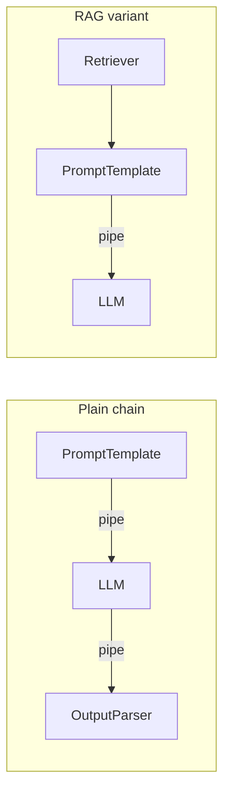

# LangChain

## Overview

LangChain is an open-source Python framework for building applications powered by Large Language Models (LLMs). It helps you connect an LLM with prompts, external data, databases, APIs, tools, and other software components to build useful AI applications. 

For your Python backend and Generative AI learning, think of LangChain as the integration layer between an LLM and the rest of your application.

## Data Flow Diagram — LCEL Chain Composition



Every block implements the same `Runnable` interface, so the same `|` syntax composes a plain chain or a retrieval-augmented one.

## Interview Q&A

### Easy — Screening Round


## E1. What Problem Does LangChain Solve?

### 1. Introduction

**LangChain is a framework that simplifies the development of applications powered by Large Language Models (LLMs).**

We can call an LLM directly using a provider's API, but building a complete AI application often requires more than sending a prompt and receiving a response.

For example, an AI application may need to:
- Create and manage prompts dynamically.
- Connect an LLM with external data, such as PDFs, documents, and databases.
- Retrieve relevant information using Retrieval-Augmented Generation (RAG).
- Connect models with tools, APIs, and external services.
- Combine multiple processing steps into a workflow.
- Parse and validate model outputs.
- Handle retries, failures, and alternative models.
- Maintain conversation history or agent state.

LangChain provides reusable components and a common interface to help developers build these workflows without implementing every integration and processing step from scratch.

### 2. What Problem Does LangChain Solve?

Consider a requirement to build an AI-powered document question-answering application.

A user asks:

> What is the company's leave policy?

The application must:
1. Accept the user's question.
2. Search company documents for relevant information.
3. Select the most relevant content.
4. Construct a prompt containing the question and retrieved context.
5. Send the prompt to an LLM.
6. Return a useful answer based on the available information.

Without a framework, we must implement and connect these steps ourselves. LangChain provides components that help organize and compose this workflow.

### 3. Without LangChain vs. With LangChain

#### Without LangChain

We typically write custom code to coordinate the complete workflow.

```python
# Simplified example without LangChain

def answer_question(question):
    documents = search_documents(question)

    context = "\n".join(documents)

    prompt = f"""
    Answer the question using the context below.

    Context:
    {context}

    Question:
    {question}
    """

    response = call_llm_api(prompt)

    return response
```

Here, `search_documents()` and `call_llm_api()` represent functions that we must implement using our chosen search system and model provider.

As the application grows, we may also need custom code for prompt management, output validation, retries, model switching, and multi-step workflows.

#### With LangChain

LangChain provides components that can be connected into a reusable pipeline.

```python
from langchain_core.prompts import ChatPromptTemplate
from langchain_core.output_parsers import StrOutputParser

prompt = ChatPromptTemplate.from_template(
    """
    Answer the question using the context below.

    Context:
    {context}

    Question:
    {question}
    """
)

# Assume llm is a configured chat model.
chain = prompt | llm | StrOutputParser()

result = chain.invoke({
    "context": "Employees receive 20 days of annual leave.",
    "question": "How many annual leave days do employees receive?"
})

print(result)
```

**Note:** This example assumes that `llm` has already been configured. The context is supplied directly, so document retrieval is not implemented here. A retriever can be added to build a complete RAG workflow.

The `|` operator uses LangChain Expression Language (LCEL) to connect components. The output of one component becomes the input of the next.

### 4. Key Problems LangChain Helps Solve

| Problem | How LangChain Helps |
|---|---|
| Prompt management | Provides reusable prompt templates with variables. |
| Model integration | Offers standardized interfaces for supported model providers. |
| Data integration | Provides document loaders, text splitters, and integrations for vector stores and retrievers. |
| RAG applications | Helps compose retrieval, prompt construction, model calls, and output parsing. |
| Workflow composition | Connects multiple components using LCEL and Runnables. |
| Tool integration | Helps connect LLMs with functions, APIs, and external tools. |
| Output handling | Provides output parsers and structured-output integrations. |
| Reliability | Supports retry and fallback patterns for compatible components. |
| Conversation workflows | Provides components for conversation history; more advanced agent state and persistence can use LangGraph. |

### 5. Real-World Example: Company Knowledge Assistant

Suppose a company wants an AI assistant that answers employees' questions using internal HR documents.

**Data flow:**

```text
Employee Question
       |
       v
Question Processing
       |
       v
Document Retriever
       |
       v
Relevant HR Documents
       |
       v
Prompt Template
       |
       v
LLM (GPT / Other Supported Model)
       |
       v
Output Parser
       |
       v
Answer to Employee
```

LangChain helps connect these components into a coherent application workflow.

For a production application, we would also consider access control, document permissions, monitoring, evaluation, error handling, and protection against sensitive-data leakage. LangChain does not automatically solve these concerns.

### 6. Does LangChain Replace an LLM API?

**No.** LangChain does not replace the underlying LLM.

It acts as an orchestration and integration layer around models and other application components.

For example:

- **LLM provider:** Generates the response.
- **LangChain:** Helps organize prompts, model calls, retrieval, tools, and output processing.
- **Vector database:** Stores and searches vector embeddings.
- **Application backend:** Handles business logic, authentication, authorization, and API endpoints.

We can also call an LLM directly without LangChain. For a simple application with one model call, using the provider's SDK directly may be easier.

### 7. When Should We Use LangChain?

Use LangChain when:
- Building RAG-based applications over documents or databases.
- Integrating multiple LLM providers or external tools.
- Creating multi-step LLM workflows.
- Reusing prompt templates and output-processing components.
- Building applications that combine retrieval, tools, and model calls.

Consider a direct model API when the application only needs a straightforward model request and response.

For complex, stateful agent workflows, **LangGraph** can provide explicit state management, branching, persistence, and control over execution.

### 8. Interview Answer

LangChain solves the problem of building and coordinating LLM-powered applications. Calling an LLM API directly is sufficient for simple use cases, but real-world applications often require prompt templates, document retrieval, RAG, tool integration, output parsing, retries, and multi-step workflows.

LangChain provides reusable components and standardized interfaces that help us connect these pieces into a maintainable pipeline. For example, in a company knowledge assistant, we can retrieve relevant documents, insert them into a prompt, invoke an LLM, and parse the response using a LangChain workflow.

However, LangChain is optional. For simple model calls, a direct API may be sufficient, while LangGraph is useful when we need more explicit control over complex, stateful agent workflows.

### 9. Key Takeaway

**LangChain helps us move from a standalone LLM API call to a composed AI application by providing reusable components for prompts, models, retrieval, tools, and output processing.**


### **E2. What is a "Runnable" in LangChain?**

### 1. What Is a Runnable?

A **Runnable** is a standard interface in LangChain that represents a unit of work that can be executed as part of an LLM application.

A Runnable could be:

- A prompt template that formats input.
- An LLM that generates a response.
- A retriever that searches for relevant documents.
- A Python function that transforms data.
- A complete chain that combines multiple operations.

LangChain provides a common interface for executing and composing these components.

The most commonly used Runnable methods include:

| Method | Purpose |
|---|---|
| `.invoke()` | Executes a Runnable with one input. |
| `.batch()` | Processes multiple inputs. |
| `.stream()` | Streams output chunks when supported. |
| `.ainvoke()` | Executes a Runnable asynchronously. |
| `.abatch()` | Processes multiple inputs asynchronously. |
| `.astream()` | Streams output asynchronously when supported. |

**Key idea:** A Runnable gives different components a common way to execute and connect with one another.

---

### 2. Example: A PromptTemplate Is a Runnable

```python
from langchain_core.prompts import PromptTemplate

prompt = PromptTemplate.from_template(
    "Explain {topic} in simple terms."
)

result = prompt.invoke({
    "topic": "Python decorators"
})

print(result)
print(result.text)
```

**Output:**

```text
text='Explain Python decorators in simple terms.'
Explain Python decorators in simple terms.
```

**Explanation:**

1. `PromptTemplate` is a Runnable.
2. `.invoke()` passes the input dictionary to it.
3. The template inserts the value of `topic`.
4. The result is a formatted prompt value.

Notice that this example does not call an LLM. The prompt Runnable only formats the input.

---

### 3. Example: A Python Function as a Runnable

LangChain provides `RunnableLambda` to wrap a Python function in the Runnable interface.

```python
from langchain_core.runnables import RunnableLambda

def uppercase_text(text: str) -> str:
    return text.upper()

runnable = RunnableLambda(uppercase_text)

result = runnable.invoke("hello langchain")

print(result)
```

**Output:**

```text
HELLO LANGCHAIN
```

**Explanation:**

- `uppercase_text()` is an ordinary Python function.
- `RunnableLambda()` wraps the function as a Runnable.
- `.invoke()` executes it using the Runnable interface.

This lets us combine custom Python logic with other LangChain components.

---

### 4. Why Do We Need Runnables?

Without a common interface, we would need to manage each component's execution and integration separately.

For example:

```python
# Conceptual workflow without Runnable composition

formatted_prompt = prompt.format(topic="FastAPI")

response = llm.invoke(formatted_prompt)
```

With Runnables, we can connect compatible components using the pipe (`|`) operator.

```python
from langchain_core.prompts import PromptTemplate
from langchain_openai import ChatOpenAI

prompt = PromptTemplate.from_template(
    "Explain {topic} in two sentences."
)

llm = ChatOpenAI(model="gpt-4.1-mini")

chain = prompt | llm

response = chain.invoke({
    "topic": "FastAPI"
})

print(response.content)
```

**Data flow:**

```text
Input dictionary
      |
      v
PromptTemplate
      |
      v
Formatted prompt
      |
      v
ChatOpenAI
      |
      v
AI response
```

Here, both the prompt and the model support the Runnable interface, so LangChain can compose them into one chain.

**Note:** This example requires the `langchain-core` and `langchain-openai` packages, a configured OpenAI API key, and access to the selected model.

---

### 5. What Does the `|` Operator Mean?

In LangChain's Runnable system, the `|` operator composes two compatible components into a sequence.

```python
chain = prompt | llm
```

This means:

1. Pass the input to `prompt`.
2. Pass the prompt's output to `llm`.
3. Return the model's output.

We can add more components:

```python
chain = prompt | llm | RunnableLambda(
    lambda response: response.content
)
```

Now the output of the model is transformed into a plain string containing its text.

**Important:** The `|` operator does not mean logical OR here. LangChain defines composition behavior for Runnables using this operator.

---

### 6. RunnableSequence and RunnableParallel

LangChain supports different ways to compose Runnables.

#### A. RunnableSequence

Executes components sequentially, passing each component's output to the next.

```python
from langchain_core.runnables import RunnableLambda

add_two = RunnableLambda(lambda x: x + 2)
multiply_by_three = RunnableLambda(lambda x: x * 3)

chain = add_two | multiply_by_three

print(chain.invoke(4))
```

**Output:**

```text
18
```

**Execution:**

```text
Input: 4
   |
   v
Add 2: 6
   |
   v
Multiply by 3: 18
```

#### B. RunnableParallel

Runs multiple Runnables against the same input and collects their results into a dictionary. The branches can execute concurrently.

```python
from langchain_core.runnables import (
    RunnableLambda,
    RunnableParallel
)

analysis = RunnableLambda(
    lambda text: f"Analysis: {text}"
)

summary = RunnableLambda(
    lambda text: f"Summary: {text}"
)

chain = RunnableParallel(
    analysis=analysis,
    summary=summary
)

result = chain.invoke("FastAPI is a Python API framework.")

print(result)
```

**Output:**

```python
{
    'analysis': 'Analysis: FastAPI is a Python API framework.',
    'summary': 'Summary: FastAPI is a Python API framework.'
}
```

This is useful when multiple independent operations need to process the same input.

---

### 7. How Are Runnables Used in a RAG Application?

In a RAG pipeline, we can compose a retriever, a prompt, and an LLM using Runnables.

```text
User question
      |
      v
Retriever Runnable
      |
      v
Relevant Documents
      |
      v
Prompt Runnable
      |
      v
LLM Runnable
      |
      v
Generated answer
```

Each component performs a specific task:

- **Retriever:** Finds relevant document chunks.
- **Prompt:** Combines the retrieved context with the user's question.
- **LLM:** Generates an answer using the resulting prompt.

The Runnable interface allows these components to be connected without manually managing every transition between them.

---

### 8. Runnable vs. Chain

| Runnable | Chain |
|---|---|
| A common interface for executable components and composed workflows. | A term commonly used for a workflow that connects multiple operations. |
| Can represent one operation or an entire sequence. | Often consists of multiple operations. |
| Supports standard methods such as `.invoke()` and `.batch()`. | Modern LangChain chains commonly use the Runnable interface. |

In modern LangChain, many components and chains implement the Runnable interface. Therefore, these terms are related rather than mutually exclusive.

---

### 9. Interview Answer

**Question: What is a Runnable in LangChain?**

A Runnable is a standard interface in LangChain that allows components such as prompt templates, LLMs, retrievers, and custom Python functions to be executed and composed consistently.

It provides methods such as `.invoke()`, `.batch()`, `.stream()`, and their asynchronous equivalents. We can use the pipe (`|`) operator to connect compatible Runnables into a workflow.

For example, `prompt | llm` creates a sequence where the prompt formats the input and passes it to the model. In a RAG application, we can use the same concept to connect retrieval, prompt construction, and LLM generation.

**In short:** A Runnable is the common execution interface that makes LangChain components composable.


### **E3. What is a `PromptTemplate`, and why not just use an f-string?**

### 1. What is a `PromptTemplate`?

A `PromptTemplate` is a reusable template used to construct prompts dynamically by inserting variables into predefined instructions or text.

In LangChain, `PromptTemplate` helps separate prompt instructions from application logic. It allows us to define a prompt once and supply different input values whenever we need to invoke an LLM.

**Example: Using LangChain `PromptTemplate`**

```python
from langchain_core.prompts import PromptTemplate

prompt = PromptTemplate.from_template(
    "Explain {topic} in simple terms with one example."
)

formatted_prompt = prompt.format(topic="Python decorators")

print(formatted_prompt)
```

**Output:**

```text
Explain Python decorators in simple terms with one example.
```

Here, `{topic}` is a template variable. When we call `format()`, LangChain replaces it with the supplied value.

---

### 2. Why Not Just Use an f-string?

Python f-strings are excellent for simple string formatting. However, `PromptTemplate` offers additional capabilities that are useful when building LLM applications.

**Example: Using an f-string**

```python
topic = "Python decorators"

prompt = f"Explain {topic} in simple terms with one example."

print(prompt)
```

This works perfectly for a simple prompt. However, as an application grows, we may need reusable templates, input validation, composition with other LangChain components, and integration with an LLM pipeline.

**Example: Using `PromptTemplate`**

```python
from langchain_core.prompts import PromptTemplate

prompt_template = PromptTemplate(
    input_variables=["topic", "level"],
    template=(
        "Explain {topic} for a {level} developer. "
        "Include one practical example."
    )
)

prompt = prompt_template.format(
    topic="FastAPI dependency injection",
    level="beginner"
)

print(prompt)
```

**Output:**

```text
Explain FastAPI dependency injection for a beginner developer. Include one practical example.
```

---

### 3. Key Differences Between `PromptTemplate` and f-strings

| Feature | f-string | LangChain `PromptTemplate` |
|---|---|---|
| Dynamic values | Supported | Supported |
| Reusable prompt definition | Possible, but usually managed manually | Built into the template abstraction |
| Input validation | No template-specific validation | Can validate required input variables |
| LangChain pipeline integration | Requires additional integration | Integrates directly with LangChain runnables |
| Prompt composition | Managed manually | Can be composed with other LangChain components |
| Best suited for | Simple string formatting | Structured prompts in LLM applications |

**Important:** An f-string is not inherently worse or less secure. For a simple, one-off prompt, an f-string may be the simplest choice. `PromptTemplate` becomes more useful when prompt management and integration with an LLM pipeline matter.

---

### 4. Example: Integrating `PromptTemplate` with an LLM

A key advantage of `PromptTemplate` is that it can be composed with a model using LangChain's pipe (`|`) operator.

```python
from langchain_core.prompts import PromptTemplate
from langchain_openai import ChatOpenAI

prompt = PromptTemplate.from_template(
    "You are a Python mentor. Explain {concept} "
    "with a simple code example."
)

llm = ChatOpenAI(model="gpt-4.1-mini")

chain = prompt | llm

response = chain.invoke({
    "concept": "Python generators"
})

print(response.content)
```

**Data flow:**

```text
Input dictionary
      |
      v
PromptTemplate
      |
      v
Formatted prompt
      |
      v
ChatOpenAI model
      |
      v
LLM response
```

In this example:

1. The input dictionary supplies the `concept`.
2. `PromptTemplate` inserts it into the predefined instructions.
3. The formatted prompt is passed to the chat model.
4. The model generates a response.

**Note:** This example requires the `langchain-core` and `langchain-openai` packages, a configured OpenAI API key, and access to the selected model.

---

### 5. How Does `PromptTemplate` Help in RAG Applications?

In Retrieval-Augmented Generation (RAG), we retrieve relevant documents and include them in the prompt so that the LLM can answer using the available context.

```python
from langchain_core.prompts import PromptTemplate

rag_prompt = PromptTemplate.from_template("""
You are a helpful assistant.
Answer the question using only the context below.

Context:
{context}

Question:
{question}

If the answer is not available in the context,
say that you do not have enough information.
""")

formatted_prompt = rag_prompt.format(
    context="FastAPI is a Python framework for building APIs.",
    question="What is FastAPI?"
)

print(formatted_prompt)
```

**How it works:**

- `{context}` receives the retrieved document text.
- `{question}` receives the user's question.
- The instructions guide the model to base its answer on the supplied context.

This makes the prompt reusable across different user questions and retrieved documents.

**Important:** Prompt instructions can reduce unsupported answers, but they do not guarantee that an LLM will never hallucinate.

---

### 6. Does `PromptTemplate` Automatically Improve LLM Responses?

No. `PromptTemplate` does not inherently make a model more intelligent or guarantee better answers.

Its main benefits are:

- Reusability and consistency.
- Clear separation between prompt instructions and application code.
- Easier integration into LangChain pipelines.
- Better organization of prompts as an application grows.

The quality of the response still depends on the instructions, input data, retrieved context, model, and other application design choices.

---

### 7. Interview Answer

**Question: What is a `PromptTemplate`, and why not just use an f-string?**

A `PromptTemplate` is a reusable prompt definition in LangChain that allows us to insert dynamic variables into predefined instructions. We can use f-strings for simple prompt construction, but `PromptTemplate` is more convenient in larger LLM applications because it supports template input validation and integrates directly with LangChain chains and runnables.

For example, in a RAG application, we can define a template containing `{context}` and `{question}` once and supply different retrieved documents and user questions for each request. This improves maintainability and consistency without requiring us to rebuild the prompt manually each time.

**In short:** Use an f-string for simple string formatting; use `PromptTemplate` when you want reusable, structured prompts integrated into a LangChain application.


**E4. What's the difference between `.invoke()` and `.stream()` on a Runnable?**
`.invoke()` runs the whole chain and returns the complete result in a single call. `.stream()` returns that same eventual result but yields it incrementally — chunk by chunk, e.g. token by token from an LLM — as it becomes available, so a UI can start displaying output before the full response is ready.


### **E4. What is a `Document` in LangChain, concretely?**

### 1. What Is a `Document`?

In LangChain, a `Document` is a data structure that stores a piece of text along with metadata describing that text.

It has two main attributes:

- **`page_content`**: The actual text or content.
- **`metadata`**: Additional information about the content, such as the source file, page number, document ID, or category.

A `Document` is not necessarily an entire file. It can represent a complete file, a page, a paragraph, or a chunk of text, depending on how the data is loaded and split.

**Import:**

```python
from langchain_core.documents import Document
```

### 2. Creating a `Document` from Scratch

```python
from langchain_core.documents import Document

doc = Document(
    page_content="FastAPI is a Python framework for building APIs.",
    metadata={
        "source": "fastapi_guide.pdf",
        "page": 5,
        "category": "backend"
    }
)

print("Content:", doc.page_content)
print("Metadata:", doc.metadata)
```

**Output:**

```text
Content: FastAPI is a Python framework for building APIs.
Metadata: {'source': 'fastapi_guide.pdf', 'page': 5, 'category': 'backend'}
```

**Explanation:**

- `page_content` contains the information we want to search or provide to an LLM.
- `metadata` tells us where that information came from and provides additional context.
- The metadata is separate from the text itself.

For example, if this document is retrieved during a RAG search, the application can use its metadata to identify the source and page of the information.

---

### 3. Why Do We Need `Document` Instead of a Normal String?

We can store text in a normal Python string:

```python
text = "FastAPI is a Python framework for building APIs."
```

However, a string does not automatically carry structured source information.

With a LangChain `Document`:

```python
from langchain_core.documents import Document

doc = Document(
    page_content="FastAPI is a Python framework for building APIs.",
    metadata={"source": "backend_notes.pdf", "page": 3}
)
```

We can keep both the content and its source information together.

| Feature | Normal string | LangChain `Document` |
|---|---|---|
| Stores text | Yes | Yes |
| Stores structured metadata | Not built in | Yes |
| Represents source information | Must be managed separately | Can be stored in `metadata` |
| Used by LangChain document loaders and retrievers | Requires adaptation in many workflows | Designed for these workflows |

A `Document` is particularly useful when working with multiple files, chunks, search results, and citations.

---

### 4. How Is `Document` Used in a RAG Pipeline?

In RAG (Retrieval-Augmented Generation), documents are commonly loaded, split into chunks, converted into embeddings, and stored in a vector database.

A retriever then returns relevant documents for a user's question.

```text
PDF / Website / Database
          |
          v
     Load the data
          |
          v
    Split into chunks
          |
          v
  Create Document objects
  (page_content + metadata)
          |
          v
   Generate embeddings
          |
          v
    Store in vector DB
          |
          v
 User asks a question
          |
          v
 Retrieve relevant Documents
          |
          v
 Extract page_content
 and build the prompt
          |
          v
        LLM answer
```

**Important:** In an actual implementation, a document loader may create `Document` objects before splitting. A text splitter commonly creates smaller `Document` objects from those original documents, often preserving or copying their metadata.

---

### 5. Practical Example: Creating Document Chunks

Suppose we have a company knowledge-base article:

```text
Our company uses FastAPI to build REST APIs.
PostgreSQL is our primary relational database.
Redis is used for caching frequently accessed data.
```

We can represent the content as a `Document` and split it into smaller chunks.

```python
from langchain_core.documents import Document
from langchain_text_splitters import RecursiveCharacterTextSplitter

doc = Document(
    page_content=(
        "Our company uses FastAPI to build REST APIs. "
        "PostgreSQL is our primary relational database. "
        "Redis is used for caching frequently accessed data."
    ),
    metadata={
        "source": "engineering_guide.txt",
        "department": "engineering"
    }
)

splitter = RecursiveCharacterTextSplitter(
    chunk_size=60,
    chunk_overlap=10
)

chunks = splitter.split_documents([doc])

for index, chunk in enumerate(chunks, start=1):
    print(f"Chunk {index}: {chunk.page_content}")
    print(f"Metadata: {chunk.metadata}")
    print()
```

**What happens here?**

1. We create a `Document` containing the article text and metadata.
2. The text splitter divides the content into smaller chunks.
3. Each chunk is represented as a `Document`.
4. The chunks generally retain the original metadata, so the application can trace them back to their source.

The exact chunk boundaries depend on the splitter and the configured size and overlap.

---

### 6. How Does a Retrieved `Document` Help Answer a Question?

Imagine a user asks:

> Which database does our company use?

A retriever might return a `Document` like this:

```python
Document(
    page_content="PostgreSQL is our primary relational database.",
    metadata={
        "source": "engineering_guide.txt",
        "department": "engineering"
    }
)
```

The application can use the retrieved document's `page_content` as context for the LLM and its metadata to identify the source.

For example:

```python
retrieved_doc = Document(
    page_content="PostgreSQL is our primary relational database.",
    metadata={"source": "engineering_guide.txt"}
)

context = retrieved_doc.page_content
question = "Which database does our company use?"

prompt = f"""
Answer the question using the context below.

Context: {context}
Question: {question}
Answer:
"""

print(prompt)
```

The LLM can use the supplied context to answer that PostgreSQL is the company's primary relational database.

**Note:** This final example uses an f-string to demonstrate prompt construction; it does not call an LLM or perform retrieval.

---

### 7. What Is the Difference Between `Document` and an Embedding?

These concepts serve different purposes:

| Concept | Purpose |
|---|---|
| `Document` | Stores text and associated metadata |
| Embedding | Represents text as a numerical vector |
| Vector database | Stores and searches vectors, often alongside document text and metadata |
| Retriever | Finds relevant documents for a query |
| LLM | Generates a response using the retrieved context |

A `Document` does not automatically contain an embedding. An embedding model generates the vector from text, and the vector store manages how vectors and associated data are stored and retrieved.

---

### 8. Interview Answer

**Question: What is a `Document` in LangChain, concretely?**

A `Document` is a LangChain data structure that contains `page_content` and `metadata`. The `page_content` holds the actual text, while the metadata stores details such as the source file, page number, or document category.

In a RAG application, document loaders create documents from sources such as PDFs and websites. We split them into smaller chunks, generate embeddings, and store them in a vector database. When a user asks a question, the retriever returns relevant documents, and we pass their content to the LLM as context. Metadata helps us track sources and apply appropriate filtering.

**In short:** A LangChain `Document` is a package of text plus metadata that helps manage, retrieve, and trace information in an LLM application.


### **E6. What is a Tool, and what does an LLM actually receive about it?**

### 1. What Is a Tool in Agentic AI?

A **Tool** is a function or capability that an AI agent can use to perform an action beyond generating text.

For example, an LLM can explain how to calculate the weather average, but it cannot retrieve live weather data from its internal knowledge alone. A weather tool can call an external API and return current weather information.

Common tools include:

- **Database tool:** Query a database.
- **Search tool:** Retrieve information from the web.
- **Calculator tool:** Perform mathematical calculations.
- **API tool:** Call an external service.
- **File tool:** Read or process files.
- **Python tool:** Execute approved Python code.

A tool generally consists of:
1. A **name** identifying the tool.
2. A **description** explaining what it does.
3. An **input schema** describing the arguments it accepts.
4. An **implementation** that performs the actual operation.

The LLM typically receives the tool's name, description, and input schema. The application or agent framework executes the actual function when the model requests the tool.

---

### 2. Example: Creating a Simple Python Tool

Suppose we want to provide an agent with a calculator tool.

```python
def multiply(a: int, b: int) -> int:
    """Multiply two integers and return the result."""
    return a * b


result = multiply(10, 5)

print(result)
```

**Output:**

```text
50
```

Here, `multiply()` is an ordinary Python function.

However, simply defining this function does not automatically make it available to an LLM. We must expose it through a supported tool-calling interface or agent framework.

---

### 3. What Does the LLM Actually Receive About a Tool?

The LLM does not normally receive the entire Python implementation of the tool. Instead, a tool-calling interface provides a description and a structured schema of the tool's arguments.

For example, the model may receive a tool definition conceptually equivalent to this:

```json
{
  "type": "function",
  "name": "multiply",
  "description": "Multiply two integers and return the result.",
  "parameters": {
    "type": "object",
    "properties": {
      "a": {
        "type": "integer",
        "description": "The first integer."
      },
      "b": {
        "type": "integer",
        "description": "The second integer."
      }
    },
    "required": ["a", "b"],
    "additionalProperties": false
  },
  "strict": true
}
```

**Explanation:**

| Field | Purpose |
|---|---|
| `name` | Identifies the function the model can request |
| `description` | Explains when and why the function should be used |
| `parameters` | Defines the expected input structure |
| `properties` | Describes each supported argument |
| `required` | Identifies mandatory arguments |
| `strict` | In supported APIs, enables stricter adherence to the declared schema |

The exact schema varies by provider and tool-calling framework. The JSON above is illustrative of a structured function definition; it is not the Python implementation itself.

**Key point:** The LLM learns how to request the tool from its description and schema. The application must still execute the function and enforce the relevant permissions and validations.

---

### 4. How Does the LLM Call a Tool?

Suppose the user asks:

> What is 10 multiplied by 5?

The model can determine that the `multiply` tool is appropriate and return a structured tool call.

Conceptually, the tool call looks like this:

```json
{
  "name": "multiply",
  "arguments": {
    "a": 10,
    "b": 5
  }
}
```

This is a **tool-call request**, not the final answer and not the result of executing the function.

The application then:

1. Receives the tool-call request.
2. Identifies the requested tool.
3. Validates the arguments.
4. Executes the corresponding Python function.
5. Sends the tool result back to the model.
6. Allows the model to produce the final response.

The LLM does not need to see the function's internal implementation to request it.

---

### 5. Complete Tool-Calling Data Flow

```text
User:
"What is 10 multiplied by 5?"
             |
             v
     LLM receives:
     - User question
     - Tool name
     - Tool description
     - Input schema
             |
             v
      LLM requests:
      multiply(a=10, b=5)
             |
             v
    Application / Agent Runtime
             |
             v
     Validate arguments
             |
             v
      Execute Python tool
             |
             v
       Result: 50
             |
             v
    Tool result sent to LLM
             |
             v
      Final LLM response
             |
             v
     "10 multiplied by 5 is 50."
```

**Important:** Tool execution happens in the application or agent runtime, not automatically inside the LLM. Some systems can execute tools through managed infrastructure, but the same conceptual separation remains.

---

### 6. Implementing a Tool with LangChain

LangChain allows us to turn a Python function into a tool using the `@tool` decorator.

```python
from langchain_core.tools import tool


@tool
def multiply(a: int, b: int) -> int:
    """Multiply two integers and return the result."""
    return a * b


print(multiply.name)
print(multiply.description)
print(multiply.args)
```

**Conceptual output:**

```text
multiply
Multiply two integers and return the result.
{
    'a': {'type': 'int', ...},
    'b': {'type': 'int', ...}
}
```

The precise representation of `multiply.args` may vary with the LangChain version.

The decorator creates a LangChain tool object with metadata and an input schema inferred from the function signature, type annotations, and docstring.

We can execute it directly:

```python
result = multiply.invoke({"a": 10, "b": 5})

print(result)
```

**Output:**

```text
50
```

This demonstrates the tool itself. It does not yet demonstrate an LLM choosing the tool automatically.

---

### 7. Connecting the Tool to an LLM

With a supported chat model, LangChain can bind tools so the model knows which tools it may request.

```python
from langchain_core.tools import tool
from langchain_openai import ChatOpenAI


@tool
def multiply(a: int, b: int) -> int:
    """Multiply two integers and return the result."""
    return a * b


llm = ChatOpenAI(model="gpt-4.1-mini")

llm_with_tools = llm.bind_tools([multiply])

response = llm_with_tools.invoke(
    "What is 10 multiplied by 5? Use the multiply tool."
)

print(response.tool_calls)
```

**Possible output:**

```python
[
    {
        "name": "multiply",
        "args": {"a": 10, "b": 5},
        "id": "call_example",
        "type": "tool_call"
    }
]
```

The call ID and exact output representation are illustrative. Actual values depend on the model response.

Notice that the code above prints the requested tool call; it does not execute the tool or complete the agent loop. To execute the tool and return its result to the model, we need an agent or an explicit orchestration loop.

---

### 8. Tool vs. LLM: Who Does What?

| Responsibility | LLM | Tool / Application |
|---|---|---|
| Understand the user's request | Yes | No, unless separately programmed |
| Decide which tool to request | Usually | An application may also enforce routing rules |
| Generate structured arguments | Yes, subject to the interface | Validate arguments |
| Execute the Python function | No, not by itself | Yes |
| Access a database or external API | Requests access through a tool | Performs the operation with its configured credentials |
| Interpret the tool result | Yes | Returns the result |
| Enforce permissions and security | Must not be trusted to enforce these alone | Must enforce authorization and validation |

A model's tool call is a request, not authorization. For example, a database tool must enforce user permissions even if the LLM requests a query.

---

### 9. What Makes a Good Tool Description?

A tool description helps the model understand when the tool should be used and what it does.

**Weak description:**

```python
@tool
def search_data(query: str) -> str:
    """Search."""
    ...
```

**Better description:**

```python
@tool
def search_data(query: str) -> str:
    """
    Search the approved company knowledge base for information
    relevant to the user's question. Use this tool for internal
    policies, technical documentation, and company procedures.
    """
    ...
```

A useful tool description should specify:

- What the tool does.
- When to use it.
- What kind of input it expects.
- Important limitations or restrictions.

A clear description improves tool selection, but it does not guarantee correct behavior. Input validation and access controls must be implemented separately.

---

### 10. Interview Answer

**Question: What is a Tool, and what does an LLM actually receive about it?**

A tool is an executable function or capability that allows an AI agent to interact with external systems, such as databases, APIs, search engines, or calculators.

The LLM typically receives the tool's name, description, and structured input schema, including argument names, types, and required fields. Based on the user's request, it can return a structured tool-call request with the appropriate arguments.

The application or agent runtime validates the request, executes the actual function, and sends the result back to the LLM so it can generate the final response. The model does not normally receive or execute the underlying Python implementation directly.

For example, a calculator tool may expose `multiply(a: int, b: int)`. When the user asks for `10 × 5`, the LLM can request `multiply(a=10, b=5)`, the application executes the function, and the result `50` is returned to the model.

**In short:** The LLM receives the tool's interface and requests its use; the application executes the tool and returns the result.


**E7. What is a text splitter, and why is it needed before embedding documents?**
A component that breaks long text into smaller, usually overlapping chunks. It's needed because embedding models and LLM context windows both have hard size limits, and because retrieval works better over focused chunks than over one giant document — a query about one paragraph shouldn't have to pull in an entire unrelated document just because they happen to be in the same file.


### **E8. What does `.batch()` do on a Runnable, and when would you use it instead of calling `.invoke()` in a loop?**

### 1. What Is `.batch()` in LangChain?

In LangChain, `.batch()` is a method available on Runnables that allows us to process multiple inputs through the same Runnable.

Instead of calling `.invoke()` separately for every input, we pass a list of inputs to `.batch()`.

**Using `.invoke()` repeatedly:**

```python
from langchain_core.prompts import PromptTemplate

prompt = PromptTemplate.from_template(
    "Explain {topic} in one sentence."
)

topics = ["Python", "FastAPI", "LangChain"]

for topic in topics:
    result = prompt.invoke({"topic": topic})
    print(result.text)
```

**Using `.batch()`:**

```python
from langchain_core.prompts import PromptTemplate

prompt = PromptTemplate.from_template(
    "Explain {topic} in one sentence."
)

inputs = [
    {"topic": "Python"},
    {"topic": "FastAPI"},
    {"topic": "LangChain"}
]

results = prompt.batch(inputs)

for result in results:
    print(result.text)
```

Both approaches process the three inputs and produce the corresponding formatted prompts.

**Key point:** `.batch()` accepts multiple inputs and returns the results in the same order as the inputs, assuming the call completes successfully.

---

### 2. What Happens Internally?

When we call `.batch()`, LangChain uses the Runnable's batch implementation.

The default implementation can execute individual invocations concurrently using a thread pool. However, a Runnable or integration can override this behavior to use a more efficient batch operation.

Conceptually:

```text
          List of Inputs
                 |
                 v
          Runnable.batch()
                 |
         +-------+-------+
         |       |       |
         v       v       v
       Input 1 Input 2 Input 3
         |       |       |
         v       v       v
       Result  Result  Result
         1       2       3
                 |
                 v
          List of Results
```

The exact execution strategy depends on the Runnable implementation.

**Important:** `.batch()` does not automatically guarantee a single API request or lower cost. It is a batching interface; the underlying implementation determines whether work is concurrent, combined into one request, or processed another way.

---

### 3. Example with an LLM

Consider a scenario where we want an LLM to explain several Python concepts.

```python
from langchain_core.prompts import PromptTemplate
from langchain_openai import ChatOpenAI

prompt = PromptTemplate.from_template(
    "Explain {topic} in two sentences."
)

llm = ChatOpenAI(model="gpt-4.1-mini")

chain = prompt | llm

inputs = [
    {"topic": "Python decorators"},
    {"topic": "Python generators"},
    {"topic": "Python context managers"}
]

results = chain.batch(inputs)

for result in results:
    print(result.content)
    print("-" * 40)
```

**How it works:**

1. `PromptTemplate` formats each input.
2. The formatted prompt is passed to the chat model.
3. `.batch()` processes the list through the composed Runnable.
4. The results are returned as a list in input order.

This is useful for processing independent requests, such as summarizing multiple documents or generating descriptions for several records.

**Note:** This example requires the `langchain-core` and `langchain-openai` packages, an API key, and access to the selected model. Actual responses will vary.

---

### 4. `.invoke()` in a Loop vs. `.batch()`

| Feature | `.invoke()` in a loop | `.batch()` |
|---|---|---|
| Input | One input per call | List of inputs |
| Code simplicity | Requires an explicit loop | Processes a list directly |
| Default execution | Sequential if called normally in a loop | Can use concurrent execution |
| Result handling | Collect results manually | Returns a list of results |
| Ordering | Follows loop order | Results correspond to input order |
| API request count | Depends on the number of invocations | Depends on the Runnable and provider implementation |
| Best suited for | Sequential work or dependent operations | Independent inputs processed through the same Runnable |

For independent inputs, `.batch()` is often more convenient and may improve throughput when the Runnable supports concurrent execution.

---

### 5. Example: Limiting Concurrency with `max_concurrency`

When calling an LLM for many inputs, unrestricted concurrency can cause rate-limit errors or put too much load on a service.

LangChain supports a `max_concurrency` option in the default batch configuration.

```python
results = chain.batch(
    inputs,
    config={"max_concurrency": 2}
)
```

This requests a maximum of two concurrent executions for implementations that honor the default concurrency configuration.

**Why is this useful?**

- Helps control simultaneous requests.
- Can reduce pressure on external APIs.
- Can help manage rate limits.
- Makes large workloads easier to control.

However, concurrency limits alone do not guarantee that you will stay within a provider's requests-per-minute or tokens-per-minute limits. You may also need rate limiting, retries, or backoff.

---

### 6. What If One Input Fails?

By default, a batch call generally raises an exception if an input fails.

You can use `return_exceptions=True` to collect exceptions alongside successful results.

```python
results = chain.batch(
    inputs,
    config={"max_concurrency": 2},
    return_exceptions=True
)

for index, result in enumerate(results):
    if isinstance(result, Exception):
        print(f"Input {index} failed: {result}")
    else:
        print(f"Input {index} succeeded: {result.content}")
```

This is useful when processing many independent records and you want to handle individual failures without losing access to successful results.

The exact exceptions depend on the underlying Runnable, model provider, and failure type.

---

### 7. When Should You Use `.batch()`?

Use `.batch()` when:

- You have many independent inputs.
- Every input needs to pass through the same Runnable or chain.
- You want simpler result collection.
- Concurrent processing can improve throughput.
- You want to configure concurrency or handle individual failures.

**Example use cases:**

- Summarizing 100 independent documents.
- Classifying customer feedback records.
- Generating embeddings or descriptions for multiple items, where the integration supports batching.
- Extracting structured information from many independent text records.

### When Should You Use `.invoke()` Instead?

Use `.invoke()` when:

- You have only one input.
- The next operation depends on the result of the previous operation.
- You need to inspect or validate a result before deciding what to do next.
- Your workflow requires strict sequential execution.

For example, if step two depends on the output of step one, calling `.invoke()` sequentially may be the more appropriate design.

---

### 8. Important Distinction: `.batch()` vs. `.abatch()`

| Method | Purpose |
|---|---|
| `.invoke()` | Process one input synchronously |
| `.batch()` | Process multiple inputs using the Runnable's batch implementation |
| `.ainvoke()` | Process one input asynchronously |
| `.abatch()` | Process multiple inputs asynchronously |

Use `.batch()` in synchronous code. Use `.abatch()` when working within an asynchronous workflow, such as an async FastAPI endpoint, and you want to await multiple Runnable inputs.

These methods do not necessarily map to one provider API request. Their actual execution depends on the Runnable implementation.

---

### 9. Interview Answer

**Question: What does `.batch()` do on a Runnable, and when would you use it instead of calling `.invoke()` in a loop?**

In LangChain, `.batch()` processes multiple inputs through the same Runnable and returns a list of results in the corresponding input order. The default implementation can run invocations concurrently, while specialized Runnables may implement more efficient batching.

I would use `.batch()` for independent workloads, such as summarizing multiple documents or classifying customer feedback, because it simplifies the code and may improve throughput. I would use `.invoke()` in a loop when processing must be sequential or when each operation depends on the previous result.

I would also configure `max_concurrency` when necessary and use `return_exceptions=True` if I need to handle individual failures.

**In short:** Use `.batch()` for multiple independent inputs; use `.invoke()` for one input or sequential workflows.

### Medium — Technical Round


## M1. What is LCEL?

### 1. What Is LCEL?

**LCEL (LangChain Expression Language)** is a declarative way to compose LangChain components into a workflow using the pipe (`|`) operator.

It allows us to connect components such as:

- `PromptTemplate` — formats input into a prompt.
- `ChatModel` — generates an AI response.
- `Retriever` — retrieves relevant documents.
- `RunnableLambda` — executes custom Python logic.
- `RunnableParallel` — executes multiple operations on the same input.

LCEL builds on LangChain's **Runnable interface**, which provides standard execution methods such as `.invoke()`, `.batch()`, `.stream()`, and their asynchronous equivalents.

**In simple words:** LCEL lets us connect multiple operations into a chain without manually writing the code that passes the output of one step into the next.

---

### 2. Basic LCEL Syntax

The basic syntax is:

```python
chain = component_1 | component_2 | component_3
```

The output of each component becomes the input to the next component.

For example:

```text
Input
  |
  v
PromptTemplate
  |
  v
ChatModel
  |
  v
Output Parser
  |
  v
Final String
```

This is called a `RunnableSequence` when the components are composed sequentially.

---

### 3. Example Without LCEL

Suppose we want to generate an explanation of Python decorators using an LLM.

Without LCEL, we can call each component manually:

```python
from langchain_core.prompts import PromptTemplate
from langchain_openai import ChatOpenAI

prompt = PromptTemplate.from_template(
    "Explain {topic} in simple terms."
)

llm = ChatOpenAI(model="gpt-4.1-mini")

# Step 1: Format the prompt
formatted_prompt = prompt.invoke({
    "topic": "Python decorators"
})

# Step 2: Pass the formatted prompt to the LLM
response = llm.invoke(formatted_prompt)

# Step 3: Extract the response text
print(response.content)
```

Here, we manually manage the transition between the prompt and the model.

---

### 4. Example Using LCEL

We can compose the same workflow using LCEL:

```python
from langchain_core.prompts import PromptTemplate
from langchain_openai import ChatOpenAI
from langchain_core.output_parsers import StrOutputParser

prompt = PromptTemplate.from_template(
    "Explain {topic} in simple terms."
)

llm = ChatOpenAI(model="gpt-4.1-mini")

chain = prompt | llm | StrOutputParser()

result = chain.invoke({
    "topic": "Python decorators"
})

print(result)
```

**How it works:**

1. `prompt` receives the input dictionary and formats the prompt.
2. `llm` receives the formatted prompt and generates a response.
3. `StrOutputParser()` extracts the response as a plain string.
4. `.invoke()` executes the complete chain.

**Note:** This example requires `langchain-core` and `langchain-openai`, a configured OpenAI API key, and access to the selected model. The actual generated text will vary.

---

### 5. LCEL Data Flow

```text
Input Dictionary
{"topic": "Python decorators"}
            |
            v
    PromptTemplate
            |
            v
  Formatted PromptValue
            |
            v
       ChatModel
            |
            v
      AI Message
            |
            v
   StrOutputParser
            |
            v
     Plain String
```

Each component has one responsibility, making the workflow easier to understand and maintain.

---

### 6. Why Do We Use LCEL?

LCEL provides several practical advantages.

| Feature | Benefit |
|---|---|
| Composition with `|` | Connects compatible components with concise syntax. |
| Standard Runnable interface | Supports invocation, batching, and streaming where implemented. |
| Async execution | Supports asynchronous workflows through methods such as `.ainvoke()` and `.astream()`. |
| Parallel execution | Supports independent operations through `RunnableParallel`. |
| Streaming | Allows intermediate or generated output to be streamed when supported by the components. |
| Reusability | Allows a composed chain to be reused with different inputs. |

**Important:** LCEL provides the composition interface, but the performance and execution behavior depend on the individual components and their implementations. It does not automatically make every operation faster or guarantee streaming from every model.

---

### 7. Example: LCEL with RunnableLambda

We can also include our own Python functions in an LCEL chain.

```python
from langchain_core.runnables import RunnableLambda

def add_prefix(text: str) -> str:
    return f"Result: {text}"

def convert_to_uppercase(text: str) -> str:
    return text.upper()

chain = (
    RunnableLambda(add_prefix)
    | RunnableLambda(convert_to_uppercase)
)

result = chain.invoke("hello langchain")

print(result)
```

**Output:**

```text
RESULT: HELLO LANGCHAIN
```

**Execution:**

```text
Input: "hello langchain"
            |
            v
add_prefix()
            |
            v
"Result: hello langchain"
            |
            v
convert_to_uppercase()
            |
            v
"RESULT: HELLO LANGCHAIN"
```

This demonstrates that LCEL is not limited to LLMs. It can compose custom Python functions and other compatible Runnables.

---

### 8. LCEL in a RAG Application

LCEL is commonly used to compose the steps of a Retrieval-Augmented Generation (RAG) pipeline.

```text
User Question
      |
      v
Retriever
      |
      v
Relevant Documents
      |
      v
PromptTemplate
      |
      v
ChatModel
      |
      v
Output Parser
      |
      v
Final Answer
```

For example, a RAG chain might:

1. Receive a user's question.
2. Retrieve relevant chunks from a vector database.
3. Insert the chunks and question into a prompt.
4. Send the prompt to the LLM.
5. Return the answer as a string.

LCEL helps compose these steps, while the retriever and vector store handle document search.

---

### 9. LCEL vs. Runnable

| LCEL | Runnable |
|---|---|
| A language and syntax for composing workflows. | The interface implemented by executable components. |
| Uses expressions such as `prompt \| llm`. | Provides methods such as `.invoke()` and `.batch()`. |
| Defines how components are connected. | Defines how a component or composed workflow can be executed. |

**Relationship:** LCEL uses the Runnable interface to compose components into executable chains.

---

### 10. Interview Answer

**Question: What is LCEL?**

LCEL stands for LangChain Expression Language. It is a declarative way to compose LangChain components into workflows using the pipe (`|`) operator.

It allows us to connect prompts, chat models, retrievers, and output parsers into a single Runnable sequence. For example, `prompt | llm | StrOutputParser()` formats the input, generates a model response, and converts that response into a plain string.

LCEL also supports standard Runnable capabilities such as batching, asynchronous execution, and streaming when supported by the underlying components. It is especially useful for building reusable LLM and RAG pipelines.

**In short:** LCEL is LangChain's composition syntax for connecting Runnables into an executable workflow.


## M2. Chains vs. Agents, in LangChain Terms

### 1. What Is a Chain?

A **chain** is a workflow in which components are connected to process input and produce output.

In modern LangChain, chains are commonly composed using LCEL and the Runnable interface.

A chain follows a predefined execution flow. For example, we decide that the input must pass through a prompt template, then an LLM, and finally an output parser.

**Example:**

```python
from langchain_core.prompts import PromptTemplate
from langchain_core.output_parsers import StrOutputParser
from langchain_openai import ChatOpenAI

prompt = PromptTemplate.from_template(
    "Explain {topic} in two sentences."
)

llm = ChatOpenAI(model="gpt-4.1-mini")

chain = prompt | llm | StrOutputParser()

result = chain.invoke({
    "topic": "Python decorators"
})

print(result)
```

**Data flow:**

```text
User Input
    |
    v
PromptTemplate
    |
    v
ChatModel
    |
    v
Output Parser
    |
    v
Final Answer
```

The execution sequence is defined by us. The chain does not independently decide to call an arbitrary tool or change its workflow based on its reasoning.

**Typical use cases:**
- Text summarization
- Translation
- Text classification
- Structured information extraction
- Standard RAG pipelines

---

### 2. What Is an Agent?

An **agent** uses an LLM to decide which action to take next, often choosing from a set of available tools.

Instead of specifying every action in advance, we provide the model with:
- The user's request
- Instructions
- Available tools and their descriptions
- Relevant conversation or execution state

The model can then request a tool call. The agent runtime executes the tool, returns its result to the model, and continues until a stopping condition is reached.

**Example scenario:**

User asks:

> What is the weather in Bengaluru, and should I carry an umbrella?

An agent might:
1. Call a weather tool.
2. Inspect the returned conditions or forecast.
3. Decide whether more information is needed.
4. Provide a recommendation based on the tool result.

**Data flow:**

```text
User Request
     |
     v
   Agent LLM
     |
     v
Choose an Action
     |
     v
Weather Tool
     |
     v
Tool Result
     |
     v
   Agent LLM
     |
     v
 Final Answer
```

The exact number of tool calls depends on the request and the agent's control logic.

**Typical use cases:**
- Multi-step research
- Calling external APIs
- Database operations
- Workflows that require selecting different tools
- Tasks where the next action depends on a previous result

---

### 3. Key Differences Between Chains and Agents

| Feature | Chain | Agent |
|---|---|---|
| Execution flow | Usually predefined | Can be selected dynamically by the LLM |
| Next step | Defined by the workflow | May depend on the model's decision |
| Tool usage | Can call tools as explicitly configured | Can choose among available tools |
| Iteration | Usually follows the configured sequence | Can repeat action-and-observation cycles |
| Predictability | Generally easier to predict | More dependent on model decisions |
| Complexity | Often simpler | Usually requires additional control and safeguards |
| Best suited for | Stable, repeatable workflows | Tasks requiring dynamic decisions |

**Important:** A chain can contain tools, conditionals, parallel branches, or loops. An agent can also be implemented inside a larger chain or workflow. The key distinction is not whether tools are present; it is whether the LLM dynamically chooses actions during execution.

---

### 4. Example: A Chain That Always Calls a Tool

A tool does not automatically make a workflow an agent.

Consider a fixed workflow that always multiplies two numbers:

```python
from langchain_core.tools import tool
from langchain_core.runnables import RunnableLambda

@tool
def multiply(a: int, b: int) -> int:
    """Multiply two integers."""
    return a * b

chain = RunnableLambda(
    lambda values: multiply.invoke(values)
)

result = chain.invoke({
    "a": 10,
    "b": 5
})

print(result)
```

**Output:**

```text
50
```

The workflow always invokes `multiply`. It does not ask an LLM to choose whether multiplication is the appropriate action.

This is a fixed Runnable workflow containing a tool call, not an autonomous tool-selection agent.

---

### 5. Example: An Agent That Chooses a Tool

In modern LangChain, `create_agent` provides an agent interface that can use an LLM and a collection of tools.

```python
from langchain.agents import create_agent
from langchain_core.tools import tool
from langchain_openai import ChatOpenAI


@tool
def multiply(a: int, b: int) -> int:
    """Multiply two integers and return the result."""
    return a * b


@tool
def add(a: int, b: int) -> int:
    """Add two integers and return the result."""
    return a + b


model = ChatOpenAI(model="gpt-4.1-mini")

agent = create_agent(
    model=model,
    tools=[multiply, add],
    system_prompt=(
        "You are a math assistant. "
        "Use the available tools when appropriate."
    )
)

result = agent.invoke({
    "messages": [
        {
            "role": "user",
            "content": "What is 10 multiplied by 5?"
        }
    ]
})

print(result["messages"][-1].content)
```

**Expected final answer:** The agent should answer that the result is `50`, assuming the model selects the multiplication tool and execution succeeds.

**How it works:**

1. The agent receives the user's question.
2. The model sees the available tool descriptions and schemas.
3. The model can request the `multiply` tool.
4. The runtime validates and executes the tool call.
5. The tool result is returned to the model.
6. The model produces a final answer.

The model chooses the tool; the runtime executes it.

**Note:** This example requires compatible versions of `langchain`, `langchain-openai`, a configured API key, and access to the selected model. Exact agent state and message formats can vary by version.

---

### 6. How Does RAG Fit into Chains and Agents?

Both chains and agents can use Retrieval-Augmented Generation (RAG), but the retrieval strategy may differ.

**RAG chain:**

```text
Question
   |
   v
Retriever
   |
   v
Relevant Documents
   |
   v
Prompt + Context
   |
   v
LLM
   |
   v
Answer
```

Retrieval is explicitly part of the workflow.

**RAG agent:**

```text
Question
   |
   v
Agent LLM
   |
   v
Choose: Search Documents?
   |
   v
Retriever Tool
   |
   v
Retrieved Context
   |
   v
Agent LLM
   |
   v
Answer or Another Action
```

The agent can decide whether to retrieve information, which retrieval tool to use, or whether another action is needed.

For example, an enterprise agent might have tools for:
- Searching internal documentation
- Looking up an order in a database
- Checking delivery status through an API

It selects tools according to the task and the available permissions.

---

### 7. When Should You Use a Chain vs. an Agent?

**Use a chain when:**
- The steps are known in advance.
- The process is stable and repeatable.
- You want simpler testing and debugging.
- Dynamic tool selection is unnecessary.

**Use an agent when:**
- The next action depends on the user's request or previous results.
- Several tools are available and the model must select among them.
- The task requires multiple action-and-observation cycles.
- A fixed sequence would be unnecessarily rigid.

**Production recommendation:** Prefer the simplest workflow that meets the requirement. Agents introduce additional model calls, latency, cost, and possible failure modes. Use bounded tool access, argument validation, authorization checks, and explicit iteration or stopping limits.

---

### 8. Interview Answer

**Question: What is the difference between chains and agents in LangChain?**

In LangChain, a chain is a workflow where components such as prompts, models, retrievers, and output parsers are connected in a predefined execution sequence, often using LCEL.

An agent uses an LLM to dynamically decide which action or tool to call based on the user's request and the results of previous actions. The agent runtime executes the selected tool and passes the result back to the model, potentially repeating this cycle until the task is complete.

For example, a RAG chain can always retrieve documents before generating an answer, whereas a RAG agent can decide whether document retrieval or another tool is necessary.

**In short:** A chain follows a configured workflow; an agent uses an LLM to select actions dynamically within a controlled runtime.


## M3. What Is a Retriever, Abstractly?

### 1. What Is a Retriever?

In LangChain, a **retriever** is a component that takes a query and returns relevant documents.

Abstractly, a retriever acts as a bridge between a user's question and the information available in a knowledge source.

For example, suppose a user asks:

> How does our application authenticate users?

A retriever searches the available knowledge base and returns relevant document chunks about authentication, JWT, OAuth2, or Keycloak.

The LLM can then use those retrieved documents to generate an answer.

**Key idea:** A retriever finds relevant information; it does not generate the final answer itself.

---

### 2. How Does a Retriever Work?

A retriever generally performs these steps:

1. Receives a query.
2. Searches for information relevant to that query.
3. Selects relevant documents or chunks.
4. Returns those documents to the calling application.

The underlying search strategy depends on the retriever implementation.

For example, a retriever might use:
- Vector similarity search
- Keyword search
- Hybrid search combining keywords and vectors
- Metadata filtering
- Database queries
- An external search service

A retriever is an abstraction: the calling application does not need to know every detail of how the search is performed.

---

### 3. Retriever in a RAG Pipeline

Retrieval-Augmented Generation (RAG) uses retrieved information to provide context to an LLM.

```text
User Question
      |
      v
    Retriever
      |
      v
Relevant Documents
      |
      v
  Prompt Template
      |
      v
      LLM
      |
      v
  Final Answer
```

**Example:**

User question:

```text
What database does our application use?
```

The retriever might return:

```text
Document 1:
PostgreSQL is our primary relational database.

Document 2:
Redis is used for caching frequently accessed data.
```

The application can pass the retrieved content to the LLM, which can answer that PostgreSQL is the primary relational database.

The retriever provides evidence; the LLM generates the response.

---

### 4. Retriever vs. Vector Database

These two concepts are related, but they are not the same.

| Component | Responsibility |
|---|---|
| Document | Stores text and metadata |
| Embedding model | Converts text or queries into numerical vectors |
| Vector database | Stores and searches vectors and associated records |
| Retriever | Provides an interface for retrieving relevant documents |
| LLM | Generates an answer using the supplied context |

A vector database can be used by a retriever, but a retriever does not have to use a vector database.

For example, a keyword-based retriever can search documents without generating embeddings.

---

### 5. Example: Creating a Retriever in LangChain

The following example uses an in-memory vector store to demonstrate the retriever interface.

```python
from langchain_core.documents import Document
from langchain_core.vectorstores import InMemoryVectorStore
from langchain_core.embeddings import FakeEmbeddings

# Create sample documents
documents = [
    Document(
        page_content="FastAPI is used to build Python APIs.",
        metadata={"topic": "backend"}
    ),
    Document(
        page_content="PostgreSQL is our primary relational database.",
        metadata={"topic": "database"}
    ),
    Document(
        page_content="Redis is used for caching frequently accessed data.",
        metadata={"topic": "caching"}
    ),
]

# Create a vector store for demonstration
embeddings = FakeEmbeddings(size=8)

vector_store = InMemoryVectorStore(embeddings)
vector_store.add_documents(documents)

# Convert the vector store into a retriever
retriever = vector_store.as_retriever(
    search_kwargs={"k": 2}
)

# Retrieve relevant documents
results = retriever.invoke(
    "Which database do we use?"
)

for doc in results:
    print(doc.page_content)
    print(doc.metadata)
```

**What happens here?**

1. We create three LangChain `Document` objects.
2. An in-memory vector store stores the documents and their embeddings.
3. `.as_retriever()` exposes the store through a retriever interface.
4. `.invoke()` sends the query to the retriever.
5. The retriever returns up to two matching documents.

**Important:** `FakeEmbeddings` is only for demonstrating the API flow. It does not provide meaningful semantic embeddings, so the retrieved results should not be treated as a reliable relevance demonstration. For real semantic retrieval, use a suitable embedding model.

---

### 6. What Does a Retriever Return?

A LangChain retriever generally returns a list of `Document` objects.

For example:

```python
[
    Document(
        page_content="PostgreSQL is our primary relational database.",
        metadata={"topic": "database"}
    )
]
```

Each document contains:

- `page_content`: The retrieved text.
- `metadata`: Information about the source or category.

The application can then extract the content and use it to build a prompt for the LLM.

---

### 7. Retriever vs. Agent

A retriever and an agent have different responsibilities.

| Retriever | Agent |
|---|---|
| Retrieves relevant documents for a query. | Decides which action to take next. |
| Typically performs a search operation. | Can choose from several available tools. |
| Returns documents or search results. | Coordinates tool calls and interprets their results. |
| Can be used as a tool inside an agent. | Can use a retriever as one of its tools. |

For example, an agent might decide to call a knowledge-base retriever, inspect the returned documents, and then call another tool if additional information is required.

---

### 8. Interview Answer

**Question: What is a retriever, abstractly?**

A retriever is an abstraction in LangChain that takes a query and returns relevant documents from a knowledge source. It hides the underlying search implementation, which might use vector similarity, keyword search, hybrid search, metadata filtering, or another retrieval strategy.

In a RAG application, the retriever finds relevant document chunks and passes them to the next stage, where they are included in the prompt sent to the LLM. The retriever itself does not generate the final answer.

**In short:** A retriever finds relevant documents; the LLM uses those documents to generate an answer.


## M4. What Is Memory in LangChain, and Why Is It Tricky?

### 1. What Is Memory in LangChain?

In an LLM application, **memory** refers to the mechanism used to retain and reuse information from previous interactions or earlier steps in a workflow.

Without memory, a model generally processes the information included in its current request. It does not automatically know what the user said in an earlier, separate request unless that information is provided again.

Memory can help an application retain information such as:

- Previous messages in a conversation.
- User preferences.
- Important facts shared earlier.
- Results from previous workflow steps.
- Information retrieved from a persistent knowledge store.

For example:

**First interaction:**

```text
User: My name is Shiv, and I work with Python.
Assistant: Nice to meet you, Shiv!
```

**Second interaction:**

```text
User: Which programming language do I work with?
Assistant: You mentioned that you work with Python.
```

The application needs to preserve and provide the relevant earlier information for the second answer.

**Key idea:** Memory is not necessarily a model capability by itself. It is usually an application-level mechanism for storing, retrieving, and supplying relevant information to the model.

---

### 2. How Does Memory Work?

A typical conversational application follows this process:

```text
       User Message
             |
             v
    Load Relevant History
             |
             v
   Combine History + Question
             |
             v
            LLM
             |
             v
      Generate Answer
             |
             v
     Save Conversation
             |
             v
     Next User Message
```

For example, if a user asks, "What is my preferred framework?" the application can retrieve a previous message stating that the user prefers FastAPI and provide it to the LLM as context.

The model can then answer using that information.

---

### 3. Traditional LangChain Memory

Earlier LangChain versions provided memory classes such as `ConversationBufferMemory` and `ConversationSummaryMemory`.

#### A. ConversationBufferMemory

This approach retains the conversation history as a buffer.

Conceptually:

```text
Message 1: User asks about Python.
Message 2: Assistant explains Python.
Message 3: User asks a follow-up question.

Stored history:
- Message 1
- Message 2
- Message 3
```

The stored messages can be supplied to a later model call.

**Advantages:**
- Simple to understand.
- Preserves conversation details.
- Useful for short conversations.

**Disadvantages:**
- History can grow indefinitely.
- More tokens can increase latency and cost.
- Irrelevant messages may distract the model.

#### B. ConversationSummaryMemory

Instead of retaining every message in full, this approach summarizes previous conversation content.

For example:

```text
Original conversation:
User discussed Python, FastAPI, PostgreSQL, and Docker
over 30 messages.

Summary:
The user is developing a Python backend using FastAPI,
PostgreSQL, and Docker.
```

**Advantages:**
- Reduces the amount of context supplied to the model.
- Can retain useful information from long conversations.

**Disadvantages:**
- Important details can be omitted during summarization.
- Summaries can lose exact wording or numerical values.
- Creating summaries may require additional model calls.

**Version note:** These are traditional LangChain memory APIs. For new LangChain applications, prefer an architecture based on conversation state, message history, and persistence rather than assuming the older memory classes are the recommended default.

---

### 4. Modern LangChain: State and Checkpointers

In modern LangChain agent workflows, conversation history is commonly maintained in the agent's state. A **checkpointer** can persist that state between invocations associated with the same conversation thread.

Here is a simplified example:

```python
from langchain.agents import create_agent
from langchain.agents.structured_output import ToolStrategy
from langgraph.checkpoint.memory import InMemorySaver
from langchain_openai import ChatOpenAI

model = ChatOpenAI(model="gpt-4.1-mini")

checkpointer = InMemorySaver()

agent = create_agent(
    model=model,
    tools=[],
    checkpointer=checkpointer
)

config = {
    "configurable": {
        "thread_id": "conversation-123"
    }
}

# First interaction
agent.invoke(
    {
        "messages": [
            {
                "role": "user",
                "content": "My preferred framework is FastAPI."
            }
        ]
    },
    config=config
)

# Second interaction: reuse the same thread
result = agent.invoke(
    {
        "messages": [
            {
                "role": "user",
                "content": "Which framework do I prefer?"
            }
        ]
    },
    config=config
)

print(result["messages"][-1].content)
```

**Expected answer:**

```text
You prefer FastAPI.
```

**How it works:**

1. The first invocation adds the user's message to the agent's conversation state.
2. The checkpointer saves the state for the specified thread.
3. The second invocation uses the same `thread_id`.
4. The agent can access the earlier conversation and answer the follow-up.

**Important notes:**

- Install compatible versions of `langchain`, `langchain-openai`, and `langgraph`.
- Configure your model provider's API key.
- `InMemorySaver` is intended for development and demonstrations; its state is lost when the process ends.
- For production, use a suitable persistent checkpointer and apply appropriate access controls.
- A `thread_id` identifies a conversation thread; it is not, by itself, a user authentication or authorization mechanism.

---

### 5. Why Is Memory Tricky?

Memory sounds simple, but storing conversation history is only part of the problem.

#### A. Context Window Limit

An LLM has a maximum amount of input it can process in one request.

If we keep adding messages, documents, and tool results, the conversation can exceed the available context window.

**Possible solutions:**
- Trim old messages.
- Summarize earlier conversations.
- Retrieve only relevant historical information.
- Keep the active context focused on the current task.

#### B. Token Cost and Latency

More conversation history generally means more input tokens.

For example:

```text
Request 1:  500 history tokens
Request 2: 1,000 history tokens
Request 3: 2,000 history tokens
```

As history grows, repeated processing can increase cost and latency. The exact impact depends on the model, caching, and provider pricing.

#### C. Irrelevant or Contradictory Information

Suppose a user previously said:

```text
My preferred framework is Django.
```

Later, the user says:

```text
I now prefer FastAPI.
```

If the application supplies both statements without tracking recency or resolving conflicts, the model may choose the wrong preference.

**Possible solutions:**
- Prefer recent, explicitly updated facts when appropriate.
- Store important facts in structured records with timestamps.
- Define conflict-resolution rules.
- Distinguish historical statements from current preferences.

#### D. Memory Is Not the Same as Long-Term Knowledge

Conversation history and persistent knowledge serve different purposes.

For example:

- Conversation history: "What did the user ask five messages ago?"
- User profile: "Which framework does the user prefer?"
- Knowledge base: "What does the company's authentication policy say?"

These may require different storage and retrieval strategies.

#### E. Privacy and Security

Conversation history may contain sensitive information.

Production applications should consider:
- Authentication and authorization.
- Per-user and per-tenant data isolation.
- Retention and deletion policies.
- Encryption and secure storage.
- Avoiding unnecessary storage of sensitive information.

A conversation identifier alone must never be treated as proof that a caller is authorized to access that conversation.

#### F. Memory Does Not Guarantee Correct Answers

Even if the correct information is stored, the model might overlook it, misinterpret it, or generate an incorrect answer.

Memory improves access to prior context; it does not guarantee perfect recall or factual accuracy.

---

### 6. Memory vs. RAG

Memory and Retrieval-Augmented Generation (RAG) are related but serve different purposes.

| Feature | Conversation Memory | RAG |
|---|---|---|
| Main purpose | Preserve and reuse conversational context | Retrieve relevant information from a knowledge source |
| Typical data | Messages, conversation state, user preferences | Documents, manuals, policies, database records |
| Retrieval mechanism | Thread state, message history, or memory lookup | Keyword, vector, hybrid, or other retrieval |
| Example question | "What framework did I mention earlier?" | "What does our API security policy require?" |
| Persistence | May be temporary or persistent | Usually backed by a document store or database |

An application can use both:

```text
User Question
      |
      v
Load Conversation State
      |
      v
Retrieve Relevant Knowledge
      |
      v
Build Prompt with Both
      |
      v
     LLM
      |
      v
  Final Answer
```

For example, a support agent can remember that a customer is discussing order 123 while retrieving the company's current refund policy from a knowledge base.

---

### 7. Short-Term vs. Long-Term Memory

| Type | Description | Example |
|---|---|---|
| Short-term memory | Information available within the current conversation or workflow state | Earlier messages in the same chat |
| Long-term memory | Information retained across sessions in persistent storage | A saved preference or customer profile |

Short-term memory is often implemented using conversation state and checkpoints. Long-term memory may use a database, a profile store, or a searchable knowledge store.

The application must decide what to retain, how to retrieve it, and when it should expire or be updated.

---

### 8. Interview Answer

**Question: What is memory in LangChain, and why is it tricky?**

Memory is the mechanism an LLM application uses to preserve and reuse information from earlier interactions or workflow steps. It can include conversation history, user preferences, and information stored in a persistent data source.

In traditional LangChain implementations, memory classes such as `ConversationBufferMemory` and `ConversationSummaryMemory` were used to manage conversation context. In modern LangChain agent workflows, conversation state and checkpointers are commonly used to retain messages across invocations associated with the same thread.

Memory is tricky because the context window is limited, long histories increase token usage, summaries can lose details, conflicting facts can confuse the model, and stored conversations introduce privacy and security concerns. Therefore, production systems need suitable persistence, context management, retrieval, and access controls.

**In short:** Memory lets an application reuse previous context, but reliable memory requires careful state management, relevance filtering, persistence, and security.


## M5. When Would You Use LangChain Instead of Calling the Model API Directly?

### 1. Short Answer

I would call the model API directly when the application is simple and only needs to send a prompt and receive a response.

I would choose **LangChain when the application requires reusable components, complex workflows, RAG, tool calling, structured outputs, conversation state, or integration with multiple models and data sources.**

LangChain provides abstractions that help organize these components, but it also introduces additional dependencies and complexity. It is not necessary for every LLM application.

---

### 2. Direct Model API vs. LangChain

#### A. Calling the Model API Directly

Suppose we need to generate a short product description.

```python
from openai import OpenAI

client = OpenAI()

response = client.responses.create(
    model="gpt-4.1-mini",
    input="Write a short description for a Python course."
)

print(response.output_text)
```

**Data flow:**

```text
User Input
    |
    v
OpenAI API
    |
    v
Generated Response
```

This approach is simple and appropriate when we only need a model request and a response.

**Advantages:**
- Less abstraction and fewer dependencies.
- Direct access to provider-specific features.
- Easier to understand for simple use cases.
- More control over the exact API request.

**Limitations:**
- We must implement workflow orchestration ourselves.
- We need to build our own reusable components for prompts, retrieval, and tool execution as the application grows.
- Switching providers may require changes to provider-specific code.

These limitations are manageable; they do not automatically justify introducing a framework.

#### B. Using LangChain

Now suppose we need to build an AI assistant that retrieves documents, creates prompts, invokes an LLM, and returns an answer based on the retrieved context.

```python
from langchain_core.prompts import ChatPromptTemplate
from langchain_openai import ChatOpenAI
from langchain_core.output_parsers import StrOutputParser

prompt = ChatPromptTemplate.from_template(
    """
    Answer the question using the context below.

    Context:
    {context}

    Question:
    {question}
    """
)

model = ChatOpenAI(model="gpt-4.1-mini")

chain = prompt | model | StrOutputParser()

answer = chain.invoke({
    "context": "FastAPI is a Python framework for building APIs.",
    "question": "What is FastAPI?"
})

print(answer)
```

**Data flow:**

```text
Context + Question
        |
        v
   ChatPromptTemplate
        |
        v
       LLM
        |
        v
  StrOutputParser
        |
        v
   Final Text Answer
```

Here, LangChain gives us reusable components and a consistent way to compose the steps.

Notice that this example passes context directly. A complete RAG application would also include document ingestion, a retriever, and usually a vector store or another search system.

---

### 3. When Should You Choose LangChain?

#### Use Case 1: RAG Applications

Suppose we build a chatbot that answers questions about company documentation.

The workflow might be:

1. Load documents.
2. Split documents into chunks.
3. Generate embeddings.
4. Store embeddings in a vector database.
5. Retrieve relevant documents for each question.
6. Pass the retrieved context to the LLM.
7. Generate an answer.

LangChain offers integrations and reusable components for many of these steps.

```text
Company Documents
       |
       v
 Document Chunking
       |
       v
    Embeddings
       |
       v
   Vector Store
       |
User Question
       |
       v
    Retriever
       |
       v
Relevant Context
       |
       v
      LLM
       |
       v
   Final Answer
```

**Why LangChain?** It helps compose retrieval, prompt construction, model invocation, and output processing without requiring us to implement every integration from scratch.

#### Use Case 2: Tool Calling and AI Agents

Suppose an assistant needs to:
- Query an order database.
- Check delivery status.
- Call a payment service.
- Answer the customer.

A direct model API can support tool calling, but our application must implement the tool-dispatch loop, validate arguments, execute functions, handle errors, and return tool results to the model.

LangChain provides abstractions for defining tools and building agents.

```python
from langchain.tools import tool
from langchain.agents import create_agent


@tool
def get_order_status(order_id: str) -> str:
    """Return the status of an order using its ID."""
    # Demonstration only; replace with a real database or API call.
    orders = {
        "ORD101": "Shipped",
        "ORD102": "Delivered",
    }
    return orders.get(order_id, "Order not found")


agent = create_agent(
    model="openai:gpt-4.1-mini",
    tools=[get_order_status],
    system_prompt=(
        "You are a customer support assistant. "
        "Use the order-status tool when necessary."
    ),
)

result = agent.invoke({
    "messages": [
        {
            "role": "user",
            "content": "What is the status of order ORD101?"
        }
    ]
})

print(result["messages"][-1].content)
```

**Why LangChain?** It provides an agent runtime that can coordinate model decisions and tool execution. We still need to implement real integrations, enforce permissions, and handle failures safely.

#### Use Case 3: Composing Multi-Step Workflows

Suppose our application needs to:

1. Classify a customer request.
2. Retrieve relevant information.
3. Generate a response.
4. Convert the response into a specific format.

LangChain's Runnable interface and LangChain Expression Language (LCEL) can help compose these steps.

```python
from langchain_core.runnables import RunnableLambda

def classify_request(data):
    text = data["question"].lower()

    if "refund" in text:
        category = "refund"
    else:
        category = "general"

    return {
        **data,
        "category": category,
    }


classifier = RunnableLambda(classify_request)

result = classifier.invoke({
    "question": "How can I request a refund?"
})

print(result)
```

Output:

```text
{
    'question': 'How can I request a refund?',
    'category': 'refund'
}
```

This example uses a simple Python rule rather than an LLM classifier. It demonstrates how a Python function can be wrapped as a Runnable and composed with other components.

#### Use Case 4: Switching Models or Integrations

Suppose we initially use OpenAI but later want to evaluate another provider.

LangChain's model integrations can provide a common interface for common operations, reducing some application-level changes.

However, provider-specific features, model capabilities, tool schemas, structured output behavior, and configuration can differ. Switching providers is not always a one-line change.

---

### 4. When Should You Avoid LangChain?

LangChain is not always the best choice.

| Situation | Recommended approach |
|---|---|
| A simple prompt-and-response application | Direct model API |
| A small summarization script | Direct model API |
| A simple text-generation endpoint | Direct model API may be enough |
| A RAG pipeline with several integrations | Consider LangChain |
| An agent that uses multiple tools | Consider LangChain |
| A complex multi-step LLM workflow | Consider LangChain or another orchestration framework |
| Maximum control over provider-specific features | Direct model API may be preferable |
| Strictly minimal dependencies and abstraction | Direct model API |

The important point is to choose based on actual requirements rather than adding LangChain to every project.

---

### 5. Important Trade-Offs

| Factor | Direct API | LangChain |
|---|---|---|
| Initial setup | Usually simpler | More concepts to learn |
| Dependencies | Fewer | Usually more |
| Prompt and workflow composition | Implement yourself | Reusable abstractions |
| Tool execution | Implement orchestration yourself | Agent and tool abstractions available |
| RAG integrations | Assemble the required components | Many integrations and components available |
| Provider-specific control | Direct access | May require using provider-specific features |
| Debugging | Often straightforward for small applications | Can be more involved across multiple components |
| Flexibility | High at the API level | High at the workflow level, with some abstraction overhead |

LangChain does not automatically make an application more accurate, faster, or cheaper. Those properties depend on the models, prompts, retrieval strategy, architecture, and implementation.

---

### 6. How I Would Decide in a Real Project

For a Python backend project, I would make the decision based on the complexity of the LLM workflow.

**Example: A FastAPI application**

If the requirement is only to expose an endpoint that generates text, I would start with the provider's SDK directly.

```text
FastAPI Endpoint
       |
       v
Model Provider SDK
       |
       v
Generated Response
```

If the requirement expands to include RAG, multiple tools, conversation state, and multi-step workflows, I would evaluate LangChain and, where appropriate, LangGraph.

```text
FastAPI Endpoint
       |
       v
Application Service
       |
       v
LangChain / LangGraph
       |
       +------> Retriever
       |
       +------> LLM
       |
       +------> Tools / External APIs
       |
       v
Validated Response
```

I would keep business logic, authorization, database access, error handling, and API contracts in well-defined application layers rather than placing everything inside an agent or chain.

---

### 7. Interview Answer

**Question: When would you use LangChain instead of calling the model API directly?**

I would use the model API directly for simple use cases, such as text generation, summarization, or a straightforward LLM-powered endpoint, because it gives me more direct control with fewer dependencies.

I would choose LangChain when the application requires reusable prompt templates, RAG, multiple model integrations, tool calling, structured output, or multi-step LLM workflows. Its Runnable interface and integrations help organize and compose these components.

For example, if I were building a company-documentation chatbot, I could use LangChain to connect a retriever, prompt template, LLM, and output parser. If I were building a simple text-generation API, I might use the provider SDK directly.

Ultimately, I would choose the simplest approach that satisfies the requirements, considering maintainability, observability, security, and complexity.

**In short:** Use the direct API for simplicity; consider LangChain when orchestration and reusable LLM components provide real value.


## M6. What Do Output Parsers Actually Do?

### 1. What Is an Output Parser?

An **output parser** takes a model's output and converts it into a format that an application can use.

An LLM often generates text, but our application may need a Python dictionary, a list, a number, a validated Pydantic object, or another structured representation.

For example, the model might return:

```text
{
  "name": "Shiv",
  "skills": ["Python", "FastAPI"],
  "experience": 4
}
```

An output parser can convert this JSON-formatted text into a Python dictionary or a typed object.

**Key idea:** An output parser bridges the gap between the model's generated output and the data format expected by our application.

---

### 2. How Does an Output Parser Work?

Consider an application that extracts candidate information from a resume.

```text
         User Input
             |
             v
       Prompt Template
             |
             v
             LLM
             |
             v
       Raw Model Output
             |
             v
       Output Parser
             |
             v
   Structured Python Data
             |
             v
       Application Logic
```

For example:

**Raw model output:**

```text
Name: Shiv
Skills: Python, FastAPI
Experience: 4 years
```

The application expects a structured object:

```python
{
    "name": "Shiv",
    "skills": ["Python", "FastAPI"],
    "experience": 4
}
```

An output parser can transform a suitable model response into that representation.

However, a parser cannot reliably recover information that the model never supplied. It may also reject malformed output or raise an exception when the response does not match the expected format.

---

### 3. Example 1: StrOutputParser

`StrOutputParser` converts a model response into a plain Python string.

```python
from langchain_core.output_parsers import StrOutputParser

parser = StrOutputParser()

result = parser.invoke("FastAPI is a Python web framework.")

print(result)
print(type(result))
```

Output:

```text
FastAPI is a Python web framework.
<class 'str'>
```

This parser is useful when the next step needs ordinary text rather than a model-specific message object.

For example, a chat model may return an `AIMessage`. `StrOutputParser` extracts its textual content.

**Typical use cases:**
- Chatbot responses.
- Summaries.
- Explanations.
- Text-generation pipelines.

---

### 4. Example 2: JsonOutputParser

`JsonOutputParser` parses JSON-formatted model output into Python data structures.

```python
from langchain_core.output_parsers import JsonOutputParser

parser = JsonOutputParser()

raw_output = """
{
    "name": "Shiv",
    "skills": ["Python", "FastAPI"],
    "experience": 4
}
"""

result = parser.parse(raw_output)

print(result)
print(type(result))
print(result["skills"])
```

Output:

```text
{
    'name': 'Shiv',
    'skills': ['Python', 'FastAPI'],
    'experience': 4
}

<class 'dict'>
['Python', 'FastAPI']
```

Notice that the JSON text becomes a Python dictionary.

The application can now access fields using ordinary Python syntax.

**Important:** The example uses valid JSON. If the model returns malformed JSON, parsing can fail. `JsonOutputParser` can also provide formatting instructions for the model, but those instructions do not guarantee that the model will obey them.

---

### 5. Example 3: PydanticOutputParser

Sometimes a dictionary is not enough. We want the returned data to follow a defined schema, including field types and validation rules.

This is where `PydanticOutputParser` can help.

```python
from pydantic import BaseModel, Field
from langchain_core.output_parsers import PydanticOutputParser


class Candidate(BaseModel):
    name: str = Field(description="Candidate's full name")
    skills: list[str] = Field(description="Technical skills")
    experience: int = Field(
        ge=0,
        description="Years of professional experience"
    )


parser = PydanticOutputParser(pydantic_object=Candidate)

raw_output = """
{
    "name": "Shiv",
    "skills": ["Python", "FastAPI", "PostgreSQL"],
    "experience": 4
}
"""

candidate = parser.parse(raw_output)

print(candidate)
print(candidate.name)
print(candidate.skills)
print(type(candidate))
```

Output:

```text
name='Shiv' skills=['Python', 'FastAPI', 'PostgreSQL'] experience=4

Shiv
['Python', 'FastAPI', 'PostgreSQL']

<class '__main__.Candidate'>
```

Here, the parser converts the JSON response into a `Candidate` Pydantic object.

The `experience` field must be a non-negative integer according to the model's validation rules. Invalid data can cause validation to fail.

**Advantages:**
- Defines an explicit schema.
- Supports type checking and validation.
- Makes application code easier to maintain.
- Helps catch malformed or unexpected model responses.

**Important:** Validation does not prove that the model's claims are factually correct. A syntactically valid candidate profile can still contain incorrect information.

---

### 6. Example 4: Using an Output Parser in LCEL

Output parsers become particularly useful when composed with prompts and models using LangChain Expression Language (LCEL).

```python
from langchain_core.prompts import ChatPromptTemplate
from langchain_core.output_parsers import StrOutputParser
from langchain_openai import ChatOpenAI

prompt = ChatPromptTemplate.from_template(
    "Explain {topic} in two sentences."
)

model = ChatOpenAI(model="gpt-4.1-mini")

parser = StrOutputParser()

chain = prompt | model | parser

result = chain.invoke({
    "topic": "Python decorators"
})

print(result)
```

**Data flow:**

```text
Input Dictionary
      |
      v
ChatPromptTemplate
      |
      v
Chat Model
      |
      v
StrOutputParser
      |
      v
Python String
```

The pipe operator (`|`) connects each Runnable in the workflow.

1. The prompt formats the input.
2. The model generates a response.
3. The parser converts the model's message into a string.
4. The application receives the final result.

Without the parser, the final output from the chat model would typically be an `AIMessage`, rather than a plain string.

---

### 7. Output Parser vs. Structured Output

These concepts are related, but they are not identical.

| Feature | Output Parser | Structured Output |
|---|---|---|
| Main purpose | Process and convert model output | Ask the model to return data matching a schema |
| Typical example | Parse JSON text into a dictionary | Return a typed object using a Pydantic schema |
| Validation | Depends on the parser | Depends on the schema and implementation |
| Guarantees correct facts? | No | No |
| Model support required? | Not always; parsing can happen after generation | Often uses model/provider capabilities to constrain or format output |

For example, LangChain supports:

```python
structured_model = model.with_structured_output(Candidate)
```

This asks the model integration to return data conforming to the `Candidate` schema, using the supported structured-output mechanism.

It is often a good choice when the model integration supports it. It can avoid manually instructing the model to print JSON and then parsing the raw response yourself.

The exact returned type and validation behavior depend on the integration and configuration.

---

### 8. Why Are Output Parsers Important in Production?

Imagine an AI application that extracts information from invoices.

The application expects:

```json
{
  "invoice_number": "INV-101",
  "amount": 15000,
  "currency": "INR"
}
```

But the model returns:

```text
The invoice number is INV-101, and the total amount is
15,000 Indian rupees.
```

The response may be understandable to a human, but the application cannot safely treat it as the expected JSON object without additional processing.

Output parsing and schema validation help enforce the expected data format.

In production, we should also consider:

- Handling parsing and validation exceptions.
- Retrying or requesting corrected output when appropriate.
- Validating business rules, not just data types.
- Treating model-generated values as untrusted input.
- Avoiding side effects until required validation and authorization checks pass.

A parser helps make the output usable; it does not replace application-level validation.

---

### 9. Common Output Parsers in LangChain

| Parser | Purpose |
|---|---|
| `StrOutputParser` | Converts model output into plain text |
| `JsonOutputParser` | Parses JSON-formatted output into Python data |
| `PydanticOutputParser` | Parses output into a Pydantic model |
| `CommaSeparatedListOutputParser` | Parses comma-separated values into a list |
| `XMLOutputParser` | Parses XML-formatted output into a structured representation |

Available parsers and their exact behavior can vary by LangChain version.

---

### 10. Interview Answer

**Question: What do output parsers actually do?**

Output parsers convert an LLM's response into a format that our application can consume. A chat model typically returns a message object or generated content, but our application may need a plain string, a Python dictionary, a list, or a validated Pydantic object.

For example, `StrOutputParser` extracts text from a model response, while `JsonOutputParser` converts valid JSON output into Python data. `PydanticOutputParser` can parse the response into a schema-defined object and validate its fields.

In an LCEL chain, we can connect the prompt, model, and parser using the pipe operator. This makes the workflow reusable and ensures that the next application step receives the expected representation.

However, parsers cannot guarantee factual correctness, and malformed output may still cause errors. In production, I would combine parsing with exception handling, schema validation, and business-rule validation.

**In short:** An output parser converts model output into usable application data; it helps with format and validation, not factual accuracy.


## M7. What Is `RunnableParallel` (and `RunnablePassthrough`) Used For?

### 1. What Is RunnableParallel?

`RunnableParallel` is a LangChain Runnable that executes multiple Runnables using the **same input** and collects their results into a dictionary.

It is useful when we want to perform multiple independent operations on the same input instead of running them one after another.

For example, suppose a user asks:

```text
Explain FastAPI.
```

We want to:
- Generate a short summary.
- Identify its advantages.
- Identify its disadvantages.

These operations can be organized as parallel branches.

**Data flow:**

```text
                 User Input
                     |
          +----------+----------+
          |          |          |
          v          v          v
       Summary   Advantages  Disadvantages
       Runnable   Runnable     Runnable
          |          |          |
          +----------+----------+
                     |
                     v
                Dictionary
```

Each branch receives the same input, and the final output contains the result from each branch under its corresponding key.

**Important:** `RunnableParallel` expresses independent branches that can run concurrently. The actual execution behavior depends on the Runnable implementation and whether it uses synchronous or asynchronous execution.

---

### 2. RunnableParallel: Python Example

```python
from langchain_core.runnables import RunnableLambda, RunnableParallel


def generate_summary(data):
    return f"Summary of {data['topic']}"


def generate_advantages(data):
    return f"Advantages of {data['topic']}"


def generate_disadvantages(data):
    return f"Disadvantages of {data['topic']}"


parallel_chain = RunnableParallel(
    summary=RunnableLambda(generate_summary),
    advantages=RunnableLambda(generate_advantages),
    disadvantages=RunnableLambda(generate_disadvantages),
)

result = parallel_chain.invoke({
    "topic": "FastAPI"
})

print(result)
```

Output:

```python
{
    "summary": "Summary of FastAPI",
    "advantages": "Advantages of FastAPI",
    "disadvantages": "Disadvantages of FastAPI"
}
```

### How does it work?

1. We provide one input dictionary containing `topic`.
2. `RunnableParallel` passes that same input to all three branches.
3. Each `RunnableLambda` executes its function.
4. The results are collected into a dictionary.
5. Each result is accessible through its assigned key.

For example:

```python
print(result["summary"])
print(result["advantages"])
print(result["disadvantages"])
```

This example uses simple Python functions to demonstrate the behavior. Real branches could contain LLM calls, retrievers, or other Runnables.

---

### 3. What Is RunnablePassthrough?

`RunnablePassthrough` passes its input through unchanged.

It is useful when a chain needs to preserve the original input while other branches perform additional processing.

```python
from langchain_core.runnables import RunnablePassthrough

chain = RunnablePassthrough()

result = chain.invoke({
    "question": "What is FastAPI?"
})

print(result)
```

Output:

```python
{
    "question": "What is FastAPI?"
}
```

The input and output are the same.

At first, this might seem unnecessary. Its value becomes clearer when we combine it with other Runnables.

---

### 4. RunnablePassthrough with assign()

`RunnablePassthrough.assign()` allows us to preserve the existing dictionary fields while adding new fields computed from the input.

```python
from langchain_core.runnables import (
    RunnableLambda,
    RunnablePassthrough,
)

chain = RunnablePassthrough.assign(
    question_length=RunnableLambda(
        lambda data: len(data["question"])
    )
)

result = chain.invoke({
    "question": "What is FastAPI?"
})

print(result)
```

Output:

```python
{
    "question": "What is FastAPI?",
    "question_length": 17
}
```

**What happened?**

- The original `question` field was preserved.
- The new `question_length` field was calculated.
- Both fields were returned in the output dictionary.

`assign()` is especially useful when later steps need both the original input and additional derived values.

---

### 5. Combining RunnableParallel and RunnablePassthrough

Now let's combine both concepts in a single example.

Suppose we want to:
1. Preserve the original question.
2. Calculate its length.
3. Generate a simple summary.

```python
from langchain_core.runnables import (
    RunnableLambda,
    RunnableParallel,
    RunnablePassthrough,
)

chain = RunnablePassthrough.assign(
    analysis=RunnableParallel(
        summary=RunnableLambda(
            lambda data: f"Summary for: {data['question']}"
        ),
        question_length=RunnableLambda(
            lambda data: len(data["question"])
        ),
    )
)

result = chain.invoke({
    "question": "What is FastAPI?"
})

print(result)
```

Output:

```python
{
    "question": "What is FastAPI?",
    "analysis": {
        "summary": "Summary for: What is FastAPI?",
        "question_length": 17
    }
}
```

**Data flow:**

```text
               Input Dictionary
                       |
                       v
             RunnablePassthrough
                       |
                       v
                  assign()
                       |
              +--------+--------+
              |                 |
              v                 v
           summary        question_length
              |                 |
              +--------+--------+
                       |
                       v
              Combine the Results
                       |
                       v
             Original Input + Analysis
```

The outer `assign()` preserves the original question and adds the results of the inner `RunnableParallel` under the `analysis` key.

Notice that `RunnableParallel` creates the nested dictionary, while `RunnablePassthrough.assign()` preserves the original dictionary and adds the new field.

---

### 6. Practical Example: RAG Pipeline

A Retrieval-Augmented Generation (RAG) pipeline may need to preserve the user's question while retrieving relevant documents.

Conceptually, we want to produce:

```python
{
    "question": "What is FastAPI?",
    "context": [
        "FastAPI is a Python framework for building APIs."
    ]
}
```

One way to build this step is:

```python
from langchain_core.runnables import (
    RunnableLambda,
    RunnableParallel,
    RunnablePassthrough,
)

def retrieve_context(data):
    question = data["question"]

    # Demonstration only; replace with a real retriever.
    return [
        f"Retrieved information relevant to: {question}"
    ]


rag_input_chain = RunnableParallel(
    question=RunnablePassthrough(),
    context=RunnableLambda(retrieve_context),
)

result = rag_input_chain.invoke({
    "question": "What is FastAPI?"
})

print(result)
```

Output:

```python
{
    "question": "What is FastAPI?",
    "context": [
        "Retrieved information relevant to: What is FastAPI?"
    ]
}
```

Here:
- The `question` branch passes the original input through unchanged.
- The `context` branch retrieves information using the question.
- `RunnableParallel` combines both results into a dictionary.

This dictionary can then be passed to a prompt template that expects `{question}` and `{context}`.

**Why is this useful?**

Without preserving the original question, a retrieval step might return only documents, leaving a later prompt without the original user query. Parallel composition lets us keep both pieces of information available.

---

### 7. RunnableParallel vs. RunnablePassthrough

| Feature | `RunnableParallel` | `RunnablePassthrough` |
|---|---|---|
| Main purpose | Runs multiple Runnables on the same input and combines their outputs | Passes the input through unchanged |
| Output | Dictionary of branch results | Original input |
| Typical use | Independent model calls, retrieval branches, data processing | Preserve the original question or input |
| Common composition | Combine independent operations | Keep existing fields and optionally add fields with `assign()` |

### RunnableParallel vs. Sequential Execution

Consider two independent operations, A and B.

**Sequential:**

```text
Input → Operation A → Operation B → Output
```

Operation B receives the output of A, and the operations depend on each other.

**Parallel:**

```text
             +→ Operation A →+
Input -------|                |→ Combined Output
             +→ Operation B →+
```

Both operations receive the same input, and their results are combined.

If B needs A's result, the operations are not independent in this way; a sequential composition or another workflow structure may be more appropriate.

---

### 8. Common Mistakes

**Mistake 1: Expecting RunnableParallel to pass one branch's result into another branch.**

Each branch receives the same input to the parallel step. One branch does not automatically receive another branch's output.

**Mistake 2: Thinking RunnablePassthrough always returns a dictionary.**

It returns its input unchanged, whatever that input type is. If the input is a string, the output is that string.

**Mistake 3: Confusing assign() with replacement.**

`RunnablePassthrough.assign()` preserves the existing dictionary fields and adds or updates the requested fields.

**Mistake 4: Assuming parallel execution is always faster.**

Parallel execution can reduce total latency when operations are independent, but performance depends on the operations, concurrency limits, and resource constraints. Parallel model calls can also increase simultaneous API usage and cost.

---

### 9. Interview Answer

**Question: What is RunnableParallel, and what is RunnablePassthrough used for?**

`RunnableParallel` is a LangChain Runnable that sends the same input to multiple Runnables and combines their outputs into a dictionary. I would use it when independent operations, such as retrieving documents and calculating metadata, can be performed concurrently.

`RunnablePassthrough` forwards the input unchanged. Its `assign()` method is particularly useful when I want to preserve the original input and add computed results to it.

For example, in a RAG application, I can use `RunnableParallel` to retain the original question and retrieve relevant documents in separate branches. I can then pass both the question and the retrieved context to a prompt template.

The key difference is that `RunnableParallel` combines results from multiple branches, while `RunnablePassthrough` preserves the input.

**In short:**
- `RunnableParallel` = run multiple branches on the same input and combine their outputs.
- `RunnablePassthrough` = preserve the input.
- `RunnablePassthrough.assign()` = preserve the input and add computed fields.


## M8. How Does LangChain Handle Retries and Fallbacks When a Model API Call Fails?

### 1. What Are Retries and Fallbacks?

When building LLM applications, model API calls can fail because of:

- Rate limits (HTTP 429).
- Temporary server errors (HTTP 500 or 503).
- Network timeouts.
- Provider outages.
- Invalid requests or authentication errors.

LangChain provides Runnable methods such as `with_retry()` and `with_fallbacks()` to help handle failures.

**Retries** mean attempting the same operation again after a failure.

**Fallbacks** mean switching to an alternative Runnable when the primary Runnable fails.

For example:

```text
                 User Request
                      |
                      v
                 Primary LLM
                      |
               +------+------+
               |             |
             Success        Failure
               |             |
               v             v
           Return Answer   Retry Request
                             |
                      +------+------+
                      |             |
                    Success       Failure
                      |             |
                      v             v
                 Return Answer  Fallback LLM
                                    |
                              +-----+-----+
                              |           |
                           Success      Failure
                              |           |
                              v           v
                         Return Answer  Handle Error
```

Retries help with temporary failures. Fallbacks help when the primary operation cannot succeed and another option is available.

---

### 2. Retry Using with_retry()

LangChain's `with_retry()` wraps a Runnable and retries it when an exception occurs.

```python
from langchain_core.prompts import ChatPromptTemplate
from langchain_core.output_parsers import StrOutputParser
from langchain_openai import ChatOpenAI

prompt = ChatPromptTemplate.from_template(
    "Explain {topic} in two sentences."
)

model = ChatOpenAI(model="gpt-4.1-mini")

retry_model = model.with_retry(
    stop_after_attempt=3,
    wait_exponential_jitter=True,
)

chain = prompt | retry_model | StrOutputParser()

result = chain.invoke({
    "topic": "Python decorators"
})

print(result)
```

**How it works:**

1. The chain formats the prompt.
2. The model attempts to generate a response.
3. If a retryable exception occurs, the retry wrapper attempts the model call again.
4. The retry process stops after the configured maximum number of attempts.
5. If all attempts fail, the exception propagates to the caller unless another layer handles it.

Here, `stop_after_attempt=3` means up to three total attempts, not three retries after the initial attempt.

`wait_exponential_jitter=True` enables exponential backoff with jitter, helping avoid synchronized retries when multiple requests fail at the same time.

**Important:** `with_retry()` does not make every error recoverable. Authentication errors, invalid requests, and other permanent failures generally should not be retried repeatedly.

---

### 3. Fallback Using with_fallbacks()

Suppose the primary model is unavailable. We can configure another model to handle the request.

```python
from langchain_openai import ChatOpenAI
from langchain_core.output_parsers import StrOutputParser

primary_model = ChatOpenAI(
    model="gpt-4.1-mini"
)

fallback_model = ChatOpenAI(
    model="gpt-4.1"
)

resilient_model = primary_model.with_fallbacks(
    [fallback_model]
)

chain = resilient_model | StrOutputParser()

result = chain.invoke(
    "Explain the difference between a list and a tuple in Python."
)

print(result)
```

**How it works:**

1. LangChain invokes the primary model.
2. If it raises an exception that triggers fallback handling, LangChain tries the fallback model.
3. If the fallback succeeds, its response is returned.
4. If the fallback also fails, the remaining exception propagates.

This example assumes both models are available to the configured account and support the requested operation.

**Important:** The fallback is another model invocation, not a retry of the primary model. Different models may produce different answers, have different costs, or support different capabilities.

---

### 4. Combining Retries and Fallbacks

In production, we may want to retry a primary model before switching to a backup.

```python
from langchain_openai import ChatOpenAI
from langchain_core.output_parsers import StrOutputParser

primary_model = ChatOpenAI(
    model="gpt-4.1-mini"
).with_retry(
    stop_after_attempt=3,
    wait_exponential_jitter=True,
)

fallback_model = ChatOpenAI(
    model="gpt-4.1"
).with_retry(
    stop_after_attempt=2,
    wait_exponential_jitter=True,
)

resilient_model = primary_model.with_fallbacks(
    [fallback_model]
)

chain = resilient_model | StrOutputParser()

result = chain.invoke(
    "What is dependency injection in FastAPI?"
)

print(result)
```

**Execution flow:**

```text
             Request
                |
                v
          Primary Model
                |
         +------+------+
         |             |
      Success        Failure
         |             |
         |        Retry Primary
         |             |
         |       +-----+-----+
         |       |           |
         |    Success      Failure
         |       |           |
         |       |           v
         |       |     Fallback Model
         |       |           |
         |       |      +----+----+
         |       |      |         |
         |       |   Success    Failure
         |       |      |         |
         v       v      v         v
             Return    Answer   Raise Error
```

**Key point:** The fallback is attempted when the primary Runnable ultimately fails with an exception handled by the fallback wrapper. It is not necessarily invoked for every intermediate failure.

Retries and fallbacks can multiply the total number of model calls. In the example above, the primary may be attempted up to three times and the fallback up to two times.

---

### 5. Which Errors Should Be Retried?

Not every failure should be handled in the same way.

| Failure | Typical strategy |
|---|---|
| Rate limit (429) | Retry with backoff; respect provider retry guidance |
| Temporary server error (500/503) | Retry with backoff; consider a fallback |
| Network timeout | Retry cautiously if the operation is safe to repeat |
| Invalid API key (401) | Fix credentials; retries usually will not help |
| Invalid request (400) | Correct the request rather than retrying unchanged |
| Unsupported model or feature | Use a compatible model or change configuration |
| Content or schema validation failure | Correct the output or prompt, validate again, or use an appropriate structured-output strategy |

The precise behavior depends on the exception type, provider SDK, and LangChain integration. Verify which exceptions the configured model integration retries automatically and which exceptions reach the Runnable wrapper.

---

### 6. Important Production Considerations

#### A. Avoid Excessive Retries

Repeated calls increase latency and can increase cost.

Set a maximum attempt count and use a request deadline so a request does not continue retrying indefinitely.

#### B. Prevent Retry Multiplication

The provider SDK may already retry some failures. Adding LangChain retries on top can multiply the number of actual network requests.

For example, three LangChain attempts combined with three SDK attempts per invocation can potentially produce up to nine network attempts, depending on the SDK's retry semantics.

#### C. Handle Timeouts

Configure sensible connection and read timeouts for the provider integration. A retry policy without timeouts can leave requests waiting too long.

#### D. Use Fallbacks Carefully

A fallback should be compatible with the operation. Check:
- Model capabilities and context limits.
- Tool-calling or structured-output support.
- Data privacy and provider policies.
- Cost and latency.
- Output quality and consistency.

#### E. Add Observability

Log relevant information such as:
- Which model was selected.
- Number of attempts.
- Exception category.
- Latency.
- Whether a fallback was used.

Avoid logging API keys, sensitive prompts, or private user data unnecessarily.

#### F. Consider Duplicate Side Effects

For model-only generation, repeating a call usually produces another generated response. If a Runnable also performs external actions, such as charging a payment method or creating an order, retries can duplicate those actions.

Use idempotency keys, transaction controls, and explicit action boundaries where appropriate. Do not blindly retry a workflow containing non-idempotent side effects.

---

### 7. Retries vs. Fallbacks

| Feature | Retry | Fallback |
|---|---|---|
| What happens? | Attempts the same Runnable again | Invokes an alternative Runnable |
| Main purpose | Recover from transient errors | Continue when the primary option fails |
| Example | Retry the same model after a timeout | Switch to another model |
| Cost | May increase calls to the same provider | May incur calls to another model or provider |
| Typical limitation | Does not fix permanent errors | Backup may have different capabilities or output quality |

---

### 8. Interview Answer

**Question: How does LangChain handle retries and fallbacks when a model API call fails?**

LangChain provides `with_retry()` and `with_fallbacks()` on Runnables.

I use `with_retry()` to retry transient failures such as rate limits, temporary server errors, or network issues. I configure a maximum number of attempts and exponential backoff with jitter to reduce repeated requests during an outage.

I use `with_fallbacks()` when I want an alternative Runnable, such as a backup model, to handle a failure from the primary model.

These can be combined so the primary model gets a limited number of attempts before the application switches to the fallback. In production, I also configure timeouts, avoid retrying permanent errors, account for SDK-level retries, and add logging and monitoring.

**In short:**
- `with_retry()` = try the same Runnable again.
- `with_fallbacks()` = try an alternative Runnable.
- Both improve resilience, but they do not eliminate the need for error handling, timeouts, and sensible retry policies.


## M9. What's the Difference Between Wrapping a Function in `RunnableLambda` Explicitly and Just Passing a Plain Python Function Inside a Chain?

### 1. Short Answer

`RunnableLambda` converts a regular Python function into a LangChain Runnable, allowing it to participate in Runnable composition and use interfaces such as `.invoke()`, `.batch()`, and `.stream()` where supported.

A plain Python function is not automatically a Runnable in every context. Whether you can pass it directly depends on the API or helper you are using.

For example, LCEL's `|` operator can accept a plain callable on the right-hand side and coerce it into a Runnable. Therefore, these two examples are equivalent in their basic behavior:

```python
from langchain_core.runnables import RunnableLambda

def uppercase(text: str) -> str:
    return text.upper()

# Explicit conversion
chain1 = RunnableLambda(uppercase)

# LCEL implicitly converts the callable on the right
chain2 = RunnableLambda(lambda text: text) | uppercase
```

Both chains can be invoked with a string and produce an uppercase result.

**Key idea:** `RunnableLambda` makes the conversion explicit. LCEL can also convert a plain callable in supported composition contexts.

---

### 2. What Is RunnableLambda?

`RunnableLambda` is a LangChain class that wraps a Python callable as a Runnable.

```python
from langchain_core.runnables import RunnableLambda

def add_prefix(text: str) -> str:
    return f"Result: {text}"

runnable = RunnableLambda(add_prefix)

result = runnable.invoke("Hello LangChain")

print(result)
```

Output:

```text
Result: Hello LangChain
```

The original function remains an ordinary Python function. `RunnableLambda` provides the LangChain interface around it.

You can now use the wrapped function in a Runnable pipeline.

---

### 3. Example: Explicit RunnableLambda

```python
from langchain_core.runnables import RunnableLambda

def clean_text(text: str) -> str:
    return text.strip().lower()

def add_prefix(text: str) -> str:
    return f"Processed: {text}"

clean_runnable = RunnableLambda(clean_text)
prefix_runnable = RunnableLambda(add_prefix)

chain = clean_runnable | prefix_runnable

result = chain.invoke("  HELLO WORLD  ")

print(result)
```

Output:

```text
Processed: hello world
```

**Data flow:**

```text
Input String
     |
     v
RunnableLambda(clean_text)
     |
     v
"hello world"
     |
     v
RunnableLambda(add_prefix)
     |
     v
"Processed: hello world"
```

Each function becomes a Runnable, and the `|` operator connects the steps.

---

### 4. Example: Passing a Plain Function into LCEL

In supported LCEL composition, you can pass a plain callable on the right-hand side of `|`. LangChain converts it into a Runnable.

```python
from langchain_core.runnables import RunnableLambda

def clean_text(text: str) -> str:
    return text.strip().lower()

def add_prefix(text: str) -> str:
    return f"Processed: {text}"

chain = RunnableLambda(clean_text) | add_prefix

result = chain.invoke("  HELLO WORLD  ")

print(result)
```

Output:

```text
Processed: hello world
```

Here, `add_prefix` is a plain Python function in the source code, but LCEL wraps it as a Runnable when composing the pipeline.

This behavior is convenient because you do not have to explicitly wrap every simple function.

**Important:** This implicit conversion applies in supported Runnable composition contexts. It does not mean every LangChain API accepts plain functions wherever it expects a Runnable.

---

### 5. When Does Explicit RunnableLambda Matter?

Explicit wrapping is useful when you want to make the Runnable boundary clear or pass the function into an API that expects a Runnable.

For example, `RunnableParallel` accepts Runnable-like branch definitions, and a plain callable can be coerced in supported contexts. Explicit wrapping makes the intent unambiguous.

```python
from langchain_core.runnables import (
    RunnableLambda,
    RunnableParallel,
)

def word_count(text: str) -> int:
    return len(text.split())

def uppercase(text: str) -> str:
    return text.upper()

chain = RunnableParallel(
    count=RunnableLambda(word_count),
    uppercase=RunnableLambda(uppercase),
)

result = chain.invoke("hello langchain")

print(result)
```

Output:

```python
{
    "count": 2,
    "uppercase": "HELLO LANGCHAIN"
}
```

Both branches receive the same input string, and their results are combined into a dictionary.

You could also pass the callables directly in supported `RunnableParallel` construction contexts:

```python
chain = RunnableParallel(
    count=word_count,
    uppercase=uppercase,
)
```

Explicit wrapping is therefore a choice for clarity and interface control, not a universal requirement.

---

### 6. Important Difference: Runnable Interface vs. Plain Function

| Feature | Plain Python function | `RunnableLambda(function)` |
|---|---|---|
| Call with `function(value)` | Yes | Not the usual interface |
| Use `.invoke()` | No, unless the function has separately been designed to provide it | Yes |
| Compose with LCEL | Can be implicitly converted in supported contexts | Directly supported |
| Use `.batch()` | Not provided automatically | Supported by the Runnable interface |
| Use `.stream()` | Not provided automatically | Supported, but does not automatically stream intermediate values from an ordinary synchronous function |
| Use in Runnable-based workflows | Depends on the API's callable coercion | Directly supported |

A subtle point about streaming: `RunnableLambda` can participate in a streaming pipeline, but an ordinary function that returns a complete value does not magically generate incremental output tokens. For true incremental output, use a suitable streaming model or a streaming-aware Runnable.

---

### 7. Async Functions and Other Considerations

`RunnableLambda` can wrap synchronous or asynchronous callables.

For example:

```python
from langchain_core.runnables import RunnableLambda

async def prepare_text(text: str) -> str:
    return text.strip().lower()

runnable = RunnableLambda(prepare_text)
```

An asynchronous callable can be used with the appropriate asynchronous Runnable execution methods, such as `ainvoke()`.

```python
# Inside an async function:
# result = await runnable.ainvoke("  HELLO  ")
```

For synchronous functions, LangChain can provide asynchronous execution behavior through its Runnable machinery, but the function itself does not become inherently asynchronous. For I/O-heavy operations, using a genuinely asynchronous implementation can be more efficient.

---

### 8. Common Mistakes

**Mistake 1: Assuming a plain function is always a Runnable.**

A regular function does not inherently have `.invoke()` or `.batch()`. LCEL can convert callables in supported composition contexts, but a plain function passed to an unrelated API may not be accepted.

**Mistake 2: Thinking explicit wrapping changes the function's business logic.**

`RunnableLambda` normally wraps the function; it does not change what that function calculates.

**Mistake 3: Assuming RunnableLambda automatically provides token streaming.**

It provides a Runnable interface, but a normal function generally returns its result as a whole.

**Mistake 4: Wrapping every function unnecessarily.**

For a short callable on the right-hand side of an LCEL pipeline, implicit conversion is often sufficient. Explicit wrapping is useful when it improves readability or when you need to clearly construct a Runnable.

---

### 9. Interview Answer

**Question: What's the difference between wrapping a function in RunnableLambda explicitly and just passing a plain Python function inside a chain?**

`RunnableLambda` wraps a Python callable as a LangChain Runnable, giving it interfaces such as `.invoke()`, `.batch()`, and `.ainvoke()` where applicable.

In LCEL, a plain callable can also be implicitly converted when used in supported composition contexts. For example, `RunnableLambda(clean_text) | add_prefix` works because LangChain converts the `add_prefix` callable into a Runnable.

I use explicit `RunnableLambda` when I want to make the Runnable interface clear or pass a function into a Runnable-based workflow. For simple LCEL composition, passing a callable directly can be more concise.

One important distinction is that wrapping a function does not automatically make it asynchronous or produce incremental streaming output.

**In short:** Explicit `RunnableLambda` makes the conversion clear; LCEL can perform that conversion automatically in supported contexts.


### Advanced — Bar-Raiser / System-Design Round

## A1. How Do You Control Cost and Latency Across a Chain with Multiple LLM Calls?

In a production LLM application, a single user request may trigger multiple LLM calls for query rewriting, intent classification, retrieval refinement, reranking, answer generation, and output validation. Each additional call increases latency and may increase token costs.

I control cost and latency by **reducing unnecessary LLM calls, selecting the right model for each task, parallelizing independent operations, limiting token usage, caching repeated work, and monitoring the complete execution trace**.

The goal is not simply to minimize the number of calls. It is to achieve the required answer quality within the application's latency and cost budgets.

### 1. Understand Where Cost and Latency Come From

Consider a RAG application that uses multiple steps:

```text
User Query
    |
    v
Intent Classification (LLM Call 1)
    |
    v
Query Rewriting (LLM Call 2)
    |
    v
Document Retrieval
    |
    v
Context Relevance Check (LLM Call 3)
    |
    v
Answer Generation (LLM Call 4)
    |
    v
Answer Validation (LLM Call 5)
    |
    v
Final Response
```

Each LLM call introduces several potential costs:

- Input tokens sent to the model.
- Output tokens generated by the model.
- Model-specific pricing.
- Network and provider overhead.
- Additional retries or repeated calls.
- Sequential waiting time between dependent calls.

For example, if five sequential LLM calls each take 500 milliseconds, their model-call latency alone adds up to approximately 2.5 seconds, excluding retrieval, network overhead outside those measurements, and other processing.

If every call uses a large model and receives a long context, both latency and cost can increase substantially.

### 2. Measure Cost and Latency for Every Step

Before optimizing, I instrument the chain to understand which stages consume the most time and tokens.

For each LLM call, I track:

- Model name and version.
- Input and output token counts.
- Input and output cost.
- Time to first token, where streaming is used.
- Total request duration.
- Retry count and timeout rate.
- Cache hit rate.
- Success and failure rates.

I also measure end-to-end p50, p95, and p99 latency to understand the experience of typical and slow requests.

For example, a monitoring table might look like this:

| Pipeline Stage | Latency | Input Tokens | Output Tokens |
|---|---:|---:|---:|
| Intent classification | 150 ms | 200 | 20 |
| Query rewriting | 300 ms | 400 | 80 |
| Retrieval | 100 ms | — | — |
| Answer generation | 900 ms | 3,000 | 400 |
| Output validation | 250 ms | 500 | 50 |

These figures are illustrative. Actual values depend on the model, provider, prompt, network, and workload.

This breakdown helps identify whether the main bottleneck is a large prompt, a slow model, unnecessary calls, or a non-LLM operation.

### 3. Reduce Unnecessary LLM Calls

My first optimization is to question whether every step genuinely requires an LLM.

For example, simple intent classification or request validation may be handled with deterministic rules or a lightweight classifier rather than an expensive generative model.

Instead of always executing:

```text
Query
  |
  v
LLM Classification
  |
  v
LLM Query Rewriting
  |
  v
LLM Answer Generation
```

I may use:

```text
Query
  |
  v
Rule-Based Validation
  |
  v
Conditional Query Rewriting
  |
  v
LLM Answer Generation
```

If the original query is already clear, the application can skip query rewriting.

Similarly, I avoid using an LLM for operations that can be performed reliably with ordinary Python code, SQL queries, metadata filters, or structured validation.

**Important:** I remove calls only after checking their effect on quality. A query-rewriting step may be worthwhile for complex queries even if it is unnecessary for straightforward ones.

### 4. Use the Right Model for Each Task

I use model routing to assign tasks according to their complexity.

For example:

| Task | Possible Approach |
|---|---|
| Input validation | Python rules or schema validation |
| Simple classification | Rules or a small model |
| Query rewriting | A fast, inexpensive model when needed |
| Complex reasoning | A stronger model |
| Structured output validation | Pydantic or deterministic checks |
| Semantic answer verification | An evaluator model when justified |

A common mistake is using the most capable model for every operation.

Instead, I establish quality requirements for each stage and choose the least expensive model that meets those requirements.

I evaluate model routing using representative data because a cheaper model may produce more errors, which can trigger retries or additional validation calls and ultimately increase total cost.

### 5. Reduce Input and Output Tokens

Token usage is one of the most direct factors affecting LLM cost.

I optimize token usage by:

- Removing irrelevant instructions and duplicated prompt content.
- Keeping system prompts concise without removing important constraints.
- Retrieving only relevant document chunks.
- Deduplicating overlapping chunks.
- Limiting conversation history to information needed for the current request.
- Setting appropriate output-token limits.
- Requesting structured outputs with only the required fields.
- Summarizing older conversation history when appropriate.

For a RAG system, I might initially retrieve 20 candidate chunks, rerank them, and send only the top 4–6 chunks to the generation model. The actual number should be determined by retrieval and answer-quality evaluations.

Sending more context is not always better. Irrelevant context can increase cost and distract the model from the evidence that matters.

### 6. Parallelize Independent Operations

If multiple operations do not depend on one another, I run them concurrently rather than waiting for each to finish sequentially.

For example, keyword search and vector search can often run in parallel.

```text
                  User Query
                      |
              +-------+-------+
              |               |
              v               v
          BM25 Search     Vector Search
              |               |
              +-------+-------+
                      |
                      v
                 Result Fusion
                      |
                      v
                 Answer LLM
```

Similarly, independent metadata lookups may run concurrently.

In Python, I can use `asyncio.gather()` for independent asynchronous operations:

```python
import asyncio


async def hybrid_search(query: str):
    bm25_results, vector_results = await asyncio.gather(
        bm25_search(query),
        vector_search(query),
    )

    return reciprocal_rank_fusion(
        [
            bm25_results,
            vector_results,
        ]
    )
```

Here, `bm25_search()`, `vector_search()`, and `reciprocal_rank_fusion()` represent application-specific functions.

This reduces waiting time when the operations can execute independently.

However, I cannot parallelize steps that genuinely depend on previous outputs. For example, answer generation must generally wait until the required retrieval results are available.

I also use concurrency limits and timeouts to prevent parallel calls from overwhelming external services.

### 7. Use Caching Strategically

Caching can reduce both latency and cost when the same work is repeated.

I consider several caching layers:

**A. Embedding cache**

Store embeddings for repeated text inputs so the application does not regenerate them unnecessarily.

**B. Retrieval cache**

Cache retrieval results for repeated queries when the underlying index, permissions, and filters have not changed.

**C. LLM response cache**

Cache responses for identical or safely equivalent requests when the response can be reused.

**D. Intermediate-step cache**

Cache expensive intermediate results, such as deterministic query transformations, when their inputs and model configuration are unchanged.

For example:

```text
Incoming Query
      |
      v
Check Cache
      |
      +------ Cache Hit ------> Return Cached Result
      |
      +------ Cache Miss
                    |
                    v
                Run LLM Chain
                    |
                    v
                Store Result
                    |
                    v
                Return Answer
```

I use version-aware cache keys that can include the normalized query, model version, prompt version, relevant configuration, and knowledge-base version.

For multi-tenant applications, cache keys and access checks must prevent data from one user or organization from being exposed to another.

I also define expiration and invalidation rules. For example, a current-pricing answer should not remain cached after the authoritative price changes.

### 8. Avoid Expensive Retries and Uncontrolled Loops

Agentic workflows can repeatedly call an LLM or tool until a condition is satisfied. Without explicit limits, latency and cost can grow unpredictably.

I control this using:

- Maximum LLM-call counts.
- Maximum agent iterations.
- Per-call timeouts.
- Overall request deadlines.
- Bounded retries with exponential backoff and jitter.
- Retry policies based on error type.
- Fallback models or deterministic responses when appropriate.

For example, a transient rate-limit error may justify a retry, while an invalid request schema usually requires fixing the request rather than repeating the same call.

I also avoid retrying an entire multi-step chain when only one independent stage has failed. Where safe, I resume from the failed step using validated intermediate results.

### 9. Stream Responses When Appropriate

Streaming does not necessarily reduce the total generation time or token cost, but it can improve perceived latency because the user starts receiving the answer before generation finishes.

For example:

```text
Request Starts
      |
      v
LLM Generates First Token
      |
      v
Stream Partial Answer to User
      |
      v
Continue Generating
      |
      v
Complete Response
```

I use streaming when the application can safely display partial output.

For systems requiring strict citation validation or structured output, I may need to buffer the response or validate individual completed sections before displaying them. Streaming should not bypass safety checks or cause unverified citations to be presented as trustworthy.

### 10. Set Budgets and Monitor the Complete Chain

I establish operational budgets for individual stages and the complete request.

For example:

| Budget | Example Control |
|---|---|
| End-to-end latency | Request deadline and stage-level timeouts |
| LLM cost | Per-request token or cost budget |
| Number of calls | Maximum model calls per workflow |
| Output length | Model-specific output-token limit |
| Agent execution | Maximum iterations and tool calls |
| Reliability | Bounded retries and fallback behavior |

I monitor cost per successful request, not just cost per individual LLM call. A cheaper model that produces incorrect answers and requires several retries may be more expensive overall.

I also evaluate answer quality, groundedness, and task completion alongside cost and latency. Optimizing only for speed can reduce the reliability of the application.

### 11. Example: An Optimized RAG Chain

Suppose I have a RAG application that originally performs five sequential LLM calls:

1. Classify the query.
2. Rewrite the query.
3. Evaluate retrieved context.
4. Generate the answer.
5. Validate the answer.

I would investigate whether I can:

- Replace classification with rules for straightforward queries.
- Skip rewriting when the original query is already suitable.
- Run keyword and vector retrieval concurrently.
- Use deterministic validation for output schemas and citation IDs.
- Reserve semantic answer verification for high-risk requests or sampled evaluations.
- Cache safe, repeatable operations.
- Use a stronger model only when the query requires complex reasoning.

The optimized flow might become:

```text
                  User Query
                      |
                      v
             Validate Input with Python
                      |
                      v
           Concurrent Hybrid Retrieval
                      |
                      v
             Optional Query Rewriting
                      |
                      v
                Context Selection
                      |
                      v
              Answer Generation
                      |
                      v
        Deterministic Output Validation
                      |
                      v
               Return Response
```

This design removes unnecessary calls while preserving important quality checks.

### Interview-Ready Answer

"In a multi-step LLM chain, I control cost and latency by instrumenting every stage and measuring token usage, call duration, retries, and end-to-end p95 latency.

I first remove unnecessary LLM calls and use deterministic code or smaller models for simpler tasks. I reduce prompt size by retrieving only relevant context, limiting output tokens, and avoiding duplicated conversation history.

I run independent operations, such as keyword and vector retrieval, concurrently using asynchronous Python. I also use version-aware caching, bounded retries, timeouts, and maximum agent iterations to prevent unnecessary work.

Finally, I monitor cost per successful request alongside answer quality and groundedness. I optimize the expensive stages first and validate each change against representative workloads so that reducing cost does not compromise answer correctness."

**Key takeaway:** Control the number of calls, model choice, token volume, sequential waiting, caching, and retries. Measure the entire chain and optimize for cost and latency without sacrificing quality.


## A2. How Would You Test and Version a LangChain Pipeline Before Shipping a Prompt Change?

A prompt change can affect the quality, consistency, latency, and cost of an LLM application. Before shipping a prompt change, I would treat the prompt as a versioned artifact, run automated evaluations against a fixed test dataset, compare the new version with the existing version, and deploy it gradually with monitoring and rollback support.

### 1. Version the Prompt and Pipeline

I would maintain separate versions for prompts, models, retrievers, and pipeline configurations rather than changing everything at once.

For example:

```text
prompts/
├── answer_v1.txt
├── answer_v2.txt
└── answer_v3.txt

evaluations/
├── test_cases.json
└── evaluation_results.json
```

Each version should track:

- Prompt template and its version.
- LLM provider and model identifier.
- Model parameters, such as temperature and maximum output tokens.
- Retriever configuration, including `top_k` and reranking settings.
- LangChain pipeline configuration and relevant dependency versions.
- Evaluation results and deployment history.

I would store prompts in Git or a prompt-management system and use immutable version identifiers so I can reproduce a previous result or roll back safely.

### 2. Create a Fixed Evaluation Dataset

Before modifying the prompt, I would create a representative dataset containing normal queries, edge cases, ambiguous questions, missing-context scenarios, and potentially unsafe inputs.

For a RAG-based application, each test case could contain:

- User query.
- Expected answer or key facts.
- Expected source documents, where applicable.
- Evaluation criteria, such as correctness, relevance, faithfulness, and citation accuracy.

Example:

```python
test_cases = [
    {
        "question": "What is our refund policy?",
        "context": "Customers can request a refund within 30 days.",
        "expected_answer": "Customers can request a refund within 30 days.",
    },
    {
        "question": "What is our policy on international shipping?",
        "context": "",
        "expected_answer": "The information is not available.",
    },
]
```

The second test case verifies that the pipeline does not invent an answer when the required information is missing.

### 3. Run Automated Tests on the LangChain Pipeline

I would test the pipeline at multiple levels.

#### A. Unit Tests

Test individual components independently, such as prompt formatting, document preprocessing, output parsing, and metadata filtering.

```python
from langchain_core.prompts import ChatPromptTemplate

prompt = ChatPromptTemplate.from_template(
    "Answer using only the following context:\n{context}\n"
    "Question: {question}"
)

def test_prompt_formatting():
    messages = prompt.invoke(
        {
            "context": "Refunds are available within 30 days.",
            "question": "What is the refund policy?",
        }
    )

    formatted_text = messages.to_string()

    assert "Refunds are available within 30 days." in formatted_text
    assert "What is the refund policy?" in formatted_text
```

This test verifies that the prompt receives the expected inputs. It does not, by itself, verify the quality of the LLM's answer.

#### B. Integration Tests

Test the complete pipeline, including retrieval, prompt construction, model invocation, and output parsing.

For predictable integration tests, I would mock the LLM response or use a controlled test model. I would also test retrieval separately against known documents.

#### C. Regression Tests

Run the same evaluation dataset against the old and new prompt versions. The goal is to identify whether the new prompt improves the desired behavior without breaking previously working scenarios.

For example, if the new prompt improves answer relevance but increases hallucinations, I would not ship it without addressing that regression.

### 4. Evaluate the Old and New Prompt Versions

I would compare both versions using the same dataset and evaluation criteria.

| Metric | What it measures |
|---|---|
| Correctness | Whether the answer contains accurate information |
| Faithfulness | Whether the answer is supported by the retrieved context |
| Relevance | Whether the answer addresses the user's question |
| Citation accuracy | Whether cited sources support the corresponding claims |
| Format compliance | Whether the output follows the required schema or format |
| Latency | How long the pipeline takes to return a response |
| Token usage and cost | How many tokens and how much money the pipeline consumes |

For a RAG application, I would evaluate retrieval quality separately from generation quality. This helps identify whether a failure originates in document retrieval or in the prompt and LLM response.

LLM-based evaluators can help assess semantic quality, but I would combine them with deterministic checks, human review of important cases, and a stable evaluation dataset.

### 5. Compare Results Against Acceptance Criteria

I would define acceptance criteria before running the evaluation rather than deciding after seeing the results.

For example:

- The new prompt must not reduce correctness below the agreed threshold.
- Faithfulness and citation accuracy must remain within acceptable limits.
- Structured outputs must pass schema validation.
- Latency and cost must remain within the production budget.
- Critical security and regression tests must pass.

These thresholds should be based on the application's risk, baseline performance, and business requirements. A prompt that performs well on average should still be rejected if it introduces a critical failure.

### 6. Automate Evaluation in CI/CD

I would integrate prompt regression tests into the CI/CD pipeline so that every prompt change is evaluated before deployment.

A simplified workflow would look like this:

```text
Prompt Change
     |
     v
Unit Tests
     |
     v
Integration Tests
     |
     v
Offline Evaluation Dataset
     |
     v
Compare Against Baseline
     |
     v
Acceptance Criteria Passed?
     |
   Yes / No
    /     \
Deploy   Reject
    |
    v
Canary or Shadow Evaluation
    |
    v
Production Monitoring
```

The evaluation job could save the prompt version, test dataset version, model configuration, metrics, and evaluation results as CI artifacts. If any critical acceptance criterion fails, the deployment should be blocked.

### 7. Deploy Gradually and Keep a Rollback Plan

Passing offline tests does not guarantee production success. Real user queries may differ from the evaluation dataset.

Therefore, I would:

1. Deploy the new prompt to a staging environment.
2. Run smoke tests and end-to-end checks.
3. Use shadow evaluation or a small canary rollout where appropriate.
4. Monitor correctness signals, user feedback, latency, token usage, and error rates.
5. Increase traffic only if the new version meets production criteria.
6. Roll back to the previous prompt version if significant regressions occur.

I would also record which prompt version handled each request, without unnecessarily logging sensitive user data.

### 8. Example: Versioned Prompt Templates in LangChain

```python
from langchain_core.prompts import ChatPromptTemplate
from langchain_openai import ChatOpenAI

PROMPT_V1 = ChatPromptTemplate.from_template(
    "Answer the question using the context.\n"
    "Context: {context}\n"
    "Question: {question}"
)

PROMPT_V2 = ChatPromptTemplate.from_template(
    "Answer the question using only the supplied context. "
    "If the answer is missing, clearly say that you do not know.\n"
    "Context: {context}\n"
    "Question: {question}"
)

llm = ChatOpenAI(model="gpt-4.1-mini", temperature=0)

chain_v1 = PROMPT_V1 | llm
chain_v2 = PROMPT_V2 | llm

inputs = {
    "context": "Refunds are available within 30 days.",
    "question": "What is the refund policy?",
}

# Run both versions against the same input.
result_v1 = chain_v1.invoke(inputs)
result_v2 = chain_v2.invoke(inputs)

print("Version 1:", result_v1.content)
print("Version 2:", result_v2.content)
```

This demonstrates how to compare two prompt versions. In a production evaluation harness, I would run both against the full test dataset, calculate evaluation metrics, save the results, and apply acceptance criteria before selecting a version for deployment.

The model identifier is an example; I would pin and record the exact supported model configuration used by the application.

### Interview-Ready Answer

"Before shipping a prompt change in LangChain, I version the prompt and relevant pipeline configuration in Git or a prompt-management system. I maintain a fixed evaluation dataset containing normal queries, edge cases, and missing-context scenarios. I run unit, integration, and regression tests, then compare the old and new versions on correctness, faithfulness, relevance, citation accuracy, latency, and token cost. I automate these checks in CI/CD and block releases that fail predefined acceptance criteria. After offline evaluation, I deploy the new version gradually, monitor production metrics, and keep the previous version available for rollback. This makes prompt changes reproducible, measurable, and safer to release."

**Key takeaway:** Treat a prompt change like a software release: version it, test it against a fixed baseline, measure quality and operational impact, deploy gradually, and preserve a reliable rollback path.


## A3. How Does LangChain's Tracing/Callback System Connect to Observability Tooling?

LangChain provides tracing and callback mechanisms that help monitor what happens inside an LLM application. They allow developers to track chain execution, LLM calls, retriever operations, tool invocations, token usage, latency, and errors.

These events can be connected to observability platforms such as LangSmith, OpenTelemetry-compatible systems, Prometheus, and Grafana to understand application behavior and troubleshoot production issues.

### 1. What Is LangChain Tracing?

Tracing records the sequence of operations performed during a request.

For example, in a RAG application, a single user query may trigger multiple operations:

```text
User Request
     |
     v
LangChain Pipeline
     |
     +----> Query Embedding
     |
     +----> Vector Database Retrieval
     |
     +----> Prompt Construction
     |
     +----> LLM Invocation
     |
     +----> Output Parsing
     |
     v
Final Response
```

A trace can capture the complete execution flow, while individual operations are represented as spans or runs, depending on the tracing system.

For each operation, we may capture information such as:

- Operation name and type.
- Execution start and end times.
- Input and output, subject to data-handling policies.
- Errors and exceptions.
- Token usage and model metadata, when available.
- Retrieved document identifiers and relevant metadata.
- Parent-child relationships between nested operations.

This helps identify which operation caused a failure, increased latency, or produced an unexpected answer.

### 2. What Are LangChain Callbacks?

Callbacks are event handlers that execute when specific events occur during a LangChain operation.

Common callback events include:

| Callback event | Purpose |
|---|---|
| `on_llm_start` | An LLM invocation begins |
| `on_llm_end` | An LLM invocation completes |
| `on_llm_error` | An LLM invocation fails |
| `on_chain_start` | A chain or runnable starts |
| `on_chain_end` | A chain or runnable completes |
| `on_chain_error` | A chain or runnable fails |
| `on_tool_start` | A tool invocation begins |
| `on_tool_end` | A tool invocation completes |
| `on_retriever_start` | A retriever operation begins |
| `on_retriever_end` | A retriever operation completes |

The exact events available depend on the LangChain component and integration being used.

Callbacks can be used to log events, collect metrics, report errors, or send execution data to a tracing backend.

### 3. How Tracing, Callbacks, and Observability Work Together

These concepts have different responsibilities:

| Component | Responsibility |
|---|---|
| LangChain callbacks | Expose execution events to application code or integrations |
| LangChain tracing | Records the execution hierarchy and details of individual operations |
| LangSmith | Provides LangChain-focused tracing, debugging, evaluation, and monitoring |
| OpenTelemetry | Provides vendor-neutral APIs and conventions for traces, metrics, and logs |
| Prometheus | Collects and stores numerical metrics |
| Grafana | Visualizes metrics and dashboards and can help correlate signals from supported data sources |
| Centralized logging system | Stores and searches application logs |

A typical architecture looks like this:

```text
                  FastAPI Application
                          |
                          v
                   LangChain Pipeline
                          |
                    Callbacks / Tracing
                          |
             +------------+-------------+
             |            |             |
             v            v             v
          LangSmith   OpenTelemetry   Application
             |            |             |
             |            v             v
             |       Trace Backend   Logs / Metrics
             |            |             |
             +------------+-------------+
                          |
                          v
                Observability Dashboards
```

This is an illustrative architecture, not a requirement to send every event to every system. In practice, I would choose the integrations needed for the application and avoid collecting duplicate telemetry unnecessarily.

### 4. Example: Enabling LangSmith Tracing

LangSmith is a tracing and evaluation platform designed to work with LangChain applications.

One straightforward approach is to configure tracing through environment variables.

```python
import os

os.environ["LANGSMITH_TRACING"] = "true"
os.environ["LANGSMITH_API_KEY"] = "your-api-key"
os.environ["LANGSMITH_PROJECT"] = "rag-production"
```

Then create and execute a LangChain pipeline:

```python
from langchain_core.prompts import ChatPromptTemplate
from langchain_openai import ChatOpenAI

prompt = ChatPromptTemplate.from_template(
    "Answer the question using the context.\n"
    "Context: {context}\n"
    "Question: {question}"
)

llm = ChatOpenAI(model="gpt-4.1-mini", temperature=0)

chain = prompt | llm

response = chain.invoke(
    {
        "context": "Refunds are available within 30 days.",
        "question": "What is the refund policy?",
    }
)

print(response.content)
```

With tracing configured and the relevant integration installed, the execution can be recorded in the configured LangSmith project.

The trace can help inspect the prompt inputs, model output, execution duration, and failures. Exact visibility depends on the integration, model response metadata, and tracing configuration.

**Important:** In production, keep API keys in a secret manager or environment configuration rather than hardcoding them. Avoid tracing sensitive prompts, credentials, personal information, or confidential retrieved documents unless collection is explicitly authorized and appropriately protected.

### 5. Example: Using a Custom LangChain Callback

A custom callback can capture execution events for application-specific monitoring.

For example, the following callback records LLM execution duration:

```python
import time
from langchain_core.callbacks import BaseCallbackHandler


class LLMMonitoringCallback(BaseCallbackHandler):
    def __init__(self):
        self.start_time = None

    def on_llm_start(self, serialized, prompts, **kwargs):
        self.start_time = time.perf_counter()

    def on_llm_end(self, response, **kwargs):
        if self.start_time is not None:
            duration = time.perf_counter() - self.start_time
            print(f"LLM duration: {duration:.3f} seconds")

    def on_llm_error(self, error, **kwargs):
        print(f"LLM error: {error}")
```

Pass the callback when invoking a runnable:

```python
monitor = LLMMonitoringCallback()

response = chain.invoke(
    {
        "context": "Refunds are available within 30 days.",
        "question": "What is the refund policy?",
    },
    config={"callbacks": [monitor]},
)
```

This is a simplified example. A production callback should handle concurrent requests safely, avoid logging sensitive information, and export measurements to a proper metrics or tracing backend rather than relying on `print()`.

For a more complete implementation, I would also record trace IDs, request IDs, operation names, error categories, and token usage when available.

### 6. How Would You Integrate LangChain With OpenTelemetry?

OpenTelemetry is useful when an organization wants a common observability standard across FastAPI, databases, external APIs, and LLM pipelines.

For example:

```text
Incoming HTTP Request
        |
        v
FastAPI Request Span
        |
        v
LangChain Pipeline Span
        |
        +----> Retriever Span
        |
        +----> LLM Span
        |
        v
HTTP Response
```

The application can export trace data to an OpenTelemetry Collector or another compatible backend. This makes it possible to correlate LLM execution with the surrounding API request and infrastructure.

There are two important implementation details:

1. Instrumenting FastAPI does not automatically guarantee detailed spans for every LangChain operation. The relevant LangChain integration or custom instrumentation must also be configured.
2. OpenTelemetry traces and Prometheus metrics serve different purposes. Traces explain the execution path of an individual request, while metrics show aggregate behavior across many requests.

### 7. What Metrics Would You Monitor in Production?

For a LangChain-based RAG application, I would monitor the following categories:

| Category | Example metrics |
|---|---|
| Latency | End-to-end latency, retrieval latency, LLM latency, p95 and p99 latency |
| Reliability | Request failure rate, timeout rate, retry count |
| Cost | Input/output tokens, cost per request, cost per successful answer |
| Retrieval | Retrieved document count, retrieval duration, empty-result rate |
| Quality | Faithfulness, answer relevance, citation correctness, user feedback |
| Agent behavior | Tool-call count, failed tool calls, maximum-iteration events |
| Infrastructure | CPU, memory, connection-pool utilization, queue depth |

I would use traces to investigate individual slow or failed requests and metrics to detect patterns across the system.

For example, if the p95 response latency suddenly increases, a trace can reveal whether the problem is caused by vector search, an external API, repeated agent tool calls, or the LLM itself.

Quality metrics often require separate evaluation jobs, sampled human review, or carefully validated evaluators; they are not automatically available just because tracing is enabled.

### 8. Production Best Practices

- Propagate request and trace identifiers across API, retrieval, and LLM operations.
- Use consistent names and attributes so traces can be searched and compared.
- Track latency distributions rather than averages alone.
- Set alerts for significant increases in errors, latency, and token costs.
- Apply sampling and retention policies to control telemetry volume.
- Redact or exclude sensitive prompts, outputs, and retrieved content.
- Avoid high-cardinality metric labels such as raw user queries or unique request IDs.
- Monitor quality separately from operational performance.
- Test telemetry behavior during retries, timeouts, concurrent execution, and failures.

### Interview-Ready Answer

"LangChain provides callbacks that expose lifecycle events for chains, LLMs, retrievers, and tools. Its tracing integrations record these operations as hierarchical execution traces. I can use LangSmith to inspect LangChain runs and evaluate outputs, or integrate compatible instrumentation with OpenTelemetry to correlate LLM execution with FastAPI requests and infrastructure. I would export operational metrics such as latency, error rate, token usage, and cost to monitoring systems like Prometheus and Grafana. In production, I would use traces to debug individual requests, metrics to monitor system-wide behavior, and separate evaluations to measure RAG quality. I would also enforce sampling, access controls, and sensitive-data redaction."

**Key takeaway:** Callbacks expose execution events, tracing captures the execution flow, and observability tools help analyze performance, reliability, cost, and quality across the application.


## A4. How Would You Integrate a Proprietary Internal System Into a Chain That LangChain Doesn't Support Out of the Box?

If LangChain does not support a proprietary internal system directly, I would build a custom integration using a Python function, a custom tool, or a custom Runnable, depending on how the system needs to interact with the chain.

For example, suppose an organization has an internal ERP system that exposes employee records, order details, or inventory information through a private REST API. I could integrate it into LangChain by wrapping the API in a custom tool and allowing the LLM to invoke that tool when needed.

The integration should handle authentication, input validation, error handling, timeouts, retries, and observability.

### 1. Choose the Right Integration Approach

LangChain supports several ways to integrate custom functionality.

| Approach | When to use it |
|---|---|
| Python function | A simple operation that can be called directly |
| Custom tool | An operation the LLM should select and invoke based on the user's request |
| Custom Runnable | A component that participates in a LangChain pipeline and follows the Runnable interface |
| Custom retriever | A proprietary system that retrieves documents or relevant records |
| Custom chat model integration | A proprietary LLM API that must behave like a LangChain chat model |
| MCP integration | A system that exposes functionality through an MCP server and can be consumed by an MCP-compatible client |

I would choose the simplest approach that meets the integration requirements rather than implementing a custom framework unnecessarily.

### 2. Example Scenario

Suppose an internal ERP system exposes this API:

```text
GET /api/orders/{order_id}
```

The API returns:

```json
{
  "order_id": "ORD-1001",
  "status": "shipped",
  "estimated_delivery": "2026-10-28"
}
```

We want users to ask:

"What is the current status of order ORD-1001?"

The LangChain application should identify the need for live order information, call the internal ERP API, and use the result to formulate an answer.

```text
User Question
     |
     v
LLM / Agent
     |
     v
Custom ERP Tool
     |
     v
Internal ERP REST API
     |
     v
Order Information
     |
     v
LLM Generates Answer
     |
     v
User Response
```

The LLM decides when to call the tool, but the internal ERP system remains the source of truth for the order status.

### 3. Implement the Proprietary System as a Custom Tool

For an API that the LLM needs to call dynamically, I would use LangChain's `@tool` decorator.

```python
import os

import httpx
from langchain_core.tools import tool


ERP_BASE_URL = os.environ["ERP_BASE_URL"]
ERP_API_TOKEN = os.environ["ERP_API_TOKEN"]


@tool
async def get_order_status(order_id: str) -> dict:
    """Retrieve the current status of an order from the internal ERP system."""

    if not order_id.startswith("ORD-"):
        return {"error": "Invalid order ID format."}

    url = f"{ERP_BASE_URL}/api/orders/{order_id}"

    headers = {
        "Authorization": f"Bearer {ERP_API_TOKEN}"
    }

    try:
        async with httpx.AsyncClient(timeout=5.0) as client:
            response = await client.get(
                url,
                headers=headers,
            )

            response.raise_for_status()
            data = response.json()

        return {
            "order_id": data["order_id"],
            "status": data["status"],
            "estimated_delivery": data.get("estimated_delivery"),
        }

    except httpx.TimeoutException:
        return {"error": "The ERP system timed out."}

    except httpx.HTTPStatusError as exc:
        if exc.response.status_code == 404:
            return {"error": "Order not found."}

        return {"error": "The ERP system returned an HTTP error."}

    except (httpx.RequestError, ValueError, KeyError):
        return {"error": "Unable to retrieve valid order information."}
```

Here is what the implementation does:

- `@tool` exposes the function as a LangChain tool.
- The docstring helps the model understand when the tool should be used.
- Input validation rejects malformed order IDs.
- `httpx.AsyncClient` performs an asynchronous HTTP request.
- A timeout prevents the application from waiting indefinitely.
- Error handling avoids exposing raw internal exceptions to the model.
- Environment variables keep credentials outside the source code.

This is a simplified integration. In production, I would also validate the order ID using a structured schema, enforce user-specific authorization, and apply rate limits and appropriate retry policies.

### 4. Connect the Tool to an LLM

Defining a tool does not automatically make the LLM call it. We must bind the tool to a compatible model and execute the tool calls.

For example:

```python
from langchain_openai import ChatOpenAI

model = ChatOpenAI(
    model="gpt-4.1-mini",
    temperature=0,
)

tools = [get_order_status]

model_with_tools = model.bind_tools(tools)

messages = [
    (
        "system",
        "Answer order questions using the ERP tool when current "
        "order information is required. Do not invent order details.",
    ),
    (
        "human",
        "What is the current status of order ORD-1001?",
    ),
]

response = await model_with_tools.ainvoke(messages)

print(response.tool_calls)
```

The model may return a tool call describing which function to invoke and which arguments to pass. At this point, the tool has not necessarily executed; the application must process the returned tool call.

For a production application, I would use a tool-calling agent or an explicit execution loop to invoke the tool, return its result to the model, and obtain the final answer.

### 5. Execute Tool Calls and Return Results to the Model

A simplified example of an explicit tool-calling loop is:

```python
from langchain_core.messages import ToolMessage


tool_map = {
    tool.name: tool
    for tool in tools
}

response = await model_with_tools.ainvoke(messages)
messages.append(response)

while response.tool_calls:
    for tool_call in response.tool_calls:
        selected_tool = tool_map.get(tool_call["name"])

        if selected_tool is None:
            result = {"error": "Unknown tool."}
        else:
            try:
                result = await selected_tool.ainvoke(
                    tool_call["args"]
                )
            except Exception:
                result = {"error": "Tool execution failed."}

        messages.append(
            ToolMessage(
                content=str(result),
                tool_call_id=tool_call["id"],
            )
        )

    response = await model_with_tools.ainvoke(messages)
    messages.append(response)

print(response.content)
```

This demonstrates the general execution pattern: the model requests a tool, the application executes it, and the tool result is returned to the model.

**Production considerations:** This example omits a maximum-iteration limit and uses simplified result serialization. I would add a strict tool-call limit, structured JSON serialization, per-tool authorization, and clear handling of failed or malformed tool calls. For more complex workflows, LangGraph or a higher-level LangChain agent abstraction can manage execution and control flow.

### 6. What If the Internal System Is Not a REST API?

The integration depends on how the proprietary system exposes its functionality.

| Internal system | Integration approach |
|---|---|
| REST API | Wrap HTTP requests in a custom tool |
| SOAP service | Use a SOAP client and expose selected operations as tools |
| Internal Python library | Wrap library functions in tools or Runnables |
| SQL database | Implement a restricted query service or custom retriever |
| Legacy system | Build a service adapter around the supported interface |
| Internal search engine | Implement a custom retriever |
| Proprietary LLM endpoint | Implement or adapt a custom chat model integration |
| MCP server | Connect through a compatible MCP client and expose approved tools to the chain |

For a system with multiple operations, I would usually create a dedicated service adapter rather than placing all the API logic inside a single tool function.

For example:

```text
LangChain Tool
      |
      v
ERP Service Adapter
      |
      +----> Authentication
      |
      +----> Input Validation
      |
      +----> HTTP Client
      |
      +----> Error Handling
      |
      v
Internal ERP System
```

This separation makes the integration easier to test, reuse, and maintain.

### 7. Handle Security, Reliability, and Observability

A proprietary system may contain confidential business data, so integration requires more than simply connecting an API.

I would implement the following controls:

- **Authentication:** Use managed credentials, OAuth2, service identities, or the authentication mechanism required by the internal system.
- **Authorization:** Verify that the requesting user is permitted to access the requested records. Never rely solely on the LLM to enforce permissions.
- **Input validation:** Validate arguments before calling internal services.
- **Timeouts and retries:** Set bounded timeouts and retry only appropriate transient failures.
- **Idempotency:** Use idempotency controls for operations that create or modify data.
- **Error handling:** Return safe, structured errors instead of exposing internal stack traces or secrets.
- **Observability:** Record tool latency, failure rates, request IDs, and relevant trace information.
- **Data protection:** Minimize sensitive data sent to the LLM and redact confidential information from logs.
- **Testing:** Mock the proprietary API for unit tests and use controlled integration tests against a non-production environment.

For read-only operations such as checking order status, the risk is generally lower than for operations that modify orders, approve payments, or delete records. Write operations should have stricter authorization and validation, and may require explicit user confirmation.

### 8. How Would You Test the Integration?

I would test the integration at several levels:

1. **Unit tests:** Test input validation, response parsing, and error handling using mocked HTTP responses.
2. **Integration tests:** Verify communication with a test instance of the proprietary system.
3. **Tool-selection tests:** Check whether the model chooses the appropriate tool for representative queries.
4. **Authorization tests:** Verify that users cannot access records they are not allowed to view.
5. **Failure tests:** Simulate timeouts, HTTP errors, malformed responses, and unavailable services.
6. **End-to-end tests:** Verify that the complete chain returns a correct answer based on the tool result.

I would not rely on the LLM's natural-language answer alone to determine whether the integration works. I would validate the tool arguments, API response, permissions, and final output independently.

### Interview-Ready Answer

"If LangChain does not support an internal system out of the box, I would build a custom integration based on the system's interface. If it exposes a REST API, I would wrap the API in a custom LangChain tool using the `@tool` decorator. The tool would handle input validation, authentication, timeouts, and errors. I would bind it to a tool-calling model or integrate it into a LangChain agent so the model can invoke it when needed. If the system provides document retrieval, I might implement a custom retriever instead. Finally, I would add authorization, unit and integration tests, tracing, and monitoring. This allows LangChain to work with proprietary systems without requiring a built-in integration."

**Key takeaway:** LangChain does not need a native integration for every system. A custom tool, Runnable, retriever, or model adapter can bridge the gap, while a separate service layer handles security, reliability, and maintainability.


## A5. How Would You Structure a Large LangChain Codebase With Dozens of Chains So It Stays Maintainable?

When a LangChain application grows to dozens of chains, I would organize it using modular architecture, separation of concerns, reusable components, dependency injection, and centralized configuration.

I would avoid putting prompts, LLM initialization, retrieval logic, business rules, and API endpoints into one large file. Instead, each component would have a clear responsibility, and chains would be composed from reusable building blocks.

For a production application, I would combine a feature-based structure with clean architecture principles so the codebase remains testable, scalable, and easy to extend.

### 1. Organize the Codebase by Responsibility

A possible project structure for a large LangChain application is:

```text
app/
├── main.py
├── core/
│   ├── config.py
│   ├── logging.py
│   ├── exceptions.py
│   └── security.py
│
├── api/
│   ├── routes/
│   │   ├── chat.py
│   │   ├── documents.py
│   │   └── agents.py
│   └── schemas/
│       ├── chat.py
│       └── documents.py
│
├── integrations/
│   ├── llm/
│   │   ├── factory.py
│   │   └── providers.py
│   ├── vectorstores/
│   │   └── factory.py
│   └── external_apis/
│       └── erp_client.py
│
├── prompts/
│   ├── chat.py
│   ├── rag.py
│   └── summarization.py
│
├── retrievers/
│   ├── document_retriever.py
│   └── hybrid_retriever.py
│
├── chains/
│   ├── chat/
│   │   ├── chain.py
│   │   └── service.py
│   ├── rag/
│   │   ├── chain.py
│   │   └── service.py
│   ├── summarization/
│   │   ├── chain.py
│   │   └── service.py
│   └── classification/
│       ├── chain.py
│       └── service.py
│
├── agents/
│   ├── customer_support.py
│   └── research_agent.py
│
├── repositories/
│   ├── conversation_repository.py
│   └── document_repository.py
│
├── observability/
│   ├── tracing.py
│   └── metrics.py
│
└── tests/
    ├── unit/
    ├── integration/
    └── evaluations/
```

This is an example rather than a mandatory structure. For a very large application, I might organize each business capability as a self-contained module containing its own API, service, chain, schemas, and tests.

### 2. Separate the Responsibilities of Each Layer

Each layer should have a well-defined responsibility.

| Layer | Responsibility |
|---|---|
| API layer | Handles HTTP requests, authentication, validation, and responses |
| Service layer | Implements business workflows and orchestrates application operations |
| Chain layer | Composes prompts, models, retrievers, and output parsers |
| Integration layer | Connects to LLM providers, vector databases, and external APIs |
| Repository layer | Handles database persistence and data access |
| Configuration layer | Manages model settings, environment variables, and feature flags |
| Observability layer | Handles tracing, metrics, structured logging, and error reporting |
| Evaluation layer | Tests answer quality, retrieval performance, and regressions |

For example, a FastAPI route should not contain the complete RAG pipeline. It should validate the request and delegate the operation to a service.

```text
HTTP Request
     |
     v
FastAPI Route
     |
     v
Application Service
     |
     v
LangChain Pipeline
     |
     +----> Retriever
     |
     +----> LLM
     |
     v
Validated Result
     |
     v
HTTP Response
```

This separation prevents changes to a prompt or vector database from unnecessarily affecting API endpoints.

### 3. Build Reusable Chain Components

Instead of independently implementing similar logic in multiple chains, I would create reusable components for common operations.

Examples include:

- LLM initialization and model selection.
- Prompt templates and prompt versioning.
- Document retrieval and reranking.
- Structured output parsing.
- Context preparation and token budgeting.
- Retry and timeout policies.
- Tool execution.
- Tracing and evaluation.

LangChain's Runnable interface supports composing reusable components with operations such as `|`, `invoke()`, `ainvoke()`, and `batch()`.

For example:

```python
from langchain_core.output_parsers import StrOutputParser
from langchain_core.prompts import ChatPromptTemplate
from langchain_openai import ChatOpenAI


def create_answer_chain(model):
    prompt = ChatPromptTemplate.from_template(
        "Answer the question using the supplied context.\n"
        "Context: {context}\n"
        "Question: {question}"
    )

    return prompt | model | StrOutputParser()


model = ChatOpenAI(
    model="gpt-4.1-mini",
    temperature=0,
)

answer_chain = create_answer_chain(model)

result = answer_chain.invoke(
    {
        "context": "Refunds are available within 30 days.",
        "question": "What is the refund policy?",
    }
)

print(result)
```

The `create_answer_chain()` function encapsulates the reusable prompt-model-parser composition. Other features can reuse this component without duplicating its implementation.

I would only share components when their behavior is genuinely common. Excessive abstraction can make simple chains harder to understand.

### 4. Use Factories for Models and Shared Dependencies

If dozens of chains use different models or configurations, I would centralize model creation rather than instantiate models inconsistently throughout the codebase.

```python
from langchain_openai import ChatOpenAI


def create_llm(
    model_name: str,
    temperature: float = 0,
):
    return ChatOpenAI(
        model=model_name,
        temperature=temperature,
        timeout=30,
        max_retries=2,
    )


fast_llm = create_llm("gpt-4.1-mini")
```

A configuration module could specify which model each feature uses.

```python
CHAIN_CONFIG = {
    "customer_support": {
        "model": "gpt-4.1-mini",
        "temperature": 0,
    },
    "research": {
        "model": "gpt-4.1",
        "temperature": 0,
    },
}
```

In a production implementation, I would validate configuration using a typed settings class and load secrets from environment variables or a secret manager.

I would also distinguish reusable model configuration from per-request state. A shared model client can often be reused, but conversation history, user-specific authorization, and mutable request data must not leak across requests.

### 5. Use a Registry for Discovering and Selecting Chains

When the application has many chains, a registry can provide a centralized way to access them without creating a large collection of conditional statements.

```python
from typing import Callable


class ChainRegistry:
    def __init__(self):
        self._chains = {}

    def register(self, name: str, factory: Callable):
        if name in self._chains:
            raise ValueError(f"Chain already registered: {name}")

        self._chains[name] = factory

    def get(self, name: str):
        if name not in self._chains:
            raise ValueError(f"Unknown chain: {name}")

        return self._chains[name]()


registry = ChainRegistry()

registry.register(
    "customer_support",
    lambda: create_answer_chain(
        create_llm("gpt-4.1-mini")
    ),
)

support_chain = registry.get("customer_support")
```

Here, the registry stores factories rather than already-created chain instances. This allows each factory to decide how to construct its chain and dependencies.

For a larger application, I would use typed interfaces, dependency injection, and startup-time validation. I would avoid allowing users to select arbitrary internal chain names without authorization and allowlisting.

A registry is useful when dynamic selection is required, but a simple explicit dependency map may be preferable for smaller applications.

### 6. Keep Prompts and Business Logic Separate

Prompts should not contain business rules that are better enforced in application code.

For example, a prompt may instruct an LLM to summarize an order, but the application should independently verify that the user is authorized to access that order.

I would separate:

- **Prompt instructions:** How the model should interpret and format information.
- **Business rules:** What operations are permitted and what conditions must be satisfied.
- **Validation rules:** Whether model outputs conform to an expected schema.
- **Data access:** Which records and documents can be retrieved.
- **Orchestration:** Which steps run, in what order, and under what conditions.

This makes behavior easier to test and prevents the application from relying on prompt instructions as a security boundary.

### 7. Use Typed Inputs and Outputs

For dozens of chains, inconsistent inputs and outputs quickly become difficult to maintain.

I would define explicit schemas for important chain boundaries using Pydantic or suitable LangChain structured-output features.

```python
from pydantic import BaseModel, Field


class QuestionInput(BaseModel):
    question: str = Field(min_length=1)
    context: str = Field(min_length=1)


class AnswerOutput(BaseModel):
    answer: str
    confidence: float = Field(ge=0, le=1)
```

These schemas document expected data structures and make validation easier.

However, a model-generated confidence score is not automatically a calibrated probability of correctness. If confidence drives important decisions, I would validate how that score is produced and evaluated.

For critical workflows, I would also validate citations, authorization, and business constraints outside the model.

### 8. Make Testing and Evaluation Part of the Architecture

Every chain should have its own tests, while shared components should have independent tests.

I would organize testing into three categories:

| Test type | What to validate |
|---|---|
| Unit tests | Prompt formatting, parsing, configuration, and business rules |
| Integration tests | LLM adapters, retrievers, databases, and external services |
| Evaluation tests | Correctness, relevance, faithfulness, citation accuracy, and regressions |

For example, if ten chains share a document retriever, I would test the retriever independently and also run targeted integration tests for the chains that depend on it.

I would maintain representative evaluation datasets and run them whenever a prompt, model, retriever, or orchestration strategy changes.

I would not require every test to make a live LLM call. Mocked tests are faster and more deterministic, while controlled integration tests and evaluations verify behavior that mocks cannot cover.

### 9. Centralize Observability Without Coupling Every Chain to It

I would standardize tracing and metrics across all chains.

For each request, I would try to capture:

- Request or trace identifier.
- Chain name and version.
- Prompt and model version.
- Total execution time and per-step latency.
- Token usage and cost, where available.
- Retry counts and failure categories.
- Evaluation or feedback signals, where appropriate.

LangSmith or compatible OpenTelemetry instrumentation can help capture execution traces. Metrics can then be exported to a monitoring backend for dashboards and alerts.

I would avoid implementing custom logging logic independently in every chain. Shared instrumentation reduces duplication and gives the team consistent operational visibility.

Sensitive prompts, personal information, and confidential retrieved documents must be protected through appropriate redaction, access control, and retention policies.

### 10. Use LangGraph When the Workflow Requires Complex Orchestration

Not every chain needs an agent or graph.

I would use a straightforward Runnable sequence for a predictable pipeline:

```text
Input → Prompt → LLM → Output Parser
```

For workflows involving conditional branches, multiple agents, stateful execution, loops, or human approval, I would consider LangGraph.

```text
             User Request
                  |
                  v
            Intent Routing
                  |
          +-------+-------+
          |               |
          v               v
       RAG Chain      ERP Tool Flow
          |               |
          +-------+-------+
                  |
                  v
           Result Validation
                  |
                  v
             Final Answer
```

This keeps simple workflows simple while giving complex workflows an explicit orchestration model.

### Interview-Ready Answer

"When a LangChain codebase grows to dozens of chains, I organize it into clear modules for API handling, business services, chains, prompts, retrievers, integrations, configuration, and observability. I build reusable Runnable components for common operations and use factories or dependency injection for shared model and infrastructure dependencies. I define typed inputs and outputs, keep business rules outside prompts, and use a registry only where dynamic chain selection is needed. I also maintain unit tests, integration tests, and evaluation datasets for each chain, with shared tracing and metrics across the application. For complex stateful workflows, I use LangGraph rather than forcing everything into a single chain."

**Key takeaway:** Maintainability comes from clear responsibilities, reusable components, explicit contracts, independent testing, and consistent observability—not from putting every chain behind one large abstraction.


## A6. LangChain vs. Calling a Cloud Provider's Raw SDK Directly — What's the Real Trade-Off if a Company Is Already Committed to One Provider?

If a company is already committed to one cloud provider, using its raw SDK directly can be simpler, more explicit, and easier to optimize for provider-specific features. LangChain becomes more valuable when the application requires orchestration across multiple components, reusable chains, retrieval, tool calling, structured outputs, or complex LLM workflows.

The key trade-off is **abstraction and development speed versus direct control and simplicity**. LangChain is not automatically better just because an application uses LLMs.

### 1. What Is the Difference?

A raw SDK is the provider's native software development kit. It exposes the provider's API directly.

For example, a company using OpenAI could call its SDK directly:

```python
from openai import OpenAI

client = OpenAI()

response = client.responses.create(
    model="gpt-4.1-mini",
    input="Explain retrieval-augmented generation.",
)

print(response.output_text)
```

With LangChain, the same general task can be expressed using a model abstraction:

```python
from langchain_openai import ChatOpenAI

llm = ChatOpenAI(model="gpt-4.1-mini", temperature=0)

response = llm.invoke(
    "Explain retrieval-augmented generation."
)

print(response.content)
```

Both approaches can call an LLM. The difference becomes more significant as the application grows beyond a simple model request.

### 2. Compare the Trade-Offs

| Area | Raw provider SDK | LangChain |
|---|---|---|
| Initial setup | Usually simpler for direct API calls | Additional abstractions and dependencies |
| Provider-specific features | Direct access to native API features | Depends on integration support; custom calls may still be needed |
| Multi-step workflows | Must implement orchestration yourself | Provides reusable Runnable composition and integrations |
| Prompt management | Implement your own conventions or use provider tools | Provides reusable prompt templates and composition |
| Tool calling | Implement execution and control flow yourself, or use provider features | Integrates tool schemas and agent abstractions |
| RAG | Combine embedding, retrieval, and generation components manually | Provides retriever and chain integrations |
| Provider portability | Usually requires refactoring when switching providers | Can reduce migration effort when supported abstractions are sufficient |
| Debugging | Straightforward for small, direct API calls | Tracing integrations can help inspect multi-step execution |
| Fine-grained control | Direct access to native request and response features | May require lower-level integration for unsupported features |
| Maintenance | Less framework overhead for simple applications | Shared abstractions can reduce duplication in complex applications |
| Performance | Easier to minimize abstraction overhead | Adds some framework overhead, although network and model latency often dominate |
| Dependency management | Fewer dependencies for a simple integration | Additional packages and compatibility considerations |

One important qualification: LangChain does not guarantee provider independence. Provider-specific capabilities, request parameters, response formats, and behavior can still differ.

### 3. When Would I Choose the Raw SDK?

I would prefer the raw SDK when the application has a small number of direct LLM operations and the team wants maximum control over the provider's API.

Typical examples include:

- A simple chatbot with one model call per request.
- A classification endpoint with a fixed prompt.
- A summarization service with predictable input and output.
- An application that depends heavily on provider-specific features.
- A latency-sensitive endpoint where minimizing unnecessary processing is important.

Example:

```python
from openai import OpenAI

client = OpenAI()


def classify_ticket(ticket: str) -> str:
    response = client.responses.create(
        model="gpt-4.1-mini",
        instructions=(
            "Classify the support ticket as billing, "
            "technical, or general."
        ),
        input=ticket,
    )

    return response.output_text
```

This implementation is direct and easy to understand. If classification is the only requirement, introducing a framework may not provide enough additional value to justify its complexity.

For production use, I would still add input validation, timeouts, error handling, observability, and output validation where appropriate.

### 4. When Would I Choose LangChain?

I would choose LangChain when the application requires multiple components to work together and I want reusable abstractions for composing them.

For example, consider a RAG application:

```text
User Question
      |
      v
Query Processing
      |
      v
Embedding Generation
      |
      v
Vector Database Retrieval
      |
      v
Prompt Construction
      |
      v
LLM Generation
      |
      v
Output Parsing
      |
      v
Final Answer
```

Using raw SDKs, I would need to integrate the embedding provider, vector database client, prompt handling, model API, output validation, and orchestration.

LangChain provides integrations and composable components for many of these steps.

```python
from langchain_core.output_parsers import StrOutputParser
from langchain_core.prompts import ChatPromptTemplate
from langchain_openai import ChatOpenAI

prompt = ChatPromptTemplate.from_template(
    "Answer using only the supplied context.\n"
    "Context: {context}\n"
    "Question: {question}"
)

llm = ChatOpenAI(model="gpt-4.1-mini", temperature=0)

chain = prompt | llm | StrOutputParser()

answer = chain.invoke(
    {
        "context": "RAG combines retrieval with generation.",
        "question": "What is RAG?",
    }
)

print(answer)
```

This example demonstrates prompt-model-parser composition. It does not implement document retrieval itself; a retriever would need to be added to create a complete RAG pipeline.

LangChain becomes more useful when similar workflows must be reused, tested, evaluated, traced, and maintained across many application features.

### 5. What If the Company Is Already Committed to One Cloud Provider?

A provider commitment changes the decision because portability may no longer be a major requirement.

For example, a company using Azure might already rely on Azure OpenAI, Azure AI services, managed identity, and Azure monitoring.

In that case, I would consider the following:

**Use the native SDK when:**
- The application relies on Azure-specific API features.
- The workflow is simple and mostly consists of direct model calls.
- The team already has shared SDK wrappers and monitoring conventions.
- The team does not need LangChain's orchestration abstractions.

**Use LangChain when:**
- The application has multiple RAG pipelines or agents.
- The team needs reusable prompt-model-retriever compositions.
- Different application features share common LLM components.
- The team benefits from framework integrations, tracing, or evaluation workflows.

A single-provider commitment does not eliminate LangChain's value. Its main value can be workflow composition and maintainability rather than switching providers.

Also, cloud-provider commitment does not necessarily mean a single model or API surface. A company may still use several model families, vector databases, internal tools, and external services.

### 6. Does LangChain Introduce More Latency?

It can introduce some framework-level overhead, but the overall impact depends on the workflow.

For a simple LLM request, the extra abstraction may be unnecessary. For a RAG pipeline involving embedding generation, retrieval, reranking, and generation, the network and model operations often contribute much more latency than the framework itself.

The more important performance factors are often:

- Number of LLM calls.
- Input and output token counts.
- Retrieval and reranking latency.
- Sequential versus parallel execution.
- Retry behavior and timeout configuration.
- Data serialization and unnecessary intermediate processing.

I would benchmark the actual application rather than assume that either approach is inherently faster.

### 7. Does LangChain Make Switching Providers Easy?

It can reduce the amount of application code that must change, but it does not make provider switching completely seamless.

For example, the same application-level Runnable composition might be reused with different compatible chat models. However, switching providers may still require changes to:

- Authentication and deployment configuration.
- Model names and supported parameters.
- Tool-calling behavior.
- Structured output support.
- Token counting and context-window assumptions.
- Error handling, rate limits, and retry policies.
- Evaluation datasets and model-specific quality tuning.

If portability is important, I would define an internal model interface and isolate provider-specific functionality behind adapters. I would then test each supported provider against the same application-level contract.

If the company has no realistic intention of switching providers, I would avoid building excessive portability layers that add complexity without a clear business benefit.

### 8. Can a Company Use Both Approaches?

Yes. A hybrid approach is often practical.

For example, an application could use LangChain for orchestration and RAG while calling the provider's native SDK directly for a feature that is not exposed by the relevant LangChain integration.

```text
FastAPI Application
        |
        v
Application Service
        |
        v
LangChain Orchestration
        |
        +----> LangChain Retriever
        |
        +----> LangChain Chat Model
        |
        +----> Native SDK Adapter
                    |
                    v
             Provider-Specific API
```

I would isolate direct SDK calls inside adapters or service classes rather than scattering them throughout the codebase. This preserves the benefits of orchestration while retaining access to specialized provider capabilities.

### 9. How I Would Make the Decision in a Production Project

I would evaluate the following questions before selecting the approach:

1. How many LLM workflows does the application contain?
2. Do the workflows need RAG, tool calling, conditional execution, or stateful agents?
3. Does the provider expose specialized features that the framework integration does not support?
4. Does the team already have reusable internal SDK wrappers?
5. How important are framework dependency overhead and operational complexity?
6. Will the application realistically need to support multiple providers?
7. What do actual latency, cost, maintainability, and quality measurements show?

I would choose the simplest architecture that satisfies the current requirements while allowing for realistic future changes.

### Interview-Ready Answer

"If a company is already committed to one cloud provider, I would not introduce LangChain just for provider portability. For simple workflows with one or two direct model calls, I would prefer the native SDK because it provides direct access to provider-specific features with fewer abstractions and dependencies. For complex applications involving RAG, multiple chains, tool calling, reusable components, or agent orchestration, I would consider LangChain because it helps compose and maintain those workflows. I would also use a hybrid approach when I need LangChain's orchestration but require a native SDK feature. Ultimately, I would compare maintainability, feature coverage, operational complexity, and measured performance rather than assuming one approach is always better."

**Key takeaway:** Use the raw SDK for simplicity and direct provider control; use LangChain when its orchestration and reusable abstractions solve a real engineering problem. A single-provider commitment makes portability less important, but it does not remove the value of modular LLM workflows.


## A7. `.with_retry()` Retried a Tool-Calling Step That Sends an Email or Charges a Card — What Could Go Wrong, and How Do You Prevent It?

The main risk is **duplicate side effects**. If a tool sends an email or charges a credit card, retrying the operation can execute the action more than once.

For example, a payment request might succeed at the payment provider, but the network connection could time out before the application receives the response. The application may interpret the timeout as a failure and retry the request, potentially charging the customer twice.

LangChain's `.with_retry()` can retry a failed Runnable execution, but it cannot automatically determine whether an external side effect already occurred.

To prevent this, I would combine idempotency, explicit operation states, bounded retries, error classification, and reconciliation with the external system.

### 1. Understand the Failure Scenario

Consider a tool that charges a customer:

```text
LangChain Agent
      |
      v
Charge Card Tool
      |
      v
Payment Provider
      |
      v
Payment Successful
      |
      X
Network Timeout Before Response
      |
      v
.with_retry() Retries
      |
      v
Second Charge Attempt
```

The application does not know whether the first request failed or whether the payment succeeded but its response was lost.

This is an **ambiguous outcome**.

The same problem can occur when sending emails, creating orders, issuing refunds, or triggering external workflows.

### 2. Why `.with_retry()` Can Be Dangerous

Consider this simplified example:

```python
from langchain_core.runnables import RunnableLambda

def charge_card(data: dict) -> dict:
    # Sends a real payment request.
    return payment_provider.charge(
        amount=data["amount"],
        customer_id=data["customer_id"],
    )

payment_runnable = RunnableLambda(
    charge_card
).with_retry(
    stop_after_attempt=3
)
```

If the payment provider processes the charge but the client experiences a timeout, the Runnable may retry the operation.

Depending on the provider's behavior, this can create multiple charges.

The problem is not that retries are inherently wrong. The problem is that **retrying a non-idempotent operation without additional safeguards can repeat its side effects**.

Also, `.with_retry()` generally retries exceptions according to its configured policy. It does not automatically retry every unsuccessful business result, nor does it determine whether an external operation is safe to repeat.

### 3. Use an Idempotency Key

An idempotency key uniquely identifies one logical operation. Repeated requests with the same key allow a supporting payment provider to recognize retries as the same operation rather than creating additional charges.

For example:

```python
import uuid

payment_operation_id = str(uuid.uuid4())

payment_payload = {
    "customer_id": "CUST-1001",
    "amount": 500,
    "currency": "INR",
    "idempotency_key": payment_operation_id,
}
```

The key should be created once per logical payment and reused for every retry of that payment.

Do not generate a new key inside the retried function. A new key on each attempt could make every retry look like a different payment.

A simplified integration might look like this:

```python
def charge_card(data: dict) -> dict:
    return payment_provider.charge(
        customer_id=data["customer_id"],
        amount=data["amount"],
        currency=data["currency"],
        idempotency_key=data["idempotency_key"],
    )
```

This example assumes the payment provider supports idempotency keys. The actual request field, retention period, and behavior depend on the provider's API.

For email delivery, an application may need its own deduplication mechanism because not every email provider offers the same idempotency guarantees.

### 4. Make Idempotency Persistent

For production systems, I would store the logical operation and its status in a database.

For example:

| operation_id | status | provider_reference |
|---|---|---|
| `PAY-1001` | `SUCCEEDED` | `TXN-9001` |
| `PAY-1002` | `PENDING` | `NULL` |
| `PAY-1003` | `FAILED` | `NULL` |

A possible operation lifecycle is:

```text
REQUESTED
    |
    v
IN_PROGRESS
    |
    +----> SUCCEEDED
    |
    +----> FAILED
    |
    +----> UNKNOWN
               |
               v
        Reconcile With Provider
```

The `UNKNOWN` state matters because a timeout does not prove that the payment failed.

I would also enforce a database uniqueness constraint on the logical operation ID so concurrent requests cannot independently create duplicate operations.

Before retrying an operation, the application should inspect its current state and determine whether it can safely resume, return an existing result, or needs reconciliation.

### 5. Retry Only Transient Errors

Not every failure should trigger another attempt.

| Error | Typical handling |
|---|---|
| Temporary network failure | Retry if the operation is safe to repeat |
| HTTP 429 rate limit | Respect `Retry-After` and use bounded retries |
| HTTP 5xx response | Retry only when the provider's semantics make it safe |
| Invalid input | Do not retry without correcting the input |
| Authentication failure | Fix credentials or permissions |
| Card declined | Return the business failure; do not blindly retry |
| Timeout after a possible charge | Check operation status or reconcile before repeating the charge |
| Validation error | Correct the request instead of retrying unchanged input |

Even an HTTP 5xx response can leave an ambiguous outcome if the provider processed the operation before encountering an error. The error code alone does not establish whether the side effect occurred.

### 6. Example: Safer Retry With a Stable Idempotency Key

The following simplified example demonstrates how to preserve one operation ID across retries.

```python
from langchain_core.runnables import RunnableLambda


def submit_payment(data: dict) -> dict:
    operation_id = data["operation_id"]

    return payment_provider.charge(
        customer_id=data["customer_id"],
        amount=data["amount"],
        currency="INR",
        idempotency_key=operation_id,
    )


payment_chain = RunnableLambda(
    submit_payment
).with_retry(
    retry_if_exception_type=(TimeoutError, ConnectionError),
    stop_after_attempt=3,
    wait_exponential_jitter=True,
)
```

Before invoking this chain, the application must create and persist the operation ID:

```python
operation = {
    "operation_id": "PAY-1001",
    "customer_id": "CUST-1001",
    "amount": 500,
}

result = payment_chain.invoke(operation)
```

Here, every retry receives the same `operation_id`.

**Important:** This is a simplified example, not a complete payment-processing implementation. The exceptions raised by a real SDK may differ from these types, and a timeout may require checking the payment's status before retrying. The application must also verify the provider's idempotency behavior and handle duplicate requests consistently.

### 7. Do Not Let the LLM Generate a New Operation ID on Every Attempt

In an agent workflow, the model may issue another tool call after an error. If each tool call creates a fresh payment ID or idempotency key, application-level retry protection may be bypassed.

I would separate the logical business operation from the LLM's tool-call identifier.

```text
User Requests Payment
        |
        v
Application Creates Operation ID
        |
        v
Agent Requests Payment Tool
        |
        v
Payment Service Uses Stable ID
        |
        +---- Retry ----> Same Operation ID
        |
        v
Existing Result or Provider Response
```

The application should own the operation ID and enforce authorization and business rules. The model should not be trusted to generate unique transaction identities or decide whether a charge is safe to repeat.

### 8. Use a Transactional Outbox for Asynchronous Side Effects

For systems that send emails or trigger background jobs, a transactional outbox can improve reliability.

For example, when an order is created, the application can save the order and an outbox event in the same database transaction.

```text
Database Transaction
        |
        +----> Save Order
        |
        +----> Save Outbox Event
                     |
                     v
              Background Worker
                     |
                     v
              Email Provider
```

A worker processes the event and records its delivery status. If it crashes and processes the event again, a stable event ID and downstream deduplication can help prevent duplicate effects.

An outbox alone does not guarantee exactly-once delivery to an external email provider. If the provider accepts an email but the worker crashes before recording success, the event may be delivered again. End-to-end deduplication depends on the provider's capabilities and the application's design.

### 9. What If the Operation Cannot Be Made Idempotent?

If the external system does not support idempotency keys or reliable deduplication, I would not blindly retry an ambiguous side effect.

Instead, I would:

1. Record the operation before attempting it.
2. Use a stable business operation ID.
3. Check the external system for an existing result when possible.
4. Mark ambiguous outcomes as `UNKNOWN`.
5. Reconcile the operation before attempting another side effect.
6. Escalate to manual review when the outcome cannot be determined safely.

For particularly sensitive actions, I would also require explicit user confirmation before initiating the operation and enforce authorization in the application layer.

### Interview-Ready Answer

"`with_retry()` can cause duplicate side effects if a tool sends an email or charges a card and the external operation succeeds but the response times out. The retry mechanism sees an exception, but it cannot know whether the operation already happened. I would prevent duplicate execution by using a stable idempotency key for each logical operation, persisting the operation's status, and enforcing a unique operation ID. I would retry only transient errors with bounded attempts and exponential backoff. For ambiguous outcomes, I would check the external system or reconcile the transaction before retrying. For asynchronous workflows, I would also consider a transactional outbox and downstream deduplication. The important point is that retries improve reliability only when the side effects are made safe to repeat."

**Key takeaway:** `.with_retry()` retries execution, not business intent. For payments, emails, and other side effects, use stable operation IDs, idempotency, persistent status tracking, and reconciliation rather than blindly repeating an action.


## A8. How Do You Stop an Agent From Looping Forever (or Running Up a Huge Bill) When the LLM Keeps Deciding to Call Another Tool?

I would control agent execution using **maximum iteration limits, execution timeouts, token and cost budgets, tool-call limits, and explicit termination conditions**.

An LLM agent can repeatedly call tools if it fails to recognize that a task is complete, receives unhelpful tool results, or keeps generating plans that require additional actions. Without execution limits, this can cause excessive API costs, high latency, and repeated side effects.

I would enforce these limits in the orchestration layer rather than relying only on a system prompt telling the LLM to stop.

### 1. Understand Why Agents Can Loop

Consider an agent that answers a user's question using external tools.

```text
User Request
     |
     v
LLM Decides to Call Tool A
     |
     v
Tool A Returns Result
     |
     v
LLM Decides to Call Tool B
     |
     v
Tool B Returns Incomplete Result
     |
     v
LLM Calls Tool A Again
     |
     v
Repeated Tool Calls
     |
     v
High Latency and Cost
```

This can happen because:

- The tool result does not contain the information the LLM expects.
- The model repeatedly selects the same tool.
- The agent has no clear stopping condition.
- Tool errors cause repeated attempts.
- The prompt encourages excessive verification or exploration.
- The task is impossible to complete with the available tools.

A robust agent must have a defined execution budget and a safe way to terminate when it cannot make progress.

### 2. Set a Maximum Number of Agent Iterations

The first safeguard is to limit how many reasoning and tool-execution steps an agent can perform.

For example, I might allow at most eight agent steps for a routine customer-support workflow, with a lower limit for simpler tasks.

In LangChain, the exact configuration depends on the agent API and version. Some agent implementations support a `max_iterations` parameter directly.

For a more explicit implementation, I can enforce the limit in my own orchestration loop:

```python
MAX_ITERATIONS = 8


def run_agent(agent, initial_state):
    state = initial_state

    for iteration in range(MAX_ITERATIONS):
        result = agent.invoke(state)

        if result["status"] == "completed":
            return result

        if result["status"] == "failed":
            return result

        state = result["state"]

    return {
        "status": "stopped",
        "reason": "Maximum iteration limit reached.",
    }
```

This is illustrative pseudocode: a real agent's state and result structure depend on its implementation.

The important principle is that the application controls the maximum execution steps. If the limit is reached, the agent stops instead of continuing indefinitely.

### 3. Use LangGraph Recursion Limits for Graph-Based Agents

For agents implemented with LangGraph, I would configure a recursion limit to prevent the graph from executing indefinitely.

```python
from langgraph.errors import GraphRecursionError

try:
    result = graph.invoke(
        {"messages": [("user", "Research this topic.")]},
        config={"recursion_limit": 20},
    )

except GraphRecursionError:
    result = {
        "status": "stopped",
        "reason": "Agent execution limit reached.",
    }
```

The recursion limit bounds graph execution steps; it does not mean that the agent can make exactly 20 tool calls. A graph step may represent an LLM call, a tool node, or another operation.

I would also implement explicit termination conditions in the graph, because reaching the recursion limit should be a safety mechanism rather than the normal way an agent finishes.

### 4. Set a Maximum Number of Tool Calls

An iteration limit alone may not provide enough control if a single step can invoke multiple tools.

I would track the total number of tool calls and optionally limit calls to individual tools.

For example:

```python
MAX_TOOL_CALLS = 10

tool_call_count = 0


async def execute_tool(tool, arguments):
    global tool_call_count

    if tool_call_count >= MAX_TOOL_CALLS:
        raise RuntimeError("Tool-call budget exceeded.")

    tool_call_count += 1

    return await tool.ainvoke(arguments)
```

This example illustrates the concept, but a global mutable counter is not appropriate for a concurrent production application. I would store counters in request-scoped execution state or a dedicated budget object so separate users' requests cannot affect one another.

I would also consider per-tool limits. For example, a search tool may allow several calls, while a payment or email tool may allow only one authorized operation per logical request.

### 5. Enforce a Time Budget

An agent might stay within its iteration limit but still run too long because individual tools or model calls are slow.

I would set:

- An overall request deadline.
- Per-LLM-call timeouts.
- Per-tool timeouts.
- Bounded retry attempts.
- Cancellation behavior for operations that are no longer needed.

For example:

```python
import asyncio


async def run_with_deadline(agent, state):
    try:
        return await asyncio.wait_for(
            agent.ainvoke(state),
            timeout=30,
        )

    except asyncio.TimeoutError:
        return {
            "status": "stopped",
            "reason": "Execution time budget exceeded.",
        }
```

This example places a deadline around the whole invocation. In production, I would also configure timeouts on underlying HTTP clients and ensure cancellation is handled correctly.

**Important:** Cancelling a local coroutine does not guarantee that an external operation has been cancelled. A payment or email request might already have been accepted by the remote service, so side-effecting operations still need idempotency and reconciliation.

### 6. Enforce Token and Cost Budgets

An agent can become expensive even if it eventually terminates. Repeated model calls, long conversation histories, large retrieved documents, and multiple tool outputs can increase token consumption substantially.

I would monitor and limit:

- Input tokens per model call.
- Output tokens per model call.
- Total LLM calls per request.
- Total tokens per request.
- Estimated cost per request.
- Maximum context size.
- Tool calls and retries.

For example, a request might have a policy such as:

```python
AGENT_BUDGET = {
    "max_iterations": 8,
    "max_tool_calls": 10,
    "max_llm_calls": 12,
    "max_total_tokens": 20_000,
    "max_duration_seconds": 30,
    "max_cost_usd": 0.10,
}
```

These are illustrative limits, not universal defaults. I would choose values based on the model's pricing, task complexity, business requirements, and acceptable latency.

A cost budget needs special attention because providers may report usage after a call completes. I would estimate cost before a call when possible, reconcile it against actual usage afterward, and reserve budget for calls already in flight. A local counter alone cannot guarantee an exact provider-side spending cap.

### 7. Detect Repeated Tool Calls and Lack of Progress

Another safeguard is to detect when an agent repeatedly performs the same operation with the same arguments but receives no useful new information.

For example:

```text
Tool Call 1:
search_docs("refund policy")

Tool Call 2:
search_docs("refund policy")

Tool Call 3:
search_docs("refund policy")
```

If the results are identical and the agent's state has not changed, repeating the same call is unlikely to help.

I would consider:

- Tracking tool names and normalized arguments.
- Detecting repeated calls with identical inputs.
- Caching safe, repeatable tool results.
- Limiting retries for identical failures.
- Requiring a state change or new evidence before repeating an operation.
- Returning a structured error when a tool repeatedly fails.

However, I would not automatically block every repeated tool call. The same search may be legitimate after the underlying data changes, and some operations intentionally require multiple calls with similar inputs. Duplicate detection should consider the operation, arguments, state, and expected behavior.

### 8. Use Explicit Stop Conditions and Structured Results

I would design the agent so that it has clear conditions for completion, failure, and escalation.

For example:

```text
Agent State
    |
    v
Has Sufficient Evidence?
    |
  Yes / No
   /     \
  Yes     No
   |       |
   v       v
 Complete  Budget Available?
             |
           Yes / No
            /    \
           Yes    No
            |      |
            v      v
         Continue  Stop or Escalate
```

The agent should stop when it has enough information to answer, when a required tool fails permanently, or when a budget is exhausted.

For important workflows, I would use structured state fields such as:

- `status`
- `iteration_count`
- `tool_call_count`
- `remaining_budget`
- `last_tool_error`
- `completed`
- `termination_reason`

This makes the orchestration easier to test and monitor than relying entirely on free-form LLM output.

### 9. Example: A Request-Scoped Execution Budget

A simple budget object can keep limits together rather than scattering counters throughout the code.

```python
from dataclasses import dataclass


@dataclass
class ExecutionBudget:
    max_tool_calls: int = 10
    max_llm_calls: int = 12
    tool_calls: int = 0
    llm_calls: int = 0

    def record_tool_call(self):
        if self.tool_calls >= self.max_tool_calls:
            raise RuntimeError("Tool-call budget exceeded.")

        self.tool_calls += 1

    def record_llm_call(self):
        if self.llm_calls >= self.max_llm_calls:
            raise RuntimeError("LLM-call budget exceeded.")

        self.llm_calls += 1
```

Each agent execution should receive its own budget instance. The orchestration layer should check the budget before starting a call and update it consistently after the call.

For a production implementation, I would extend this pattern with deadlines, token estimates, cost accounting, per-tool limits, structured termination reasons, and cancellation handling.

### 10. Combine the Safeguards

I would not depend on just one limit. A maximum iteration count does not prevent one expensive LLM call, and a token budget does not prevent a fast loop of repeated API calls.

| Safeguard | Main problem it addresses |
|---|---|
| Maximum iterations or graph steps | Infinite or excessively long workflows |
| Maximum tool calls | Excessive external operations |
| Maximum LLM calls | Repeated model invocations |
| Request deadline | Long-running execution |
| Token and cost budgets | Unexpected model expenditure |
| Per-tool timeouts and retry limits | Hung or repeatedly failing integrations |
| Repeated-call detection | Lack of progress |
| Explicit termination conditions | Unnecessary continued execution |
| Idempotency | Duplicate side effects during retries |
| Monitoring and alerts | Production loops and cost spikes |

I would also record why an agent stopped, whether it completed successfully, and how much budget it consumed. This information helps identify prompt problems, poorly designed tools, and tasks that need a different workflow.

### Interview-Ready Answer

"I would prevent infinite agent loops by enforcing execution limits in the orchestration layer rather than relying on the LLM's instructions. I would set a maximum number of iterations, tool calls, and LLM calls, together with a request deadline and token or cost budget. For LangGraph, I would configure a recursion limit and explicit termination conditions. I would also detect repeated tool calls with identical arguments, use bounded retries, and monitor token usage, latency, and cost. If the budget is exhausted, the agent should stop with a structured result or escalate to a human. For side-effecting tools, I would additionally use idempotency so retries cannot accidentally duplicate operations."

**Key takeaway:** A production agent needs a hard execution budget, explicit stop conditions, and observability. The LLM can decide what to do next, but the application must retain control over how long it runs and how much it can spend.


### Practical / Coding Round

*Questions below reference [`example.py`](example.py), which builds real LangChain LCEL chains (`build_chain`, `build_rag_chain`) on top of `FakeListChatModel` so they run with no API key and no network access.*

**P1. What would it take to replace `FakeListChatModel` with a real provider like `ChatAnthropic(model="claude-...")` in `build_chain`, and why doesn't the rest of the chain need to change?**
Only the one line inside `build_chain` that constructs `model` changes — swap `FakeListChatModel(responses=responses)` for `ChatAnthropic(model="claude-...")` (plus an API key, typically read from an environment variable). The `prompt | model | parser` composition, the prompt template, and the parser are untouched because all three only depend on `model` satisfying the `Runnable` interface, and both a fake test double and a real provider integration satisfy it identically — that uniform interface is the entire reason LangChain can make "swap providers" a one-line change instead of a rewrite.

**P2. Why does `chain.stream(...)` in `example.py` produce multiple chunks even though `FakeListChatModel` never calls a real streaming API?**
Because `FakeListChatModel` doesn't just fall back to a generic default — it implements its own internal streaming logic that deliberately loops over its canned response string and yields it one character at a time as a separate chunk, specifically so code exercising `.stream()` has something realistic to iterate over in tests. This is worth contrasting with a Runnable that has no custom streaming logic at all (e.g. a plain `RunnableLambda`): LangChain's default `Runnable.stream()` implementation for those simply calls `.invoke()` once and yields the entire result as a single chunk — so "does `.stream()` work" is always true for any Runnable, but "does it actually stream incrementally" depends on whether that specific component bothered to implement it.

**P3. In `example.py`, if `StrOutputParser` in `build_chain` were swapped for `JsonOutputParser`, what happens with the canned responses as written, and how would you fix it?**
It would raise an `OutputParserException` (`"Invalid json output: ..."`) the moment a canned response like `"LCEL stands for LangChain Expression Language."` reaches the parser, because that string isn't valid JSON — a real model has the same failure mode if it doesn't strictly follow a requested JSON format. The fix is simple here since the "model" is just a fixed list: change the canned strings themselves to valid JSON text (e.g. `'{"answer": "LCEL stands for LangChain Expression Language."}'`) so `build_chain`'s output matches what `JsonOutputParser` expects — with a real provider you'd instead adjust the prompt/schema or use structured-output support to make the *actual* model output conform.

**P4. How does `build_rag_chain` in `example.py` turn `build_chain` into a retrieval-augmented chain, concretely?**
It replaces the plain prompt-first pipeline with `retrieve | prompt | model | parser`, where `retrieve` is a `RunnableParallel` running two branches on the same raw question string: `fake_retriever` (a keyword lookup against the `_DOCS` dict, standing in for a real vector-store similarity search) produces the `context` key, and `RunnablePassthrough()` produces the `question` key by forwarding the input unchanged. Both land in one dict that matches the `{context}` / `{question}` placeholders the RAG prompt template expects, so from the prompt onward the chain looks exactly like `build_chain`'s tail end.

**P5. Why is testing a chain against `FakeListChatModel` with fixed responses (as `example.py` does) more useful for CI than always testing against a real model API?**
It's deterministic, free, and fast — the same canned response comes back every run, with no network flakiness, no per-run API cost, and no risk of a live model's non-deterministic wording breaking an assertion that shouldn't care about wording. It tests exactly what a unit test should: that your chain's plumbing (prompt formatting, composition, parsing) is wired correctly — it deliberately does *not* test whether a real model produces a good answer, which belongs in a separate, smaller suite of live-model evaluation tests that you run less frequently.
