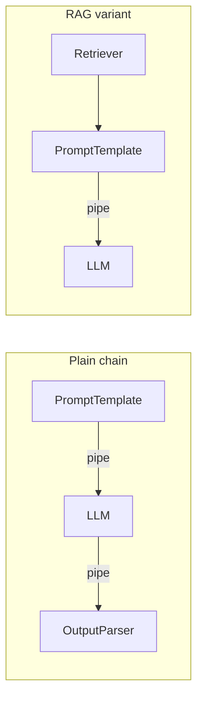

# LangChain

## Overview

LangChain is a framework for building LLM applications out of standard, swappable building blocks — prompts, models, retrievers, tools, output parsers, memory — composed together instead of hand-written around every API call. Its composition syntax, LCEL, chains components together with a pipe operator, much like Unix pipes.

## Data Flow Diagram — LCEL Chain Composition



Every block implements the same `Runnable` interface, so the same `|` syntax composes a plain chain or a retrieval-augmented one.

## Interview Q&A

### Easy — Screening Round

**E1. What problem does LangChain solve?**
It standardizes the recurring pieces of an LLM app — prompts, model calls, retrievers, tools, memory, output parsing — so you don't hand-roll API glue code every time, and it makes swapping model providers or retrieval backends a config change rather than a rewrite.

**E2. What is a "Runnable"?**
The common interface every component implements — `invoke()`, `batch()`, `stream()`, `ainvoke()`. Because a prompt, a model, a retriever, and a parser all speak this same interface, arbitrary components can be piped together uniformly.

**E3. What is a `PromptTemplate`, and why not just use an f-string?**
A `PromptTemplate` handles variable substitution the same way an f-string does, but it also validates that the expected input variables are present, integrates with the `Runnable` interface so it composes with `|` like any other chain component, and — for chat models — supports role-tagged message templates (system/human/ai) instead of one flat string. It also plugs into LangChain's tracing, so the exact prompt sent for a given run is recorded automatically, which a raw f-string embedded in application code doesn't give you for free.

**E4. What's the difference between `.invoke()` and `.stream()` on a Runnable?**
`.invoke()` runs the whole chain and returns the complete result in a single call. `.stream()` returns that same eventual result but yields it incrementally — chunk by chunk, e.g. token by token from an LLM — as it becomes available, so a UI can start displaying output before the full response is ready.

**E5. What is a `Document` in LangChain, concretely?**
A small container object with two fields: `page_content` (the actual text) and `metadata` (a dict of arbitrary extra info, like a source filename, page number, or URL). It's the standard unit that document loaders, text splitters, and retrievers all pass around, so every retrieval-related component can interoperate without agreeing on anything more than this one shape.

**E6. What is a Tool, and what does an LLM actually receive about it?**
A Tool wraps an ordinary function with a name, a natural-language description, and an input schema. The LLM never executes the function itself — it only ever sees the name/description/schema as text and outputs a request to call it with certain arguments; the calling code is responsible for actually invoking the function and feeding the result back in.

**E7. What is a text splitter, and why is it needed before embedding documents?**
A component that breaks long text into smaller, usually overlapping chunks. It's needed because embedding models and LLM context windows both have hard size limits, and because retrieval works better over focused chunks than over one giant document — a query about one paragraph shouldn't have to pull in an entire unrelated document just because they happen to be in the same file.

**E8. What does `.batch()` do on a Runnable, and when would you use it instead of calling `.invoke()` in a loop?**
It runs the same Runnable over a list of inputs and returns a list of results in the same order. Prefer it over a manual loop whenever the underlying component can process multiple inputs more efficiently together than one at a time — e.g. issuing several requests to an API concurrently instead of waiting for each call to finish before starting the next.

### Medium — Technical Round

**M1. What is LCEL?**
LangChain Expression Language — a declarative syntax using the `|` pipe operator to compose Runnables (`prompt | model | parser`) into a chain that automatically gets streaming, batching, and async support without extra code.

**M2. Chains vs. agents, in LangChain terms?**
A chain follows a fixed, predetermined sequence of steps every time. An agent uses the LLM itself to decide, at runtime, which tool or step to call next and in what order, based on the evolving situation — that's the seed of what LangGraph formalizes.

**M3. What is a retriever, abstractly?**
Anything exposing `.invoke(query) → documents`. It might wrap a vector store, a keyword search, an external API, or an ensemble of several — downstream chains don't need to know or care which, which is exactly the point of the abstraction.

**M4. What is memory in LangChain, and why is it tricky?**
Memory persists conversation state across turns — raw history, a running summary, or a structured store — because the LLM call itself is stateless. It's tricky because you must decide what to keep, summarize, or drop as a conversation grows past the context window, without losing information the user still needs.

**M5. When would you reach for LangChain instead of just calling the model API directly?**
A single simple prompt doesn't need it. LangChain earns its keep once you need retrieval, tool use, multi-step chains, provider portability, or standardized tracing/observability (via LangSmith) — i.e. once the app has more moving parts than one API call.

**M6. What do output parsers actually do?**
They coerce the LLM's raw text into a structured type — JSON, a Pydantic model, a list — and some can auto-retry or ask the model to self-correct if its output doesn't parse cleanly the first time.

**M7. What is `RunnableParallel` (and `RunnablePassthrough`) used for?**
`RunnableParallel` runs several Runnables concurrently on the same input and merges their outputs into one dict — the standard way to fan a single question out to a retriever and a prompt template at the same time instead of running them one after another. `RunnablePassthrough` is the identity Runnable: it forwards its input unchanged, which is what lets the original question ride alongside a transformed branch (like retrieved context) into that same dict.

```python
from langchain_core.runnables import RunnableParallel, RunnablePassthrough

def fake_retriever(question: str) -> str:
    return f"[relevant context for: {question}]"

# both branches run on the SAME input string; the dict below is what
# reaches the next step in the chain (e.g. a prompt template)
setup = RunnableParallel(context=fake_retriever, question=RunnablePassthrough())
print(setup.invoke("What is LCEL?"))
# {'context': '[relevant context for: What is LCEL?]', 'question': 'What is LCEL?'}
```

This is essentially what `build_rag_chain` in `example.py` does before handing the merged dict to the prompt template.

**M8. How does LangChain handle retries and fallbacks when a model API call fails?**
`.with_retry()` wraps any Runnable so failures are retried automatically with backoff, up to a configurable attempt count, before the exception is allowed to propagate. `.with_fallbacks([...])` wraps a primary Runnable with one or more alternates that get tried in order — the next fallback receives the same input the moment the primary (or an earlier fallback) raises — which is how you'd route around a rate-limited or down provider without the caller ever seeing the failure.

```python
from langchain_core.runnables import RunnableLambda

def primary(x):
    raise ValueError("primary provider is down")

backup = RunnableLambda(lambda x: f"backup handled: {x}")
robust = RunnableLambda(primary).with_fallbacks([backup])

print(robust.invoke("hello"))   # "backup handled: hello" -- primary's error never surfaces
```

**M9. What's the difference between wrapping a function in `RunnableLambda` explicitly and just passing a plain Python function inside a chain?**
Functionally little in most cases — LangChain auto-coerces a plain function into a `RunnableLambda` wherever a `Runnable` is expected, e.g. as a value inside `RunnableParallel`/a dict literal, or on either side of a `|`. Wrapping it explicitly matters when you need to call Runnable-specific methods on it directly (like `.with_retry()` or `.with_fallbacks()`), pass it around before it's composed into a chain, or make the intent obvious to a reader; relying on auto-coercion is fine once it's already written inline inside a `|` chain or a parallel dict.

```python
from langchain_core.runnables import RunnableParallel

def double(x):
    return x * 2

# a plain function works directly as a RunnableParallel value -- LangChain
# auto-coerces it into a RunnableLambda under the hood, no wrapping needed
parallel = RunnableParallel(doubled=double, original=lambda x: x)
print(parallel.invoke(21))   # {'doubled': 42, 'original': 21}
```

### Advanced — Bar-Raiser / System-Design Round

**A1. How do you control cost and latency across a chain with multiple LLM calls?**
Cache repeated/similar sub-calls (semantic caching on the prompt), batch independent calls instead of running them serially, route cheap sub-tasks (classification, extraction) to a smaller/cheaper model and reserve the expensive model for the step that actually needs its reasoning, and stream partial output to the user so perceived latency drops even if total latency doesn't.

**A2. How would you test and version a LangChain pipeline before shipping a prompt change?**
Treat prompts like code: keep them in version control, run the changed chain against a fixed regression dataset of representative inputs (ideally with an evaluation harness like LangSmith), and compare outputs/scores against the previous version before rolling out — never ship a prompt change based on a handful of manually eyeballed examples.

**A3. How does LangChain's tracing/callback system connect to observability tooling?**
Every Runnable emits lifecycle events (on_start, on_end, on_error, token-level streaming events) through a callback system; a tracer callback listens for these events and forwards them — with full inputs, outputs, and timing — to a backend like LangSmith, which is how you get a full trace of a chain's execution without manually instrumenting each component.

**A4. How would you integrate a proprietary internal system into a chain that LangChain doesn't support out of the box?**
Wrap it as a custom Runnable (or a custom Tool if it's agent-facing) implementing the standard `invoke`/`batch`/`stream` interface around your internal API call — once it speaks that interface, it composes with `|` exactly like any built-in component, and gets tracing, streaming, and async support for free.

**A5. How would you structure a large LangChain codebase with dozens of chains so it stays maintainable?**
Keep prompts out of business logic — store them as templates (files or a prompt registry) that get imported, not inlined as string literals scattered across the code, so they can be versioned and regression-tested independently of the code that calls them. Organize chains by domain rather than by LangChain component type, factor genuinely shared sub-chains (a common retriever setup, a common output schema) into their own module so a fix or a model swap happens in one place, and keep a thin, consistent interface (e.g. every chain exposes the same `invoke`/`ainvoke` shape) so callers don't need to know which chain they're calling internally.

**A6. LangChain vs. calling a cloud provider's raw SDK directly — what's the real trade-off if a company is already committed to one provider?**
If you'll only ever use that one provider for a single straightforward call pattern, the raw SDK is simpler: zero extra abstraction layer, no extra dependency to track, and no waiting on LangChain to wrap a new provider feature the day it ships. LangChain earns its cost once you need composition (multi-step chains), retrieval, standardized tracing, or the real possibility of adding/switching providers later — the trade-off isn't "LangChain is better," it's "an abstraction layer is worth its cost exactly when you're actually going to use the flexibility it buys you."

**A7. `.with_retry()` retried a tool-calling step that sends an email or charges a card — what could go wrong, and how do you prevent it?**
A retry assumes the failed attempt had no side effect worth worrying about, but if the underlying call actually succeeded and only the response was lost (a timeout on the way back, not the way there), a naive retry re-executes the side effect and the user gets charged or emailed twice. The fix is the same one used anywhere retries meet side effects: make the operation idempotent, typically by having the tool pass a stable idempotency key (derived from the request, not regenerated per retry) so the downstream system can recognize and drop a duplicate — retry logic itself should never be the thing deciding whether a real-world action happens twice.

**A8. How do you stop an agent from looping forever (or running up a huge bill) when the LLM keeps deciding to call another tool?**
Put a hard ceiling on the loop that doesn't depend on the LLM ever deciding to stop on its own: a maximum number of steps/tool calls, a wall-clock timeout, and/or a running token- or dollar-cost budget that aborts the loop once exceeded. Agent runtimes built on LangChain (like LangGraph) typically expose this as a configurable recursion/step limit for exactly this reason; beyond the hard cap, escalating to a human or returning a "couldn't complete this" response is safer than letting an agent retry indefinitely against a problem it isn't converging on.

```python
MAX_STEPS = 10

def run_agent_loop(agent_step, initial_state):
    """agent_step(state) -> (next_state, done). The cap below is what
    guarantees termination -- it does not depend on the LLM ever
    deciding on its own that it is finished."""
    state = initial_state
    for _ in range(MAX_STEPS):
        state, done = agent_step(state)
        if done:
            return state
    raise RuntimeError(f"agent did not converge within {MAX_STEPS} steps")
```

### Practical / Coding Round

*Questions below reference [`example.py`](example.py), which builds real LangChain LCEL chains (`build_chain`, `build_rag_chain`) on top of `FakeListChatModel` so they run with no API key and no network access.*

**P1. What would it take to replace `FakeListChatModel` with a real provider like `ChatAnthropic(model="claude-...")` in `build_chain`, and why doesn't the rest of the chain need to change?**
Only the one line inside `build_chain` that constructs `model` changes — swap `FakeListChatModel(responses=responses)` for `ChatAnthropic(model="claude-...")` (plus an API key, typically read from an environment variable). The `prompt | model | parser` composition, the prompt template, and the parser are untouched because all three only depend on `model` satisfying the `Runnable` interface, and both a fake test double and a real provider integration satisfy it identically — that uniform interface is the entire reason LangChain can make "swap providers" a one-line change instead of a rewrite.

**P2. Why does `chain.stream(...)` in `example.py` produce multiple chunks even though `FakeListChatModel` never calls a real streaming API?**
Because `FakeListChatModel` doesn't just fall back to a generic default — it implements its own internal streaming logic that deliberately loops over its canned response string and yields it one character at a time as a separate chunk, specifically so code exercising `.stream()` has something realistic to iterate over in tests. This is worth contrasting with a Runnable that has no custom streaming logic at all (e.g. a plain `RunnableLambda`): LangChain's default `Runnable.stream()` implementation for those simply calls `.invoke()` once and yields the entire result as a single chunk — so "does `.stream()` work" is always true for any Runnable, but "does it actually stream incrementally" depends on whether that specific component bothered to implement it.

**P3. In `example.py`, if `StrOutputParser` in `build_chain` were swapped for `JsonOutputParser`, what happens with the canned responses as written, and how would you fix it?**
It would raise an `OutputParserException` (`"Invalid json output: ..."`) the moment a canned response like `"LCEL stands for LangChain Expression Language."` reaches the parser, because that string isn't valid JSON — a real model has the same failure mode if it doesn't strictly follow a requested JSON format. The fix is simple here since the "model" is just a fixed list: change the canned strings themselves to valid JSON text (e.g. `'{"answer": "LCEL stands for LangChain Expression Language."}'`) so `build_chain`'s output matches what `JsonOutputParser` expects — with a real provider you'd instead adjust the prompt/schema or use structured-output support to make the *actual* model output conform.

**P4. How does `build_rag_chain` in `example.py` turn `build_chain` into a retrieval-augmented chain, concretely?**
It replaces the plain prompt-first pipeline with `retrieve | prompt | model | parser`, where `retrieve` is a `RunnableParallel` running two branches on the same raw question string: `fake_retriever` (a keyword lookup against the `_DOCS` dict, standing in for a real vector-store similarity search) produces the `context` key, and `RunnablePassthrough()` produces the `question` key by forwarding the input unchanged. Both land in one dict that matches the `{context}` / `{question}` placeholders the RAG prompt template expects, so from the prompt onward the chain looks exactly like `build_chain`'s tail end.

**P5. Why is testing a chain against `FakeListChatModel` with fixed responses (as `example.py` does) more useful for CI than always testing against a real model API?**
It's deterministic, free, and fast — the same canned response comes back every run, with no network flakiness, no per-run API cost, and no risk of a live model's non-deterministic wording breaking an assertion that shouldn't care about wording. It tests exactly what a unit test should: that your chain's plumbing (prompt formatting, composition, parsing) is wired correctly — it deliberately does *not* test whether a real model produces a good answer, which belongs in a separate, smaller suite of live-model evaluation tests that you run less frequently.
