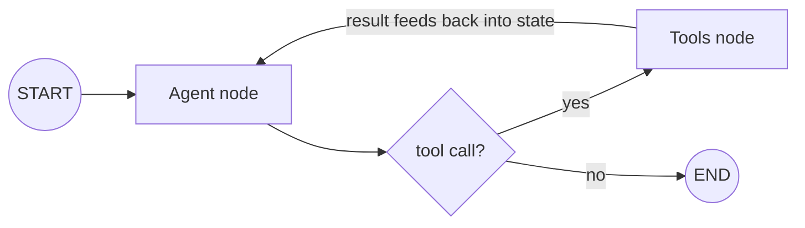

# LangGraph

## Overview


# LangGraph — Complete Overview

## 1. What Is LangGraph?

LangGraph is a framework for building stateful, controllable AI agents and multi-step LLM workflows.

It allows developers to define workflows as graphs containing nodes, edges, and shared state. These components control how an AI application processes information, makes decisions, invokes tools, and moves between tasks.

LangGraph is particularly useful when an AI application requires conditional execution, loops, persistence, human approval, or long-running workflows.

### Interview Definition

LangGraph is a framework for orchestrating stateful AI agents. It provides graph-based execution using nodes, edges, and state, enabling conditional routing, looping, checkpointing, and human-in-the-loop interactions.

---

## Data Flow Diagram — Stateful Loop / Graph



## 2. Why Do We Need LangGraph?

Consider a company support assistant that answers employee questions using internal documents.

The application may need to:

1. Receive a user's question.
2. Analyze the question.
3. Decide whether to search documents or call an external API.
4. Execute the selected action.
5. Evaluate the result.
6. Retry or perform another action if necessary.
7. Generate the final answer.

A simple linear chain is suitable for fixed sequences of operations, but more complex workflows need conditional paths, loops, and shared state.

LangGraph allows us to define and control these workflows explicitly.

---

## 3. Core Concepts of LangGraph

### 3.1 State

State stores the information shared between nodes during graph execution.

For example:

```python
from typing_extensions import TypedDict

class AgentState(TypedDict):
    question: str
    context: str
    answer: str
```

Here:
- `question` stores the user's question.
- `context` stores retrieved information.
- `answer` stores the generated response.

Nodes can read the current state and return updates to it.

### 3.2 Nodes

Nodes are Python functions that perform individual tasks.

Examples include:
- Calling an LLM.
- Retrieving documents.
- Validating information.
- Calling external APIs.
- Checking whether an answer is sufficient.

Example:

```python
def process_question(state: AgentState):
    question = state["question"]

    return {
        "answer": f"Processed question: {question}"
    }
```

A node generally returns a partial state update rather than rebuilding the entire state.

### 3.3 Edges

Edges define the execution flow between nodes.

LangGraph supports:

- Normal edges: Connect one node to another.
- Conditional edges: Select the next node based on a condition or routing function.
- Entry and termination points: `START` and `END`.

Example:

```python
builder.add_edge("retrieve", "generate")
```

This means that after the `retrieve` node completes, execution proceeds to the `generate` node.

---

## 4. LangGraph Architecture

The following diagram represents a simplified AI support agent.

```text
             User Question
                   |
                   v
             Analyze Question
                   |
                   v
            Conditional Routing
              /           \
             v             v
      Search Documents   Call API
             |             |
             v             v
       Evaluate Result / Combine Results
                   |
                   v
            Generate Answer
                   |
                   v
                  END
```

The next step can depend on the current state. The graph may also return to an earlier node if additional processing is required.

---

## 5. Basic LangGraph Python Example

### Installation

```bash
pip install -U langgraph
```

### Complete Example

```python
from typing_extensions import TypedDict
from langgraph.graph import StateGraph, START, END


# Step 1: Define the shared state
class AgentState(TypedDict):
    question: str
    answer: str


# Step 2: Define a node
def answer_question(state: AgentState):
    question = state["question"]

    return {
        "answer": f"You asked: {question}"
    }


# Step 3: Create the graph builder
builder = StateGraph(AgentState)


# Step 4: Register the node
builder.add_node("answer_question", answer_question)


# Step 5: Define execution flow
builder.add_edge(START, "answer_question")
builder.add_edge("answer_question", END)


# Step 6: Compile the graph
graph = builder.compile()


# Step 7: Execute the graph
result = graph.invoke({
    "question": "What is LangGraph?",
    "answer": ""
})


print(result)
```

### Output

```python
{
    'question': 'What is LangGraph?',
    'answer': 'You asked: What is LangGraph?'
}
```

### Execution Flow

1. `StateGraph(AgentState)` creates a graph builder using the defined state schema.
2. `add_node()` registers the Python function.
3. `add_edge(START, "answer_question")` defines the entry point.
4. `add_edge("answer_question", END)` defines the termination point.
5. `compile()` prepares the graph for execution.
6. `invoke()` executes the graph with the initial state.
7. The node returns an answer update, which LangGraph applies to the existing state.

**Note:** This example demonstrates graph execution only. It does not call an actual LLM.

---

## 6. Conditional Routing in LangGraph

Conditional routing allows the graph to choose the next node based on the current state.

For example, an agent can decide whether a question requires document retrieval or can be answered directly.

```python
from typing_extensions import TypedDict
from langgraph.graph import StateGraph, START, END


class AgentState(TypedDict):
    question: str
    route: str
    answer: str


def classify_question(state: AgentState):
    question = state["question"].lower()

    if "policy" in question or "document" in question:
        return {"route": "search"}

    return {"route": "direct"}


def search_documents(state: AgentState):
    return {
        "answer": "Searching relevant documents..."
    }


def direct_answer(state: AgentState):
    return {
        "answer": "This question can be handled directly."
    }


def choose_route(state: AgentState):
    return state["route"]


builder = StateGraph(AgentState)

builder.add_node("classify", classify_question)
builder.add_node("search", search_documents)
builder.add_node("direct", direct_answer)

builder.add_edge(START, "classify")

builder.add_conditional_edges(
    "classify",
    choose_route,
    {
        "search": "search",
        "direct": "direct",
    },
)

builder.add_edge("search", END)
builder.add_edge("direct", END)

graph = builder.compile()

result = graph.invoke({
    "question": "Explain the company leave policy",
    "route": "",
    "answer": "",
})

print(result["answer"])
```

### Output

```text
Searching relevant documents...
```

The example uses simple keyword-based routing. In a real application, an LLM or a separate classifier could determine the appropriate route.

---

## 7. Important LangGraph Features

| Feature | Description |
|---|---|
| Stateful execution | Shares application data across graph nodes. |
| Conditional routing | Selects execution paths based on state or decisions. |
| Loops | Repeats operations until a condition is met. |
| Checkpointing | Saves graph state at execution checkpoints. |
| Persistence | Allows state to be retained across invocations using a checkpointer. |
| Human-in-the-loop | Supports pausing workflows for human review or approval. |
| Streaming | Provides intermediate execution updates. |
| Error handling | Supports controlled recovery patterns when designed into the workflow. |

These features are useful for building robust agents and long-running AI workflows.

---

## 8. LangChain vs. LangGraph

| LangChain | LangGraph |
|---|---|
| Provides components and integrations for LLM applications. | Provides graph-based workflow orchestration. |
| Includes prompts, models, retrievers, and tools. | Uses nodes, edges, and shared state. |
| LCEL composes components into pipelines. | Graph structure supports branching and looping. |
| Useful for straightforward RAG pipelines and model workflows. | Useful for complex, stateful agent workflows. |
| Can be used independently. | Can be used independently or with LangChain components. |

**Important:** LangChain and LangGraph are complementary technologies. LangChain helps provide the building blocks, while LangGraph helps control how a stateful workflow executes.

---

## 9. LangGraph vs. a Traditional Linear Chain

A traditional linear workflow may look like this:

```text
Prompt -> LLM -> Output Parser -> Final Answer
```

The operations execute in a predefined sequence.

A LangGraph workflow can look like this:

```text
             Start
               |
               v
          Analyze Input
               |
               v
          Choose Action
           /        \
          v          v
      Call Tool   Retrieve Data
          \          /
           v        v
         Evaluate Result
               |
         Is result sufficient?
            /       \
          No         Yes
          |           |
          v           v
      Retry/Loop   Final Answer
```

This structure is helpful when the application must make decisions, repeat tasks, or use different tools depending on the situation.

---

## 10. Real-World Use Cases

### AI Customer Support Agent

- Retrieves answers from company knowledge bases.
- Calls APIs to check order or ticket status.
- Escalates unresolved issues to a human.

### RAG-Based Knowledge Assistant

- Retrieves relevant documents.
- Generates answers grounded in the retrieved context.
- Evaluates results and retries retrieval when needed.

### Multi-Tool AI Agent

- Selects an appropriate tool.
- Executes the tool.
- Processes the result and decides the next action.

### Approval-Based Business Workflow

- Generates a proposed action.
- Pauses for human approval.
- Continues after approval or follows a rejection path.

---

## 11. When Should We Use LangGraph?

Use LangGraph when:
- The next step depends on previous results.
- The workflow requires conditional branching or loops.
- The agent needs shared state across multiple steps.
- A workflow must pause for human approval and resume later.
- Long-running tasks need checkpointing and recovery.
- The application uses multiple tools and requires explicit execution control.

For a simple prompt followed by one LLM call, a direct model API or a basic LangChain pipeline may be sufficient.

---

## 12. Interview Questions to Prepare

**Q1. What is LangGraph?**

LangGraph is a framework for building stateful AI agents and graph-based LLM workflows using nodes, edges, and shared state.

**Q2. What are nodes and edges?**

Nodes perform tasks, while edges define the execution path between those tasks.

**Q3. What is state in LangGraph?**

State contains the information shared across graph nodes, such as user input, retrieved context, tool results, and generated answers.

**Q4. What is conditional routing?**

Conditional routing selects the next node based on the current state or the result of a routing function.

**Q5. What is checkpointing?**

Checkpointing saves graph state at execution checkpoints so a workflow can support persistence, recovery, and resumption.

**Q6. What is the difference between LangChain and LangGraph?**

LangChain provides reusable components for LLM applications, while LangGraph provides explicit control over stateful workflows, including branching, loops, and persistence.

**Q7. Can LangGraph work without LangChain?**

Yes. LangGraph can be used independently with Python functions and other model integrations. LangChain components can also be used within its nodes.

---

## 13. Key Takeaway

LangGraph helps developers build controllable, stateful AI workflows. Its core building blocks are:

- **State:** The information shared throughout the workflow.
- **Nodes:** The functions that perform tasks.
- **Edges:** The rules that determine what executes next.

Use LangChain components when useful, and use LangGraph when your AI application needs explicit control over decisions, execution paths, state, and workflow persistence.


The agent/tool loop is a cycle in the graph, not a special case: a shared state object (messages, tool results) flows through every node and is checkpointed after each step, which is what makes pause/resume and human-in-the-loop possible.

## Interview Q&A

### Easy — Screening Round


## E1. Why Build LangGraph When LangChain Already Exists?

### 1. Introduction

LangChain provides reusable components for building LLM applications, such as prompts, models, retrievers, tools, and output parsers.

However, complex AI agents often require more than connecting components in a fixed sequence. They may need conditional routing, loops, shared state, human approval, and the ability to pause and resume execution.

**LangGraph was developed to provide more explicit control over these complex, stateful workflows.**

LangChain and LangGraph are complementary technologies, not replacements for each other.

### 2. The Limitation of a Simple Linear Chain

Consider a basic LangChain workflow:

```python
chain = prompt | llm | output_parser
```

The data flows through the components in sequence:

```text
Input
  |
  v
Prompt Template
  |
  v
LLM
  |
  v
Output Parser
  |
  v
Final Answer
```

This approach works well when the execution flow is relatively straightforward.

But imagine building a customer-support AI agent that must:

1. Understand the user's question.
2. Decide whether to search a knowledge base or call an API.
3. Execute the selected action.
4. Evaluate the result.
5. Retry if the result is insufficient.
6. Ask for human approval before performing sensitive actions.
7. Generate the final response.

This workflow requires conditional execution, loops, and state management. A simple linear chain does not provide the same explicit graph-based control.

### 3. How LangGraph Addresses This Problem

LangGraph represents an application as a graph with three core components:

- **State:** Stores information shared between steps.
- **Nodes:** Execute individual tasks.
- **Edges:** Define which task executes next.

For example:

```text
                User Question
                      |
                      v
                 Analyze Input
                      |
                      v
                Choose Action
                 /          \
                v            v
         Search Documents   Call API
                \            /
                 v          v
                 Evaluate Result
                      |
               Is result useful?
                  /       \
                No         Yes
                |           |
                v           v
             Retry      Final Answer
```

Unlike a fixed pipeline, this graph can follow different paths, repeat operations, and maintain state throughout execution.

### 4. LangChain vs. LangGraph

| Capability | LangChain | LangGraph |
|---|---|---|
| Prompt templates | Yes | Can use LangChain prompts |
| LLM integration | Yes | Can invoke models directly or through LangChain |
| Retrievers and tools | Provides integrations | Can orchestrate them within graph nodes |
| Linear workflows | LCEL pipelines | Graphs can also represent linear workflows |
| Conditional routing | Available through composition and branching patterns | Explicit conditional graph edges |
| Loops | Possible with suitable components | Explicit graph cycles |
| Shared workflow state | Depends on the components used | Central graph state |
| Checkpointing and resumption | Not the primary LCEL abstraction | Built-in graph persistence capabilities through checkpointers |
| Human approval workflows | Can be integrated | Supports interrupts and resumable workflows |

**Important:** LangChain is not limited to linear chains. LangGraph provides a more explicit model for controlling complex, stateful execution.

### 5. Example: Customer-Support Agent

Suppose an employee asks:

"What is my leave balance, and can you submit a leave request for me?"

The AI application may need to:

1. Retrieve the employee's leave policy.
2. Call an HR API to check the current leave balance.
3. Prepare a leave request.
4. Pause for employee confirmation or approval where required.
5. Submit the request after the appropriate approval.
6. Return the submission result.

LangChain components can provide the LLM, prompts, retrievers, and tool integrations.

LangGraph can coordinate the overall process, preserve the workflow state, route execution based on results, and pause or resume the workflow around approval steps.

### 6. When Should We Use Each?

**Use LangChain when:**
- You need to connect an LLM with prompts and output parsers.
- You are building a straightforward RAG pipeline.
- You need model, retriever, or tool integrations.
- The workflow is relatively simple.

**Use LangGraph when:**
- You need an agent to choose between different actions.
- Your workflow contains loops or conditional branches.
- You need stateful, multi-step execution.
- You need checkpointing, recovery, or human-in-the-loop interactions.
- You need explicit control over a complex agent's execution.

You can use both together: LangChain supplies useful building blocks, and LangGraph orchestrates the workflow.

### 7. Interview Answer

LangGraph was developed to address the need for more explicit control over complex, stateful AI workflows. LangChain provides components such as prompts, models, retrievers, and tools, but sophisticated agents may also require conditional routing, loops, persistent state, checkpointing, and human approval.

LangGraph models these workflows using nodes, edges, and shared state. For example, in a customer-support agent, LangChain can provide the LLM and retrieval components, while LangGraph controls whether the agent searches documents, calls an API, retries an operation, or waits for approval.

Therefore, LangGraph complements LangChain by making complex agent workflows easier to structure, control, and resume.

### 8. Key Takeaway

**LangChain provides the building blocks for LLM applications; LangGraph provides explicit control over how complex, stateful AI workflows execute.**


## E2. What Are the Core Building Blocks of LangGraph?

### 1. Introduction

LangGraph is a framework for building stateful AI agents and multi-step workflows.

Its core building blocks are:

1. **State** — stores the data shared across graph execution.
2. **Nodes** — execute tasks or business logic.
3. **Edges** — define the execution flow between nodes.
4. **Conditional Edges** — select the next node based on a condition.
5. **START and END** — represent the entry and termination points of a graph.
6. **Checkpointers** — save graph state to support persistence and resumption.

The first three concepts—State, Nodes, and Edges—are the fundamental building blocks.

---

### 2. State

State represents the data available throughout graph execution.

It carries information from one node to another, such as:
- User questions
- Retrieved documents
- LLM responses
- Tool execution results
- Current workflow status

Example:

```python
from typing_extensions import TypedDict

class AgentState(TypedDict):
    question: str
    context: str
    answer: str
```

Here, `AgentState` defines the expected structure of the graph's state.

A node can read values from the state and return updates.

```python
def retrieve_context(state: AgentState):
    question = state["question"]

    return {
        "context": f"Retrieved information for: {question}"
    }
```

LangGraph applies the returned update to the existing state.

**Interview point:** State acts as shared working memory for the graph execution. It is not automatically permanent across separate invocations unless persistence is configured.

---

### 3. Nodes

Nodes are functions that perform individual tasks in the workflow.

A node may:
- Call an LLM.
- Retrieve information from a vector database.
- Execute a tool or API.
- Validate a response.
- Apply business rules.
- Update the graph's state.

Example:

```python
def generate_answer(state: AgentState):
    context = state["context"]
    question = state["question"]

    answer = f"Question: {question}\nContext: {context}"

    return {
        "answer": answer
    }
```

Register a node with:

```python
builder.add_node("generate_answer", generate_answer)
```

The first argument is the node name, and the second is the function that executes.

**Interview point:** A node performs the work; it usually returns a partial state update rather than replacing the entire state.

---

### 4. Edges

Edges define which node executes next.

For example:

```python
builder.add_edge("retrieve", "generate")
```

This means that after the `retrieve` node completes, execution continues to the `generate` node.

A normal edge defines a fixed transition between two nodes.

Example workflow:

```text
START
  |
  v
Retrieve Documents
  |
  v
Generate Answer
  |
  v
END
```

Edges help connect individual tasks into a complete workflow.

---

### 5. Conditional Edges

Conditional edges allow a graph to choose its next node dynamically.

For example, an AI agent might search documents when the question concerns company policies, but answer a simple greeting directly.

```python
def route_question(state: AgentState):
    if "policy" in state["question"].lower():
        return "retrieve"

    return "direct_answer"
```

Register the conditional routing:

```python
builder.add_conditional_edges(
    "classify",
    route_question,
    {
        "retrieve": "retrieve",
        "direct_answer": "direct_answer"
    }
)
```

The routing function returns a destination key. The mapping connects that key to the appropriate node.

Example:

```text
             Classify Question
                    |
             Conditional Edge
               /         \
              v           v
        Retrieve Docs   Direct Answer
```

**Interview point:** Normal edges define a predetermined transition, whereas conditional edges choose a transition based on a decision or the current state.

---

### 6. START and END

LangGraph provides special graph markers:

- `START` identifies where graph execution begins.
- `END` identifies a terminal point where graph execution finishes.

Example:

```python
from langgraph.graph import START, END

builder.add_edge(START, "retrieve")
builder.add_edge("generate", END)
```

The graph starts at `retrieve` and terminates after `generate`, provided the execution follows these edges.

---

### 7. Checkpointers and Persistence

A checkpointer saves graph state at checkpoints during execution.

It is useful when an application needs to:
- Resume an interrupted workflow.
- Preserve state across invocations.
- Support human approval and review.
- Recover from failures, subject to the application's recovery design.

Example:

```python
from langgraph.checkpoint.memory import InMemorySaver

checkpointer = InMemorySaver()

graph = builder.compile(
    checkpointer=checkpointer
)

config = {
    "configurable": {
        "thread_id": "support-session-101"
    }
}

result = graph.invoke(
    {
        "question": "Explain the leave policy",
        "context": "",
        "answer": ""
    },
    config=config
)
```

The `thread_id` identifies the conversation or workflow thread associated with the checkpointed state.

`InMemorySaver` is useful for demonstrations and testing. Its data is held in memory, so it is not a durable production database. Production applications should select an appropriate persistent checkpointer and configure it correctly.

---

### 8. Complete Example Combining the Core Building Blocks

The following example demonstrates state, nodes, normal edges, conditional edges, `START`, and `END`.

```python
from typing_extensions import TypedDict
from langgraph.graph import StateGraph, START, END


# 1. Define the state
class AgentState(TypedDict):
    question: str
    route: str
    answer: str


# 2. Define nodes
def classify_question(state: AgentState):
    question = state["question"].lower()

    if "policy" in question:
        return {"route": "retrieve"}

    return {"route": "direct"}


def retrieve_documents(state: AgentState):
    return {
        "answer": "Retrieved relevant company policy documents."
    }


def direct_answer(state: AgentState):
    return {
        "answer": "This question can be answered directly."
    }


# 3. Define the routing function
def choose_route(state: AgentState):
    return state["route"]


# 4. Create the graph
builder = StateGraph(AgentState)

builder.add_node("classify", classify_question)
builder.add_node("retrieve", retrieve_documents)
builder.add_node("direct", direct_answer)


# 5. Connect the graph
builder.add_edge(START, "classify")

builder.add_conditional_edges(
    "classify",
    choose_route,
    {
        "retrieve": "retrieve",
        "direct": "direct"
    }
)

builder.add_edge("retrieve", END)
builder.add_edge("direct", END)


# 6. Compile the graph
graph = builder.compile()


# 7. Execute the graph
result = graph.invoke({
    "question": "What is the company leave policy?",
    "route": "",
    "answer": ""
})

print(result["answer"])
```

Expected output:

```text
Retrieved relevant company policy documents.
```

**Note:** This is a simplified demonstration. The retrieval node returns a fixed message rather than searching a real document store, and the routing logic uses a keyword instead of an LLM.

---

### 9. Summary Table

| Building Block | Responsibility |
|---|---|
| State | Stores shared workflow data. |
| Nodes | Execute tasks and return state updates. |
| Edges | Connect nodes and define execution order. |
| Conditional Edges | Select the next node dynamically. |
| START | Defines the graph's entry point. |
| END | Marks a terminal point. |
| Checkpointer | Saves state to support persistence and resumption. |

### 10. Interview Answer

The core building blocks of LangGraph are state, nodes, and edges. State stores the information shared throughout graph execution. Nodes are functions that perform tasks, such as calling an LLM or retrieving documents. Edges define the execution flow between nodes, while conditional edges dynamically select the next step based on the current state or a routing decision.

`START` and `END` identify the graph's entry and termination points. For workflows that need persistence or resumption, LangGraph also supports checkpointers. Together, these components enable developers to build stateful, conditional, and controllable AI agent workflows.

### 11. Key Takeaway

**State stores the information, nodes perform the work, and edges control the flow.** Conditional edges enable decisions, while checkpointers support persistence and resumption.


## E3. What Is the Difference Between `add_edge` and `add_conditional_edges`?

### 1. Introduction

In LangGraph, `add_edge()` and `add_conditional_edges()` define how execution moves from one node to another.

The main difference is:

- **`add_edge()`** connects nodes using a predefined execution path.
- **`add_conditional_edges()`** selects the next node based on the result of a routing function.

In simple terms, `add_edge()` follows a fixed path, whereas `add_conditional_edges()` allows the graph to make a routing decision.

---

### 2. `add_edge()`

The `add_edge()` method creates a normal edge between nodes.

#### Syntax

```python
builder.add_edge("source_node", "destination_node")
```

- `source_node`: The node that executes first.
- `destination_node`: The node that executes next.

#### Example

```python
from langgraph.graph import StateGraph, START, END
from typing_extensions import TypedDict


class AgentState(TypedDict):
    question: str
    answer: str


def retrieve(state: AgentState):
    return {"answer": "Relevant documents retrieved."}


def generate(state: AgentState):
    return {
        "answer": state["answer"] + " Final answer generated."
    }


builder = StateGraph(AgentState)

builder.add_node("retrieve", retrieve)
builder.add_node("generate", generate)

builder.add_edge(START, "retrieve")
builder.add_edge("retrieve", "generate")
builder.add_edge("generate", END)

graph = builder.compile()

result = graph.invoke({
    "question": "Explain RAG",
    "answer": ""
})

print(result["answer"])
```

#### Execution Flow

```text
START
  |
  v
Retrieve
  |
  v
Generate
  |
  v
END
```

The graph follows the predefined path:

1. Execute `retrieve`.
2. Execute `generate`.
3. Finish execution.

The next node does not depend on a routing decision.

---

### 3. `add_conditional_edges()`

The `add_conditional_edges()` method allows the graph to choose its next node dynamically.

The destination depends on the value returned by a routing function.

#### Syntax

```python
builder.add_conditional_edges(
    "source_node",
    routing_function,
    {
        "route_a": "node_a",
        "route_b": "node_b"
    }
)
```

- `source_node`: The node after which the routing decision occurs.
- `routing_function`: A function that examines the current state and returns a routing key.
- Mapping: Associates each routing key with its destination node.

#### Example

```python
from langgraph.graph import StateGraph, START, END
from typing_extensions import TypedDict


class AgentState(TypedDict):
    question: str
    answer: str


def classify_question(state: AgentState):
    question = state["question"].lower()

    if "policy" in question:
        return {"answer": "route_to_retrieval"}

    return {"answer": "route_to_direct_answer"}


def retrieve_documents(state: AgentState):
    return {"answer": "Searching company policy documents."}


def direct_answer(state: AgentState):
    return {"answer": "Answering the question directly."}


def route_question(state: AgentState):
    return state["answer"]


builder = StateGraph(AgentState)

builder.add_node("classify", classify_question)
builder.add_node("retrieve", retrieve_documents)
builder.add_node("direct", direct_answer)

builder.add_edge(START, "classify")

builder.add_conditional_edges(
    "classify",
    route_question,
    {
        "route_to_retrieval": "retrieve",
        "route_to_direct_answer": "direct"
    }
)

builder.add_edge("retrieve", END)
builder.add_edge("direct", END)

graph = builder.compile()

result = graph.invoke({
    "question": "What is the company leave policy?",
    "answer": ""
})

print(result["answer"])
```

#### Output

```text
Searching company policy documents.
```

#### Execution Flow

```text
              START
                |
                v
             Classify
                |
        Conditional Routing
           /          \
          v            v
      Retrieve        Direct
          |            |
          v            v
         END          END
```

The graph chooses the `retrieve` node because the question contains the word `"policy"`.

If the question were `"What is LangGraph?"`, the routing function would select the `direct` node instead.

**Important:** The routing function's returned value must match a key in the mapping. The example uses a field in the state to store the routing decision for simplicity; in production, a separate `route` field would make the state clearer.

---

### 4. Key Differences

| Feature | `add_edge()` | `add_conditional_edges()` |
|---|---|---|
| Purpose | Defines a normal transition | Defines a conditional transition |
| Routing | Predetermined | Based on a routing function |
| Routing function | Not required | Required |
| Destination | Specified directly | Selected using the returned routing value |
| Branching | Not by itself | Supports multiple possible destinations |
| Common use | Fixed processing sequence | Decisions, tool selection, and workflow branching |

---

### 5. Real-World Example

Suppose you are building an AI customer-support agent.

A user asks: "Where is my order?"

The agent must decide whether to retrieve an answer from the knowledge base or call the order-status API.

Using `add_edge()`:

```text
START -> Retrieve Documents -> Generate Answer -> END
```

The graph always follows the same path.

Using `add_conditional_edges()`:

```text
                Analyze Question
                       |
                Choose Next Step
                  /          \
                 v            v
           Search Docs    Order API
                 \            /
                  v          v
                 Generate Answer
                       |
                      END
```

The graph can choose the appropriate operation based on the question.

---

### 6. Can We Use Both in the Same Graph?

Yes. In fact, most practical LangGraph workflows use both methods.

For example:

```python
builder.add_edge(START, "classify")

builder.add_conditional_edges(
    "classify",
    route_question,
    {
        "retrieve": "retrieve",
        "direct": "direct"
    }
)

builder.add_edge("retrieve", "generate")
builder.add_edge("direct", "generate")
builder.add_edge("generate", END)
```

Here:
- `add_edge()` defines the fixed start and final processing steps.
- `add_conditional_edges()` chooses the path after classification.
- Both branches join at the `generate` node.

This approach combines predictable execution with dynamic routing.

---

### 7. Interview Answer

`add_edge()` and `add_conditional_edges()` both define execution flow in LangGraph, but they serve different purposes. `add_edge()` creates a predefined transition from one node to another. `add_conditional_edges()` uses a routing function to decide which node should execute next based on the current state or a decision.

For example, in a customer-support agent, I would use `add_edge()` to connect the start node to a classification node, and `add_conditional_edges()` to route the question to document retrieval or an external API. Both can be used together to build controlled but flexible workflows.

### 8. Key Takeaway

**`add_edge()` = predefined transition.**

**`add_conditional_edges()` = transition selected by a routing decision.**


## E4. What Does `.compile()` Do to a `StateGraph`?

### 1. Introduction

In LangGraph, `StateGraph` is used to define the structure of a workflow by registering nodes, edges, and state.

However, defining the graph does not make it ready for execution.

**The `.compile()` method validates and prepares the graph, producing a compiled graph that can be executed using methods such as `.invoke()`, `.stream()`, or `.ainvoke()`.**

During compilation, LangGraph checks graph structure and prepares its execution machinery. When configured, compilation also incorporates features such as checkpointers, interrupt settings, and other runtime options.

### 2. Why Do We Need `.compile()`?

Consider the following workflow:

```text
START
  |
  v
Retrieve Documents
  |
  v
Generate Answer
  |
  v
END
```

We define the nodes and connect them using `add_node()` and `add_edge()`. These operations configure the graph's structure.

The graph must then be compiled before we execute it.

The process is:

```text
StateGraph()
    |
    v
Register Nodes
    |
    v
Connect Edges
    |
    v
compile()
    |
    v
Compiled Graph
    |
    v
invoke()
    |
    v
Execution Result
```

### 3. Basic Example

```python
from typing_extensions import TypedDict
from langgraph.graph import StateGraph, START, END


# Step 1: Define the state
class AgentState(TypedDict):
    question: str
    answer: str


# Step 2: Define a node
def generate_answer(state: AgentState):
    return {
        "answer": f"You asked: {state['question']}"
    }


# Step 3: Create the graph builder
builder = StateGraph(AgentState)


# Step 4: Register the node
builder.add_node("generate_answer", generate_answer)


# Step 5: Connect the graph
builder.add_edge(START, "generate_answer")
builder.add_edge("generate_answer", END)


# Step 6: Compile the graph
graph = builder.compile()


# Step 7: Execute the compiled graph
result = graph.invoke({
    "question": "What is LangGraph?",
    "answer": ""
})


print(result)
```

### Output

```python
{
    'question': 'What is LangGraph?',
    'answer': 'You asked: What is LangGraph?'
}
```

### 4. What Happens During `.compile()`?

#### A. Graph validation

LangGraph checks the graph's structure for issues such as invalid node references and certain structural errors. A graph with invalid configuration may fail to compile.

#### B. Execution preparation

The builder is converted into a compiled graph that knows how to execute its nodes and follow its edges.

#### C. Runtime features can be configured

We can configure features such as a checkpointer or interruption points during compilation.

For example:

```python
from langgraph.checkpoint.memory import InMemorySaver

checkpointer = InMemorySaver()

graph = builder.compile(
    checkpointer=checkpointer
)
```

This enables checkpoint-based state persistence within the lifetime and capabilities of the configured in-memory saver.

#### D. The graph becomes ready to run

The compiled graph can be called with methods such as:

- `invoke()` — runs the graph and returns the final result.
- `stream()` — streams execution updates.
- `ainvoke()` — runs the graph asynchronously.
- `astream()` — streams execution updates asynchronously.

### 5. Difference Between `StateGraph()` and `.compile()`

| `StateGraph()` | `.compile()` |
|---|---|
| Creates a graph builder. | Produces the executable compiled graph. |
| Defines the workflow structure. | Validates and prepares that structure for execution. |
| Registers nodes and edges through builder methods. | Incorporates configured execution features. |
| Is used during graph construction. | Is called after graph construction is sufficiently complete. |

### 6. Can We Call `.invoke()` Before `.compile()`?

No. The `StateGraph` builder is not the compiled executable graph.

Incorrect:

```python
builder = StateGraph(AgentState)

# This builder is not ready for graph execution.
result = builder.invoke({
    "question": "What is LangGraph?",
    "answer": ""
})
```

Correct:

```python
builder = StateGraph(AgentState)

# Register nodes and edges first.

graph = builder.compile()

result = graph.invoke({
    "question": "What is LangGraph?",
    "answer": ""
})
```

### 7. Important Interview Clarification

`.compile()` does **not** execute the nodes or generate an LLM response.

It prepares the graph for execution. The actual workflow runs when we call a method such as `invoke()` or `stream()`.

Compilation also does not automatically connect an LLM, create a vector database, or configure persistent storage. Those components must be configured separately.

### 8. Interview Answer

In LangGraph, `.compile()` converts a `StateGraph` builder into an executable graph. It validates the graph structure, prepares the execution machinery, and incorporates configured options such as checkpointers and interrupt settings. After compilation, we can execute the workflow using methods such as `invoke()`, `stream()`, or `ainvoke()`.

For example, after defining the nodes and edges of a RAG workflow, I call `.compile()` to prepare the graph and then `.invoke()` to execute it with a user's question.

### 9. Key Takeaway

**`StateGraph()` defines the workflow, `.compile()` prepares it for execution, and `.invoke()` runs it.**


## E5. What Are `START` and `END` in LangGraph?

### 1. Introduction

In LangGraph, `START` and `END` are special graph markers used to define where graph execution begins and where it finishes.

- **`START`** represents the entry point of the graph.
- **`END`** represents a terminal point where graph execution finishes.

They are provided by `langgraph.graph` and are used when connecting nodes with methods such as `add_edge()` and `add_conditional_edges()`.

### 2. What Is `START`?

`START` identifies the first node or nodes that should execute when the graph begins.

Example:

```python
from langgraph.graph import StateGraph, START, END

builder.add_edge(START, "classify_question")
```

This means that graph execution begins with the `classify_question` node.

### 3. What Is `END`?

`END` marks the completion of a graph execution path.

Example:

```python
builder.add_edge("generate_answer", END)
```

This means that after `generate_answer` completes, that execution path terminates.

### 4. Complete Python Example

```python
from typing_extensions import TypedDict
from langgraph.graph import StateGraph, START, END


# 1. Define the graph state
class AgentState(TypedDict):
    question: str
    answer: str


# 2. Define nodes
def analyze_question(state: AgentState):
    print("Analyzing question...")

    return {}


def generate_answer(state: AgentState):
    print("Generating answer...")

    return {
        "answer": f"Answer for: {state['question']}"
    }


# 3. Create the graph builder
builder = StateGraph(AgentState)

# 4. Register nodes
builder.add_node("analyze", analyze_question)
builder.add_node("generate", generate_answer)

# 5. Define execution flow
builder.add_edge(START, "analyze")
builder.add_edge("analyze", "generate")
builder.add_edge("generate", END)

# 6. Compile the graph
graph = builder.compile()

# 7. Execute the graph
result = graph.invoke({
    "question": "What is LangGraph?",
    "answer": ""
})

print(result["answer"])
```

### Output

```text
Analyzing question...
Generating answer...
Answer for: What is LangGraph?
```

### 5. Execution Flow

```text
        START
          |
          v
       Analyze
          |
          v
       Generate
          |
          v
         END
```

**Step-by-step execution:**

1. `START` directs execution to `analyze`.
2. `analyze` processes the question.
3. The normal edge directs execution to `generate`.
4. `generate` creates an answer and updates the state.
5. `END` terminates the graph execution.

### 6. Can a Graph Have Multiple Paths to `END`?

Yes. Multiple branches can terminate at `END`.

For example:

```python
builder.add_conditional_edges(
    "classify",
    route_question,
    {
        "search": "retrieve",
        "direct": "answer_directly"
    }
)

builder.add_edge("retrieve", END)
builder.add_edge("answer_directly", END)
```

Both routes can finish the workflow independently.

### 7. Difference Between `START` and `END`

| Feature | `START` | `END` |
|---|---|---|
| Purpose | Marks the entry point | Marks a terminal point |
| Position | At the beginning of an execution path | At the end of an execution path |
| Typical usage | `add_edge(START, "node")` | `add_edge("node", END)` |
| Meaning | Begin executing the graph | Finish the current graph execution |

### 8. Interview Answer

In LangGraph, `START` and `END` are special markers that define the entry and termination points of a graph. `START` directs the initial execution to the first node, while `END` marks the completion of an execution path. For example, I can connect `START` to a classification node, route the question to different processing nodes, and connect those nodes to `END` when their work is complete.

### 9. Key Takeaway

**`START` tells LangGraph where execution begins, and `END` tells it when an execution path is finished.**


## E6. Does a LangGraph Node Have to Call an LLM?

### 1. Short Answer

**No. A LangGraph node does not have to call an LLM.**

A node can be any Python function or supported runnable that performs a task and returns a state update.

A node may:
- Call an LLM.
- Execute normal Python logic.
- Query a database.
- Retrieve documents from a vector database.
- Call an external API.
- Validate input or output.
- Perform calculations.
- Check permissions or business rules.
- Execute a tool.

LangGraph manages the workflow between nodes, while each node performs its assigned task.

---

### 2. Example 1: Node Without an LLM

Consider a node that checks whether a user is eligible for a discount.

```python
from typing_extensions import TypedDict
from langgraph.graph import StateGraph, START, END


class AgentState(TypedDict):
    purchase_amount: float
    discount: float


def calculate_discount(state: AgentState):
    amount = state["purchase_amount"]

    if amount >= 1000:
        discount = amount * 0.10
    else:
        discount = 0.0

    return {"discount": discount}


builder = StateGraph(AgentState)

builder.add_node("calculate_discount", calculate_discount)

builder.add_edge(START, "calculate_discount")
builder.add_edge("calculate_discount", END)

graph = builder.compile()

result = graph.invoke({
    "purchase_amount": 1500.0,
    "discount": 0.0
})

print(result["discount"])
```

**Output:**

```text
150.0
```

The node performs ordinary Python calculations. No LLM is required.

---

### 3. Example 2: Node That Calls an LLM

An LLM node sends a prompt to a configured language model and returns the generated response.

```python
from typing_extensions import TypedDict
from langgraph.graph import StateGraph, START, END
from langchain_openai import ChatOpenAI
from langchain_core.messages import HumanMessage


class AgentState(TypedDict):
    question: str
    answer: str


# Requires a configured OPENAI_API_KEY.
llm = ChatOpenAI(model="gpt-4.1-mini")


def generate_answer(state: AgentState):
    response = llm.invoke([
        HumanMessage(content=state["question"])
    ])

    return {"answer": response.content}


builder = StateGraph(AgentState)

builder.add_node("generate_answer", generate_answer)

builder.add_edge(START, "generate_answer")
builder.add_edge("generate_answer", END)

graph = builder.compile()

result = graph.invoke({
    "question": "Explain LangGraph in one sentence.",
    "answer": ""
})

print(result["answer"])
```

**Note:** This example requires the `langchain-openai` package and a valid API key. The model response will vary.

---

### 4. Example 3: Combining LLM and Non-LLM Nodes

In real-world applications, a graph commonly combines both types of nodes.

For example, consider an AI customer-support assistant:

```text
             User Question
                   |
                   v
          Validate User Input
              (Python)
                   |
                   v
          Classify the Question
                (LLM)
                   |
                   v
          Retrieve Documents
        (Vector Database/API)
                   |
                   v
           Check Permissions
                (Python)
                   |
                   v
          Generate Final Answer
                (LLM)
                   |
                   v
                  END
```

Each node has a specific responsibility:

| Node | Responsibility | Requires LLM? |
|---|---|---|
| Validate input | Check input fields and constraints | No |
| Classify question | Understand the user's intent | Optional |
| Retrieve documents | Search relevant information | No |
| Check permissions | Apply authorization rules | No |
| Generate answer | Produce a natural-language response | Usually, but not necessarily |

This design separates business logic from language generation and makes the workflow easier to test and maintain.

---

### 5. Why Not Use an LLM for Every Node?

Using an LLM for every task is often unnecessary.

**Reasons to use normal Python functions:**

- Deterministic calculations are easier to test.
- Database operations should use appropriate database clients.
- Authorization decisions should rely on trusted application rules.
- Simple conditions do not need model inference.
- Avoiding unnecessary model calls can reduce latency and cost.

**Use an LLM when:**

- You need natural-language generation.
- You need semantic understanding or classification.
- You need to summarize or interpret unstructured text.
- You need model-based reasoning or tool selection.

For sensitive operations, do not rely solely on an LLM to enforce security or authorization.

---

### 6. Interview Answer

No, a LangGraph node does not have to call an LLM. A node can be a normal Python function, a database operation, an API call, a document retriever, a validation step, or an LLM invocation. LangGraph is responsible for coordinating the execution flow and managing shared state between these nodes.

In a production application, I would combine deterministic Python nodes for validation, authorization, and calculations with LLM nodes for language understanding and generation. This approach improves reliability, testability, and cost efficiency.

---

### 7. Key Takeaway

**LangGraph nodes perform tasks; an LLM is just one possible component inside a node.**


## E7. What's the Difference Between `StateGraph` and a Prebuilt Helper Like `create_react_agent`?

### 1. Overview

In LangGraph, `StateGraph` and `create_react_agent` serve different purposes.

- **`StateGraph`** is a lower-level graph-building API that lets us define our own workflow using nodes, edges, conditional routing, and shared state.
- **`create_react_agent`** is a higher-level helper that creates a ready-made ReAct-style agent workflow. The agent can reason with an LLM, select tools, execute them, and use their results to decide what to do next.

**In simple terms:**

`StateGraph` = Build your own workflow.

`create_react_agent` = Start with a prebuilt tool-calling agent workflow.

> Note: The exact helper API can vary by LangGraph version. In current LangGraph applications, `create_react_agent` is a legacy/deprecated API in favor of `langchain.agents.create_agent`. Check the documentation for the version used by your project.

---

### 2. Key Differences

| Feature | `StateGraph` | `create_react_agent` |
|---|---|---|
| Abstraction | Lower-level graph API | Higher-level agent helper |
| Main purpose | Build custom workflows | Create a ReAct-style tool-using agent |
| Workflow structure | You define nodes and edges | A standard agent/tool loop is provided |
| Control flow | Fully customizable | Standard loop is provided; customization depends on the API |
| LLM required | No | Typically yes |
| Tool calling | Can be implemented in custom nodes | Built into the agent pattern |
| Conditional routing | Define your own routing logic | Standard routing between model and tools |
| Best use case | Business workflows and complex orchestration | Quickly building an LLM agent that uses tools |

---

### 3. Example 1: Building a Workflow with `StateGraph`

Suppose we need a workflow that validates a user's order and then calculates the total price.

We do not need an LLM because the steps follow predefined business rules.

#### Workflow

```text
       START
         |
         v
  Validate Order
         |
         v
  Calculate Total
         |
         v
        END
```

#### Python Code

```python
from typing import TypedDict
from langgraph.graph import StateGraph, START, END


class OrderState(TypedDict):
    quantity: int
    unit_price: float
    total: float
    valid: bool


def validate_order(state: OrderState):
    valid = state["quantity"] > 0 and state["unit_price"] >= 0
    return {"valid": valid}


def calculate_total(state: OrderState):
    if not state["valid"]:
        return {"total": 0.0}

    return {
        "total": state["quantity"] * state["unit_price"]
    }


# Create the graph builder
builder = StateGraph(OrderState)

# Add nodes
builder.add_node("validate", validate_order)
builder.add_node("calculate", calculate_total)

# Define the workflow
builder.add_edge(START, "validate")
builder.add_edge("validate", "calculate")
builder.add_edge("calculate", END)

# Compile the graph
graph = builder.compile()

# Execute the workflow
result = graph.invoke({
    "quantity": 3,
    "unit_price": 100.0,
    "total": 0.0,
    "valid": False
})

print(result)
```

#### Output

```python
{
    'quantity': 3,
    'unit_price': 100.0,
    'total': 300.0,
    'valid': True
}
```

#### Explanation

1. `StateGraph(OrderState)` defines the shared state structure.
2. `add_node()` registers our Python functions.
3. `add_edge()` defines the execution order.
4. `compile()` prepares the graph for execution.
5. `invoke()` runs the workflow.
6. Each node returns updates to the shared state.

**Important:** The nodes do not call an LLM. We control the business logic directly.

---

### 4. Example 2: Creating an Agent with `create_react_agent`

Now suppose we want an AI assistant that can answer questions by calling tools.

For example, a user asks:

"What is 25 multiplied by 4?"

The agent can decide to call a calculator tool, receive its result, and formulate the answer.

#### Workflow

```text
          START
            |
            v
       Call LLM
            |
            v
    Does it request a tool?
        /         \
      Yes          No
       |            |
       v            v
  Execute Tool     Finish
       |
       v
    Call LLM
       |
       v
   Finish or Tool
```

The helper provides the standard model/tool interaction loop.

#### Python Code

The following illustrates the commonly used `create_react_agent` API in versions that support it:

```python
from langchain_openai import ChatOpenAI
from langchain_core.tools import tool
from langgraph.prebuilt import create_react_agent


@tool
def multiply(a: int, b: int) -> int:
    """Multiply two integers."""
    return a * b


llm = ChatOpenAI(model="gpt-4.1-mini")

agent = create_react_agent(
    model=llm,
    tools=[multiply]
)

result = agent.invoke({
    "messages": [
        {
            "role": "user",
            "content": "What is 25 multiplied by 4?"
        }
    ]
})

print(result["messages"][-1].content)
```

#### Possible Output

```text
25 multiplied by 4 is 100.
```

The exact response wording may vary.

#### Explanation

1. The user submits a question.
2. The LLM decides whether a tool is needed.
3. If the LLM requests `multiply`, the agent executes the tool.
4. The tool returns `100`.
5. The LLM uses the tool result to produce a final answer.

The model decides when to call the tool; the tool performs the actual calculation.

> The example uses the legacy `create_react_agent` interface. For new projects, consult the installed LangGraph/LangChain version and consider `langchain.agents.create_agent`, which provides a higher-level agent API.

---

### 5. Can We Build the Same Agent Using `StateGraph`?

**Yes.** We can build a tool-calling agent with `StateGraph` by defining the model node, tool node, and conditional edges ourselves.

Conceptually:

```text
START
  |
  v
LLM Node
  |
  v
Conditional Routing
  |
  +---- Tool requested ----> Tool Node
  |                              |
  |                              v
  +-------------------------- LLM Node
  |
  +---- Final answer -------> END
```

This gives us more control over the workflow.

For example, we could add:

- A validation node before tool execution.
- A permission check before accessing sensitive data.
- A retry node if a tool fails.
- A human approval step before making a payment.
- A logging node to record important operations.

With a prebuilt helper, the standard agent/tool loop is already implemented, so we need less setup for a conventional tool-using assistant.

---

### 6. Which One Should We Choose?

**Choose `StateGraph` when:**

- You need complete control over workflow execution.
- You have multiple business-process steps.
- You need custom branching, loops, retries, or approval steps.
- Your workflow combines APIs, databases, validation, and LLM calls.
- You want to build a custom agent architecture.

**Choose a prebuilt agent helper when:**

- You need a tool-calling assistant quickly.
- The LLM should decide which tools to use.
- You want a standard model/tool execution loop.
- You do not need to define every orchestration step yourself.

**Real-world example:**

For a customer-support chatbot that answers questions using a search tool, a prebuilt agent may be sufficient.

For a delivery-management system that checks authentication, validates an order, checks inventory, obtains approval, publishes an event to Kafka, and sends a notification, a custom `StateGraph` can provide clearer control over the business workflow. A prebuilt agent can still be used as one component within that larger graph.

---

### 7. Interview Answer

**Question:** What's the difference between `StateGraph` and `create_react_agent`?

**Answer:**

"`StateGraph` is the lower-level graph-building API in LangGraph. It allows us to define our own state, nodes, edges, and conditional routing to implement custom workflows. The nodes can contain ordinary Python logic, API calls, database operations, or LLM calls.

`create_react_agent`, on the other hand, is a higher-level helper for creating a ReAct-style agent that uses an LLM to decide when to call tools and how to use their results. It provides the standard agent/tool loop without requiring us to implement that orchestration from scratch.

I would choose a prebuilt agent for a straightforward tool-calling assistant, while I would choose `StateGraph` when I need custom business logic, conditional paths, retries, approvals, or more control over execution. They are not mutually exclusive: a custom graph can incorporate an agent as one of its nodes."

---

### 8. Key Takeaway

- `StateGraph` gives you **control over workflow design**.
- A prebuilt agent helper gives you **a ready-made agent/tool loop**.
- `StateGraph` does not require an LLM.
- A prebuilt agent normally uses an LLM to choose and call tools.
- Both approaches can be combined when an application needs an agent inside a larger business workflow.


## E8. What Does `.invoke()` Return — Just the Model's Final Answer?

### 1. Short Answer

No. In LangGraph, `.invoke()` generally returns the **final state of the graph**, not just the LLM's final answer.

The returned value depends on how the graph is designed and what its state contains.

For example, the returned state might contain:

- The user's original question.
- The LLM's response.
- Tool calls and tool results.
- Intermediate values updated by nodes.
- Other application data stored in the graph state.

**Important distinction:** `.invoke()` returns the graph's output state. It does not automatically extract only the final text from an LLM response.

---

### 2. Example 1: `.invoke()` with a Basic `StateGraph`

Consider a graph that adds two numbers.

```python
from typing import TypedDict
from langgraph.graph import StateGraph, START, END


class MathState(TypedDict):
    a: int
    b: int
    result: int


def add_numbers(state: MathState):
    return {"result": state["a"] + state["b"]}


builder = StateGraph(MathState)

builder.add_node("add", add_numbers)

builder.add_edge(START, "add")
builder.add_edge("add", END)

graph = builder.compile()

result = graph.invoke({
    "a": 10,
    "b": 20,
    "result": 0
})

print(result)
```

**Output:**

```python
{
    'a': 10,
    'b': 20,
    'result': 30
}
```

#### Explanation

Step 1: We pass the initial state to `.invoke()`.

```python
{
    "a": 10,
    "b": 20,
    "result": 0
}
```

Step 2: The `add_numbers` node calculates the sum and returns a partial state update.

```python
{"result": 30}
```

Step 3: LangGraph merges that update into the graph state.

Step 4: `.invoke()` returns the final state:

```python
{
    "a": 10,
    "b": 20,
    "result": 30
}
```

Notice that `.invoke()` returns the complete final state, not just `30`.

To extract the result, use:

```python
print(result["result"])
```

Output:

```text
30
```

---

### 3. Example 2: `.invoke()` with an LLM

When using an LLM directly, the return value depends on the model integration.

```python
from langchain_openai import ChatOpenAI

llm = ChatOpenAI(model="gpt-4.1-mini")

response = llm.invoke("What is Python?")

print(response)
```

The result is typically an `AIMessage` object rather than a plain string.

To extract its text:

```python
print(response.content)
```

Possible output:

```text
Python is a high-level, general-purpose programming language.
```

Here, `.invoke()` belongs to the LangChain model interface, so it returns a model message.

**Remember:** `llm.invoke()` and `graph.invoke()` do not necessarily return the same type of value.

---

### 4. Example 3: `.invoke()` with a LangGraph Agent

Suppose we create an agent that can use tools.

```python
from langchain_openai import ChatOpenAI
from langchain_core.tools import tool
from langgraph.prebuilt import create_react_agent


@tool
def multiply(a: int, b: int) -> int:
    """Multiply two integers."""
    return a * b


llm = ChatOpenAI(model="gpt-4.1-mini")

agent = create_react_agent(
    model=llm,
    tools=[multiply]
)

result = agent.invoke({
    "messages": [
        {
            "role": "user",
            "content": "What is 5 multiplied by 6?"
        }
    ]
})

print(result.keys())
```

For the commonly used `create_react_agent` interface, the output state typically contains a `messages` key.

Example:

```python
dict_keys(['messages'])
```

The `messages` list can include the user message, an AI tool-call message, the tool result, and the AI's final response.

To retrieve the final message's text:

```python
final_answer = result["messages"][-1].content

print(final_answer)
```

Possible output:

```text
5 multiplied by 6 is 30.
```

The precise messages and response wording depend on the model and agent execution.

**Why does the agent return messages instead of just text?**

Because the agent needs to preserve its conversation history, including tool interactions. Returning only the final text would discard that information.

*Note:* `create_react_agent` is a legacy helper in current LangGraph development. New projects should check the installed version and the recommended `langchain.agents.create_agent` API.

---

### 5. How Does `.invoke()` Work Internally?

```text
Initial Input
     |
     v
graph.invoke(input)
     |
     v
Execute First Node
     |
     v
Update Shared State
     |
     v
Execute Next Node(s)
     |
     v
Continue Until Graph Finishes
     |
     v
Return Final Graph State
```

The graph executes the relevant nodes and applies their state updates according to its defined control flow. When execution finishes, `.invoke()` returns the graph's final output state.

It does not automatically return only the last LLM message unless you explicitly design your graph's output to do so.

---

### 6. How Can We Return Only the Final Answer?

There are two common approaches.

**Approach A: Extract the answer after invocation**

```python
result = agent.invoke({
    "messages": [
        {"role": "user", "content": "What is 5 multiplied by 6?"}
    ]
})

answer = result["messages"][-1].content

print(answer)
```

This is convenient when the graph returns a message list and the final message contains the answer.

**Approach B: Define a dedicated output field**

For a custom graph, you can define an `answer` field in the state and update it in a node. The graph can then return the final state containing that field.

```python
from typing import TypedDict
from langgraph.graph import StateGraph, START, END


class AnswerState(TypedDict):
    question: str
    answer: str


def generate_answer(state: AnswerState):
    return {"answer": f"You asked: {state['question']}"}


builder = StateGraph(AnswerState)

builder.add_node("answer_node", generate_answer)
builder.add_edge(START, "answer_node")
builder.add_edge("answer_node", END)

graph = builder.compile()

result = graph.invoke({
    "question": "What is LangGraph?",
    "answer": ""
})

print(result["answer"])
```

Output:

```text
You asked: What is LangGraph?
```

This example uses ordinary Python logic to demonstrate state handling; it does not call an LLM.

---

### 7. `.invoke()` vs `.stream()`

| Method | Behavior |
|---|---|
| `.invoke(input)` | Runs the graph and returns its final output. |
| `.stream(input)` | Yields output as graph execution progresses, according to the selected stream mode. |
| `.ainvoke(input)` | Asynchronously runs the graph and returns its final output. |
| `.astream(input)` | Asynchronously streams output as execution progresses. |

The exact streaming events depend on the stream mode and graph configuration.

---

### 8. Interview Answer

**Question:** What does `.invoke()` return in LangGraph? Just the model's final answer?

**Answer:**

"No. In LangGraph, `.invoke()` normally returns the final state of the graph. The returned structure depends on the graph's state schema and the output produced by its nodes.

For example, a custom graph might return a dictionary containing the original input and calculated results. An agent graph might return a dictionary containing a messages list, including tool calls and tool results.

If I only need the final answer, I can extract it from the returned state, such as `result['messages'][-1].content` for an agent whose last message contains the final response. Alternatively, I can design my graph with a dedicated output field."

---

### 9. Key Takeaway

- `llm.invoke()` typically returns an LLM message object.
- `graph.invoke()` typically returns the graph's final output state.
- An agent's final state may contain the entire message history, including tool interactions.
- Extract the specific field you need instead of assuming `.invoke()` always returns a string.


## E9. Is LangGraph Only Useful for Single-Agent ReAct-Style Loops?

### 1. Short Answer

**No. LangGraph is not limited to single-agent ReAct-style loops.**

LangGraph is a framework for building **stateful, controllable workflows and AI agent systems**. A ReAct-style agent is just one possible use case.

With LangGraph, we can build:

- Single-agent systems that call tools.
- Multi-agent systems in which specialized agents collaborate.
- Sequential workflows with predefined steps.
- Conditional workflows with branching logic.
- Iterative workflows with loops and retries.
- Human-in-the-loop systems that require approval.
- Stateful applications that preserve information across interactions.
- RAG pipelines that retrieve documents and generate answers.
- Long-running workflows with checkpointing and recovery.

**Key idea:** LangGraph controls how the components of an application work together. Those components do not all need to be AI agents.

---

### 2. What Is a Single-Agent ReAct Loop?

A ReAct-style agent uses an LLM to reason about a task, select a tool when necessary, observe the tool's result, and decide what to do next.

For example, a user asks:

"What is the weather in Bangalore, and should I carry an umbrella?"

The agent might call a weather tool, inspect the result, and generate a recommendation.

#### Workflow

```text
       START
         |
         v
      Call LLM
         |
         v
   Tool Required?
      /      \
    Yes       No
     |         |
     v         v
 Execute Tool  END
     |
     v
   Call LLM
     |
     v
 Tool or Final Answer
```

This is useful when one agent can handle the task by choosing from a collection of tools.

However, some applications need much more structured control than a single agent loop provides.

---

### 3. Use Case 1: Sequential Workflow

Suppose an order-processing system needs to:

1. Validate an order.
2. Check inventory.
3. Calculate the total price.
4. Generate a confirmation.

These steps can follow a predefined sequence. An LLM is not necessarily required.

#### Workflow

```text
START
  |
  v
Validate Order
  |
  v
Check Inventory
  |
  v
Calculate Price
  |
  v
Generate Confirmation
  |
  v
 END
```

#### Python Example

```python
from typing import TypedDict
from langgraph.graph import StateGraph, START, END


class OrderState(TypedDict):
    quantity: int
    unit_price: float
    total: float
    message: str


def validate_order(state: OrderState):
    if state["quantity"] <= 0:
        raise ValueError("Quantity must be greater than zero")

    return {}


def calculate_price(state: OrderState):
    return {
        "total": state["quantity"] * state["unit_price"]
    }


def generate_confirmation(state: OrderState):
    return {
        "message": f"Order total: {state['total']}"
    }


builder = StateGraph(OrderState)

builder.add_node("validate", validate_order)
builder.add_node("calculate", calculate_price)
builder.add_node("confirm", generate_confirmation)

builder.add_edge(START, "validate")
builder.add_edge("validate", "calculate")
builder.add_edge("calculate", "confirm")
builder.add_edge("confirm", END)

graph = builder.compile()

result = graph.invoke({
    "quantity": 3,
    "unit_price": 100.0,
    "total": 0.0,
    "message": ""
})

print(result["message"])
```

**Output:**

```text
Order total: 300.0
```

**Why use LangGraph here?**

It lets us define a clear workflow, share state between steps, and extend the process with branching, persistence, or approval when needed.

---

### 4. Use Case 2: Conditional Workflows

Sometimes the next step depends on the result of a previous step.

For example, a customer-support system might classify a request and route it to the appropriate handler.

#### Workflow

```text
              START
                |
                v
       Classify Customer Query
                |
          Conditional Edge
          /       |       \
         v        v        v
      Billing   Technical  General
      Support    Support   Support
         \        |        /
          \       |       /
                  v
                 END
```

A conditional edge determines which node executes next.

#### Example

```python
from typing import Literal, TypedDict
from langgraph.graph import StateGraph, START, END


class SupportState(TypedDict):
    category: str
    response: str


def classify_query(state: SupportState):
    # Simplified example: classification is provided in the input.
    return {}


def route_query(
    state: SupportState,
) -> Literal["billing", "technical", "general"]:
    category = state["category"].lower()

    if category == "billing":
        return "billing"

    if category == "technical":
        return "technical"

    return "general"


def billing_support(state: SupportState):
    return {"response": "Your query has been routed to billing support."}


def technical_support(state: SupportState):
    return {"response": "Your query has been routed to technical support."}


def general_support(state: SupportState):
    return {"response": "Your query has been routed to general support."}


builder = StateGraph(SupportState)

builder.add_node("classify", classify_query)
builder.add_node("billing", billing_support)
builder.add_node("technical", technical_support)
builder.add_node("general", general_support)

builder.add_edge(START, "classify")

builder.add_conditional_edges(
    "classify",
    route_query,
    {
        "billing": "billing",
        "technical": "technical",
        "general": "general",
    },
)

builder.add_edge("billing", END)
builder.add_edge("technical", END)
builder.add_edge("general", END)

graph = builder.compile()

result = graph.invoke({
    "category": "billing",
    "response": ""
})

print(result["response"])
```

**Output:**

```text
Your query has been routed to billing support.
```

This example uses a predefined category rather than an LLM. We could replace the classification function with an LLM-based classifier if needed.

---

### 5. Use Case 3: Multi-Agent Systems

LangGraph can orchestrate multiple specialized agents.

For example, a research application might use:

- **Research Agent:** Collects relevant information.
- **Analysis Agent:** Examines the collected information.
- **Writer Agent:** Produces the final report.

Each agent can have its own tools, prompts, and responsibilities.

#### Workflow

```text
             START
               |
               v
         Research Agent
               |
               v
         Analysis Agent
               |
               v
           Writer Agent
               |
               v
              END
```

A more dynamic design could include a supervisor that decides which agent should act next.

```text
             START
               |
               v
         Supervisor Agent
          /      |      \
         v       v       v
      Research  Analysis  Writer
         \       |       /
          \      |      /
               Supervisor
                   |
             Final Answer
                   |
                  END
```

This second design is conceptual: the actual graph would define explicit routing and the conditions for returning to the supervisor or finishing.

**Important:** Multi-agent systems are not automatically better. They introduce additional model calls, coordination complexity, latency, and cost. Use multiple agents when separating responsibilities provides a meaningful benefit.

---

### 6. Use Case 4: Human-in-the-Loop Approval

Some actions should not be performed automatically.

For example, an AI system might draft a refund request but require a human to approve it before the refund is issued.

#### Workflow

```text
        START
          |
          v
   Analyze Refund Request
          |
          v
   Prepare Refund Proposal
          |
          v
    Human Approval
       /      \
   Approved   Rejected
      |          |
      v          v
  Issue Refund  Stop or Revise
      |          |
      v          v
     END        END
```

LangGraph supports workflows that pause for human input and resume later, commonly using an appropriate interrupt mechanism and a checkpointer.

This is useful for:

- Financial transactions.
- Refund processing.
- Sensitive database changes.
- Access-control decisions.
- AI-generated actions requiring authorization.

**Important:** An approval pause is not itself a security boundary. The application must still authenticate the approver and enforce authorization before performing sensitive operations.

---

### 7. Use Case 5: RAG Workflows

LangGraph can orchestrate a Retrieval-Augmented Generation (RAG) pipeline.

For example, an internal company assistant may answer questions using organization-specific documents.

#### Workflow

```text
         START
           |
           v
     Receive Question
           |
           v
     Retrieve Documents
           |
           v
    Check Relevance
       /       \
 Relevant     Not Relevant
    |              |
    v              v
 Generate Answer  Refine Query
    |              |
    v              └----> Retrieve Again
   END
```

A graph can decide whether retrieved documents are relevant, refine a search query, retry retrieval, or generate a response.

This demonstrates an important distinction:

- **RAG** is a technique for grounding generation in retrieved information.
- **LangGraph** can orchestrate the retrieval, validation, generation, and retry steps.

LangGraph does not automatically provide a vector database, embedding model, or retrieval strategy. Those components must be selected and integrated separately.

---

### 8. Use Case 6: Loops, Retries, and Self-Correction

Some workflows need to repeat a step until a condition is satisfied.

For example, a code-generation agent might generate code, run tests, inspect failures, and try again.

```text
          START
            |
            v
       Generate Code
            |
            v
        Run Tests
            |
            v
        Tests Pass?
         /      \
       No        Yes
        |          |
        v          v
  Analyze Errors  Return Code
        |          |
        └----> Generate Code
                   |
                  END
```

A conditional edge can send execution back to an earlier node when tests fail.

In production, retries should have clear limits and error-handling rules. Otherwise, the workflow might loop indefinitely or waste resources.

---

### 9. What Makes LangGraph Suitable for These Use Cases?

LangGraph provides building blocks that can be combined in different ways.

| Building block | Purpose |
|---|---|
| State | Stores information shared across graph steps |
| Nodes | Execute Python functions, model calls, tools, or other operations |
| Edges | Define execution order |
| Conditional edges | Route execution according to a condition |
| Loops | Repeat steps when necessary |
| Checkpointers | Save graph state for persistence and recovery |
| Interrupts | Pause execution for external input or approval |

These building blocks are useful for both AI-driven workflows and ordinary application workflows.

A node does not have to be an agent. It can be a database operation, API call, validation function, or another graph component.

---

### 10. Interview Answer

**Question:** Is LangGraph only useful for single-agent ReAct-style loops?

**Answer:**

"No. LangGraph is a general framework for building stateful workflows and agentic applications. A single-agent ReAct loop is only one possible use case.

We can use LangGraph to build sequential pipelines, conditional workflows, multi-agent systems, RAG pipelines, retry loops, and human-in-the-loop approval processes. We can also combine ordinary Python functions, APIs, databases, and LLM-based agents in the same graph.

For example, in a delivery-management application, I could use a graph to validate an order, check inventory, route exceptions, obtain approval when necessary, publish an event to Kafka, and send a notification. Only the steps that require reasoning would need an LLM.

I would choose LangGraph based on the control-flow and state-management requirements of the application, not simply because I need a ReAct agent."

---

### 11. Key Takeaway

**LangGraph is a workflow and orchestration framework, not just a single-agent framework.**

It can coordinate deterministic business logic, LLMs, tools, multiple agents, external services, and human decisions within one stateful application.

Use the simplest architecture that satisfies the requirements. A single agent may be enough for a straightforward task; a custom graph or multi-agent design is useful when the workflow requires more control.


### Medium — Technical Round

**M1. What is a conditional edge?**
An edge whose destination is decided at runtime by a routing function that inspects the current state, rather than being hardcoded — e.g. "if the last message includes a tool call, go to Tools; otherwise go to END." This is how LangGraph implements branching and looping agent logic:

```python
def route(state: AgentState) -> str:
    last_message = state["messages"][-1]
    return "tools" if getattr(last_message, "tool_calls", None) else "end"

graph.add_conditional_edges("agent", route, {"tools": "tools", "end": END})
```

The graph calls `route(state)` after every visit to `"agent"` and sends execution wherever `path_map` says the returned key maps to.

**M2. What are checkpoints, and why do they matter?**
A checkpointer saves the graph's state after every step, to memory, SQLite, Postgres, etc. That enables pausing and resuming a run, time-travel debugging, replaying from any earlier step, and durable long-running or human-in-the-loop workflows.

**M3. How does "human-in-the-loop" work in LangGraph?**
Because state is checkpointed at every node, you can configure the graph to interrupt right before (or after) a specific node — say, an irreversible tool call — wait for human approval, and then resume the graph exactly where it left off.

**M4. LangGraph vs. a hand-rolled while-loop agent — what do you actually gain?**
You could write your own loop calling the LLM and tools. LangGraph gives you state management, persistence/checkpointing, streaming, graph visualization, and standard patterns (subgraphs, parallel branches, retries) for free, instead of re-inventing all of it per project.

**M5. What is a subgraph?**
An entire graph used as a single node inside a larger graph — it lets you compose complex multi-agent systems out of smaller, independently built and tested graphs, instead of one flat sprawling graph.

**M6. How does LangGraph support multiple agents talking to each other?**
Each agent is a node or subgraph; edges and routing functions define how control and state pass between them — e.g. a supervisor node decides which specialist agent to invoke next — with all agents sharing (or partitioning) the same state object.

**M7. How do you stream intermediate steps out of a LangGraph run to a frontend, instead of just the final answer?**
Calling `.stream()` instead of `.invoke()` on the compiled graph yields a state update after every node finishes, rather than blocking until the whole run reaches `END`. You forward each chunk to the frontend as it arrives, so a user sees "calling search tool…" / "reading result…" progress live instead of a long silent wait:

```python
for update in app.stream(initial_state, stream_mode="updates"):
    node_name, state_delta = next(iter(update.items()))
    send_to_frontend(f"{node_name} finished: {state_delta}")
```

`stream_mode` also supports `"values"` (the full state after each step) and `"messages"` (token-by-token streaming from inside a node's own LLM call), depending on how granular the frontend needs the updates to be.

**M8. What is the difference between the graph's "state" and a node's local variables?**
State is the shared, typed object that flows between nodes and is exactly what gets checkpointed — anything a later node (or a resumed run) needs to see must be written back into it. Local variables inside a node function are completely ephemeral: they exist only for that one function call and vanish the moment the node returns, so relying on a plain local variable to "remember" something across nodes is a bug, not an optimization — it will silently fail to survive to the next step.

**M9. What is a "reducer", and why does the `messages` field commonly use `add_messages`?**
By default, when a node returns an update for a state key, LangGraph simply overwrites the old value with the new one. A reducer changes that: `Annotated[list, some_fn]` tells LangGraph to combine the old value and the returned value via `some_fn(old, new)` instead of replacing it. `add_messages` is the standard reducer for chat history — it appends new messages onto the existing list, matching by message `id` so re-sending a message with the same id updates it in place instead of duplicating it:

```python
from typing import Annotated
from langgraph.graph.message import add_messages

class ChatState(TypedDict):
    messages: Annotated[list, add_messages]
```

The important gotcha: once a key has a reducer, a node must return only the *new* item(s) to merge in, not the whole accumulated list — returning the full list back would get concatenated onto itself and silently duplicate every entry.

**M10. How do you actually attach persistence to a compiled graph, and how does it know which conversation a checkpoint belongs to?**
Pass a checkpointer instance into `.compile()`, then pass a `thread_id` inside `config` on every `.invoke()`/`.stream()` call — the thread_id is the key the checkpointer uses to look up and save that specific conversation's state:

```python
from langgraph.checkpoint.memory import MemorySaver

app = graph.compile(checkpointer=MemorySaver())
config = {"configurable": {"thread_id": "user-42-session-1"}}
app.invoke({"question": "..."}, config=config)
```

Calling `.invoke()` again later with the same `thread_id` resumes from that thread's latest checkpoint instead of starting fresh — which is the whole mechanism behind multi-turn memory and pause/resume.

### Advanced — Bar-Raiser / System-Design Round

**A1. How would you implement a map-reduce / parallel fan-out pattern in LangGraph?**
Use a routing function that returns a list of `Send` objects — one per independent work item — to dispatch parallel branches of the same node, each with its own private slice of input; a downstream state field with a reducer then collects all the branch results back together:

```python
from langgraph.types import Send

def dispatch(state: FanState):
    return [Send("worker", {"item": item}) for item in state["items"]]

graph.set_conditional_entry_point(dispatch)   # or add_conditional_edges(some_node, dispatch)
graph.add_node("worker", worker_fn)           # runs once per item, concurrently
```

Each `worker_fn` invocation should return only its own new result — never the whole accumulated list (see the reducer gotcha in M9) — and LangGraph merges every branch's result into the shared state key via that field's reducer once all branches finish. This is the pattern behind things like "summarize each of these 50 documents, then combine."

**A2. How do you handle a node that fails or times out mid-graph in a long-running production workflow?**
Because state is checkpointed, a failed run can be retried from its last successful checkpoint instead of restarting from scratch. Beyond that, `add_node(..., retry_policy=RetryPolicy(max_attempts=3))` gives an individual node built-in retry-with-backoff for transient failures, you can route failures to a dedicated error-handling node via a conditional edge, and you decide per-failure-type whether to retry, fall back to a simpler path, or surface the failure to a human.

**A3. What persistence backend would you choose for checkpoints at scale, and why?**
In-memory for local development only (lost on restart); SQLite for single-instance small deployments; Postgres (or another managed relational store) for production multi-instance deployments needing durability, concurrent access, and query-ability over past runs. The choice hinges on durability requirements and whether more than one process needs to read/write the same run's state.

**A4. How do you prevent an agentic loop in LangGraph from running away — infinite loops or runaway cost?**
Cap the number of iterations/tool calls explicitly in the routing function (route to `END` after N loops regardless of state), track cumulative token/cost spend in state and check it as part of the routing condition, and add a "no progress" detector — if the last few iterations produced no new information, force an exit rather than looping indefinitely.

**A5. How would you version a LangGraph agent's graph structure itself (not just prompts) as you iterate on it in production?**
Treat the graph-building code exactly like any other versioned code — code review, tests, releases. The catch is that checkpoints are tied to a specific graph structure (node names, edges, state schema), so renaming nodes or restructuring edges can break resuming an old, still-in-flight checkpointed run that was saved under the previous graph shape. In practice that means either writing an explicit migration for in-flight checkpoints when the structure changes, or accepting that older in-flight runs must drain and finish on the previous graph version before new runs cut over to the new one.

**A6. How do you unit test an individual node function in isolation from the rest of the graph?**
Node functions are typically plain functions that take a state dict and return a state update, so you can call them directly in a test with a hand-built state — no compiling or running the full graph required:

```python
def test_calculator_tool_computes_product():
    state = {"question": "?", "steps": [], "tool_result": None, "answer": ""}
    updated = calculator_tool(state)
    assert updated["tool_result"] == 84
    assert "84" in updated["steps"][-1]
```

This is exactly what makes LangGraph nodes easy to test compared to an opaque prompt chain — each node is an ordinary function with a clear input/output contract, so normal unit-testing practice applies without needing a live LLM or a running graph.

**A7. How would you design a supervisor-style multi-agent architecture, and what are the trade-offs against a peer-to-peer mesh of agents?**
A supervisor pattern has one router node (often an LLM call) that looks at the current state and decides which specialist agent or subgraph to invoke next, then loops back to the supervisor after each specialist finishes — it centralizes control flow, which makes the system easier to reason about, debug, and extend with a new specialist without touching the others. A peer-to-peer mesh, where agents hand off directly to each other, can cut latency by skipping the round-trip through a supervisor, but it scales poorly past a handful of agents because handoff logic ends up scattered across every agent instead of living in one place — most production systems default to a supervisor (or a hierarchy of supervisors, for very large agent counts) for that maintainability reason.

**A8. How would you keep a long-running agent session from blowing the context window or checkpoint storage as its state grows unbounded?**
Don't let the state's message history (or other accumulating fields) grow forever unmanaged: periodically summarize older turns into a compact summary message and drop the originals, trim to the last N messages or a token budget before each LLM call, and move large artifacts (documents, tool outputs, images) into external storage with only a reference/ID kept in state rather than the full blob. This keeps the per-step state small even though the logical conversation is long, which matters both for the LLM's context limit and for how much data the checkpointer has to persist on every single step.

**A9. When multiple parallel branches write to the same state key at the same time (via `Send` fan-out), how does LangGraph avoid one branch's update clobbering another's?**
Plain state keys use "last write wins" semantics, which is undefined/racy if two concurrent branches both try to overwrite the same key in the same step. That's exactly why any state key that parallel branches write to needs an explicit associative reducer (`operator.add` for a list or number, `add_messages` for chat history) via `Annotated[Type, reducer_fn]` — the reducer defines how to deterministically combine multiple simultaneous updates to the same key into one, instead of leaving the outcome to whichever branch happened to finish last.

### Practical / Coding Round

*Questions below reference [`example.py`](example.py), which uses the real `langgraph` library with a plain, deterministic Python function standing in for the "LLM" decision step, so the agent/tool loop from the diagram above runs with no API key and no network access.*

**P1. Trace through `build_graph()` by hand for the input in `__main__`: list the exact sequence of nodes visited, and explain why the loop terminates after exactly one pass through `"tools"`.**
`START → agent → tools → agent → END`. On the first visit to `"agent"`, `fake_llm_decide` sees `tool_result is None`, so it leaves `answer` as `""` and `needs_tool` routes to `"tools"`. `calculator_tool` runs once, permanently setting `tool_result` to `84` in state. On the second visit to `"agent"`, `tool_result` is no longer `None`, so `fake_llm_decide` fills in `answer` this time, and `needs_tool` now routes to `"end"`. The loop can only go around once because `tool_result` only transitions one way (`None → 84`) and never resets, so the branch leading back to `"tools"` can never be taken again after the first pass.

**P2. `needs_tool` is the conditional-edge routing function — in a real agent (not simulated), what would it inspect instead of `state["answer"] == ""` to decide whether to call a tool?**
Whether the LLM's structured response includes a tool_call/function_call field. Real tool-calling APIs (Anthropic, OpenAI) return a response object where, if the model wants to use a tool, there's a populated `tool_calls` list (or equivalent) alongside or instead of plain text — `needs_tool` would check something like `bool(state["messages"][-1].tool_calls)` rather than comparing a plain string to `""`.

**P3. What would happen if you removed the `tools -> agent` edge — trace what LangGraph would do, and why the graph would be structurally incomplete/invalid.**
The first time `needs_tool` routed to `"tools"`, `calculator_tool` would run once and then have nowhere to go — `"tools"` would have no outgoing edge at all. `.compile()` validates that every node has some path forward, so with no edge out of `"tools"`, compiling would fail outright with a graph-structure error (a dangling/unfinished node) rather than letting you invoke a graph that could silently dead-end at runtime.

**P4. Add a `max_iterations`-style field to `AgentState` and use it inside `needs_tool` to force a route to `END` after, say, 3 tool calls even if `answer` is still empty — why does a real production agent need a guard like this?**

```python
class AgentState(TypedDict):
    question: str
    steps: List[str]
    tool_result: Optional[int]
    answer: str
    tool_calls_made: int

def needs_tool(state: AgentState) -> str:
    if state["answer"] != "":
        return "end"
    if state["tool_calls_made"] >= 3:
        return "end"          # bail out even without a real answer
    return "tools"
```

A real production agent needs this because, unlike this deterministic simulation, a real LLM can get stuck calling the same tool repeatedly and never produce a tool-call-free response — due to a confusing tool result, a looping strategy, or plain model error. Without a hard iteration cap the graph would run (and bill API calls) indefinitely instead of eventually giving up and returning whatever partial answer or error it has, echoing the runaway-loop guard discussed in A4.

**P5. Sketch what changes in `AgentState` and `needs_tool` if you swap `fake_llm_decide` for a real LLM call with tool-calling (an Anthropic/OpenAI client) — what real field would you inspect on the model's response instead of the simulated `tool_result` flag?**
`AgentState` would drop the ad-hoc `tool_result`/`answer` fields and instead hold a `messages` list (the running conversation, typically `Annotated[list, add_messages]` as in M9); `fake_llm_decide` would become a real call like `response = client.messages.create(..., tools=[...], messages=state["messages"])`, appending `response` to `messages`. `needs_tool` would then inspect `response.tool_calls` (or `response.stop_reason == "tool_use"` for Anthropic's API) instead of `state["tool_result"]` — routing to `"tools"` whenever the model's response actually asked for a tool call, and to `"end"` once it returned a plain text answer with no tool call.

**P6. What's the smallest change needed to support a second tool (e.g. a `search_tool` alongside `calculator_tool`) — sketch the node/edge changes in `build_graph`?**
Add a new node (`graph.add_node("search", search_tool)`), have the (real) agent's decision include which tool name it wants, and change `needs_tool`'s `path_map` from `{"tools": "tools", "end": END}` to something like `{"calculator": "calculator", "search": "search", "end": END}` so the routing function can send execution to whichever specific tool node is needed. Each tool node still needs its own edge back to `"agent"` to close its loop, exactly like the existing `tools -> agent` edge.

**P7. How would you unit test `needs_tool` in isolation, given it's a plain function taking `AgentState` and returning a string?**

```python
def test_needs_tool_routes_to_tools_when_no_answer():
    state = {"question": "?", "steps": [], "tool_result": None, "answer": ""}
    assert needs_tool(state) == "tools"

def test_needs_tool_routes_to_end_when_answered():
    state = {"question": "?", "steps": [], "tool_result": 84, "answer": "The answer is 84."}
    assert needs_tool(state) == "end"
```

Because `needs_tool` is a pure function with no dependency on the compiled graph, checkpointer, or an LLM, you can call it directly with a couple of hand-built state dicts and assert on its return value — the same "test the node function directly" approach as A6, applied to a routing function instead of a state-updating one.
