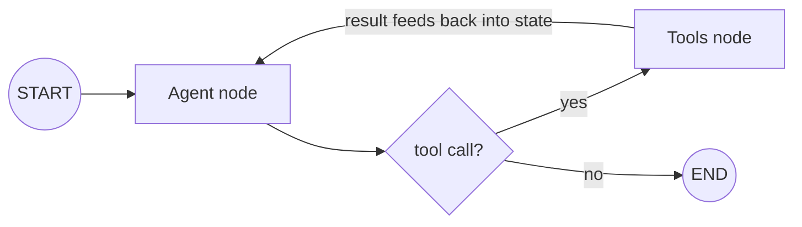

# LangGraph

## Overview

LangChain's chains are essentially directed acyclic graphs — great for a fixed pipeline, but real agents need to *loop*: think, act, observe, think again, and branch depending on what happened. LangGraph models an application explicitly as a graph of nodes and edges with a shared, persistent state object, so cycles and conditional branches are first-class instead of hacked in.

## Data Flow Diagram — Stateful Loop / Graph



The agent/tool loop is a cycle in the graph, not a special case: a shared state object (messages, tool results) flows through every node and is checkpointed after each step, which is what makes pause/resume and human-in-the-loop possible.

## Interview Q&A

### Easy — Screening Round

**E1. Why build LangGraph when LangChain already exists?**
LangChain's chains are directed acyclic graphs — ideal for linear pipelines, but real agents need to loop (think → act → observe → think again) and branch conditionally. LangGraph models the app explicitly as a graph with cycles and shared state, giving fine-grained control that's awkward to express as a simple chain.

**E2. What are the core building blocks of LangGraph?**
Nodes (functions or LLM calls that read and update state), edges (fixed or conditional transitions between nodes), and a shared, typed State object that flows through and accumulates results across the whole run.

**E3. What is the difference between `add_edge` and `add_conditional_edges`?**
`add_edge(a, b)` wires a fixed, unconditional transition: whenever node `a` finishes, control always passes to node `b` next. `add_conditional_edges(a, routing_fn, path_map)` instead calls `routing_fn(state)` once `a` finishes, and whatever key it returns is looked up in `path_map` to decide the destination — so the next node is picked dynamically per run based on state, instead of being fixed in the graph definition.

**E4. What does `.compile()` do to a `StateGraph`?**
It turns the graph definition you've been building — the nodes and edges registered so far — into a runnable object. Compiling validates the structure (for example, that every node is reachable from the entry point and that there's a path from every node onward to `END`) and returns a `CompiledStateGraph` exposing `.invoke()`, `.stream()`, and `.batch()`, optionally wired up to a checkpointer or store you pass in as arguments.

**E5. What are `START` and `END`?**
Reserved sentinel node names LangGraph provides out of the box. `START` marks the graph's entry point — `set_entry_point("agent")` is really just sugar for wiring an edge from `START` to `"agent"` — and `END` marks a valid terminal point; routing to `END`, whether via a fixed or conditional edge, tells LangGraph the run is finished and its final state should be handed back to the caller.

**E6. Does a LangGraph node have to call an LLM?**
No. A node is just any Python callable that takes the current state and returns a state update — it can call an LLM, call a tool or external API, run plain business logic, validate input, or transform data. LLM calls are the common case in agent graphs, but nothing about how nodes or edges work requires it.

**E7. What's the difference between `StateGraph` and a prebuilt helper like `create_react_agent`?**
`StateGraph` is the general-purpose, low-level primitive — you register every node and edge yourself. LangGraph also ships prebuilt constructors such as `create_react_agent` (from `langgraph.prebuilt`) that wire up an entire common pattern — a standard agent/tools ReAct loop — in a single function call, trading flexibility for speed. You drop back down to `StateGraph` directly the moment you need custom routing, multiple cooperating agents, or non-standard control flow.

**E8. What does `.invoke()` return — just the model's final answer?**
The full final state object, not just "the answer" — whatever fields your State schema defines. If state has `messages`, `tool_result`, and `answer` fields, `.invoke()` returns all of them populated as of the moment the graph reached `END`, and it's up to the caller to pick out whichever field it actually needs.

**E9. Is LangGraph only useful for single-agent ReAct-style loops?**
No. The same nodes/edges/state primitives support multi-agent systems, parallel fan-out over independent work items, human-in-the-loop approval steps, and arbitrary custom control flow. The agent/tool loop in the diagram above is the simplest, most common example of what the graph model can express, not a ceiling on it.

### Medium — Technical Round

**M1. What is a conditional edge?**
An edge whose destination is decided at runtime by a routing function that inspects the current state, rather than being hardcoded — e.g. "if the last message includes a tool call, go to Tools; otherwise go to END." This is how LangGraph implements branching and looping agent logic:

```python
def route(state: AgentState) -> str:
    last_message = state["messages"][-1]
    return "tools" if getattr(last_message, "tool_calls", None) else "end"

graph.add_conditional_edges("agent", route, {"tools": "tools", "end": END})
```

The graph calls `route(state)` after every visit to `"agent"` and sends execution wherever `path_map` says the returned key maps to.

**M2. What are checkpoints, and why do they matter?**
A checkpointer saves the graph's state after every step, to memory, SQLite, Postgres, etc. That enables pausing and resuming a run, time-travel debugging, replaying from any earlier step, and durable long-running or human-in-the-loop workflows.

**M3. How does "human-in-the-loop" work in LangGraph?**
Because state is checkpointed at every node, you can configure the graph to interrupt right before (or after) a specific node — say, an irreversible tool call — wait for human approval, and then resume the graph exactly where it left off.

**M4. LangGraph vs. a hand-rolled while-loop agent — what do you actually gain?**
You could write your own loop calling the LLM and tools. LangGraph gives you state management, persistence/checkpointing, streaming, graph visualization, and standard patterns (subgraphs, parallel branches, retries) for free, instead of re-inventing all of it per project.

**M5. What is a subgraph?**
An entire graph used as a single node inside a larger graph — it lets you compose complex multi-agent systems out of smaller, independently built and tested graphs, instead of one flat sprawling graph.

**M6. How does LangGraph support multiple agents talking to each other?**
Each agent is a node or subgraph; edges and routing functions define how control and state pass between them — e.g. a supervisor node decides which specialist agent to invoke next — with all agents sharing (or partitioning) the same state object.

**M7. How do you stream intermediate steps out of a LangGraph run to a frontend, instead of just the final answer?**
Calling `.stream()` instead of `.invoke()` on the compiled graph yields a state update after every node finishes, rather than blocking until the whole run reaches `END`. You forward each chunk to the frontend as it arrives, so a user sees "calling search tool…" / "reading result…" progress live instead of a long silent wait:

```python
for update in app.stream(initial_state, stream_mode="updates"):
    node_name, state_delta = next(iter(update.items()))
    send_to_frontend(f"{node_name} finished: {state_delta}")
```

`stream_mode` also supports `"values"` (the full state after each step) and `"messages"` (token-by-token streaming from inside a node's own LLM call), depending on how granular the frontend needs the updates to be.

**M8. What is the difference between the graph's "state" and a node's local variables?**
State is the shared, typed object that flows between nodes and is exactly what gets checkpointed — anything a later node (or a resumed run) needs to see must be written back into it. Local variables inside a node function are completely ephemeral: they exist only for that one function call and vanish the moment the node returns, so relying on a plain local variable to "remember" something across nodes is a bug, not an optimization — it will silently fail to survive to the next step.

**M9. What is a "reducer", and why does the `messages` field commonly use `add_messages`?**
By default, when a node returns an update for a state key, LangGraph simply overwrites the old value with the new one. A reducer changes that: `Annotated[list, some_fn]` tells LangGraph to combine the old value and the returned value via `some_fn(old, new)` instead of replacing it. `add_messages` is the standard reducer for chat history — it appends new messages onto the existing list, matching by message `id` so re-sending a message with the same id updates it in place instead of duplicating it:

```python
from typing import Annotated
from langgraph.graph.message import add_messages

class ChatState(TypedDict):
    messages: Annotated[list, add_messages]
```

The important gotcha: once a key has a reducer, a node must return only the *new* item(s) to merge in, not the whole accumulated list — returning the full list back would get concatenated onto itself and silently duplicate every entry.

**M10. How do you actually attach persistence to a compiled graph, and how does it know which conversation a checkpoint belongs to?**
Pass a checkpointer instance into `.compile()`, then pass a `thread_id` inside `config` on every `.invoke()`/`.stream()` call — the thread_id is the key the checkpointer uses to look up and save that specific conversation's state:

```python
from langgraph.checkpoint.memory import MemorySaver

app = graph.compile(checkpointer=MemorySaver())
config = {"configurable": {"thread_id": "user-42-session-1"}}
app.invoke({"question": "..."}, config=config)
```

Calling `.invoke()` again later with the same `thread_id` resumes from that thread's latest checkpoint instead of starting fresh — which is the whole mechanism behind multi-turn memory and pause/resume.

### Advanced — Bar-Raiser / System-Design Round

**A1. How would you implement a map-reduce / parallel fan-out pattern in LangGraph?**
Use a routing function that returns a list of `Send` objects — one per independent work item — to dispatch parallel branches of the same node, each with its own private slice of input; a downstream state field with a reducer then collects all the branch results back together:

```python
from langgraph.types import Send

def dispatch(state: FanState):
    return [Send("worker", {"item": item}) for item in state["items"]]

graph.set_conditional_entry_point(dispatch)   # or add_conditional_edges(some_node, dispatch)
graph.add_node("worker", worker_fn)           # runs once per item, concurrently
```

Each `worker_fn` invocation should return only its own new result — never the whole accumulated list (see the reducer gotcha in M9) — and LangGraph merges every branch's result into the shared state key via that field's reducer once all branches finish. This is the pattern behind things like "summarize each of these 50 documents, then combine."

**A2. How do you handle a node that fails or times out mid-graph in a long-running production workflow?**
Because state is checkpointed, a failed run can be retried from its last successful checkpoint instead of restarting from scratch. Beyond that, `add_node(..., retry_policy=RetryPolicy(max_attempts=3))` gives an individual node built-in retry-with-backoff for transient failures, you can route failures to a dedicated error-handling node via a conditional edge, and you decide per-failure-type whether to retry, fall back to a simpler path, or surface the failure to a human.

**A3. What persistence backend would you choose for checkpoints at scale, and why?**
In-memory for local development only (lost on restart); SQLite for single-instance small deployments; Postgres (or another managed relational store) for production multi-instance deployments needing durability, concurrent access, and query-ability over past runs. The choice hinges on durability requirements and whether more than one process needs to read/write the same run's state.

**A4. How do you prevent an agentic loop in LangGraph from running away — infinite loops or runaway cost?**
Cap the number of iterations/tool calls explicitly in the routing function (route to `END` after N loops regardless of state), track cumulative token/cost spend in state and check it as part of the routing condition, and add a "no progress" detector — if the last few iterations produced no new information, force an exit rather than looping indefinitely.

**A5. How would you version a LangGraph agent's graph structure itself (not just prompts) as you iterate on it in production?**
Treat the graph-building code exactly like any other versioned code — code review, tests, releases. The catch is that checkpoints are tied to a specific graph structure (node names, edges, state schema), so renaming nodes or restructuring edges can break resuming an old, still-in-flight checkpointed run that was saved under the previous graph shape. In practice that means either writing an explicit migration for in-flight checkpoints when the structure changes, or accepting that older in-flight runs must drain and finish on the previous graph version before new runs cut over to the new one.

**A6. How do you unit test an individual node function in isolation from the rest of the graph?**
Node functions are typically plain functions that take a state dict and return a state update, so you can call them directly in a test with a hand-built state — no compiling or running the full graph required:

```python
def test_calculator_tool_computes_product():
    state = {"question": "?", "steps": [], "tool_result": None, "answer": ""}
    updated = calculator_tool(state)
    assert updated["tool_result"] == 84
    assert "84" in updated["steps"][-1]
```

This is exactly what makes LangGraph nodes easy to test compared to an opaque prompt chain — each node is an ordinary function with a clear input/output contract, so normal unit-testing practice applies without needing a live LLM or a running graph.

**A7. How would you design a supervisor-style multi-agent architecture, and what are the trade-offs against a peer-to-peer mesh of agents?**
A supervisor pattern has one router node (often an LLM call) that looks at the current state and decides which specialist agent or subgraph to invoke next, then loops back to the supervisor after each specialist finishes — it centralizes control flow, which makes the system easier to reason about, debug, and extend with a new specialist without touching the others. A peer-to-peer mesh, where agents hand off directly to each other, can cut latency by skipping the round-trip through a supervisor, but it scales poorly past a handful of agents because handoff logic ends up scattered across every agent instead of living in one place — most production systems default to a supervisor (or a hierarchy of supervisors, for very large agent counts) for that maintainability reason.

**A8. How would you keep a long-running agent session from blowing the context window or checkpoint storage as its state grows unbounded?**
Don't let the state's message history (or other accumulating fields) grow forever unmanaged: periodically summarize older turns into a compact summary message and drop the originals, trim to the last N messages or a token budget before each LLM call, and move large artifacts (documents, tool outputs, images) into external storage with only a reference/ID kept in state rather than the full blob. This keeps the per-step state small even though the logical conversation is long, which matters both for the LLM's context limit and for how much data the checkpointer has to persist on every single step.

**A9. When multiple parallel branches write to the same state key at the same time (via `Send` fan-out), how does LangGraph avoid one branch's update clobbering another's?**
Plain state keys use "last write wins" semantics, which is undefined/racy if two concurrent branches both try to overwrite the same key in the same step. That's exactly why any state key that parallel branches write to needs an explicit associative reducer (`operator.add` for a list or number, `add_messages` for chat history) via `Annotated[Type, reducer_fn]` — the reducer defines how to deterministically combine multiple simultaneous updates to the same key into one, instead of leaving the outcome to whichever branch happened to finish last.

### Practical / Coding Round

*Questions below reference [`example.py`](example.py), which uses the real `langgraph` library with a plain, deterministic Python function standing in for the "LLM" decision step, so the agent/tool loop from the diagram above runs with no API key and no network access.*

**P1. Trace through `build_graph()` by hand for the input in `__main__`: list the exact sequence of nodes visited, and explain why the loop terminates after exactly one pass through `"tools"`.**
`START → agent → tools → agent → END`. On the first visit to `"agent"`, `fake_llm_decide` sees `tool_result is None`, so it leaves `answer` as `""` and `needs_tool` routes to `"tools"`. `calculator_tool` runs once, permanently setting `tool_result` to `84` in state. On the second visit to `"agent"`, `tool_result` is no longer `None`, so `fake_llm_decide` fills in `answer` this time, and `needs_tool` now routes to `"end"`. The loop can only go around once because `tool_result` only transitions one way (`None → 84`) and never resets, so the branch leading back to `"tools"` can never be taken again after the first pass.

**P2. `needs_tool` is the conditional-edge routing function — in a real agent (not simulated), what would it inspect instead of `state["answer"] == ""` to decide whether to call a tool?**
Whether the LLM's structured response includes a tool_call/function_call field. Real tool-calling APIs (Anthropic, OpenAI) return a response object where, if the model wants to use a tool, there's a populated `tool_calls` list (or equivalent) alongside or instead of plain text — `needs_tool` would check something like `bool(state["messages"][-1].tool_calls)` rather than comparing a plain string to `""`.

**P3. What would happen if you removed the `tools -> agent` edge — trace what LangGraph would do, and why the graph would be structurally incomplete/invalid.**
The first time `needs_tool` routed to `"tools"`, `calculator_tool` would run once and then have nowhere to go — `"tools"` would have no outgoing edge at all. `.compile()` validates that every node has some path forward, so with no edge out of `"tools"`, compiling would fail outright with a graph-structure error (a dangling/unfinished node) rather than letting you invoke a graph that could silently dead-end at runtime.

**P4. Add a `max_iterations`-style field to `AgentState` and use it inside `needs_tool` to force a route to `END` after, say, 3 tool calls even if `answer` is still empty — why does a real production agent need a guard like this?**

```python
class AgentState(TypedDict):
    question: str
    steps: List[str]
    tool_result: Optional[int]
    answer: str
    tool_calls_made: int

def needs_tool(state: AgentState) -> str:
    if state["answer"] != "":
        return "end"
    if state["tool_calls_made"] >= 3:
        return "end"          # bail out even without a real answer
    return "tools"
```

A real production agent needs this because, unlike this deterministic simulation, a real LLM can get stuck calling the same tool repeatedly and never produce a tool-call-free response — due to a confusing tool result, a looping strategy, or plain model error. Without a hard iteration cap the graph would run (and bill API calls) indefinitely instead of eventually giving up and returning whatever partial answer or error it has, echoing the runaway-loop guard discussed in A4.

**P5. Sketch what changes in `AgentState` and `needs_tool` if you swap `fake_llm_decide` for a real LLM call with tool-calling (an Anthropic/OpenAI client) — what real field would you inspect on the model's response instead of the simulated `tool_result` flag?**
`AgentState` would drop the ad-hoc `tool_result`/`answer` fields and instead hold a `messages` list (the running conversation, typically `Annotated[list, add_messages]` as in M9); `fake_llm_decide` would become a real call like `response = client.messages.create(..., tools=[...], messages=state["messages"])`, appending `response` to `messages`. `needs_tool` would then inspect `response.tool_calls` (or `response.stop_reason == "tool_use"` for Anthropic's API) instead of `state["tool_result"]` — routing to `"tools"` whenever the model's response actually asked for a tool call, and to `"end"` once it returned a plain text answer with no tool call.

**P6. What's the smallest change needed to support a second tool (e.g. a `search_tool` alongside `calculator_tool`) — sketch the node/edge changes in `build_graph`?**
Add a new node (`graph.add_node("search", search_tool)`), have the (real) agent's decision include which tool name it wants, and change `needs_tool`'s `path_map` from `{"tools": "tools", "end": END}` to something like `{"calculator": "calculator", "search": "search", "end": END}` so the routing function can send execution to whichever specific tool node is needed. Each tool node still needs its own edge back to `"agent"` to close its loop, exactly like the existing `tools -> agent` edge.

**P7. How would you unit test `needs_tool` in isolation, given it's a plain function taking `AgentState` and returning a string?**

```python
def test_needs_tool_routes_to_tools_when_no_answer():
    state = {"question": "?", "steps": [], "tool_result": None, "answer": ""}
    assert needs_tool(state) == "tools"

def test_needs_tool_routes_to_end_when_answered():
    state = {"question": "?", "steps": [], "tool_result": 84, "answer": "The answer is 84."}
    assert needs_tool(state) == "end"
```

Because `needs_tool` is a pure function with no dependency on the compiled graph, checkpointer, or an LLM, you can call it directly with a couple of hand-built state dicts and assert on its return value — the same "test the node function directly" approach as A6, applied to a routing function instead of a state-updating one.
