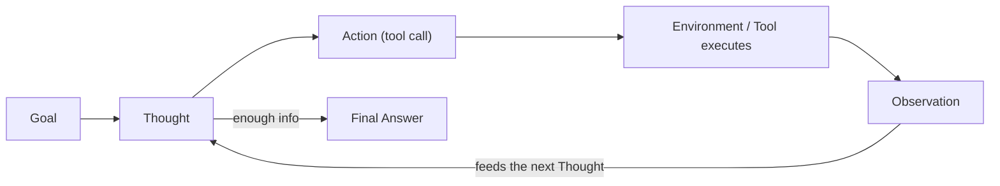

# Agentic AI

## Overview

"Agentic" describes systems where the LLM doesn't just answer once — it plans, chooses actions (usually tool calls), observes what happens, and iterates toward a goal. That loop is what LangGraph's cycles are built to run; agentic AI is the behavior you get once you wire that loop up.

## Data Flow Diagram — ReAct Think-Act-Observe Loop



ReAct (Reason + Act): the agent alternates Thought and Action, folding each Observation back into the next Thought, until it has enough to answer.

## Interview Q&A

### Easy — Screening Round

**E1. What makes a system "agentic" rather than just a chatbot?**
A chatbot maps one input to one output. An agent maintains a goal, decides on a sequence of actions — often tool calls — observes their results, and adapts its plan; it operates in a loop rather than a single pass.


### E2 What Is Tool Use / Function Calling?

**Tool use** allows an AI agent to interact with external tools, APIs, databases, or functions to perform tasks beyond generating text.

**Function calling** is a mechanism that allows an LLM to request the execution of a specific function by providing its name and required arguments. The application executes the function and returns the result to the LLM.

**How does it work?**

1. **User Request:** The user asks a question or requests an action.
2. **LLM Decision:** The model determines whether a tool is needed.
3. **Function Call:** The model returns the tool name and arguments.
4. **Tool Execution:** The application executes the function or API.
5. **Result Returned:** The tool's output is sent back to the LLM.
6. **Final Response:** The LLM uses the result to answer the user.

**Example:**

Suppose a user asks, "What is the current weather in Bangalore?"

- The LLM identifies that weather information is needed.
- It calls a weather API with `Bangalore` as the location.
- The API returns the current weather data.
- The LLM uses that data to provide the answer.

**Common examples of tools:**
- APIs for weather, payments, and external services.
- Database queries to retrieve information.
- Python functions to perform calculations.
- Search tools to find relevant documents.
- Email functions to send messages.

**In short:** Tool use allows an AI agent to perform actions and retrieve real information, while function calling enables the LLM to request those actions through structured function names and arguments.


### Does an Agent Always Need an LLM, or Can Rule-Based Logic Be Agentic?

No, an agent does not always need an LLM. A rule-based system can also behave like an agent if it observes its environment, makes decisions, and takes actions to achieve a specific goal.

**Rule-Based Agent:**
- Uses predefined rules and conditions (`if/else` statements).
- Makes decisions based on fixed logic.
- Works well for predictable and repetitive tasks.

**LLM-Based Agent:**
- Uses a Large Language Model (LLM) to understand user requests and make decisions.
- Can handle complex instructions and unstructured data.
- Can select tools dynamically and adapt its actions based on the situation.

**Example:**

Suppose we want to monitor server CPU usage.

- **Rule-Based Agent:** If CPU usage exceeds 80%, send an alert automatically.
- **LLM-Based Agent:** Analyze CPU metrics, investigate possible causes, check logs using tools, and recommend troubleshooting steps.

**In short:** An agent does not require an LLM. Rule-based logic can be agentic when it observes, decides, and acts toward a goal. LLMs make agents more flexible when handling complex or less predictable tasks.


**E4. What is a "tool" from the model's point of view — just a function, or something more?**
From the model's side, a tool is only a name, a natural-language description, and an input schema shown to it in the prompt/context — the model never executes anything itself. It just outputs a structured request saying which tool it wants and with what arguments; your application code is what actually looks up and runs the real function.


### E5. What Is the Difference Between an Agent's System Prompt and Its Scratchpad?

A **system prompt** defines the agent's role, instructions, rules, and boundaries, while a **scratchpad** is used to track intermediate reasoning, observations, and steps while solving a task.

**System Prompt:**
- Defines the agent's role and responsibilities.
- Specifies rules, goals, and constraints.
- Explains which tools the agent can use and how it should behave.

**Scratchpad:**
- Stores intermediate information during task execution.
- Helps track previous actions, tool results, and the next steps.
- May be maintained as internal state or execution history, depending on the framework.

**Example:**

Suppose an AI agent is designed to answer questions about company documents.

- **System Prompt:** "You are a company-document assistant. Retrieve relevant documents before answering, use authorized sources only, and do not invent facts."
- **Scratchpad:** "Step 1: Search the vector database. Step 2: Review the retrieved chunks. Step 3: Prepare an answer based on the results."

**In short:** The system prompt tells the agent how it should behave, while the scratchpad helps track information and progress during task execution.


### E6. Why Does an Agent Loop Need an Explicit Stop Condition?

An AI agent needs an **explicit stop condition**, such as `Final Answer`, to know when the task is complete and when it should stop taking actions.

Simply stopping token generation is not enough because token generation ending only means the model has finished its current response. It does not necessarily mean the agent has completed the user's task.

**Why is an explicit stop condition important?**

1. **Task Completion:** It tells the agent when the user's request has been fulfilled.
2. **Prevents Infinite Loops:** It prevents the agent from repeatedly calling tools or performing unnecessary actions.
3. **Controls Costs:** It reduces unnecessary LLM calls, API requests, and token usage.
4. **Avoids Unnecessary Actions:** It prevents the agent from continuing to execute tools after it has enough information.
5. **Provides a Clear Exit:** It allows the orchestration framework to distinguish a final response from an intermediate thought or tool call.

**Example:**

Suppose a user asks, "What is the weather in Bangalore?"

An agent might follow this loop:

1. **Plan:** Determine that weather data is required.
2. **Act:** Call the weather API.
3. **Observe:** Receive the weather data.
4. **Evaluate:** Determine whether the result answers the user's question.
5. **Finish:** Return `Final Answer: The current weather in Bangalore is ...`

Without an explicit stop condition, the agent might call the weather API repeatedly or continue reasoning even after obtaining the answer.

**Example Python implementation:**

```python
def agent():
    while True:
        result = run_agent_step()

        if result["status"] == "final":
            return result["answer"]

        if result["status"] == "tool_call":
            execute_tool(result["tool"], result["arguments"])
```

Here, the loop stops when the agent returns a `final` status. In production, the loop should also have a maximum iteration limit and error handling.

**In short:** Token generation stopping ends one model response; an explicit stop condition tells the agent when the overall task is complete. It makes agent execution controlled, efficient, and predictable.


**E7. What's an everyday example of an "agentic" system you might already use?**
A coding assistant that reads a repo, decides which files to edit, runs the test suite, sees the failures, and edits again until tests pass is a full perceive/decide/act/observe loop. Browser-automation assistants and support bots that look up an order and then decide whether to issue a refund are other common examples.

**E8. Is agent "autonomy" all-or-nothing, or a spectrum?**
It's a spectrum. On one end, a system might just suggest an action and wait for a human to approve every single step; further along, it might execute low-risk actions on its own but still pause for high-risk ones; at the far end, it runs unsupervised end-to-end. Most production systems deliberately sit somewhere in the middle rather than at either extreme.

**E9. Why can't an LLM just browse the web or query a database on its own, without anything being wired up for it?**
An LLM only ever produces text — it has no independent way to open a socket, hit an API, or read a filesystem. "Browsing the web" as an agent capability really means a tool that wraps an actual HTTP request or search API is registered with the model; the model requests that tool by name, and your code performs the real network call and hands the result back as text.

### Medium — Technical Round

**M1. Explain the ReAct pattern.**
Reasoning + Acting: the model alternates writing a "Thought" (reasoning about what to do next) and an "Action" (a tool call), then receives an "Observation" (the tool's result), which feeds the next Thought — continuing until it can produce a Final Answer.

**M2. Planning vs. execution in an agent?**
Planning decides the sequence of steps needed to reach the goal, sometimes upfront and sometimes step-by-step. Execution actually carries out each step and reacts to real results — which often forces the plan to be revised mid-flight.

**M3. What are the common failure modes of agents?**
Looping without making progress, hallucinating tool arguments or results, picking the wrong tool, losing track of the goal over a long context, and cascading errors where one wrong step compounds with no way to self-correct.

**M4. What is reflection / self-critique in an agent?**
A step where the agent reviews its own output or plan against the goal and critiques it before finalizing or continuing — catching some errors much the way a person catches mistakes by proofreading their own work.

**M5. Single-agent vs. multi-agent systems?**
A single agent handles the whole task with all its tools itself. A multi-agent system splits the work across specialized agents (researcher, coder, reviewer) coordinated by a supervisor — trading added coordination complexity for sharper focus and modularity per agent.

**M6. "AI agent" vs. "agentic workflow" — is there a real difference?**
"AI agent" usually means one autonomous unit with a goal, tools, and a loop. "Agentic workflow" often means a more structured, partly predetermined pipeline that still lets the LLM make some decisions. The line is blurry — it's mostly a matter of how much autonomy and looping is involved versus fixed structure.

**M7. What's the difference between an agent's short-term and long-term memory?**
Short-term memory is the current run's conversation and scratchpad — it exists only for the duration of that run and disappears once it ends. Long-term memory is information deliberately persisted across separate runs and sessions, typically in a database or vector store, that the agent explicitly writes to and later retrieves — e.g. remembering a user's preferences across conversations that happen days apart.

```python
import json, os

# short-term: lives only inside one run, discarded when run_agent() returns
scratchpad = ["Thought: ...", "Action: ...", "Observation: ..."]

# long-term: written once, read back in a completely separate later run
def remember(key, value, path="agent_memory.json"):
    store = json.load(open(path)) if os.path.exists(path) else {}
    store[key] = value
    json.dump(store, open(path, "w"))

def recall(key, path="agent_memory.json"):
    store = json.load(open(path)) if os.path.exists(path) else {}
    return store.get(key)
```

**M8. How do you decide how many tools to give an agent — is more always better?**
No — more tools means a harder tool-selection decision for the model at every step, more chances of picking the wrong one, and more prompt space spent on tool descriptions instead of the actual task. The general guidance is to give the minimum tool set that covers the task, and when the full catalog is genuinely large, split it across multiple specialized agents (each with a focused subset) rather than handing one agent dozens of tools at once.

**M9. What is "context engineering" in the agent sense, and how is it different from prompt engineering for a single LLM call?**
Prompt engineering optimizes the wording of one static prompt. Context engineering is the ongoing, run-time problem of deciding what to put into a long-running agent's limited context window at each step — which parts of a growing scratchpad, which retrieved documents, which past tool results are still worth the tokens — and it typically involves actively trimming, summarizing, or re-ranking that content as the run progresses, not just writing it well once.

**M10. How does "native" structured function calling differ from an agent parsing a tool call out of the model's free-form generated text?**
With native function calling, the API itself returns the tool call as structured, machine-parseable data — a JSON object with a tool name and arguments already validated against the schema you registered — so there's no ambiguity about where the call starts or ends. Parsing free text, by contrast, means regex- or string-matching a pattern like `Action: tool[input]` out of prose the model generated, which breaks the moment the model phrases something slightly differently, forgets a bracket, or wraps the call in extra commentary.

```python
import json, re

# "native" structured function calling: the API already hands you this
structured_call = json.loads('{"name": "calculator", "arguments": {"expression": "15 * 23"}}')
tool_name, args = structured_call["name"], structured_call["arguments"]

# free-text parsing: you must regex it out of prose the model generated,
# and anything that deviates from the expected shape silently fails to match
raw_text = "Thought: let me compute that.\nAction: calculator[15 * 23]"
match = re.search(r"Action:\s*(\w+)\[(.*?)\]", raw_text)
tool_name2 = match.group(1) if match else None  # None if the model phrased it differently
```

### Advanced — Bar-Raiser / System-Design Round

**A1. How do you put guardrails around an agent that can take real, irreversible actions (sending emails, spending money)?**
Classify actions by risk/reversibility and require human approval before executing anything irreversible or high-stakes; enforce hard allow-lists/deny-lists on what tools and parameters are permitted regardless of what the model requests; add a policy-check layer between the model's proposed action and actual execution rather than trusting the model's judgment alone; and log every action for audit.

**A2. Supervisor/orchestrator pattern vs. decentralized "swarm" multi-agent pattern — when do you choose each?**
A supervisor pattern (one coordinator routes work to specialists) gives clearer control, easier debugging, and predictable cost — best when tasks decompose cleanly into known sub-roles. A decentralized swarm (agents communicate peer-to-peer, no central coordinator) can be more robust to a single point of failure and more flexible for emergent task decomposition, but is much harder to debug, bound in cost, and reason about — most production systems today lean supervisor-style for exactly that reason.

**A3. How do you evaluate an agent's performance in production?**
Track task success rate against a labeled benchmark of representative tasks, sample live transcripts for human review (especially ones with unusually many steps or tool errors, which correlate with failure), and build regression suites so a prompt or model change that improves one capability doesn't silently break another.

**A4. How do you control runaway cost or latency in a long agent loop making dozens of LLM calls?**
Set a hard budget (max tool calls, max tokens, max wall-clock time) and force early termination with a best-effort answer if exceeded; use a cheaper/faster model for intermediate reasoning steps and reserve the strongest model for the final synthesis; and cache tool results within a run so the agent doesn't re-fetch the same information across repeated reasoning steps.

**A5. Should an agent treat a tool that partially fails (returns a result but with a warning) the same as one that fails outright?**
No. A hard failure should surface as an Observation that unambiguously signals failure, so the agent knows to retry or pick a different approach rather than building on nothing. A partial success with a warning is still usable, but the warning text needs to reach the agent inside the observation itself so it can decide whether to trust the result as-is, verify it with another tool, or flag it — treating a shaky result identically to a clean one just relocates the failure to somewhere less visible.

```python
def make_observation(status, value, warning=None):
    if status == "error":
        return f"Observation: ERROR - {value}"
    if warning:
        # still usable, but the agent needs the warning to decide
        # whether to trust it or verify further
        return f"Observation: {value} (WARNING: {warning})"
    return f"Observation: {value}"

make_observation("ok", 345)
make_observation("ok", 340, warning="result rounded to nearest integer")
make_observation("error", "connection timed out after 3 retries")
```

**A6. What's the difference between evaluating an agent's final answer versus evaluating its entire trajectory, and why would a company care about both?**
Final-answer evaluation only checks the end result, and can miss an agent that got the right answer via an unreliable or unsafe path — e.g. calling a destructive tool unnecessarily along the way. Trajectory evaluation also checks the intermediate steps: which tools were called, whether policy was followed, how many steps it took — which matters for cost, safety, and catching "right answer for the wrong reason" cases that would likely fail differently on the next, slightly different input.

```python
def score_trajectory(steps, final_answer, expected_answer, forbidden_tools=()):
    correct = final_answer == expected_answer
    used_forbidden = any(step["tool"] in forbidden_tools for step in steps)
    return {
        "final_answer_correct": correct,         # answer-only view
        "trajectory_safe": not used_forbidden,   # path-aware view
        "efficient": len(steps) <= 3,
        "pass": correct and not used_forbidden,  # both must hold
    }
```

**A7. How do you avoid duplicate side effects when an agent retries a non-idempotent tool (e.g. `send_email`) after a transient failure?**
The risk is that the tool actually succeeded server-side (the email went out) but the response timed out or errored before the agent saw it, so a naive retry sends it twice. The standard fix is the same one used for any non-idempotent API call: generate an idempotency key per logical action (not per retry) and pass it through to the underlying service, so a retried call with the same key is recognized as a duplicate and safely no-ops instead of repeating the side effect.

**A8. Why validate or sanitize LLM-generated tool arguments before executing them, even when using "native" structured function calling?**
Structured function calling guarantees the arguments are well-typed JSON matching your schema — it does not guarantee the values are safe or sensible. A model can still generate a syntactically valid but semantically wrong argument: a wildly out-of-range quantity, a file path outside the intended directory, an amount with the wrong currency assumption. Production systems validate argument values against domain-specific bounds and permissions right before execution, the same way you'd never trust raw user input on a web form just because it passed JSON parsing.

### Practical / Coding Round

*Questions below reference [`example.py`](example.py), a from-scratch, dependency-free ReAct agent loop that implements the Think-Act-Observe cycle shown in the diagram above, using a simulated (rule-based) stand-in for a real LLM.*

**P1. Why does `calculator` restrict `eval`'s builtins to `{}`, and is that actually safe for arbitrary input?**
Passing `{"__builtins__": {}}` as the globals dict strips access to `__import__`, `open`, `exec`, and every other builtin, so an input like `__import__('os').system(...)` fails immediately instead of running. It is not fully safe, though — `eval` still executes arbitrary Python expression syntax, and crafted input can sometimes reach dangerous functionality indirectly even with builtins stripped. Production code would use a real arithmetic-expression parser (e.g. Python's `ast` module, walking only `ast.BinOp`/`ast.Constant` node types and rejecting everything else) or run the evaluation in a genuinely sandboxed subprocess with no filesystem/network access, rather than trusting a builtins-only restriction on `eval`.

**P2. Trace what happens if `fake_llm_reason` had a bug and never produced a "Final Answer" — how does `run_agent`'s `max_steps` prevent that from becoming a real problem?**
Every iteration would parse as an Action, execute a tool, append another Observation, and call `fake_llm_reason` again — forever, if nothing stopped it. `run_agent`'s `for step in range(1, max_steps + 1)` loop guarantees the function returns after at most `max_steps` iterations regardless, falling through to the `"Agent stopped after N steps..."` message instead of hanging or burning unbounded LLM calls. This is exactly the hard-budget mitigation described in the "runaway cost" and "looping without progress" failure-mode questions above — a bug in the reasoning step degrades to a bounded, visible failure instead of an unbounded one.

**P3. `parse_action` uses a regex to extract the tool call from raw text — what's fragile about that, and how does real structured function calling avoid it?**
The regex `Action:\s*(\w+)\[(.*?)\]` only matches if the model phrases the call in exactly that shape — a different word than "Action", a missing bracket, a tool name with a space in it, or the call wrapped in markdown all silently fail to match, and `parse_action` falls through to its `"none"` branch. Real structured/native function calling sidesteps this entirely: the API returns the tool name and arguments as an already-parsed JSON object (see the snippet in question M10), so there's no free-text pattern to break in the first place.

**P4. If you added a second tool (e.g. a trivial `word_count`) to `TOOLS`, what else would have to change in `fake_llm_reason` for it to choose between the two?**
Right now `fake_llm_reason`'s first-step branch unconditionally emits `Action: calculator[...]` — it has no logic for deciding which tool fits the question. Supporting a second tool means adding real tool-selection logic: at minimum a keyword/heuristic check ("contains a math expression" vs. "asks how many words"), or, in a real system, replacing the hardcoded branch with an actual LLM call that sees both tools' descriptions and picks one itself. This is the toy version of the M8 question above — every additional tool is one more decision the reasoning step has to get right.

**P5. `run_agent` keeps the full `scratchpad` for the whole run, appending every Observation forever — why would that eventually become a problem, and what would you do instead?**
Every step's Thought/Action/Observation text gets fed back into the next `fake_llm_reason` call, so the amount of text sent grows linearly with the number of steps — for a long-running task this eventually exceeds the context window, and even before that, it burns tokens (cost and latency) re-sending old, already-used information. The context-engineering fix is to actively manage what stays in context: summarize or drop older Thought/Observation pairs once they've served their purpose, keep only the most recent steps verbatim, or move older content out to long-term memory (see question M7) and retrieve it back only if it becomes relevant again.

**P6. What happens in `run_agent` if `parse_action` extracts a tool name that isn't a key in `TOOLS`?**
The `if tool_name not in TOOLS` check catches it and produces `Observation: Error: unknown tool '<name>'` instead of raising a `KeyError` and crashing the whole run. That observation gets fed back into the next `fake_llm_reason` call just like any other observation, so — in a real system with a real reasoning step — the agent would actually see the error and could try a different tool, rather than the process dying on a single bad tool name.
