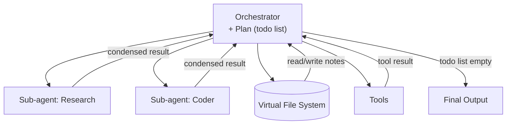

# Deep Agents

## Overview

"Deep Agents" is a pattern (popularized by the LangChain team, built on LangGraph) for tackling long-horizon, complex tasks — the kind coding assistants and deep-research tools handle — by combining explicit planning, a virtual file system for working memory, and the ability to delegate isolated sub-tasks to sub-agents.

## Data Flow Diagram — Orchestrator + Sub-Agents + Planning



The orchestrator never does a sub-task's work itself: it delegates, gets back a condensed result, checks it off the plan, and loops until the plan is done.

## Interview Q&A

### Easy — Screening Round

**E1. Why do simple ReAct agents struggle with long, complex tasks?**
A flat think-act-observe loop keeps everything in one context window. As a task grows across many steps and lots of intermediate output, the context fills up, the agent loses track of the overall goal, and errors compound with no structure in place to recover.

**E2. What's a virtual file system for, in an agent?**
A scratch space — real or simulated files — where the agent writes intermediate results, notes, and drafts instead of keeping everything in the LLM's context. It offloads working memory the same way a person jots notes instead of holding everything in their head.

**E3. Is a Deep Agent a different underlying model, or the same LLM used differently?**
The same underlying model. Deep Agents is an architecture — explicit planning, sub-agents, a virtual file system, tool calls — built around a normal LLM, not a different or specially-trained model. Swap in any sufficiently capable tool-calling model underneath and the same pattern still applies.

**E4. Why is it called a "virtual" file system rather than just using the real filesystem directly?**
It's typically a sandboxed or in-memory abstraction scoped to a single agent run, giving the agent file-like read/write semantics without touching — or risking — the actual host filesystem. Some implementations do back it with real sandboxed files on disk, but the defining property is isolation from the host and from other runs, not the specific storage medium.

**E5. What does "long-horizon task" mean in this context — give an example?**
A task that can't be completed in one or a few LLM calls: it needs many steps, produces a lot of intermediate output, and may take minutes or longer to finish. "Refactor this codebase to use a new API across 40 files" or "research this topic across dozens of sources and write a report" are both long-horizon — they need sustained multi-step work, not a single-shot answer.

**E6. Is the "todo list" in a Deep Agent a real tool the model calls, or just a description of its behavior?**
A real, concrete tool. Implementations typically expose something like a `write_todos` tool the model calls to create and update a list of plan items in the agent's state, which is then shown back to the model on every later turn. It's structured, inspectable state — not just descriptive language in a system prompt.

**E7. Does the Deep Agent pattern require a model with function/tool-calling support?**
Effectively yes. Planning, writing to the virtual file system, and delegating to sub-agents are all implemented as tools the LLM invokes, so a model with no reliable tool-calling ability has no clean way to trigger any of that — the pattern assumes a modern tool-calling-capable model.

**E8. What's the difference between an agent's "context" and its "memory" in this architecture?**
Context is what's actually inside the current LLM call's input — the live, immediate working set, bounded by the context window. Memory is broader: anything the agent can pull back into context later, including things stored outside the window entirely, like the virtual file system or a summarized transcript. Good context engineering is deciding, at each step, which slice of memory belongs in context right now.

### Medium — Technical Round

**M1. What is explicit planning in a Deep Agent?**
The agent maintains a visible todo list as part of its state — not just implicit in its reasoning text — which it writes up front and updates/checks off as it completes steps. That keeps a long task anchored to the goal instead of drifting.

**M2. Why spawn sub-agents instead of doing everything in one loop?**
A sub-agent gets its own isolated context window scoped to one sub-task, so all of that sub-task's intermediate detail never pollutes the main agent's context — it returns only a condensed result, the way a manager delegates work and gets back a summary, not the whole process.

**M3. How is a Deep Agent different from a general LangGraph multi-agent graph?**
A Deep Agent is a specific, opinionated architecture — planning tool + virtual file system + sub-agents + a main loop — usually implemented on top of LangGraph's primitives. LangGraph is the general graph engine; Deep Agents is one well-tested design built with it.

**M4. What real systems follow the Deep Agent pattern?**
Coding assistants like Claude Code, and "deep research" agents that read many sources over a long session — both plan up front, take many tool-using steps, keep notes outside the immediate context, and often delegate sub-investigations to sub-agents.

**M5. What's the trade-off of using sub-agents?**
Better context isolation and modularity, at the cost of coordination overhead, added latency from multiple LLM round-trips, and potential information loss if a sub-agent's summary drops a detail the orchestrator actually needed.

**M6. How does a Deep Agent know when its overall task (not just one sub-task) is actually complete?**
The orchestrator checks its plan/todo-list state after each delegated result comes back; once every item is marked done, it stops looping and produces the final output instead of continuing indefinitely. It's a structural check, not a judgment call left to free-form model reasoning:

```python
def is_plan_complete(plan):
    return all(step["done"] for step in plan)

# orchestrator's main loop, sketched:
while not is_plan_complete(plan):
    step = next(s for s in plan if not s["done"])
    step["result"] = dispatch(step)
    step["done"] = True
```

Without an explicit, inspectable completion condition like this, a long-running agent has no principled way to tell "still working" apart from "stuck in a loop."

**M7. What's an example of a task that's a bad fit for the Deep Agent pattern?**
A short, single-step task — "summarize this one paragraph," "fix this one-line typo" — where a plain single LLM call or a simple ReAct loop is enough. The planning, sub-agent-spawning, and virtual-file-system machinery only pays for itself on genuinely long, multi-part tasks; wrapping a trivial request in all that machinery just adds latency and cost for no benefit.

**M8. How does the virtual file system relate to RAG — are they solving the same problem?**
Related, not identical. RAG retrieves relevant chunks from a large, mostly static external corpus to ground answers in facts the model wasn't trained on or can't fit in context. The virtual file system is the agent's own scratch space for the current run — notes and drafts it writes itself during the task, not a pre-existing knowledge corpus. A deep agent can use both together: RAG for outside knowledge, the virtual file system for what it has produced or learned so far this session.

**M9. How would you design the "condensed result" a sub-agent returns so the orchestrator doesn't lose critical information?**
Treat the summary as a small design problem, not an afterthought: give the sub-agent an explicit format to fill in — key findings, any blockers hit, a confidence level, and a pointer to where the full detail lives (a virtual-file-system path) if the orchestrator ever needs to dig deeper. A bare "summarize what you did" instruction is far more likely to drop something the orchestrator actually needed than a structured one.

### Advanced — Bar-Raiser / System-Design Round

**A1. What is "context engineering," and why is it central to building reliable deep agents?**
The discipline of deliberately deciding what goes into the model's limited context at each step — what to keep verbatim, what to summarize, what to offload to files/memory, and what to drop entirely — rather than letting context grow unmanaged. For long-horizon agents this matters more than prompt wording alone, because a context that's bloated with irrelevant history degrades reasoning quality even when every individual fact in it is correct.

**A2. How do you compact an agent's memory as a long task grows, without losing critical details?**
Periodically summarize older parts of the transcript into a condensed form, while pinning genuinely load-bearing facts (the original goal, key decisions, constraints) so they survive summarization instead of being compressed away; offload verbose intermediate outputs (large tool results, file contents) to the virtual file system and keep only a reference/pointer to them in the active context.

**A3. How would you secure a deep agent's file-system and shell tool access in a multi-tenant production environment?**
Sandbox execution (containers or VMs) so a compromised or misbehaving agent can't affect the host system or other tenants, scope file system access to a per-run isolated directory rather than the real filesystem, apply the same allow-list/deny-list discipline to shell commands as you would to any other high-risk tool, and never let an agent's file system double as a path to executing arbitrary unreviewed code in production without a sandbox boundary.

**A4. How do you decide whether a sub-task should be delegated to a sub-agent versus handled inline?**
Delegate when the sub-task needs a lot of exploratory back-and-forth whose intermediate detail is irrelevant to the parent's decision-making (e.g. "research X and summarize"), since isolating that noise is the whole benefit. Handle inline when the sub-task is short, or when the parent genuinely needs the intermediate reasoning steps (not just the final answer) to make its next decision — delegating everything, even trivial steps, just adds coordination latency for no isolation benefit.

**A5. How would you design human checkpoints into a deep agent's long-running plan without breaking its autonomy for routine steps?**
Classify plan steps by risk when the plan is created — flag steps that touch external systems, spend money, or are hard to reverse (sending an email, deploying code, making a purchase) — and only pause for human approval at those specific points, letting the agent run the rest of the plan autonomously. It's the same risk-based approval idea used for guardrails on a single agent action, just applied one level up, at plan-authoring time:

```python
HIGH_RISK_TYPES = {"send_email", "deploy", "purchase", "delete_file"}

def needs_human_approval(step):
    return step["type"] in HIGH_RISK_TYPES

for step in plan:
    if needs_human_approval(step) and not step.get("approved"):
        pause_for_human_review(step)   # blocks until a human approves/edits it
        continue
    execute(step)
```

Routine, low-risk steps (research, drafting, reading files) never trigger a pause; only steps that could cause real-world harm if wrong do.

**A6. How do you budget cost across an orchestrator and many sub-agents so a single run doesn't silently balloon in price?**
Track cumulative token/dollar spend in shared state across every sub-agent call, not just the orchestrator's own LLM calls — a sub-agent's internal loop can burn far more tokens than the one delegation call that kicked it off. Set a hard total budget the orchestrator checks before delegating each new sub-task, and cut the run short with a best-effort partial result rather than allowing an unbounded number of sub-agent invocations:

```python
class Budget:
    def __init__(self, max_cost):
        self.max_cost, self.spent = max_cost, 0.0

    def charge(self, cost):
        self.spent += cost
        if self.spent > self.max_cost:
            raise BudgetExceeded(f"{self.spent:.2f} > {self.max_cost:.2f}")

budget = Budget(max_cost=5.00)
for step in plan:
    if budget.spent >= budget.max_cost:
        return partial_result(plan)      # stop early with what's done so far
    result, cost = dispatch_with_cost(step)
    budget.charge(cost)
```

Without a hard, checked ceiling like this, a bug that causes repeated re-delegation (or a sub-agent stuck in its own retry loop) can consume unbounded spend before anyone notices.

**A7. How would you handle a sub-agent that fails or times out mid-task, from the orchestrator's perspective?**
Don't let one sub-agent failure silently corrupt the plan state or crash the whole run. Catch the failure/timeout at the delegation boundary, record the step as failed (not done) with the error captured, and apply a bounded retry policy — retry once with a clarified instruction, then escalate to a human or mark that branch of the plan as blocked rather than looping forever. It's the orchestrator-level analogue of any service call needing a timeout and a retry/circuit-breaker policy — a sub-agent call is no different just because the "service" happens to be an LLM loop.

**A8. How would you prevent an orchestrator from spawning unbounded or recursive sub-agents — e.g. a sub-agent that itself tries to spawn sub-agents?**
Enforce a maximum delegation depth and a maximum total sub-agent count as hard limits in the orchestration code itself, not as something the model is merely instructed not to exceed — pass a remaining-depth counter down through every delegation call and refuse to spawn further sub-agents once it hits zero:

```python
def delegate(step, depth, max_depth=3):
    if depth >= max_depth:
        return "[blocked] max delegation depth reached"
    subagent = SUBAGENTS[step["type"]]
    return subagent(step["detail"], depth=depth + 1)
```

This is the same defense used against runaway recursion or infinite tool-calling loops in any agent system: a structural limit enforced by code beats a polite instruction in a prompt every time.

### Practical / Coding Round

*Questions below reference [`example.py`](example.py), a from-scratch, dependency-free simulation of an orchestrator that plans, delegates to sub-agents, and assembles a final result — the same plan-and-delegate loop shown in the diagram above.*

**P1. `research_subagent` and `coder_subagent` return only a one-line condensed string — in a real deep agent, what would each sub-agent actually be internally, and why does the orchestrator only see the condensed output?**
Internally, each would be its own full ReAct loop — reason about the sub-task, call tools (web search, a code sandbox, file reads), observe the result, repeat, potentially for dozens of steps and thousands of tokens. `research_subagent` and `coder_subagent` collapse all of that into one canned string because the orchestrator is deliberately designed to never see that intermediate detail: if it absorbed every sub-agent's full transcript, its context would fill up exactly as fast as the flat ReAct loop from E1 that Deep Agents exists to avoid. The condensed return value is the actual interface contract between orchestrator and sub-agent.

**P2. `build_plan` is hardcoded to always produce the same fixed two-step plan — sketch how you'd change it so a real LLM call generates a variable-length plan based on the actual goal text.**
Replace the hardcoded return list with a call to an LLM given the goal and a description of the available sub-agent types, asking it to return a structured plan — e.g. a JSON list of `{type, detail}` objects — via function calling or structured output. Nothing else in `run_orchestrator` needs to change: it already just iterates whatever list `build_plan` hands back and dispatches through `SUBAGENTS[step["type"]]`, so a plan with 1 step or 10 steps works without touching the orchestrator loop at all — that decoupling of orchestration logic from plan content is exactly why planning lives in its own function.

**P3. `run_orchestrator` processes the plan strictly in order — how would you change it to run independent todo items concurrently, and which items in this example could safely run in parallel (if any)?**
Swap the sequential dispatch loop for something like `concurrent.futures.ThreadPoolExecutor.map` over the steps that don't depend on each other's results, then join and mark them all done together. In this toy example, the two default steps don't actually read from each other's `result` — `coder_subagent`'s spec is built purely from the original goal string — so, as currently written, they could technically run in parallel with no changes to the sub-agents themselves. That's an artifact of the toy's simplicity: the moment the code step depends on the research step's actual findings (see P4), they become a true sequential dependency and can no longer run concurrently.

**P4. Add a shared context dict that accumulates condensed results and gets passed into each subsequent sub-agent call, so `coder_subagent` can actually use the research results instead of a hardcoded string — sketch the change.**
Add a `context = {}` dict in `run_orchestrator`, and after each step completes, store `context[step["type"]] = step["result"]`. Change `coder_subagent`'s signature to accept that context (`coder_subagent(spec, context)`), and build its spec from `context.get("research", "")` instead of the current hardcoded string. This is a minimal version of exactly what the virtual file system does in a real deep agent (E2): a shared place later steps can read what earlier steps produced, instead of every sub-agent working from only its own isolated instruction.

**P5. What would you add to detect that a sub-agent failed or returned a low-quality result, and re-plan or retry that step instead of blindly marking it done?**
Right now `run_orchestrator` marks a step `done` unconditionally as soon as its sub-agent returns — there's no quality gate. Add a check after dispatch (a cheap LLM-as-judge call, or a simple heuristic like "result is non-empty and contains no error marker") before setting `step["done"] = True`; on failure, increment a per-step retry counter and re-invoke the sub-agent, falling back to marking the step permanently failed/blocked only after a max-retry cap — mirroring the bounded-retry policy from A7.

**P6. Why does `build_plan` return a list of dicts with `id`/`type`/`detail`/`done`/`result` fields instead of a list of plain strings — what does that structure buy the orchestrator?**
A plain string only says what to do, not how to route it, whether it's finished, or what came back. The dict shape gives `run_orchestrator` everything the loop needs as structured, checkable state: `type` drives the `SUBAGENTS[step["type"]]` dispatch, `done` is exactly what `is_plan_complete` checks to decide whether to keep looping, and `result` is where the condensed sub-agent output gets stored so it survives past that one loop iteration. It's the concrete, minimal version of "todo list as state, not just prose" from M1 — the plan can be inspected or serialized at any point to know precisely how far the run has gotten.

**P7. What is the time complexity of `run_orchestrator` in terms of number of plan steps, and how would that change if independent steps ran concurrently as in P3?**
As written, O(n) sequential sub-agent dispatches for n plan steps, since the loop processes one step at a time and each dispatch here does O(1) canned work. Running independent steps concurrently wouldn't change the total amount of work, but would change the wall-clock time: with enough parallelism, wall-clock time drops toward O(longest single sub-agent call) instead of O(sum of all sub-agent calls) — the same fan-out/fan-in trade-off as parallelizing any batch of independent I/O-bound calls. Steps with real data dependencies (P4) still cap how much parallelism is actually available, no matter how many worker threads are thrown at it.
