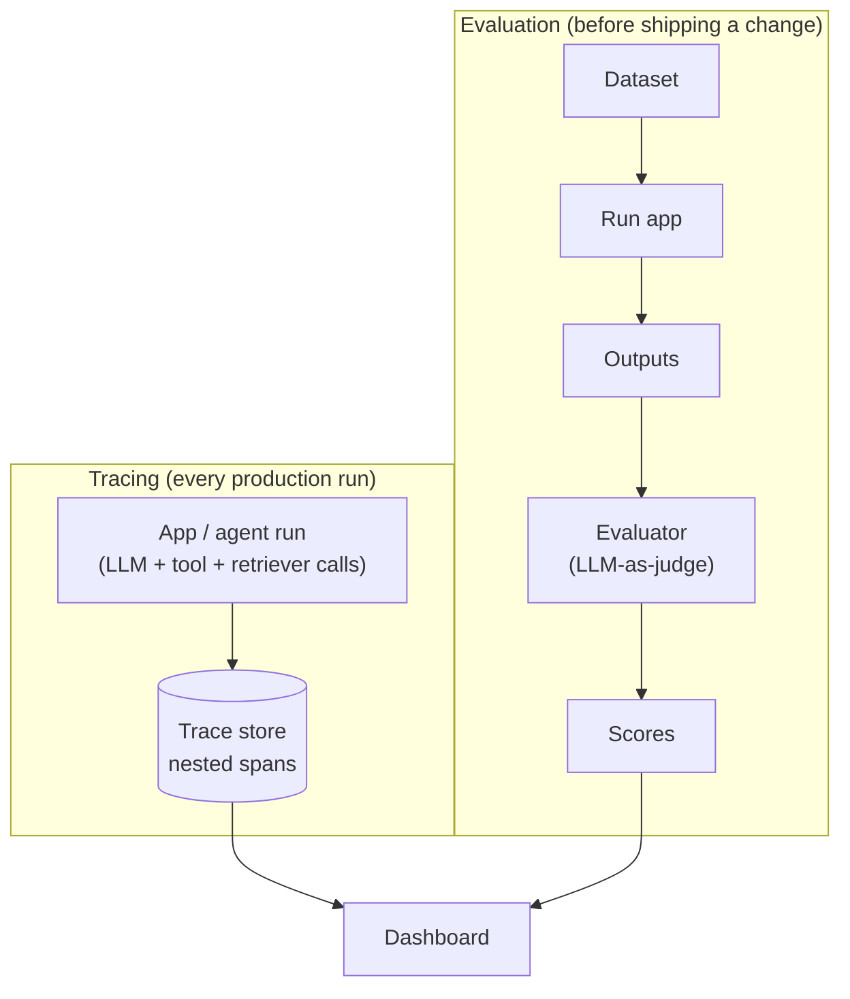

# LangSmith

## Overview

LangSmith is an observability and evaluation platform for LLM apps. It traces every step of a chain or agent run — every prompt, model call, and tool call, with latency and token cost — so you can see exactly what happened instead of guessing, and it lets you run datasets through evaluators to test changes before shipping them.

## Data Flow Diagram — Tracing + Evaluation



Tracing (top) and evaluation (bottom) are two entry points into the same dashboard — one shows what production is doing, the other tells you whether a change made it better.

## Interview Q&A

### Easy — Screening Round

**E1. What problem does LangSmith solve?**
LLM apps fail silently and non-deterministically — a bad answer could come from retrieval, prompting, or the model itself. LangSmith records a full trace of every step in a run, so you can see exactly what was retrieved, what prompt was actually sent, and what came back, instead of guessing.

**E2. What is a "trace"?**
A tree of nested spans representing one end-to-end run — the top-level chain or agent call, plus every nested step inside it (each LLM call, tool call, retriever call), each with its inputs, outputs, latency, and token usage.

**E3. What's the difference between a "run" and a "trace" in LangSmith's terminology?**
A run is a single execution of one component — one LLM call, one tool call, one retriever call, one chain invocation. A trace is the whole tree produced by one end-to-end invocation: the top-level run plus every nested child run underneath it. Every trace is made of runs, but a single run in isolation isn't itself a trace.

**E4. Is LangSmith free, and is it required to build an LLM app?**
It has a free tier with usage limits and paid tiers for scale, so small projects and experimentation aren't blocked by cost. It's also entirely optional — plenty of LLM apps ship with no tracing platform at all — but debugging and evaluating a non-deterministic system gets much harder without one, since you lose visibility into what actually happened on any given run.

**E5. What is a "project" in LangSmith, and why organize traces into one?**
A project is a named bucket that traces get grouped into, typically one per application or one per environment (e.g., `my-app-dev` vs. `my-app-prod`). Grouping traces this way keeps dashboards, filters, and dataset curation scoped to the right slice of traffic instead of mixing a developer's local test runs in with real production requests.

**E6. What is "feedback" in LangSmith, and where does it come from?**
A score or label attached to a run after the fact — a user's thumbs up/down on a chat response, a support agent's correction, or an automated evaluator's score. Feedback is what turns a raw trace into a judged one, and it's the main raw material for deciding which production traces are worth promoting into an evaluation dataset.

**E7. Can LangSmith trace plain Python functions that don't call an LLM at all, like a database lookup or a re-ranking step?**
Yes — the `@traceable` decorator (or equivalent wrapper) works on any Python function, not just LLM calls. This matters because a real bug is often in a non-LLM step — a retriever returning stale results, a re-ranker dropping the right document, a post-processing regex mangling the output — and you want that step visible in the trace too, not just the model calls.

**E8. Does adding LangSmith tracing to an app slow down the response the user actually receives?**
It shouldn't, if instrumented properly — the SDK batches recorded runs and sends them to the backend asynchronously, off the critical path of producing the user-facing response. It's still an extra moving part, though, so it's worth checking the actual request timeline in production rather than assuming tracing is always free.

**E9. What's the difference between LangSmith and LangChain?**
They're separate products from the same company built for different jobs: LangChain is a framework for building LLM apps (chains, agents, prompt templates), while LangSmith is the observability and evaluation platform for watching and testing whatever app you built, whether or not it uses LangChain. They integrate closely — a LangChain run traces to LangSmith automatically — but neither requires the other, as this topic's `example.py` demonstrates by tracing a hand-rolled pipeline with zero LangChain code.

### Medium — Technical Round

**M1. How does LangSmith help with evaluation, not just debugging?**
You define a dataset of example inputs (often with expected outputs), run your app against it, and score each output with an evaluator — exact match, LLM-as-judge, or custom code — giving a repeatable benchmark to compare prompt or model changes against, instead of eyeballing a handful of examples.

**M2. What is LLM-as-judge evaluation?**
Using a (usually stronger) LLM with a grading rubric to score another model's output on a dimension like correctness, faithfulness to the retrieved context, or helpfulness — useful whenever there's no single exact answer to string-match against.

**M3. How does LangSmith support prompt iteration?**
It lets you version prompts and compare them directly against historical traces or a fixed dataset — so you can tell whether a prompt tweak actually improved outputs across many examples, rather than just the one case that originally caught your eye.

**M4. Does LangSmith require using LangChain or LangGraph?**
No — it has a standalone SDK that can wrap and trace any LLM call or function via decorators, so it can observe a custom-built LLM app too, though it integrates automatically with LangChain and LangGraph runs.

**M5. What production monitoring does LangSmith provide beyond tracing individual runs?**
Dashboards for latency, cost/token usage, and error rates over time, plus the ability to flag and filter production traces — for example ones with negative user feedback — and turn them directly into new evaluation dataset examples.

**M6. How would you use LangSmith to debug a RAG app that returned a wrong answer — what would you check first in the trace?**
Check what was actually retrieved first. If the wrong or irrelevant chunks were fetched, the bug is in retrieval, embeddings, or indexing, not the LLM — no amount of prompt engineering fixes a model that was never shown the right context. Only if the right chunks were retrieved but the answer still ignored, misread, or contradicted them do you move on to inspecting the prompt construction and the model call itself.

**M7. What are LangSmith "datasets," and how do they relate to evaluation runs?**
A dataset is a saved collection of example inputs, optionally paired with reference/expected outputs, that you can run any version of your app against repeatedly. Each such run of an app version against a dataset — scored by an evaluator — is an experiment; because every experiment reuses the exact same examples, you can compare app versions apples-to-apples over time instead of each evaluation using a different, hand-picked set of test cases.

**M8. How does LangSmith know how much a given LLM call cost in dollars?**
It reads prompt and completion token counts off the raw model API response, then multiplies by a per-model price table (dollars per 1K/1M input and output tokens). Those per-call costs then roll up the trace tree, so a single multi-step run shows one total cost, not just the cost of one call in isolation.

```python
PRICE_PER_1K = {"gpt-4o": {"input": 0.005, "output": 0.015}}

def call_cost(model, prompt_tokens, completion_tokens):
    price = PRICE_PER_1K[model]
    return (prompt_tokens / 1000) * price["input"] + (completion_tokens / 1000) * price["output"]

# a trace's total cost is just call_cost() summed over every LLM-call span
# in its tree, however deeply nested
trace_cost = sum(call_cost(s["model"], s["prompt_tokens"], s["completion_tokens"])
                  for s in llm_call_spans)
```

**M9. What's the difference between a code-based (heuristic) evaluator and an LLM-as-judge evaluator, and when would you pick one over the other?**
A code-based evaluator is a plain function — exact match, a regex, JSON-schema validation, a unit test run against the output — fast, free, deterministic, and usable whenever correctness has a checkable structural rule. LLM-as-judge is needed whenever quality is open-ended with no fixed right answer to check against (tone, helpfulness, faithfulness to context), at the cost of extra latency, extra cost, and the judge itself being an imperfect, occasionally inconsistent grader.

**M10. When comparing two evaluation experiments run against the same dataset (e.g. before/after a prompt change), why isn't comparing the two average scores enough?**
An average can move for the wrong reason — a couple of examples flipping from great to terrible while most others improve slightly can still raise the mean. LangSmith's comparison view aligns per-example scores side by side across both runs so you can see exactly which individual examples got better, which got worse, and which didn't change — a real regression on one important example is easy to miss if you only ever look at the aggregate.

**M11. What's the difference between attaching tags/metadata to a run and relying on the trace tree structure alone?**
Tags and metadata are arbitrary key-value labels — a prompt version, a user id, an experiment name, an environment — attached directly to a run regardless of where it sits in the tree. They let you filter and aggregate across runs by a dimension that cuts across the tree structure, like "every run tagged prompt-v3 across every trace in the last week," which parent/child relationships alone can't answer since the tree only tells you what called what within one single trace, not what's shared in common across many.

### Advanced — Bar-Raiser / System-Design Round

**A1. How would you set up online evaluation and alerting on production traces?**
Run a lightweight evaluator (e.g. a faithfulness or safety check) asynchronously against a sample of live traces as they land, write the scores back alongside the trace, and wire an alert when the rolling average score drops below a threshold or a specific failure pattern spikes — so regressions surface within minutes/hours instead of being discovered from user complaints days later.

**A2. How do you curate a high-quality evaluation dataset from real production traffic over time?**
Continuously promote interesting production traces into the dataset: ones with explicit negative user feedback, ones an online evaluator flagged as low-quality, and a random sample for baseline coverage — then periodically de-duplicate and re-label as the product surface changes, so the dataset tracks what users actually ask rather than freezing at whatever you imagined during initial development.

**A3. How would you A/B test two prompt or model versions using LangSmith, and what would you look at?**
Run both versions against the same fixed evaluation dataset (and/or split live traffic between them), compare evaluator scores, latency, and token cost side by side, and check for statistically meaningful differences rather than reacting to noise from a small sample — a version that scores marginally higher on 20 examples isn't a confident win.

**A4. How do you attribute cost and latency across a multi-agent, multi-step run to find the actual bottleneck?**
Because a trace is a tree of nested spans, you can sum token cost and wall-clock time per span type (per tool, per sub-agent, per LLM call) across many runs to see which step dominates — often it's a surprising one, like a retry loop on a flaky tool or an oversized context being re-sent on every step, rather than the "obvious" expensive LLM call.

**A5. How do you avoid tracing sensitive data (PII, secrets) into a third-party observability platform?**
Redact or mask sensitive fields before they're ever logged, rather than trusting a third-party platform to safely handle raw sensitive data: strip or hash known PII patterns (emails, phone numbers, card numbers), exclude specific fields from what gets traced entirely (a raw `password` or `api_key` kwarg), or replace user identifiers with a consistent hashed id so records stay linkable without exposing the real value. Most tracing SDKs, including LangSmith's, support a hook or configuration option to redact fields before the payload is transmitted, so the redaction happens on your side of the network boundary, not after the data has already left.

```python
import re

EMAIL_RE = re.compile(r"[\w.+-]+@[\w.-]+")

def redact(value):
    """Run on inputs/outputs before they leave the process."""
    if isinstance(value, str):
        return EMAIL_RE.sub("[REDACTED_EMAIL]", value)
    if isinstance(value, dict):
        skip = {"password", "api_key"}
        return {k: ("[REDACTED]" if k in skip else redact(v)) for k, v in value.items()}
    return value
```

**A6. How would you set up a regression gate in CI that blocks a deploy if a prompt/model change drops evaluation scores below a threshold?**
Run the changed app version against a fixed evaluation dataset as a CI step, compute the evaluator score the same way `run_evaluation` does in this topic's `example.py`, and fail the build if the score drops below an absolute threshold or regresses meaningfully versus the current production version's stored baseline — the same idea as a test-coverage or lint gate, applied to LLM output quality instead of code style.

```python
BASELINE_SCORE = 0.82
TOLERANCE = 0.03

score = run_evaluation(fixed_dataset, candidate_pipeline)
if score < BASELINE_SCORE - TOLERANCE:
    print(f"BLOCKED: score {score:.2f} regressed below baseline {BASELINE_SCORE:.2f}")
    raise SystemExit(1)   # non-zero exit fails the CI job
```

**A7. How would you design tracing for a distributed multi-service agent (an orchestrator calling separate microservices, each making their own LLM calls) so you still get ONE unified trace instead of disconnected fragments?**
Propagate trace context across the network boundary the same way distributed tracing systems like OpenTelemetry do: when the orchestrator calls a downstream service, it passes the current trace id and the calling span's id (e.g. as HTTP headers), and the downstream service attaches its own spans as children of that parent instead of starting a new trace. Skip this and every microservice shows its own disconnected trace fragment for the same logical request, making it impossible to see the true end-to-end picture or attribute total latency and cost correctly.

```python
def call_downstream_service(payload, trace_id, parent_span_id):
    headers = {
        "X-Trace-Id": trace_id,
        "X-Parent-Span-Id": parent_span_id,
    }
    return http_post("/downstream", json=payload, headers=headers)

# the downstream service reads these headers and attaches its own spans as
# children of parent_span_id instead of starting a brand-new, disconnected trace
```

**A8. What are the tradeoffs of synchronous vs. asynchronous (background/batched) trace submission in a latency-sensitive production system?**
Synchronous submission — call the tracing API and wait, inline with the request — is simplest and guarantees the trace is recorded, but it adds real network latency to the user-facing critical path, and a tracing-backend outage can directly slow down or break your app. Asynchronous/batched submission (a background thread or queue that flushes periodically) decouples user latency from trace delivery, which is what production SDKs default to, but it adds its own failure modes: backpressure or dropped traces if the queue fills faster than it drains, and lost data if the process crashes before the next flush.

**A9. How would you evaluate a multi-turn conversational agent, not just single-turn Q&A — what's different about designing the dataset and evaluator?**
Dataset examples become entire conversation histories rather than single inputs, since a reply only makes sense in light of everything said before it. Scoring needs two levels: per-turn (is this one reply reasonable given the history so far) and per-session (did the agent actually resolve the user's underlying goal by the end) — a trajectory can look fine turn-by-turn while still never actually solving what the user needed, which single-turn scoring won't catch.

**A10. How do sampling strategies for tracing volume work in a very high-traffic production system, and what's the risk of naive random sampling?**
At high enough traffic, tracing every single request gets expensive, so systems sample a percentage instead. Pure uniform random sampling under-represents exactly what's most worth debugging — rare errors and negative-feedback conversations are uncommon by definition, so a flat X% sample can easily miss all of them. The fix is stratified sampling: keep a random baseline for overall visibility, but always trace anything that errors, gets flagged with negative feedback, or trips a safety/latency threshold, so rare failures are never the ones you happen to have skipped.

### Practical / Coding Round

*Questions below reference [`example.py`](example.py), a from-scratch, dependency-free mini tracer (`traceable`, `TRACE_LOG`) and dataset evaluator (`exact_match_evaluator`, `run_evaluation`) that implement the tracing + evaluation flow shown in the diagram above, without needing a real LangSmith account or API key.*

**P1. `TRACE_LOG` is a flat list — after running `rag_pipeline`, does it capture the parent/child relationship between `rag_pipeline`, `retrieve`, and `generate`, or just a flat list? What would you add to make it a true nested trace tree like real LangSmith?**
Just a flat list, in call-completion order — each entry has a `name`, `inputs`, `output`, and `duration_ms`, but nothing recording that `retrieve` and `generate` both ran *inside* one `rag_pipeline` call. To fix that, track a call stack: a module-level list that a span pushes its own id onto when it starts and pops when it finishes, so any span started while the stack is non-empty can record `parent_id = stack[-1]`. Reconstructing the tree afterward is then just grouping spans by `parent_id` — the same `trace_id` / `span_id` / `parent_span_id` model OpenTelemetry and real LangSmith use.

```python
# conceptual extension, not implemented in example.py's traceable
_stack = []

def wrapper(*args, **kwargs):
    parent_id = _stack[-1] if _stack else None
    span_id = len(TRACE_LOG)
    _stack.append(span_id)
    output = fn(*args, **kwargs)
    _stack.pop()
    TRACE_LOG.append({"span_id": span_id, "parent_id": parent_id, "name": name})
    return output
```

**P2. `exact_match_evaluator` does a substring check — describe a concrete case where this gives a false negative (a genuinely correct answer scored 0), and explain how LLM-as-judge evaluation addresses that.**
If `expected` is `"Paris"` but the pipeline correctly answers "It's located in the French capital," the substring check scores 0 even though the answer is right — it never says the literal word "Paris." Exact/substring match can only recognize correctness that happens to be phrased one specific way. LLM-as-judge fixes this by giving a grading model the question, the candidate answer, and (optionally) a reference answer, then asking it to judge semantic correctness, which handles paraphrase and different levels of detail that a string comparison never can.

**P3. What environment variables and code change would swap `traceable` in `example.py` for the real `from langsmith import traceable`, so traces actually appear in the LangSmith dashboard?**
Replace the import with `from langsmith import traceable` and delete the local decorator definition — the real one is a drop-in match for how it's used here, `@traceable("name")` decorating a plain function — and set environment variables before running: `LANGCHAIN_TRACING_V2=true` to turn tracing on, `LANGCHAIN_API_KEY` with a real key from the LangSmith UI, and optionally `LANGCHAIN_PROJECT` to name which project the traces land in. No other code changes are needed — the decorator still just wraps `retrieve`, `generate`, and `rag_pipeline` the same way.

**P4. `run_evaluation` runs the dataset serially — how would you parallelize it safely for a large dataset, and what would you need to be careful about with the shared `TRACE_LOG` list if multiple examples ran concurrently?**
Use a `concurrent.futures.ThreadPoolExecutor` and submit one `pipeline(example["query"])` call per example — threads are the right tool here, not multiprocessing, because the simulated work (`time.sleep` standing in for real network calls) releases the GIL, so threads genuinely overlap. `list.append` on `TRACE_LOG` is itself safe from corruption under CPython's GIL — you won't lose or corrupt entries. The real problem is attribution: concurrent examples' spans interleave in one flat list with no field saying which example produced which span, so the fix is adding an explicit `example_id` to every recorded span before parallelizing, not adding locks around the append.

**P5. Add a check inside `run_evaluation` that prints a warning for any example scoring below a threshold — show the code.**
`run_evaluation` already takes a `warn_below` parameter (default `0.5`) and prints a `WARNING: below threshold` marker inline for any example whose score falls under it:
```python
status = "OK" if score >= warn_below else "WARNING: below threshold"
print(f"[{status}] query={query!r} score={score} output={output!r}")
```
This is the seed of the "online evaluation and alerting" idea from the advanced tier (A1) — in production you wouldn't just print, you'd write the score back to the trace and fire an actual alert (Slack, PagerDuty, a metrics dashboard threshold) whenever the rolling average crossed the same kind of line.

**P6. How does `functools.wraps` matter in the `traceable` decorator — what would break if it were omitted?**
`functools.wraps(fn)` copies `fn`'s `__name__`, `__doc__`, and other metadata onto the wrapper function it returns. Without it, every traced function — `retrieve`, `generate`, `rag_pipeline` — would report its name as `"wrapper"` to anything that introspects it: debuggers, `help()`, or logging that prints `fn.__name__`. The trace entries themselves would still be labeled correctly since `traceable` passes `name` in explicitly rather than relying on `fn.__name__`, but any other tooling relying on introspection would see the wrong function identity.

**P7. How would you extend `retrieve` to record which knowledge-base keys were matched as extra trace metadata, so you could later filter traces by "did this run retrieve document X"?**
Capture the matched keys alongside the primary output when the span is recorded — for example, change `retrieve` to also compute `matched_keys = [key for key in _KNOWLEDGE_BASE if key in query.lower()]` and have `traceable` accept an optional metadata dict to merge into the span it appends to `TRACE_LOG`, similar to how real LangSmith lets you attach arbitrary metadata to a run, not just its input/output pair. That metadata becomes a filterable field in the log/dashboard, letting you answer questions like "show me every trace that retrieved the Colosseum doc but still got negative feedback" instead of only ever searching by input/output text.
